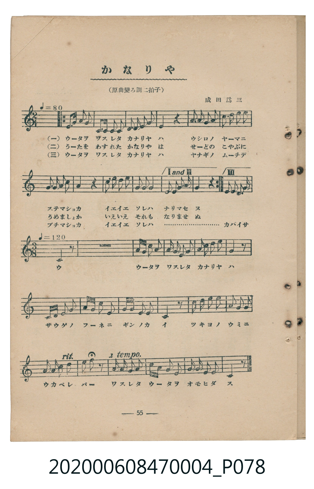
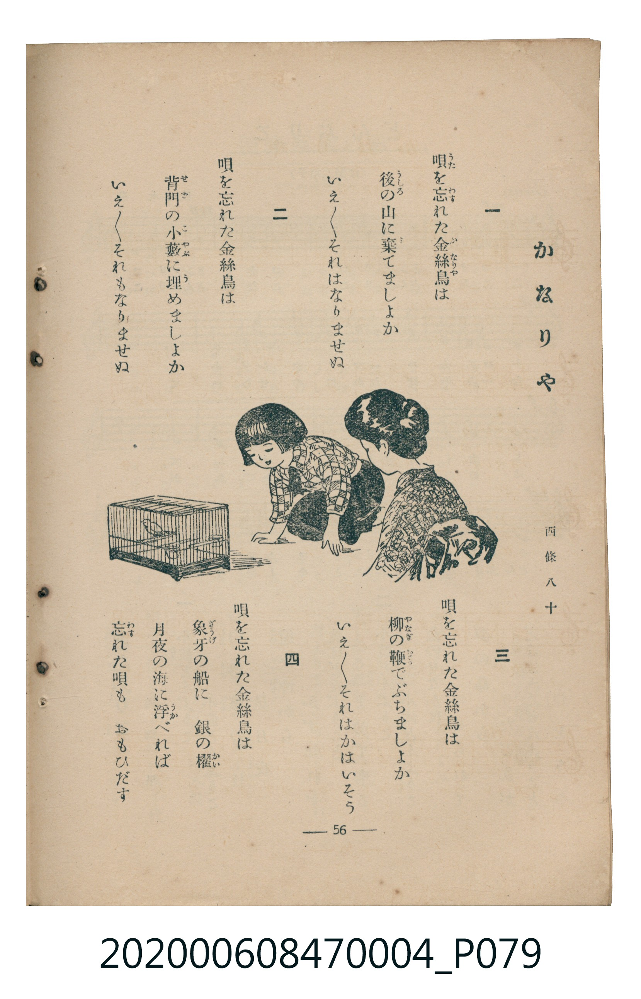

# かなりや

> Re:Shōka 使用 AI 協助辨識與重建樂譜，可能會有錯誤。歡迎回報。

- **鋼琴伴奏版**：<br><audio controls src="kanariya.mp3"></audio>
- **NEUTRINO 歌聲合成版**：<br><audio controls src="kanariya_neutrino.mp3"></audio>

- 曲：成田爲三／詞：西條八十
- 臺灣教育會公認《新定兒童唱歌》尋常科第四學年用（2020.006.0847.0004）

## 說明

原書資訊與歌詞全文（對應 P078.jpg–P079.jpg，書頁 pp. 55–56，參考教材第 19 首）：
調性與拍號：原曲變ろ調二拍子（本譜無調號 2/4 拍，後半轉 3/8 拍）
速度指示：♩=80 → ♩=120


## 歌詞

```text
一
唄（うた）を忘（わす）れた金絲鳥（かなりや）は
後（うしろ）の山に棄（す）てましよか
いえ／＼それはなりませぬ

二
唄を忘れた金絲鳥は
背門（せど）の小藪（こやぶ）に埋（う）めましよか
いえ／＼それもなりませぬ

三
唄を忘れた金絲鳥は
柳（やなぎ）の鞭（むち）でぶちましよか
いえ／＼それはかはいそう

四
唄を忘れた金絲鳥は
象牙（ざうげ）の船に　銀の櫂（かい）
月夜の海に浮（うか）べれば
忘（わす）れた唄も　おもひだす
（譜面第 5 行記為「ワスレタ ウータヲ オモヒダ ス」）
```

## ABC

<div class="abc-score" data-abc-src="kanariya.abc" aria-label="五線譜載入中"></div>

[下載 ABC 原始檔](kanariya.abc)

## TMD 檔案連結

- [主旋律 TMD 檔案](kanariya.tmd) [[在 TMD Studio 編輯](https://tmdlang.github.io/Tmd-TS/#tmd=s7IKdvYPcrWy4qpTUCpJTLdSSM7PyUlNLsnMz7MqzsjMK0nNjM_KTMmPL87Iz05Ugisry88pzU21Si9KTEmNN4k3MjAyiDcwMIs3sDAxBzIMTBBKi_NLi5JTrYqTM_Lzc-JLUitKkvLzsxHyBUX5Zal5iXlANQVFIBtTwIoQClLLMlNSQdKpKZkl-UWZiTlI7kgtKga7FWxJfElRYl5xclFmAcgDCFX5RSUZ-UC3FmRUWmVkFoMMSU7Mic9OzEPyUklGKtBHiXmZucgWAJWmZ-ZZlSRmAkMAFArlifG5iZl5OYl5Keh-jC9ITE-1CjAwt9AFEpZKXFpaCo8bux83rnrc1PW4qUVBS4tL0VbBwoDL3lbBmcvGSN_EDmTEs9mb3u-Z9axjwvMpG553bHqyo_P9nv4XK-cBBV8s3f9s0dynrauf9jaCrXvRvut54-JnU2e-aNr0bE7z09Y1L1b1Pm7oejZtw9N1s562Tnq-eunTKRufre153ND9dEP30x07ni-f-HzNmqezZz9du-Ppzi3Pp6x4v6cDFGN6wBjTA8UYkGFg8n5PpxIXl76Wgi21AJeCgsLTvvnPZu94sbn9xYquFx3tQHcBPfa0dcWzae1AVzzd0PusvVMBFGR6WQXpjxomgwIOxHy_pweo7-WCRoWCAj0FU1OglKkZUPBpf_OLhmag_5_NnQD0lYKhpcLLZdOAbgcGFsi-F6v2P2tYDrKpu_fFzPlAUbALNr1YB4yBXqDsk109QKmnaycArX82Z82LtXOetywEigMVKwAjRAEoCbJmX8_T3q4XezsVjPUtIGKdIONfNsx_umvZs57250t2Ac1-NHOlrYWBwqO2SQogpqGRARdI1ZMdDWC_T2kBWvK4se1xI9AhnY-bJj3dPwMk0tT_uHEmWKQHKPWyfeLzrZtebl4KVoxILiAFjevBBu3rgRk0HegLsMS6pxs3Pm5c_WwxxA6wcY3LHjfuA6sBGQTS-bix5XFjBzA5vd-z53HjXLCF66E2gJTOfty4BuLkXT1QJ0OcieY0qENeNPe8nNYAthCocyXUIRv6X0xfBRacDHT248ZtYPHVT-d3Q1wN9mkjEU5rasLqtB3goCfgtGfzN4ODFmjoqseNfRCnvZy3FizY8LhxIVhkOdB1QDaRwQSMCyAJlJoL9AXYLcBcREwwbVz4vBMYI0Djp4FjbRLEOS86dgLD5XFDw8suoIvWPVvdBItyUGSDfTGn4-mSOSC5rdtBsbt1HSzigWEJNGIn2MINYDdgS0tghzUBbXjcCExCwODc9LhxAVABSANQNTC1v5y7CJRvTBVeLOx5sWLG86Zdjxt6Hjevf9y083HzmsdN-xUeNy173LwHyHrcvAnIWfW4edHj5kmPmxuAnJ2PG2BZgfLyAQoUtPS5uLyBZXFRZmWio1VAZmJevkONQU01yBYFG0MzLTswC1g0aQBzlibYgRDX1SiguBzIbVr9uLnrcTPQ0UvAsv0g00G6axSqcwtqFYwVdIHQVMEMTOoChQ3BIoZgGoRrFIyAJAiD1ELUQHTpKhhA6RqwkT6GIAuXQcVADgCSQFeBdADdBRXdCWSvgcuDnQhW1wUmV4HJJVA9_djtMQLKNbbB7GmcDzZtEtQ0iB5gHAPZPXB5kI5uMA9sQxPYNmAVBJGBuA3DHmP6-AcYkeAo3P64ee3j5j6wyiWPm-c9bu4GmweMzjYQF6RgOdQGeCyCIg4WeSAaGIFxQMoIRBjDiRqwPEwNWAVEK75YBFoIdv1aMNkH9QPIL2CfN88Dk6BQBbsSzAPFClQG4lxEkOCKyNkwAxtXgsl1ED2Nk8GGgKIIWEiBSZApsKgHlqBgsX1gElh2tUMlQe7BEZdgt0NjpglkDcJXC-C-AhvbDDWteRqSGJG-AkfnksdNKyAkWOVeUI4ERj_ISEh2BEbnbjC3BxGX4HgBxxci-hAxB8JgW8DZD5YZwXGOFHFgLwJtBZEINtgNYE-Akyo8IYLdAxaBJFSIF3ejxRAkDjrAJIINkpkLVg_OZk1NCDORMxk0hkCxjJytSHYnNFuBRGA6toLNrEUqLV3zUnAXmJCgxJHigfGAO4mCHIMqh2apET5bq22AjSa7WoVqRVCLqBZawkJMg9qCXNBAhJEscEI3HFTyA2teTXBjTAPa0tK0AptRo6BRlFpcogkOMjLqBYjDcbgc5n9IlJgBwxOcZCHlDoiLqCLMQFLoyRjD16gGwood9IIWeyELSrn4Clik3LgNHBSbYIXr1MfNvbDCdd3j5s1AcZCBkGQJUgBsNABL4hVQ9aD6fz5IPSKjAutDZK9CwwEkBPIoJBwgPJTIhoYJcrkMK7vBRiESwzZwYADdDPYerJSaCub1gklYubsOyN4MVQPJJLDshbAW6COg2FogDc5wMPMgwd0Mrj8h5sGTV1FmiR60ZQFMKTNBoQ8yZoKCRlpqUW5iSSIogWkkKpSk5hbkg1Sipy-kpIfcZILUFIg2CDBhGQATlhkkvUALPrC4hSmwdQIPKIg_YOkQpBylwoNwCYY_cmaDJKGZYL-DkhbEe6ihhj3pYUmkTauA7EVADGqFgPyJqBNRsrSunQK82AA7BlkAWI5gEzNCF3SCCShzAQA)]
- [鋼琴伴奏 TMD 檔案](kanariya_piano.tmd) [[在 TMD Studio 編輯](https://tmdlang.github.io/Tmd-TS/#tmd=s7IKdvYPcrWy4qpTUCpJTLdSyC8qychPL0osyKi0ysgsLskvykxOzInPTsxLVIIrKs4vLUpOjS9ITE-1CjAwt9AFEpZKXFpaCo8bux83rnrc1PW4qeX9no6X3XueT9jyZM-Wp0v7n3d2vN_TqaClxaVoq2BhwGVvq-DMZWOkb2IHMvfZ7E3v98x61jHh-ZQNzzs2PdnR-X5P_4uV84CCL5buf7Zo7tPW1U97G8FueNG-63nj4mdTZ75o2vRsTvPT1jUvVvU-buh6Nm3D03WznrZOer566dMpG5-t7Xnc0P10Q_fTHTueL5_4fM2ap7NnP1274-nOLc-nrAC6zsjAyEDPwMBMz8DCxBzIMDABOlCJi8sb6NmizMpEq4DMxLz8IA-HGoOaai4FILAxNNOyA7NqFKpzC2oVjBV0gdBUwQxM6gKFDcEihmAahGsUjIAkCIPUQtRAdOkqGEDpGrCRPjUKj5uWQYUeN-0Hkc2bwBoeN6-Hiu4EstfA5UE6VoPVdYHJVWByCVRPP1ZrasCOhTkYRAMdHQdyI4gwhhM1YHmYGrAKiFY8Ln_ctB3sgrVgsg_qDpB7wK5vngcmu6Eu3wnmtSFkmrY_bl6O5C1sjgc7BOxAhHsRTgVhsGpwGMNCHOJJmBwWt4Nc-LhpBZhEsEEye8GuA4c4PDxBfkIOb4jbd0NlejCsgbqc2mmlERRy4HBtnA92wSSomyHufNw4E8gGuQYiD9IBCnlg_gSrBvugqQUqA0lfdEorjbPhLl8JJtdBXTEZ7qbHjdvAJCgZwPz6uKkRLLYPTE5_3NSO5C16pZVGiOs6wCSCDZKZC3YjOMSbmuCGo4Q31O0g_4NkQOmKLmll6JYrYFuh7mgCpRNEubIA5qdmcLpohiaH5mlIYjQrV0AhDw51CkoRaBiDRGA6toKNhFUxNsb6Fna1CtWKtoZGBrXQNABxew3cBxDDzICuAfsBEvIgLiJhmIGk0P0FNwkzlWCzAFbCo6cf7GkHFGP40g082IEBiexOqCdAQiBXQjwB4aH6HuIh5GQFS3posbIN7PLHTSAXI9LOVDCvF0zC6qN1QPZmqBpI3MBiFWHt4-YWoNhaIA2OZ5h5kLBpBpfDEPNgUQiMOgNg1JlB4gCausDiFqbA9gPc_RDjYTENUo6SjSBcgsGCHJWQaJgJdhIoekCOn4DmGezRhyWim1YB2YuAGFTJPG5ugIqCqnCE5bXobScf5LaTBaLpBGw5GcYrRBvGKpjFA2mz-NxYkE8gQlAK6E-QnGk8kghChQGi1IGbAJKFGgUWxKbVBCRhApRA1ghiYTMQ7AA0izH4qI6HBAQscY_6cWj4Ee5C3EUvzOtwPRADEJagOBlVHmQyin0IR8KchmEasnJ0vWi6wGEB46GXOwgTwf6DFTwgtaBsi1TkwEyB-gPFVFSXwDWDcryunQIs0ysA2cpcAA)]

## 分析

```text
================================================================================
📊 TMD Song Profile: [ かなりや ]
================================================================================
⏱  Duration:       0:31 (32.0s), 30 measures total
🎼 Key & Tempo:    首調基準 C, != 80.0 BPM, <2/4>
   - 分析範圍：      由實際發聲的音符與和弦推測調性；播放脈絡另行呈現
🎤 人聲音域:    C4 (MIDI 60) – E5 (MIDI 76) [跨度: 16 個半音 / 1.3 個八度, 難度: moderate]
   - 最低音:  C4 in [KanariyaA #1 @ m.2, 0:01]
   - 最高音: E5 in [KanariyaA #1 @ m.6, 0:08]
   - 適合: soprano, mezzo-soprano, contralto, tenor, baritone, bass
🏛  結構:      KanariyaA (16.5s) -> KanariyaAEnd (1.5s) -> KanariyaAEnd2 (0.8s) -> KanariyaB (13.2s)
⚡ 編曲密度:        Peak 1 軌道同時演奏
🗝  調性診斷：       C 大調（純淨自然大調，未偵測到可信轉調）
   - 風格氣質:    純淨自然大調（陽光明朗、易唱易記，無明顯調外色彩）
   - 轉調歷程:    全曲維持單一推測調性（未偵測到可信轉調）
   - 核心骨幹音:  G, E, C, A, D
   - 調性數值:    C 大調 [相關度: 0.80, 穩定度: Moderate, 自然音純度: 100.0%]
   - 候選調性 (K-S): C 大調 (0.80), E 小調 (0.76), G 大調 (0.66)
   - 五度圈歷程:   +0 -> +1 -> +0 -> +0
   - 各段落調性細節:
     • [KanariyaA #1]: C 調性不明確 (r: 0.76, 自然音純度: 100.0%)
     • [KanariyaAEnd #1]: G 調性不明確 (r: 0.68, 自然音純度: 100.0%)
     • [KanariyaAEnd2 #1]: C 調性不明確 (r: 0.68, 自然音純度: 100.0%)
     • [KanariyaB #1]: C 調性不明確 (r: 0.79, 自然音純度: 100.0%)

  [ 五度圈游移軌跡 ]
              [C ]*
         F           [G ]*
      Bb               D  
      Eb               A  
         Ab           E  
            Db       B  
               F# 
     (* = active key center)

  [ 十二半音累積音高分佈 ]
     C  : ██████████████████        20.5%
     C# :                            0.0%
     D  : ███████                    8.0%
     D# :                            0.0%
     E  : ████████████████████████  26.7%
     F  :                            0.0%
     F# :                            0.0%
     G  : ████████████████████████  27.3%
     G# :                            0.0%
     A  : ████████████████          17.6%
     A# :                            0.0%
     B  :                            0.0%
--------------------------------------------------------------------------------
Assignment 軌道音域：
  - Piano         : C4 – E5 (16 個半音 / 1.3 個八度, 91 個音符)
================================================================================
```


## 原書掃描頁






