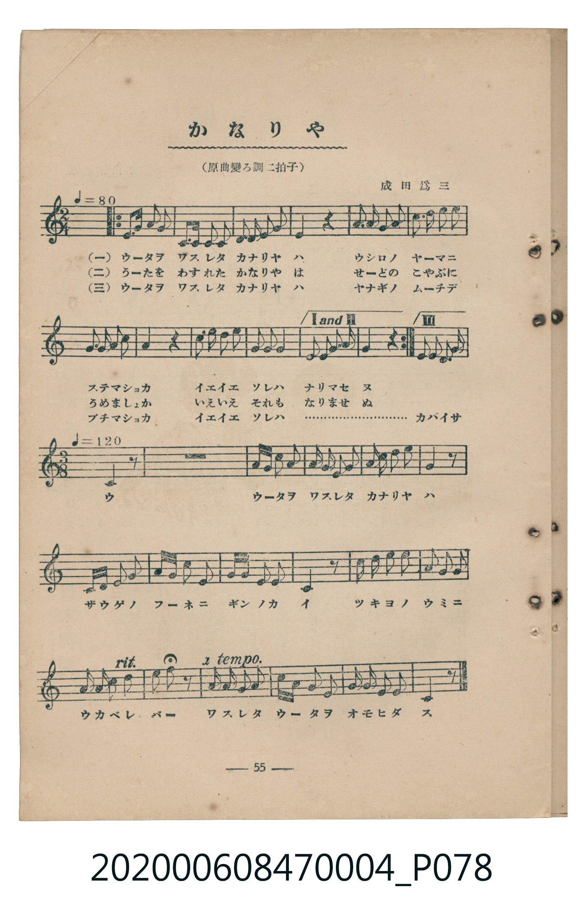
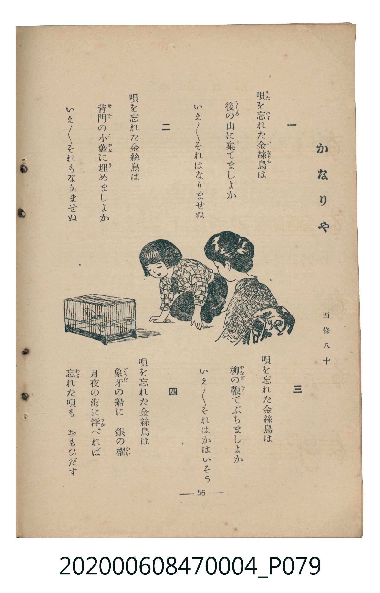

# かなりや

<audio controls src="kanariya.mp3"></audio>

- 曲：成田爲三／詞：西條八十
- 臺灣教育會公認《新定兒童唱歌》尋常科第四學年用（2020.006.0847.0004）

## 說明

原書資訊與歌詞全文（對應 P078.jpg–P079.jpg，書頁 pp. 55–56，參考教材第 19 首）：
調性與拍號：原曲變ろ調二拍子（本譜記為イ短調 2/4 拍，後半轉 3/8 拍）
速度指示：♩=80 → ♩=120

## 歌詞

```text
一
唄（うた）を忘（わす）れた金絲鳥（かなりや）は
後（うしろ）の山に棄（す）てましよか
いえ／＼それはなりませぬ

二
唄を忘れた金絲鳥は
背門（せど）の小藪（こやぶ）に埋（う）めましよか
いえ／＼それもなりませぬ

三
唄を忘れた金絲鳥は
柳（やなぎ）の鞭（むち）でぶちましよか
いえ／＼それはかはいそう

四
唄を忘れた金絲鳥は
象牙（ざうげ）の船に　銀の櫂（かい）
月夜の海に浮（うか）べれば
忘（わす）れた唄も　おもひだす
```

## 原書掃描頁





## 分析

```text
================================================================================
📊 TMD Song Profile: [ かなりや ]
================================================================================
⏱  Duration:       1:06 (66.5s), 53 measures total
🎼 Key & Tempo:    首調基準 C, != 80.0 BPM, <2/4>
   - 分析範圍：      由實際發聲的音符與和弦推測調性；播放脈絡另行呈現
🎤 人聲音域:    D3 (MIDI 50) – E4 (MIDI 64) [跨度: 14 個半音 / 1.2 個八度, 難度: moderate]
   - 最低音:  D3 in [Kanariya #1 @ m.36, 0:52]
   - 最高音: E4 in [Kanariya #1 @ m.1, 0:00]
   - 適合: contralto, tenor, baritone, bass
🏛  結構:      Kanariya (66.5s)
⚡ 編曲密度:        Peak 1 軌道同時演奏
🗝  調性診斷：       A 小調（純淨自然小調，未偵測到可信轉調）
   - 風格氣質:    純淨自然小調（陰鬱抒情、旋律集中，無明顯調外色彩）
   - 轉調歷程:    全曲維持單一推測調性（未偵測到可信轉調）
   - 核心骨幹音:  A, E, D, C, F
   - 調性數值:    A 小調 [相關度: 0.85, 穩定度: High, 自然音純度: 100.0%]
   - 候選調性 (K-S): A 小調 (0.85), A 大調 (0.71), D 小調 (0.60)
   - 五度圈歷程:   +3
   - 各段落調性細節:
     • [Kanariya #1]: A 小調 (r: 0.85, 自然音純度: 100.0%)

  [ 五度圈游移軌跡 ]
               C  
         F            G  
      Bb               D  
      Eb              [A ]*
         Ab           E  
            Db       B  
               F# 
     (* = active key center)

  [ 十二半音累積音高分佈 ]
     C  : ███████████               14.7%
     C# :                            0.0%
     D  : ████████████████          21.2%
     D# :                            0.0%
     E  : ██████████████████        24.1%
     F  : ██████                     8.2%
     F# :                            0.0%
     G  :                            0.0%
     G# :                            0.0%
     A  : ████████████████████████  31.8%
     A# :                            0.0%
     B  :                            0.0%
--------------------------------------------------------------------------------
Assignment 軌道音域：
  - Piano         : D3 – E4 (14 個半音 / 1.2 個八度, 163 個音符)
================================================================================
```

## ABC

```abc
X:1
T:かなりや
C:曲：成田爲三／詞：西條八十
M:2/4
L:1/16
Q:1/4=80
K:Am
V:V1 name="Piano" snm="Pia"
[V:V1]
!mp! A c d2 e2 d2 | A3 A A2 E2 | F2 E2 F2 A2 | E4 z4 |
A2 A2 A2 c2 | d3 e d2 c2 | A2 c2 A2 e2 | d4 z4 |
e2 e2 d2 e2 | c2 d2 c4 | A2 F2 E2 A2 | A4 z4 |
A c d2 e2 d2 | A3 A A2 E2 | F2 E2 F2 A2 | E4 z4 |
A2 A2 A2 c2 | d3 e d2 c2 | A2 c2 A2 e2 | d4 z4 |
e2 e2 d2 e2 | c2 d2 c4 | A2 F2 E2 A2 | A4 z4 |
A c d2 e2 d2 | A3 A A2 E2 | F2 E2 F2 A2 | E4 z4 |
A2 A2 A2 c2 | d3 e d2 c2 | A2 c2 A2 e2 | d4 z4 |
e2 e2 d2 e2 | c2 d2 c4 | c2 A2 F2 E2 | M:3/8 Q:1/8=240 D4 z2 |
z6 | A c d2 e2 | A2 A2 E2 | F2 A2 d2 |
e4 z2 | E F A2 A2 | F A d2 d2 | A A F2 E2 |
D4 z2 | d2 e2 d2 | c2 A2 c2 | Q:1/8=200 A2 F2 A2 |
Q:1/8=170 e4 z2 | Q:1/8=240 A2 A2 A2 | d c A2 c2 | A c F2 E2 |
A4 z2 |
```

- [主旋律 TMD 檔案](kanariya.tmd)
- [鋼琴伴奏 TMD 檔案](kanariya_piano.tmd)
