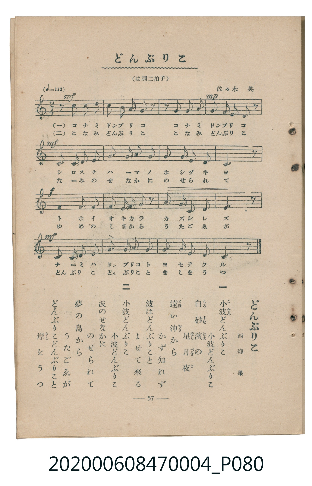

# どんぶりこ

> Re:Shōka 使用 AI 協助辨識與重建樂譜，可能會有錯誤。歡迎回報。

- **鋼琴伴奏版**：<br><audio controls src="donburiko.mp3"></audio>
- **NEUTRINO 歌聲合成版**：<br><audio controls src="donburiko_neutrino.mp3"></audio>

- 曲：佐々木英／詞：西郷果
- 臺灣教育會公認《新定兒童唱歌》尋常科第四學年用（2020.006.0847.0004）

## 說明

原書資訊與歌詞全文（對應 P080.jpg，書頁 p. 57，參考教材第 20 首）：
調性與拍號：は調二拍子（C 大調 2/4 拍）
速度指示：（♩=112）


## 歌詞

```text
一
小波（こなみ）どんぶりこ
小波どんぶりこ
白（しろ）砂（すな）濱（はま）の
星（ほし）月（づき）夜（よ）
遠（とほ）い沖（おき）から
かず知れず
波はどんぶりこと
よせて來る

二
小波どんぶりこ
小波どんぶりこ
波のせなかに
のせられて
夢の島から
うたごゑが
どんぶりこどんぶりこと
岸（きし）をうつ
```

## ABC

```abc
X:1
T:どんぶりこ
C:曲：佐々木英／詞：西郷果
M:2/4
L:1/16
Q:1/4=112
K:C
V:V1 name="Piano" snm="Pia"
[V:V1]
!mf! z2 c2 c2 d2 | c2 A G G2 z2 | !mp! z2 G2 G2 A2 | G2 E D C2 z2 |
w: 1.~コ ナ ミ | ドン ブ リ コ | コ ナ ミ | ドン ブ リ コ
w: 2.~こ な み | どん ぶ り こ | こ な み | どん ぶ り こ
!mf! C3 C D2 E2 | G3 G A2 G2 | G3 G E2 D2 | C6 z2 |
w: 1.~シ ロ ス ナ | ハ _ マ ノ | ホ シ ヅ キ | ヨ
w: 2.~な _ み の | せ な か に | の せ ら れ | て
!f! F4 F2 F2 | F2 E F G2 z2 | A3 G C2 D2 | E6 z2 |
w: 1.~ト ホ イ | オ キ カ ラ | カ ズ シ レ | ズ
w: 2.~ゆ め の | し ま か ら | う た ご ゑ | が
!mf! C3 C D2 E2 | G3 G A2 G2 | G3 G E2 D2 | C6 z2 |
w: 1.~ナ _ ミ ハ | ドン ブ リコ ト | ヨ セ テ ク | ル
w: 2.~どん ぶ り こ | どん ぶ りこ と | き し を う | つ
```

## TMD 檔案連結

- [主旋律 TMD 檔案](donburiko.tmd) [[在 TMD Studio 編輯](https://tmdlang.github.io/Tmd-TS/#tmd=s7IKdvYPcrWy4qpTUCpJTLdSSM7PyUlNLsnMz7MqzsjMK0nNjM_KTMmPL87Iz05Ugisry88pzU21Si9KTEmNN4k3MjAyiDcwMIs3sDAxBzIMTBBKi_NLi5JTrYqTM_Lzc-JLUitKkvLzsxHyBUX5Zal5iXlANQVFIBtTwIoQClLLMlNSQdKpKZkl-UWZiTlI7kgtKga7FWxJfElRYl5xclFmAcgDCFX5RSUZ-UC3FmRUWmVkFoMMSU7Mic9OzEPyUklGKtBH5YklqUXIOjPTM_OsShIzgQEACoTyxPjcxMy8nMS8FCUuLS2Fx40rHzdNfty47XFT1-PGyQpaWlyKtgqGhkZc9rYKzlw2RvomdiDTns3e9H7PrCd7JzxuaH02Z8WL7o3v9_S_WDkPKPhi6f6XzdufzZsDtvZF-67njYufTZ35omnTsznNT1vXvFjV-7ih69m0DU_XzXraOun56qVPp2x8trbncUP30w3dT3fseL584vM1a57Onv107Y6nO7c8n7Li_Z4OUJToAaNEDxQlQIaByfs9nUpcXPpaCrbUAlwKCgpP--Y_m73jxeb2Fyu6XnS0A90F9NXT1hXPprUDXfF0Q--z9k6FAAMLA72sgvT3e3qAil8uaFQo0FMwNQdyn_Y3v2hoBnr32dwJQE8oGBkovFw2DehUYMCAjH-xav-zhuUgg7t7X8ycDxR93LgeKPhkVw9Q5OnaCUBLnBWeLlkOFFMABrYCUBSoG6T1ZcP8p7uWPetpf75kF1AfUOGjmSttgVEDkgcpeLKjAeyDDf3PNi8CSgPj73HjqseN-4EK0OIVpA6mEovU85l7wfqnP24C2f58QROYOxNoHJD7bD8wsoHc9Y8b94GNXgcx7tkMoH-A4ruBGkHK5nSAuUsfN4IMebpkDojbBBSEeKdxAVh6BVAD2JSWZ5uAAQUUAboCpOFxY_fjJrBSBWCy7H7cOOv5_KWPm3qADJAg2OVAJ6A4HmgcVEMT0KDZjxuXPdnX9ripGxI-u3oQ4UNagIBF14FNBAYo0C2rYe4CCzZ1gt21DGz8EpDSp5u3obq_7XHj_MeNUx43TXzcCHYGhsuxe-Tpph3gQOmFBOrjpklgs5aAZClP8VCgoKXPxeWSn5dUWpSZnW8VkJmYl-9QY1BTDXaDjaGZlh2YBcxsGsBUpgkM3s2Pm7seN89XqFF43Nz5uBnInfa4eRVQHCSCR1YfaMKuHqAJsMQJUoNW6IBEcMsC3QpyS42CgYKuQnVuWq2CYRyQBSaMQEQNhG2mYAqEumBlMMUFtWAhEDYDC4NYxgpGCoYwhWCzfQwhGkAOBpLNXWByPlgHxENggWlAvAqqCGELqZogNhpBNQM9CCJXgcn9EM3gAAALbANq7IIqQrKRRE2wuHzctP1x89rHTTtBjgU5sv9x87zHzX1gNjBVA2VbHzetBXNXAGMOEiXA1A02H5EXwFxERgBzlyHiCRJHQIuBkQQMalCAw4IeFBWgiACxESIgeZA6YESCRSAQNXqArgOLAj0AZO-EhzjYG1AdQN-AyT6o-GyIKFAn0GNg1lqozArs9gAjBRKqYH3gkAX5HhK-UNOA8sBQALNWQ2VAKkD82UAbOsH29EBllmG1BxQVzR3gIF8Czj7AnAKMltWPm1eCuasfN-0Cx8YaMHcXKCqagMVaIywqpgNLYkhxA-YiyhowtwcpKoAxYQK1H0SDcA2YNAaSiNwCihNQTIDCHxIToDjBERPNHfDwBoUJyBNg3zaB0yMwjIE-AMqthJsO4kNiYhc0HkFeg8jswh0TTW0we5oaUWJiOpi3DxwPkBCH2tMI0QEMDiCeAtY5ESoDihEcMQEquUCJCKPwAvkUnFoeN-1-3AyMgPVg7mpw1sAswtALdLAgqByHFOJg7hJaZxNwpoBEDqgogmQOpAIJXiTBii1QZCKyBNCnQDYoGEG-hchAIg97ZoEWOohiB1Y6YZOElVsgq8BhA5WcDpScBGaBLIYEE7qVtVxcunYK8DpLAchR5gIA)]
- [鋼琴伴奏 TMD 檔案](donburiko_piano.tmd) [[在 TMD Studio 編輯](https://tmdlang.github.io/Tmd-TS/#tmd=s7IKdvYPcrWy4tLSUnjcuPJx0-THjdseN3U9bpz8fk_Hy-49zydsebJny9Ol_c87O97v6VTQ0uJStFUwNDTisrdVcOayMdI3seOqU1B6NnvT-z2znuyd8Lih9dmcFS-6N77f0_9i5Tyg4Iul-182b382b44SSOGL9l3PGxc_mzrzRdOmZ3Oan7auebGq93FD17NpG56um_W0ddLz1UufTtn4bG3P44bupxu6n-7Y8Xz5xOdr1jydPfvp2h1Pd255PmUF0G1GBkYGegYGZnoGFibmQIaBCdB5SlxcLvl5SaVFmdn5VgGZiXn5QR4ONQY11VwKQGBjaKZlB2bVKBgo6CpU56bVKhjGAVlgwghE1EDYZgqmQKgLVgZTXFALFgJhM7AwiGWsYKRgCFMINtvHEKLhcdNmENncBSbng3U8bu583AwRngbEq6CKELaQqglioxFUc-NkMLkKTO6HaAZHKlhgG1BjF1QRko0kaoKGHyTsgALAwAMGASggYEECCiJQAIHYCBGQPEgdMIDBIhCIGmyPm7aDRR83rwWyd8JDAhQG_VAdj5vngck-qPhsiChQ5-PmVjBrLVRmBXZ7gIEF8S1YH9jHjxvXQf0NNQ0o_7ixG8xaDZUBqQDxZwNt6ATb0wOVWYbVHmAQAUPIBCoOokG4BkwaA0lE6gKFFSiEQOECCSFQWOEIoeYOeDiA3Pq4aQnEFU3g-AP6_XHTaqDcSrjpID4khHZBw_dx8xqozC7cIdTUBrOnqRElhKaDefvA4QMJCag9jRAdjxvnA_EUsM6JUBlQSGENIZokInCSgQQRKANBkg5SNoJnJFhmAwUpIsE8btoNZIM887hpPVQGEoTYkxI0qyAyCyxPYZOE5TaQVSD5XqjkdKDkJDALZDFIBhSvqFbWYhRuPsiFmwW8bKsGllSG8QrRhrFgyjQ-FhRgQJYJkAWkDaBcqDxIFCIAUgmRh5oEVWUaD6HhAiboAqj2QAQQxoDLTrAekF1wBjAzwJhQVyHz8ZmH8CApTgPxIMEJDkxdOwV4eEb7gORQBIzAAspcAA)]

## 分析

```text
================================================================================
📊 TMD Song Profile: [ どんぶりこ ]
================================================================================
⏱  Duration:       0:17 (17.1s), 16 measures total
🎼 Key & Tempo:    首調基準 C, != 112.0 BPM, <2/4>
   - 分析範圍：      由實際發聲的音符與和弦推測調性；播放脈絡另行呈現
🎤 人聲音域:    C4 (MIDI 60) – D5 (MIDI 74) [跨度: 14 個半音 / 1.2 個八度, 難度: moderate]
   - 最低音:  C4 in [Donburiko #1 @ m.4, 0:03]
   - 最高音: D5 in [Donburiko #1 @ m.1, 0:00]
   - 適合: soprano, mezzo-soprano, contralto, tenor, baritone, bass
🏛  結構:      Donburiko (17.1s)
⚡ 編曲密度:        Peak 1 軌道同時演奏
🗝  調性診斷：       C 大調（純淨自然大調，未偵測到可信轉調）
   - 風格氣質:    純淨自然大調（陽光明朗、易唱易記，無明顯調外色彩）
   - 轉調歷程:    全曲維持單一推測調性（未偵測到可信轉調）
   - 核心骨幹音:  G, C, E, D, F
   - 調性數值:    C 大調 [相關度: 0.96, 穩定度: High, 自然音純度: 100.0%]
   - 候選調性 (K-S): C 大調 (0.96), G 大調 (0.71), E 小調 (0.55)
   - 五度圈歷程:   +0
   - 各段落調性細節:
     • [Donburiko #1]: C 大調 (r: 0.96, 自然音純度: 100.0%)

  [ 五度圈游移軌跡 ]
              [C ]*
         F            G  
      Bb               D  
      Eb               A  
         Ab           E  
            Db       B  
               F# 
     (* = active key center)

  [ 十二半音累積音高分佈 ]
     C  : ███████████████████████   26.8%
     C# :                            0.0%
     D  : ██████████                11.6%
     D# :                            0.0%
     E  : ████████████              14.3%
     F  : ████████                   9.8%
     F# :                            0.0%
     G  : ████████████████████████  28.6%
     G# :                            0.0%
     A  : ████████                   8.9%
     A# :                            0.0%
     B  :                            0.0%
--------------------------------------------------------------------------------
Assignment 軌道音域：
  - Piano         : C4 – D5 (14 個半音 / 1.2 個八度, 52 個音符)
================================================================================
```


## 原書掃描頁




