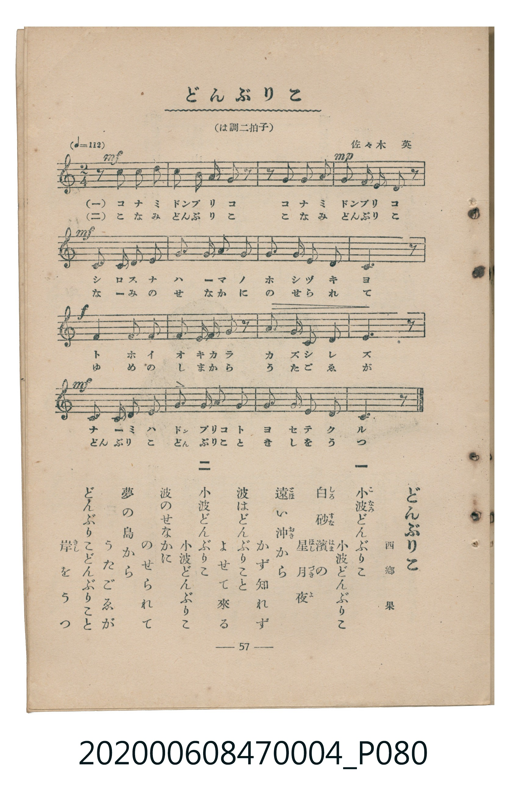

# どんぶりこ

<audio controls src="donburiko.mp3"></audio>

- 曲：佐々木英／詞：西郷果
- 臺灣教育會公認《新定兒童唱歌》尋常科第四學年用（2020.006.0847.0004）

## 說明

原書資訊與歌詞全文（對應 P080.jpg，書頁 p. 57，參考教材第 20 首）：
調性與拍號：は調二拍子（C 大調 2/4 拍）
速度指示：（♩=112）

## 歌詞

```text
一
小波（こなみ）どんぶりこ
小波どんぶりこ
白（しろ）砂（すな）濱（はま）の
星（ほし）月（づき）夜（よ）
遠（とほ）い沖（おき）から
かず知れず
波はどんぶりこと
よせて來る

二
小波どんぶりこ
小波どんぶりこ
波のせなかに
のせられて
夢の島から
うたごゑが
どんぶりこどんぶりこと
岸（きし）をうつ
```

## ABC

```abc
X:1
T:どんぶりこ
C:曲：佐々木英／詞：西郷果
M:2/4
L:1/16
Q:1/4=112
K:C
V:V1 name="Piano" snm="Pia"
[V:V1]
!mf! z2 c2 c2 d2 | e2 e d c2 z2 | !mp! z2 c2 c2 d2 | e2 e d c2 z2 |
!mf! A2 A2 G2 c2 | e2 d c d4 | e2 e e d2 g2 | e6 z2 |
!f! a4 a2 g2 | e2 d c d2 z2 | c2 d e g2 e2 | d6 z2 |
!mf! c2 c d e2 c2 | a2 a a g2 e2 | d2 d c A2 d2 | c6 z2 |
```

## TMD 檔案連結

- [主旋律 TMD 檔案](donburiko.tmd)
- [鋼琴伴奏 TMD 檔案](donburiko_piano.tmd)

## 分析

```text
================================================================================
📊 TMD Song Profile: [ どんぶりこ ]
================================================================================
⏱  Duration:       0:17 (17.1s), 16 measures total
🎼 Key & Tempo:    首調基準 C, != 112.0 BPM, <2/4>
   - 分析範圍：      由實際發聲的音符與和弦推測調性；播放脈絡另行呈現
🎤 人聲音域:    G3 (MIDI 55) – A4 (MIDI 69) [跨度: 14 個半音 / 1.2 個八度, 難度: moderate]
   - 最低音:  G3 in [Donburiko #1 @ m.5, 0:04]
   - 最高音: A4 in [Donburiko #1 @ m.9, 0:08]
   - 適合: mezzo-soprano, contralto, tenor, baritone, bass
🏛  結構:      Donburiko (17.1s)
⚡ 編曲密度:        Peak 1 軌道同時演奏
🗝  調性診斷：       C 大調（純淨自然大調，未偵測到可信轉調）
   - 風格氣質:    純淨自然大調（陽光明朗、易唱易記，無明顯調外色彩）
   - 轉調歷程:    全曲維持單一推測調性（未偵測到可信轉調）
   - 核心骨幹音:  C, D, E, A, G
   - 調性數值:    C 大調 [相關度: 0.70, 穩定度: Moderate, 自然音純度: 100.0%]
   - 候選調性 (K-S): C 大調 (0.70), A 小調 (0.66), G 大調 (0.55)
   - 五度圈歷程:   +0
   - 各段落調性細節:
     • [Donburiko #1]: C 大調 (r: 0.70, 自然音純度: 100.0%)

  [ 五度圈游移軌跡 ]
              [C ]*
         F            G  
      Bb               D  
      Eb               A  
         Ab           E  
            Db       B  
               F# 
     (* = active key center)

  [ 十二半音累積音高分佈 ]
     C  : ████████████████████████  26.8%
     C# :                            0.0%
     D  : ███████████████████████   25.9%
     D# :                            0.0%
     E  : ██████████████████████    24.1%
     F  :                            0.0%
     F# :                            0.0%
     G  : ████████                   8.9%
     G# :                            0.0%
     A  : █████████████             14.3%
     A# :                            0.0%
     B  :                            0.0%
--------------------------------------------------------------------------------
Assignment 軌道音域：
  - Piano         : G3 – A4 (14 個半音 / 1.2 個八度, 57 個音符)
================================================================================
```


## 原書掃描頁




