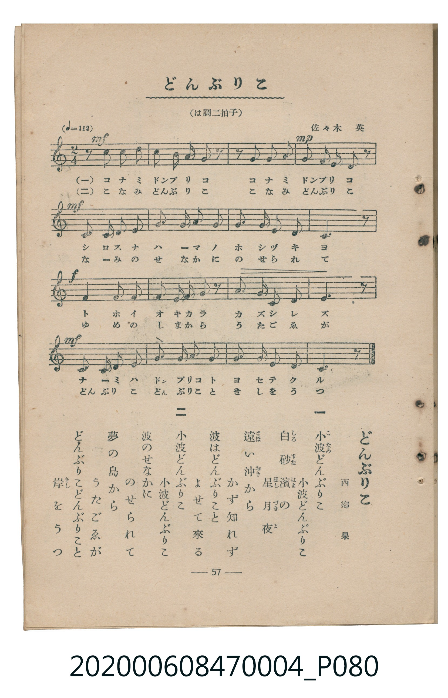

# どんぶりこ

> Re:Shōka 使用 AI 協助辨識與重建樂譜，可能會有錯誤。歡迎回報。

- **鋼琴伴奏版**：<br><audio controls src="donburiko.mp3"></audio>
- **NEUTRINO 歌聲合成版**：<br><audio controls src="donburiko_neutrino.mp3"></audio>

- 曲：佐々木英／詞：西郷果
- 臺灣教育會公認《新定兒童唱歌》尋常科第四學年用（2020.006.0847.0004）

## 說明

原書資訊與歌詞全文（對應 P080.jpg，書頁 p. 57，參考教材第 20 首）：
調性與拍號：は調二拍子（C 大調 2/4 拍）
速度指示：（♩=112）


## 歌詞

```text
一
小波（こなみ）どんぶりこ
小波どんぶりこ
白（しろ）砂（すな）濱（はま）の
星（ほし）月（づき）夜（よ）
遠（とほ）い沖（おき）から
かず知れず
波はどんぶりこと
よせて來る

二
小波どんぶりこ
小波どんぶりこ
波のせなかに
のせられて
夢の島から
うたごゑが
どんぶりこどんぶりこと
岸（きし）をうつ
```

## ABC

<div class="abc-score" data-abc-src="donburiko.abc" aria-label="五線譜載入中"></div>

[下載 ABC 原始檔](donburiko.abc)

## TMD 檔案連結

- [主旋律 TMD 檔案](donburiko.tmd) [[在 TMD Studio 編輯](https://tmdlang.github.io/Tmd-TS/#tmd=s7IKdvYPcrWy4qpTUCpJTLdSSM7PyUlNLsnMz7MqzsjMK0nNjM_KTMmPL87Iz05Ugisry88pzU21Si9KTEmNN4k3MjAyiDcwMIs3sDAxBzIMTBBKi_NLi5JTrYqTM_Lzc-JLUitKkvLzsxHyBUX5Zal5iXlANQVFIBtTwIoQClLLMlNSQdKpKZkl-UWZiTlI7kgtKga7FWxJfElRYl5xclFmAcgDCFX5RSUZ-UC3FmRUWmVkFoMMSU7Mic9OzEPyUklGKtBH5YklqUXIOjPTM_OsShIzgQEACoTyxPjcxMy8nMS8FHQvxhckpqdaBRhYGChxaWkpPG5c-bhp8uPGbY-buh43TlbQ0uJStFUwNDTisrdVcOayMdI3sQOZ8Gz2pvd7Zj3ZO-FxQ-uzOStedG98v6f_xcp5QMEXS_e_bN7-bN4csFUv2nc9b1z8bOrMF02bns1pftq65sWq3scNXc-mbXi6btbT1knPVy99OmXjs7U9jxu6n27ofrpjx_PlE5-vWfN09uyna3c83bnl-ZQV7_d0gCJLDxhZeqDIAjIMTN7v6VTi4tLXUrClFuBSUFB42jf_2ewdLza3v1jR9aKjHeguoK-etq54Nq0d6IqnG3qftXcqgIJLL6sg_f2eHqDilwsaFQr0FEzNgdyn_c0vGpqB3n02dwLQEwpGBgovl00DOhUYMCDjX6za_6xhOcjg7t4XM-cDRR83rgcKPtnVAxR5unYC0BJnhadLlgPFFICBrQAUBeoGaX3ZMP_prmXPetqfL9kF1AdU-GjmSltg1IDkQQqe7GgA-2BD_7PNi4DSwPh73LjqceN-oAK0eAWpg6nEIvV85l6w_umPm0C2P1_QBObOBBoH5D7bD4xsIHf948Z9YKPXQYx7NgPoH6D4bqBGkLI5HWDu0seNIEOeLpkD4jYBBSHeaVwAll4B1AA2peXZJmBAAUWArgBpeNzY_bgJrFQBmCy7HzfOej5_6eOmHiADJAh2OdAJKI4HGgfV0AQ0aPbjxmVP9rU9buqGhM-uHkT4kBYgYNF1YBOBAQp0y2qYu8CCTZ1gdy0DG78EpPTp5m2o7m973Dj_ceOUx00THzeCnYHhcuweebppBzhQeiGB-rhpEtisJSBZylM8FCho6XNxueTnJZUWZWbnWwVkJublO9QY1FSD3WBjaKZlB2YBM5sGMJVpAoN38-PmrsfN8xVqFB43dz5uBnKnPW5eBRQHieCR1QeasKsHaAIscYLUoBU6IBHcskC3gtxSo2CgoKtQnZtWq2AYB2SBCSMQUQNhmymYAqEuWBlMcUEtWAiEzcDCIJaxgpGCIUwh2GwfQ4gGkIOBZHMXmJwP1gHxEFhgGhCvgipC2EKqJoiNRlDNQA-CyFVgcj9EMzgAwALbgBq7oIqQbCRREywuHzdtf9y89nHTTpBjQY7sf9w873FzH5gNTNVA2dbHTWvB3BXAmINECTB1g81H5AUwF5ERwNxliHiCxBHQYmAkAYMaFOCwoAdFBSgiQGyECEgepA4YkWARCESNHqDrwKJADwDZO-EhDvYGVAfQN2CyDyo-GyIK1An0GJi1FiqzArs9wEiBhCpYHzhkQb6HhC_UNKA8MBTArNVQGZAKEH820IZOsD09UJllWO0BRUVzBzjIl4CzDzCnAKNl9ePmlWDu6sdNu8CxsQbM3QWKiiZgsdYIi4rpwJIYUtyAuYiyBsztQYoKYEyYQO0H0SBcAyaNgSQit4DiBBQToPCHxAQoTnDERHMHPLxBYQLyBNi3TeD0CAxjoA-AcivhpoP4kJjYBY1HkNcgMrtwx0RTG8yepkaUmJgO5u0DxwMkxKH2NEJ0AIMDiKeAdU6EyoBiBEdMgEouUCLCKLxAPgWnlsdNux83AyNgPZi7Gpw1MIsw9AIdLAgqxyGFOJi7hNbZBJwpIJEDKoogmQOpQIIXSbBiCxSZiCwB9CmQDQpGkG8hMpDIw55ZoIUOotiBlU7YJGHlFsgqcNhAJacDJSeBWSCLIcGEbmUtF5eunQK8zlIAcpS5AA)]
- [鋼琴伴奏 TMD 檔案](donburiko_piano.tmd) [[在 TMD Studio 編輯](https://tmdlang.github.io/Tmd-TS/#tmd=s7IKdvYPcrWy4qpTUCpJTLdSyC8qychPL0osyKi0ysgsLskvykxOzInPTsxLVIIrKs4vLUpOjS9ITE-1CjCwMFDi0tJSeNy48nHT5MeN2x43dT1unPx-T8fL7j3PJ2x5smfL06X9zzs73u_pVNDS4lK0VTA0NOKyt1Vw5rIx0jexAxn7bPam93tmPdk74XFD67M5K150b3y_p__FynlAwRdL979s3v5s3hyw_S_adz1vXPxs6swXTZuezWl-2rrmxarexw1dz6ZteLpu1tPWSc9XL306ZeOztT2PG7qfbuh-umPH8-UTn69Z83T27KdrdzzdueX5lBVAtxkZGBnoGRiY6RlYmJgDGQYmQOcpcXG55OcllRZlZudbBWQm5uUHeTjUGNRUcykAgY2hmZYdmFWjYKCgq1Cdm1arYBgHZIEJIxBRA2GbKZgCoS5YGUxxQS1YCITNwMIglrGCkYIhTCHYbB9DiIbHTZtBZHMXmJwP1vG4ufNxM0R4GhCvgipC2EKqJoiNRlDNjZPB5CowuR-iGRypYIFtQI1dUEVINpKoCRp-kLADCgADDxgEoICABQkoiEABBGIjREDyIHXAAAaLQCBqsD1u2g4Wfdy8FsjeCQ8JUBj0Q3U8bp4HJvug4rMhokCdj5tbway1UJkV2O0BBhbEt2B9YB8_blwH9TfUNKD848ZuMGs1VAakAsSfDbShE2xPD1RmGVZ7gEEEDCETqDiIBuEaMGkMJBGpCxRWoBAChQskhEBhhSOEmjvg4QBy6-OmJRBXNIHjD-j3x02rgXIr4aaD-JAQ2gUN38fNa6Ayu3CHUFMbzJ6mRpQQmg7m7QOHDyQkoPY0QnQ8bpwPxFPAOidCZUAhhTWEaJKIwEkGEkSgDARJOkjZCJ6RYJkNFKSIBPO4aTeQDfLM46b1UBlIEGJPStCsgsgssDyFTRKW20BWgeR7oZLTgZKTwCyQxSAZULyiWlmLUbj5IBduFvCyrRpYUhnGK0QbxoIp0_hYUIABWSZAFpA2gHKh8iBRiABIJUQeahJUlWk8hIYLmKALoNoDEUAYAy47wXpAdsEZwMwAY0JdhczHZx7Cg6Q4DcSDBCc4MHXtFODhGe0DkkMRMAILKHMBAA)]

## 分析

```text
================================================================================
📊 TMD Song Profile: [ どんぶりこ ]
================================================================================
⏱  Duration:       0:17 (17.1s), 16 measures total
🎼 Key & Tempo:    首調基準 C, != 112.0 BPM, <2/4>
   - 分析範圍：      由實際發聲的音符與和弦推測調性；播放脈絡另行呈現
🎤 人聲音域:    C4 (MIDI 60) – D5 (MIDI 74) [跨度: 14 個半音 / 1.2 個八度, 難度: moderate]
   - 最低音:  C4 in [Donburiko #1 @ m.4, 0:03]
   - 最高音: D5 in [Donburiko #1 @ m.1, 0:00]
   - 適合: soprano, mezzo-soprano, contralto, tenor, baritone, bass
🏛  結構:      Donburiko (17.1s)
⚡ 編曲密度:        Peak 1 軌道同時演奏
🗝  調性診斷：       C 大調（純淨自然大調，未偵測到可信轉調）
   - 風格氣質:    純淨自然大調（陽光明朗、易唱易記，無明顯調外色彩）
   - 轉調歷程:    全曲維持單一推測調性（未偵測到可信轉調）
   - 核心骨幹音:  G, C, E, D, F
   - 調性數值:    C 大調 [相關度: 0.96, 穩定度: High, 自然音純度: 100.0%]
   - 候選調性 (K-S): C 大調 (0.96), G 大調 (0.71), E 小調 (0.55)
   - 五度圈歷程:   +0
   - 各段落調性細節:
     • [Donburiko #1]: C 大調 (r: 0.96, 自然音純度: 100.0%)

  [ 五度圈游移軌跡 ]
              [C ]*
         F            G  
      Bb               D  
      Eb               A  
         Ab           E  
            Db       B  
               F# 
     (* = active key center)

  [ 十二半音累積音高分佈 ]
     C  : ███████████████████████   26.8%
     C# :                            0.0%
     D  : ██████████                11.6%
     D# :                            0.0%
     E  : ████████████              14.3%
     F  : ████████                   9.8%
     F# :                            0.0%
     G  : ████████████████████████  28.6%
     G# :                            0.0%
     A  : ████████                   8.9%
     A# :                            0.0%
     B  :                            0.0%
--------------------------------------------------------------------------------
Assignment 軌道音域：
  - Piano         : C4 – D5 (14 個半音 / 1.2 個八度, 52 個音符)
================================================================================
```


## 原書掃描頁




