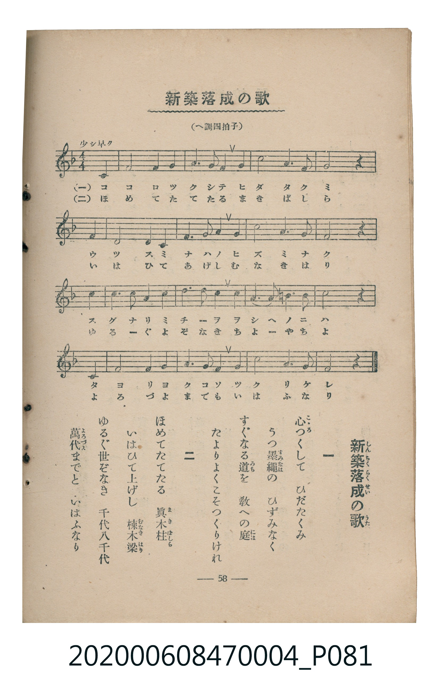

# 新築落成の歌（新築落成式）

<audio controls src="shinchiku_rakuseishiki.mp3"></audio>

- 臺灣教育會公認《新定兒童唱歌》尋常科第四學年用（2020.006.0847.0004）

## 說明

原書資訊與歌詞全文（對應 P081.jpg，書頁 p. 58，參考教材第 21 首）：
目次標題：新築落成式／內頁標題：新築落成の歌（しんちくらくせいのうた）
調性與拍號：へ調四拍子（F 大調 4/4 拍，弱起 1 拍）
速度指示：少シ早ク

## 歌詞

```text
一
心（こゝろ）つくして　ひだたくみ
うつ墨繩（すみなは）の　ひずみなく
すぐなる道（みち）を　敎（をし）への庭（には）
たよりよくこそつくりけれ

二
ほめてたてたる　眞木柱（まきはしら）
いはひて上げし　棟木梁（むなきはり）
ゆるぐ世ぞなき　千代八千代
萬代（よろづよ）までと　いはふなり
```

## ABC

```abc
X:1
T:新築落成の歌（新築落成式）
C:TMD (Chen, Chih-Han / aguai)
M:4/4
L:1/16
Q:1/4=108
K:F
V:V1 name="Piano" snm="Pia"
[V:V1]
!mf! z12 F4 | F8 G4 G4 | A6 A2 G4 A4 | c8 A6 G2 |
G8 z4 F4 | F8 G4 G4 | A6 A2 G4 A4 | c8 A6 G2 |
F8 z4 c4 | d6 d2 c4 A4 | d6 d2 c4 c4 | A6 A2 =B6 B2 |
c8 z4 C4 | F8 G4 G4 | A6 G2 F4 d4 | c8 A6 G2 |
F8 z8 |
```

## TMD 檔案連結

- [主旋律 TMD 檔案](shinchiku_rakuseishiki.tmd)
- [鋼琴伴奏 TMD 檔案](shinchiku_rakuseishiki_piano.tmd)

## 分析

```text
================================================================================
📊 TMD Song Profile: [ 新築落成の歌（新築落成式） ]
================================================================================
⏱  Duration:       0:37 (37.8s), 17 measures total
🎼 Key & Tempo:    首調基準 F, != 108.0 BPM, <4/4>
   - 分析範圍：      由實際發聲的音符與和弦推測調性；播放脈絡另行呈現
🎤 人聲音域:    C4 (MIDI 60) – D5 (MIDI 74) [跨度: 14 個半音 / 1.2 個八度, 難度: moderate]
   - 最低音:  C4 in [ShinchikuRakuseishiki #1 @ m.13, 0:28]
   - 最高音: D5 in [ShinchikuRakuseishiki #1 @ m.10, 0:20]
   - 適合: soprano, mezzo-soprano, contralto, tenor, baritone, bass
🏛  結構:      ShinchikuRakuseishiki (37.8s)
⚡ 編曲密度:        Peak 1 軌道同時演奏
🗝  調性診斷：       F 大調（純淨自然大調，未偵測到可信轉調）
   - 風格氣質:    純淨自然大調（陽光明朗、易唱易記，無明顯調外色彩）
   - 轉調歷程:    全曲維持單一推測調性（未偵測到可信轉調）
   - 核心骨幹音:  A, C, F, G, D
   - 調性數值:    F 大調 [相關度: 0.79, 穩定度: Moderate, 自然音純度: 96.7%]
   - 候選調性 (K-S): F 大調 (0.79), C 大調 (0.73), A 小調 (0.70)
   - 五度圈歷程:   -1
   - 各段落調性細節:
     • [ShinchikuRakuseishiki #1]: F 大調 (r: 0.79, 自然音純度: 96.7%, 調外音: B)

  [ 五度圈游移軌跡 ]
               C  
        [F ]*          G  
      Bb               D  
      Eb               A  
         Ab           E  
            Db       B  
               F# 
     (* = active key center)

  [ 十二半音累積音高分佈 ]
     C  : █████████████████████     21.7%
     C# :                            0.0%
     D  : ████████                   8.3%
     D# :                            0.0%
     E  :                            0.0%
     F  : █████████████████████     21.7%
     F# :                            0.0%
     G  : ███████████████████       20.0%
     G# :                            0.0%
     A  : ████████████████████████  25.0%
     A# :                            0.0%
     B  : ███                        3.3%
--------------------------------------------------------------------------------
Assignment 軌道音域：
  - Piano         : C4 – D5 (14 個半音 / 1.2 個八度, 50 個音符)
================================================================================
```


## 原書掃描頁




