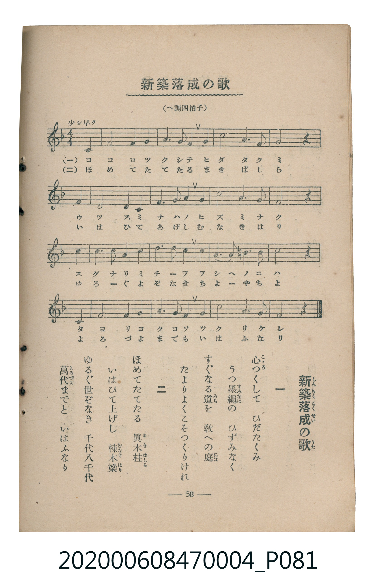

# 新築落成の歌（新築落成式）

> Re:Shōka 使用 AI 協助辨識與重建樂譜，可能會有錯誤。歡迎回報。

- **鋼琴伴奏版**：<br><audio controls src="shinchiku_rakuseishiki.mp3"></audio>
- **NEUTRINO 歌聲合成版**：<br><audio controls src="shinchiku_rakuseishiki_neutrino.mp3"></audio>

- 臺灣教育會公認《新定兒童唱歌》尋常科第四學年用（2020.006.0847.0004）

## 說明

原書資訊與歌詞全文（對應 P081.jpg，書頁 p. 58，參考教材第 21 首）：
目次標題：新築落成式／內頁標題：新築落成の歌（しんちくらくせいのうた）
調性與拍號：へ調四拍子（F 大調 4/4 拍，弱起 1 拍）
速度指示：少シ早ク


## 歌詞

```text
一
心（こゝろ）つくして　ひだたくみ
うつ墨繩（すみなは）の　ひずみなく
すぐなる道（みち）を　敎（をし）への庭（には）
たよりよくこそつくりけれ
（譜面第 3 行記為「スグナリミチーヲ」）

二
ほめてたてたる　眞木柱（まきはしら）
いはひて上げし　棟木梁（むなきはり）
ゆるぐ世ぞなき　千代八千代
萬代（よろづよ）までと　いはふなり
（譜面第 4 行記為「よろづよまでも」）
```

## ABC

<div class="abc-score" data-abc-src="shinchiku_rakuseishiki.abc" aria-label="五線譜載入中"></div>

[下載 ABC 原始檔](shinchiku_rakuseishiki.abc)

## TMD 檔案連結

- [主旋律 TMD 檔案](shinchiku_rakuseishiki.tmd) [[在 TMD Studio 編輯](https://tmdlang.github.io/Tmd-TS/#tmd=s7IKdvYPcrWy4qpTUCpJTLdSSM7PyUlNLsnMz7MqzsjMK0nNjM_KTMmPL87Iz05Ugisry88pzU21Si9KTEmNN4k3MjAyiDcwMIs3sDAxBzIMTBBKi_NLi5JTrYqTM_Lzc-JLUitKkvLzsxHyBUX5Zal5iXlANQVFIBtTwIoQClLLMlNSQdKpKZkl-UWZiTlI7kgtKga7FWxJfElRYl5xclFmAcgDCFX5RSUZ-UC3FmRUWmVkFoMMSU7Mic9OzEPyUklGKtBHaanFJZllyFZAxJNTi1Jz8_NQLIfK5OfmluZlllQi25eZnplnVZKYCQw2UNCVJ8bnJmbm5STmpShxaWkpPJu24fn6zhcT9j7rmPC4cd2ztT3v93QgCz7d0_9-T6eClhaXoq2CoYEFl72tghuXjYm-iR3Ilhftu543Ln42deaLpk3P5jQ_bV3zYlXv44YuoBFP18162jrp-eqlT6dsBJr7uKH76Ybupzt2PF8-8fmaNU9nz366dsfTnVueT1kBtBIUb3rAeNMDxRuQYWACtFWJi0tfS8GWWoBLQUHhad_8Z7N3vNjc_mJF14uOdqC7Xqyc97R1xbNp7UBXPN3Q-6y9UyHAwMJQL6sg_f2eHqDilwsaFQr0FEwtgNyn_c0vGpqB3n02dwLQEwpGhgovl00DOvX9nlkg45_PXvdszcJnK2a-XAgMyFkYAdn_tHU50DysCuDB_7hx-uOmyY8bFz5u7H_c1AkiG2c_bmwBKnjc2Pa4cT7QPpBlL1btf9awHOSL7t4XM4Gisx437gAKAoMWKPJ07QSgWW4KT5csB4opACNMASgK8sOejS-2blcwhHDBJr1smP9017JnPe3Pl-wCGvN0w8THTdufTV_5uGk9F0j-yY4GcODtbwY7b_LjprmPm0CaHzcuATtv-uPGZY8bGh43bnrcuADoQrDgfpAeBQWwm5c8XbTi-c6VYO0zgVKPG1c9blwPNmEdTCPQ-RDxfpBGsDpgoKx63NT9snEyWCdQeiFIT9MkoJ5nU_tAgkB243SwQTuAZj3dtRascjXEdJgL5j9uAqrsApEglwEDdy7U6UDBRqBve0AqgTpfrJ3zcu4iUNQaK7xY2PNixYznTbseN_Q8btr5uGnD4-aux82rHjfPf9zc-Lh5z-PmTY8bwGEIDqRdYEMeN-5-3NQICg9QMIDJpm6gc5_Pmfdszopn8zeC3bfvcWMv0IngqAYmHrhDgZEMFAQGxrInO4AuA_kN5NXF80F6FzWCPQwMLWAggbU3dUH1Pm5qA1nTOOHJjmmPG-dBVTQ0PO1tfrJ78dPW1RAGxJoXE9YA2WCzgAho0FIgAxyEQGctf9y4AhwjEKdsBcdAF0bwmKAFD8IgqClNTdCwAeqkPO9CgYKWPhdXMLA6SM7IzC4NSswuLU4FFm2Z2ZlWAZmJefkONQY11WBP2lho2YEZwBJEA5h-NYFBtFmhBkQ-bl77uLkFzAaG4PbHzW2PmyeBuM0Nj5v2AwXB7PkKBkAFyxT0gdp39QC1N-4Ga4FGLYgNj93GfWAuMAA2ACMMrKwTpL2xBeRgkCtqgFxdOKzOTatVMI0HsmqA-RAiBqKNwCLGYL4RkogpVA1ExhAoAhIHQZCpIHU1YFt8DFHtAXkZpB9Cg0Wa14LJFqj4eqi67UCxNrDMJIhMcwPcjP1QGhYuCJtB4QO32wjNbmB4QexohIuAVIPCDiwO5kH4wDAEs_ZBZXrhOjZAaVigItkNDFyY3cA4BnoJlEeBzgM5EphN-x8390HjFZhEQVm2C-pjULzuBMYrPKuB7WyC5ramBjAXmsPAWrrAWtoQcWkGijoQBDNQItIIHEnYos0IKbJBHgDJIqINEiWQgN4JjghoMAGdDYm4fiDuQ46ipl0wHdBIQXgROYpApiGiCOQnWOBugkcKOACgopPAwQ3SCUoC4LCA64BEDCJckO0BJR9EdCAVlmBfAMvLTUAE1gfMcjPAsdMNluoHB-9-UIyAizBgGQK2FlaKNS4E6wKWMMAiCcoGa-lAxAgkqE3BQQ0OWAUzSASBeRARSDQYK5iogxlAChFF4AgBxyMiRpqgiQ8YqkCPoMQJPEkDfQQjwT6Dis6AxhWIDfMkcliBshRSnICTPyRkJ4DlO6AhPw8qugoa9iD_Q2wCqYCkFki6QYQMsj1gcxBZZAU4QlbAir7Nj5v2IkpCoFTTRrBb14CjAlqcg90BK9GBeQ6chCD1AjQRwCOB9KIMPU-AIHKeWAEPZ0j4g_jIxdZmIN4LlkEt0GA6QGpgfsJqCzj0IakaFIZLUUIfVByBRJcDxUC5A1rkoOShrVAaFhjottRycenaKWCtshSAEspcAA)]
- [鋼琴伴奏 TMD 檔案](shinchiku_rakuseishiki_piano.tmd) [[在 TMD Studio 編輯](https://tmdlang.github.io/Tmd-TS/#tmd=s7IKdvYPcrWy4tLSUng2bcPz9Z0vJux91jHhceO6Z2t73u_pQBZ8uqf_cfPul917nk_Y8mTPlqdL-593drzf06mgpcWlaKtgaGDBZW-r4MZlY6JvYsdVp6D0on3X88bFz6bOfNG06dmc5qeta16s6n3c0AU09Om6WU9bJz1fvfTplI1Amx43dD_d0P10x47nyyc-X7Pm6ezZT9fueLpzy_MpK4COMDIwMtAzMDDTM7AwMQcyDEyAtipxcQVnZOYlZ2RmlwYlZpcWp2YWA9mZVgGZiXn5QR4ONQY11VwKQGBjoWUHZtQoGCjowmF1blqtgmk8kFWjYAgVA9FGYBFjMN8IScQUqgYiYwgUAYmDIMhUkLoasC0-hqj2PG7aDNYPocEizWvBZAtUfD1U3XagWBtYZhJEprkBbsZ-KL0eLD4fyebHTcsQdhuh2d24G2pHI1wEpPpxI8gEoDiYB-E_buoGs_ZBZXrhOjZA6elgkzqR7W4E-wEaumagwARBMAMlaI3AwYYtII2Qgh9kJEgWEZCQQIJ4fSc4aKAOb-6CiDb3A3EfcqA17YLpgAYTSC0imGGBBjINEWiPG2Gyjxs3wYMJJN4EFZ0EDgCQTlCkgGRWwXVAggpkBsgeiMtg9oAiFBZAEJ-bgn0O9qeCGSS8wDyICCRUjBVM1MEMIIUIMXD4gIMVEUBN0NgBevJxM8hJiCCCx3kz2EtgEqRjO1R0BjToQOxusI5-FKeD0hxSEIHTB8SjE8DyHdCAmAcVXQUNiseNC6E2gVRAIg8SjSAZZHGIPWBzoEFEek5ET0AgiJyAVsBDARI6ID5yrtsMxHvBMqj5EaYDpGYjOHTWYLcFHDaQJADy4VKUsAHlJpDocqAYKClBcwxKgtsKpVdhJB-ILbV4izof5KLOBF7UVRfUIoxQMIxXiDaMBVOm8bEIAZN4dBEoBQxlmBSIYQCPICOQsFF8biyEhaEXu2EIPsIkdDVgt5gAtcNFzEAiZhC7gJbicRUZ_gORkFAGh7CunQLWQI72AanDKQl0FFBSmQsA)]

## 分析

```text
================================================================================
📊 TMD Song Profile: [ 新築落成の歌（新築落成式） ]
================================================================================
⏱  Duration:       0:37 (37.8s), 17 measures total
🎼 Key & Tempo:    首調基準 F, != 108.0 BPM, <4/4>
   - 分析範圍：      由實際發聲的音符與和弦推測調性；播放脈絡另行呈現
🎤 人聲音域:    C4 (MIDI 60) – D5 (MIDI 74) [跨度: 14 個半音 / 1.2 個八度, 難度: moderate]
   - 最低音:  C4 in [ShinchikuRakuseishiki #1 @ m.1, 0:01]
   - 最高音: D5 in [ShinchikuRakuseishiki #1 @ m.11, 0:22]
   - 適合: soprano, mezzo-soprano, contralto, tenor, baritone, bass
🏛  結構:      ShinchikuRakuseishiki (37.8s)
⚡ 編曲密度:        Peak 1 軌道同時演奏
🗝  調性診斷：       F 大調（純淨自然大調，未偵測到可信轉調）
   - 風格氣質:    純淨自然大調（陽光明朗、易唱易記，無明顯調外色彩）
   - 轉調歷程:    全曲維持單一推測調性（未偵測到可信轉調）
   - 核心骨幹音:  C, F, A, G, D
   - 調性數值:    F 大調 [相關度: 0.86, 穩定度: Moderate, 自然音純度: 96.7%]
   - 候選調性 (K-S): F 大調 (0.86), C 大調 (0.79), A 小調 (0.67)
   - 五度圈歷程:   -1
   - 各段落調性細節:
     • [ShinchikuRakuseishiki #1]: F 大調 (r: 0.86, 自然音純度: 96.7%, 調外音: B)

  [ 五度圈游移軌跡 ]
               C  
        [F ]*          G  
      Bb               D  
      Eb               A  
         Ab           E  
            Db       B  
               F# 
     (* = active key center)

  [ 十二半音累積音高分佈 ]
     C  : ████████████████████████  28.3%
     C# :                            0.0%
     D  : ███████                    8.3%
     D# :                            0.0%
     E  :                            0.0%
     F  : █████████████████████     25.0%
     F# :                            0.0%
     G  : █████████████             15.8%
     G# :                            0.0%
     A  : ████████████████          19.2%
     A# :                            0.0%
     B  : ███                        3.3%
--------------------------------------------------------------------------------
Assignment 軌道音域：
  - Piano         : C4 – D5 (14 個半音 / 1.2 個八度, 50 個音符)
================================================================================
```


## 原書掃描頁




