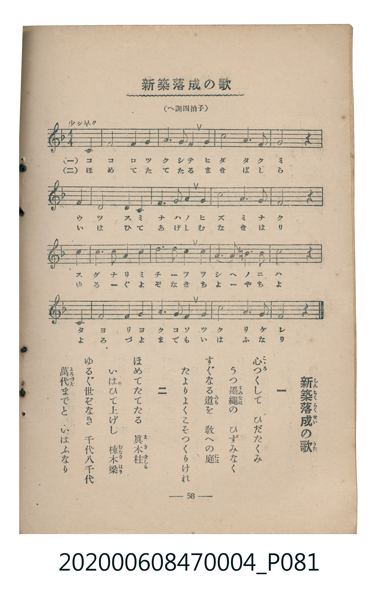

# 新築落成の歌（新築落成式）

> Re:Shōka 使用 AI 協助辨識與重建樂譜，可能會有錯誤。歡迎回報。

- **鋼琴伴奏版**：<br><audio controls src="shinchiku_rakuseishiki.mp3"></audio>
- **NEUTRINO 歌聲合成版**：<br><audio controls src="shinchiku_rakuseishiki_neutrino.mp3"></audio>

- 臺灣教育會公認《新定兒童唱歌》尋常科第四學年用（2020.006.0847.0004）

## 說明

原書資訊與歌詞全文（對應 P081.jpg，書頁 p. 58，參考教材第 21 首）：
目次標題：新築落成式／內頁標題：新築落成の歌（しんちくらくせいのうた）
調性與拍號：へ調四拍子（F 大調 4/4 拍，弱起 1 拍）
速度指示：少シ早ク


## 歌詞

```text
一
心（こゝろ）つくして　ひだたくみ
うつ墨繩（すみなは）の　ひずみなく
すぐなる道（みち）を　敎（をし）への庭（には）
たよりよくこそつくりけれ
（譜面第 3 行記為「スグナリミチーヲ」）

二
ほめてたてたる　眞木柱（まきはしら）
いはひて上げし　棟木梁（むなきはり）
ゆるぐ世ぞなき　千代八千代
萬代（よろづよ）までと　いはふなり
（譜面第 4 行記為「よろづよまでも」）
```

## ABC

<div class="abc-score" data-abc-src="shinchiku_rakuseishiki.abc" aria-label="五線譜載入中"></div>

[下載 ABC 原始檔](shinchiku_rakuseishiki.abc)

## TMD 檔案連結

- [主旋律 TMD 檔案](shinchiku_rakuseishiki.tmd) [[在 TMD Studio 編輯](https://tmdlang.github.io/Tmd-TS/#tmd=s7IKdvYPcrWy4qpTUCpJTLdSSM7PyUlNLsnMz7MqzsjMK0nNjM_KTMmPL87Iz05Ugisry88pzU21Si9KTEmNN4k3MjAyiDcwMIs3sDAxBzIMTBBKi_NLi5JTrYqTM_Lzc-JLUitKkvLzsxHyBUX5Zal5iXlANQVFIBtTwIoQClLLMlNSQdKpKZkl-UWZiTlI7kgtKga7FWxJfElRYl5xclFmAcgDCFX5RSUZ-UC3FmRUWmVkFoMMSU7Mic9OzEPyUklGKtBHaanFJZllyFZAxJNTi1Jz8_NQLIfK5OfmluZlllQi25eZnplnVZKYCQw2UNCVJ8bnJmbm5STmpaAHTHxBYnqqVYCBhaESl5aWwrNpG56v73wxYe-zjgmPG9c9W9vzfk8HsuDTPf3v93QqaGlxKdoqGBpYcNnbKrhx2Zjom9iBTH7Rvut54-JnU2e-aNr0bE7z09Y1L1b1Pm7oAhrxdN2sp62Tnq9e-nTKRqC5jxu6n27ofrpjx_PlE5-vWfN09uyna3c83bnl-ZQVQCtBMaoHjFE9UIwCGQYmQFuVuLj0tRRsqQW4FBQUnvbNfzZ7x4vN7S9WdL3oaAe668XKeU9bVzyb1g50xdMNvc_aOxVAoaOXVZD-fk8PUPHLBY0KBXoKphZA7tP-5hcNzUDvPps7AegJBSNDhZfLpgGd-n7PLJDxz2eve7Zm4bMVM18uBAbkLIyA7H_auhxoHlYF8OB_3Dj9cdPkx40LHzf2P27qBJGNsx83tgAVPG5se9w4H2gfyLIXq_Y_a1gO8kV374uZQNFZjxt3AAWBQQsUebp2AtAsN4WnS5YDxRSAEaYAFAX5Yc_GF1u3KxhCuGCTXjbMf7pr2bOe9udLdgGNebph4uOm7c-mr3zctJ4LJP9kRwM48PY3g503-XHT3MdNIM2PG5eAnTf9ceOyxw0Njxs3PW5cAHQhWHA_SI-CAtjNS54uWvF850qw9plAqceNqx43rgebsA6mEeh8iHg_SCNYHTBQVj1u6n7ZOBmsEyi9EKSnaRJQz7OpfSBBILtxOtigHUCznu5aC1a5GmI6zAXzHzcBVXaBSJDLgIE7F-p0oGAj0Lc9IJVAnS_Wznk5dxEoao0VXizsebFixvOmXY8beh437XzctOFxc9fj5lWPm-c_bm583LzncfOmxw3gMAQH0i6wIY8bdz9uagSFBygYwGRTN9C5z-fMezZnxbP5G8Hu2_e4sRfoRHBUAxMP3KHASAYKAgNj2ZMdQJeB_Aby6uL5IL2LGsEeBoYWMJDA2pu6oHofN7WBrGmc8GTHtMeN86AqGhqe9jY_2b34aetqCANizYsJa4BssFlABDRoKZABDkKgs5Y_blwBjhGIU7aCY6ALI3hM0IIHYRDUlKYmaNgAdVKed6FAQUufiysYWFEkZ2RmlwYlZpcWpwILvczsTKuAzMS8fIcag5pqsCdtLLTswAxgCaIBTL-awCDarFADIh83r33c3AJmA0Nw--PmtsfNk0Dc5obHTfuBgmD2fAUDoIJlCvpA7bt6gNobd4O1QKMWxIbHbuM-MBcYABuAEQZW1gnS3tgCcjDIFTVAri4cVuem1SqYxgNZNcB8CBED0UZgEWMw3whJxBSqBiJjCBQBiYMgyFSQuhqwLT6GqPaAvAzSD6HBIs1rwWQLVHw9VN12oFgbWGYSRKa5AW7GfigNCxeEzaDwgdtthGY3MLwgdjTCRUCqQWEHFgfzIHxgGIJZ-6AyvXAdG6A0LFCR7AYGLsxuYBwDvQTKo0DngRwJzKb9j5v7oPEKTKKgLNsF9TEoXncC4xWe1cB2NkFzW1MDmAvNYWAtXWAtbYi4NANFHQiCGSgRaQSOJGzRZoQU2SAPgGQR0QaJEkhA7wRHBDSYgM6GRFw_EPchR1HTLpgOaKQgvIgcRSDTEFEE8hMscDfBIwUcAFDRSeDgBukEJQFwWMB1QCIGES7I9oCSDyI6kApLsC-A5eUmIALrA2a5GeDY6QZL9YODdz8oRsBFGLAMAVsLK8UaF4J1AUsYYJEEZYO1dCBiBBLUpuCgBgesghkkgsA8iAgkGowVTNTBDCCFiCJwhIDjEREjTdDEBwxVoEdQ4gSepIE-gpFgn0FFZ0DjCsSGeRI5rEBZCilOwMkfErITwPId0JCfBxVdBQ17kP8hNoFUQFILJN0gQgbZHrA5iCyyAhwhK2BF3-bHTXsRJSFQqmkj2K1rwFEBLc7B7oCV6MA8B05CkHoBmgjgkUB6UYaeJ0AQOU-sgIczJPxBfORiazMQ7wXLoBZoMB0gNTA_YbUFHPqQVA0Kw6UooQ8qjkCiy4FioNwBLXJQ8tBWKA0LDHRbarm4dO0UsFZZCkAJZS4A)]
- [鋼琴伴奏 TMD 檔案](shinchiku_rakuseishiki_piano.tmd) [[在 TMD Studio 編輯](https://tmdlang.github.io/Tmd-TS/#tmd=s7IKdvYPcrWy4qpTUCpJTLdSyC8qychPL0osyKi0ysgsLskvykxOzInPTsxLVIIrKs4vLUpOjS9ITE-1CjCwMFTi0tJSeDZtw_P1nS8m7H3WMeFx47pna3ve7-lAFny6p_9x8-6X3XueT9jyZM-Wp0v7n3d2vN_TqaClxaVoq2BoYMFlb6vgxmVjom9iB7LrRfuu542Ln02d-aJp07M5zU9b17xY1fu4oQto6NN1s562Tnq-eunTKRuBNj1u6H66ofvpjh3Pl098vmbN09mzn67d8XTnludTVgAdYWRgZKBnYGCmZ2BhYg5kGJgAbVXi4grOyMxLzsjMLg1KzC4tTs0sBrIzrQIyE_PygzwcagxqqrkUgMDGQssOzKhRMFDQhcPq3LRaBdN4IKtGwRAqBqKNwCLGYL4RkogpVA1ExhAoAhIHQZCpIHU1YFt8DFHtedy0GawfQoNFmteCyRao-Hqouu1AsTawzCSITHMD3Iz9UHo9WHw-ks2Pm5Yh7DZCs7txN9SORrgISPXjRpAJQHEwD8J_3NQNZu2DyvTCdWyA0tPBJnUi290I9gM0dM1AgQmCYAZK0BqBgw1bQBohBT_ISJAsIiAhgQTx-k5w0EAd3twFEW3uB-I-5EBr2gXTAQ0mkFpEMMMCDWQaItAeN8JkHzduggcTSLwJKjoJHAAgnaBIAcmsguuABBXIDJA9EJfB7AFFKCyAID43Bfsc7E8FM0h4gXkQEUioGCuYqIMZQAoRYuDwAQcrIoCaoLED9OTjZpCTEEEEj_NmsJfAJEjHdqjoDGjQgdjdYB39KE4HpTmkIAKnD4hHJ4DlO6ABMQ8qugoaFI8bF0JtAqmARB4kGkEyyOIQe8DmQIOI9JyInoBAEDkBrYCHAiR0QHzkXLcZiPeCZVDzI0wHSM1GcOiswW4LOGwgSQDkw1koYQPKTSDR5UAxUFKC5hiUBLcVSq_CSD4QW2rxFnU-yEWdCbyoqy6oRRihYBivEG0YC6ZM42MRAibx6CJQChjKMCkQwwAeQUYgYaP43FgIC0MvdsMQfIRJ6GrAbjEBaoeLmIFEzCB2AS3F4yoy_AciIaEMDmFdOwWsgRztA1KHUxLoKKCkMhcA)]

## 分析

```text
================================================================================
📊 TMD Song Profile: [ 新築落成の歌（新築落成式） ]
================================================================================
⏱  Duration:       0:37 (37.8s), 17 measures total
🎼 Key & Tempo:    首調基準 F, != 108.0 BPM, <4/4>
   - 分析範圍：      由實際發聲的音符與和弦推測調性；播放脈絡另行呈現
🎤 人聲音域:    C4 (MIDI 60) – D5 (MIDI 74) [跨度: 14 個半音 / 1.2 個八度, 難度: moderate]
   - 最低音:  C4 in [ShinchikuRakuseishiki #1 @ m.1, 0:01]
   - 最高音: D5 in [ShinchikuRakuseishiki #1 @ m.11, 0:22]
   - 適合: soprano, mezzo-soprano, contralto, tenor, baritone, bass
🏛  結構:      ShinchikuRakuseishiki (37.8s)
⚡ 編曲密度:        Peak 1 軌道同時演奏
🗝  調性診斷：       F 大調（純淨自然大調，未偵測到可信轉調）
   - 風格氣質:    純淨自然大調（陽光明朗、易唱易記，無明顯調外色彩）
   - 轉調歷程:    全曲維持單一推測調性（未偵測到可信轉調）
   - 核心骨幹音:  C, F, A, G, D
   - 調性數值:    F 大調 [相關度: 0.86, 穩定度: Moderate, 自然音純度: 96.7%]
   - 候選調性 (K-S): F 大調 (0.86), C 大調 (0.79), A 小調 (0.67)
   - 五度圈歷程:   -1
   - 各段落調性細節:
     • [ShinchikuRakuseishiki #1]: F 大調 (r: 0.86, 自然音純度: 96.7%, 調外音: B)

  [ 五度圈游移軌跡 ]
               C  
        [F ]*          G  
      Bb               D  
      Eb               A  
         Ab           E  
            Db       B  
               F# 
     (* = active key center)

  [ 十二半音累積音高分佈 ]
     C  : ████████████████████████  28.3%
     C# :                            0.0%
     D  : ███████                    8.3%
     D# :                            0.0%
     E  :                            0.0%
     F  : █████████████████████     25.0%
     F# :                            0.0%
     G  : █████████████             15.8%
     G# :                            0.0%
     A  : ████████████████          19.2%
     A# :                            0.0%
     B  : ███                        3.3%
--------------------------------------------------------------------------------
Assignment 軌道音域：
  - Piano         : C4 – D5 (14 個半音 / 1.2 個八度, 50 個音符)
================================================================================
```


## 原書掃描頁




