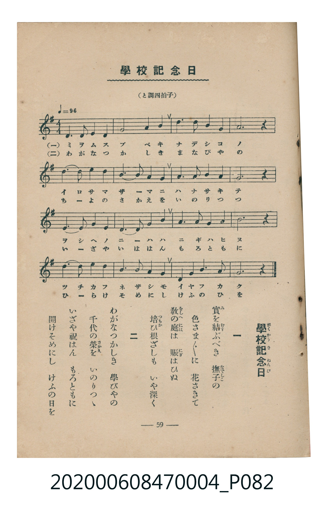

# 學校記念日

<audio controls src="gakko_kinenbi.mp3"></audio>

- 臺灣教育會公認《新定兒童唱歌》尋常科第四學年用（2020.006.0847.0004）

## 說明

原書資訊與歌詞全文（對應 P082.jpg，書頁 p. 59，參考教材第 22 首）：
調性與拍號：と調四拍子（G 大調 4/4 拍）
速度指示：♩=96

## 歌詞

```text
一
實（み）を結（むす）ぶべき　撫子（なでしこ）の
色さま／″＼に　花さきて
敎（をしへ）の庭（には）は　賑（にぎ）はひぬ
培（つちか）ひ根ざしも　いや深く

二
わがなつかしき　學びやの
千代の榮（さかえ）を　いのりつゝ
いざや祝はん　もろともに
開けそめにし　けふの日を
```

## ABC

```abc
X:1
T:學校記念日
C:TMD (Chen, Chih-Han / aguai)
M:4/4
L:1/16
Q:1/4=96
K:G
V:V1 name="Piano" snm="Pia"
[V:V1]
!mf! D6 E2 D4 G4 | B8 A4 d4 | B6 B2 A4 G4 | A12 z4 |
D6 E2 D4 G4 | B6 A2 G4 B4 | A6 B2 A4 E4 | G12 z4 |
F6 G2 A4 D4 | G6 A2 B4 G4 | A6 B2 A4 ^c4 | d12 z4 |
d6 B2 G4 d4 | B6 A2 G4 E4 | D4 G4 B6 A2 | G12 z4 |
```

## TMD 檔案連結

- [主旋律 TMD 檔案](gakko_kinenbi.tmd) [[在 TMD Studio 編輯](https://tmdlang.github.io/Tmd-TS/#tmd=s7IKdvYPcrWy4tLSUni6dsezBQtfrJjxdP_WZ9OXKmhpcSnaKliacdnbKrhz2Zjom9hx1SkovWjf9bxx8bOpM180bXo2p_lp65oXq3ofN3Q9m7bh6bpZT1snPV-99OmUjc_W9jxu6H66ofvpjh3Pl098vmbN09mzgVY83bnl-ZQV7_d0GBkYGegZGJjpGViYmAMZBibv93QqcXHpaynYUgtwKSgoPO2b_2z2jheb21-s6HrR0Q5014uV8562rng2rR3oiqcbep-1dyoEGFgY6WUVpL_f0wNU_HJBo0KBnoKpJZD7tL_5RUMz0LvP5k4AekLByEjh5bJpQKe-3zMLZPyLVfufNSwHGdzd-2LmfKDo48YVQEGgb4EiT9dOAFrirvB0yXKgmAIwDBWAokDdIK0vG-Y_3bXsWU_78yW7gPoezVxpCwxtkMyTHQ1gp69fBtT9uHE_UMPjpknPt4IMe9zU8LhxJkikcdvjxp2PG4GB3_Bs0mqIVY8bVz1uXP64cfrjxslgNetABgGd2bnpcePUx4373u_pf9Sw-f2ePY8bVwM1vujaCBbvfdy4DKTy2dQ-sB2TwEbsgBjxdNdasNGrHzeuB4usB-ncPBEmCNQCFmwE2rEGYt_T-TvBskseNy583NgNVrDp2QKgc6eBTG5qAprwuLHlcVPLs-1AF_RDvL2rB0Q9bup_3NgD9glQezfYJSBPAlPP48bNQC1wXz3tbX6yezGQ-2zZOrB1QJ8A1XdAwgtqReO6x01dIKOa5oJNBwlNA5ryfOlckKObJoPUAR3UBAyDFSBG42qI6S-nAc2a-Lhx7uOmRrA_p4NNBIpsBVk5fSnQDpBKytMpFCho6XNxuSdmZ-d7Z-al5iVlWgVkJublO9QY1ChUg91kY6FlB2YAc4kGMJVoKjxunv-4edPj5gWPm3Yq1AC50x43z3zctPZxcxeY2_64afvjps1gdp-CPlDXrh6gLqQgBknBQ7lxH5gLFAcFNJi9DuQskJ1AR-Sm1SqYxivoAqFZPIRlCMQ1CsZgMV0FIyA2RRIxBotA1IBYMGgAEoH55HHTksfNax83bX3cPA9kZdO2x817gOzHzd1gd_cDPQOSbVoL5rYBvQFKVkA1TcA4Xwd2JTTmgVEC5iKiHcxdgvADHucbgXkgNsyxEOcD1YKEQJLY3Q-MAGAoN88ABTHIhd1g9wOd3Q_lNq0Dc8Fua-4Bu78FpAacEGEOBmYgUHIEhwAiOYJlVyPcbw5xvyEkqJFdZgR2OnJYQ5xvog4WAkULDucD3dL4uGn14-apYAf2gmIA5KFFYLcAIweIpgIVgLnrwc4HJjlg8ANz9USwAxF5BMyF5hGgMrCWSUjBD3UYyJnICQUS9tCQhscMTA5b4NdycenaKSBnFwUgX5mLCwA)]
- [鋼琴伴奏 TMD 檔案](gakko_kinenbi_piano.tmd) [[在 TMD Studio 編輯](https://tmdlang.github.io/Tmd-TS/#tmd=s7IKdvYPcrWy4tLSUni6dsezBQtfrJjxdP_WZ9OXvt_T8bJ7z_MJW57s2fJ0af_zzo73ezoVtLS4FG0VLM247G0V3LlsTPRN7LjqFJRetO963rj42dSZL5o2PZvT_LR1zYtVvY8bup5N2_B03aynrZOer176dMrGZ2t7Hjd0P93Q_XTHjufLJz5fs-bp7NlAe5_u3PJ8ygqgjUYGRgZ6BgZmegYWJuZAhoEJ0FIlLi73xOzsfO_MvNS8pEyrgMzEvPwgD4cagxqFai4FILCx0LIDM4ACuWm1CqbxCrpAaBYPYRkCcY2CMVhMV8EIiE2RRIzBIhA1IBYMGoBEoKbiMdAIzAOxYdohBgLVgoRAkthMNIeYaAhxDrJaI7BhyO6BGGiiDhYCOR2rE6FKQRqRvQdxH9Q1cNfD5LA5sBZbePughLcJIrwLahUM4xWiDWNhFNBICMM0HkibxiOJmIFEzOJzQUJwWRDDAO4NHGYh6zQCMo2ALEzzgRTCJBQLMNRBTAcbFQujSHWUCUi1CdhgsEZUP4O4kEAFB6munQJyqCoA-cpcXAA)]

## 分析

```text
================================================================================
📊 TMD Song Profile: [ 學校記念日 ]
================================================================================
⏱  Duration:       0:40 (40.0s), 16 measures total
🎼 Key & Tempo:    首調基準 G, != 96.0 BPM, <4/4>
   - 分析範圍：      由實際發聲的音符與和弦推測調性；播放脈絡另行呈現
🎤 人聲音域:    D4 (MIDI 62) – D5 (MIDI 74) [跨度: 12 個半音 / 1.0 個八度, 難度: easy]
   - 最低音:  D4 in [GakkoKinenbi #1 @ m.1, 0:00]
   - 最高音: D5 in [GakkoKinenbi #1 @ m.2, 0:04]
   - 適合: soprano, mezzo-soprano, contralto, tenor, baritone, bass
🏛  結構:      GakkoKinenbi (40.0s)
⚡ 編曲密度:        Peak 1 軌道同時演奏
🗝  調性診斷：       G 大調（純淨自然大調，未偵測到可信轉調）
   - 風格氣質:    純淨自然大調（陽光明朗、易唱易記，無明顯調外色彩）
   - 轉調歷程:    全曲維持單一推測調性（未偵測到可信轉調）
   - 核心骨幹音:  G, D, A, B, E
   - 調性數值:    G 大調 [相關度: 0.83, 穩定度: Moderate, 自然音純度: 98.3%]
   - 候選調性 (K-S): G 大調 (0.83), D 大調 (0.78), B 小調 (0.63)
   - 五度圈歷程:   +1
   - 各段落調性細節:
     • [GakkoKinenbi #1]: G 大調 (r: 0.83, 自然音純度: 98.3%, 調外音: C#)

  [ 五度圈游移軌跡 ]
               C  
         F           [G ]*
      Bb               D  
      Eb               A  
         Ab           E  
            Db       B  
               F# 
     (* = active key center)

  [ 十二半音累積音高分佈 ]
     C  :                            0.0%
     C# : ██                         1.7%
     D  : ████████████████████      22.5%
     D# :                            0.0%
     E  : █████                      5.0%
     F  :                            0.0%
     F# : ██                         2.5%
     G  : ████████████████████████  26.7%
     G# :                            0.0%
     A  : ████████████████████      21.7%
     A# :                            0.0%
     B  : ██████████████████        20.0%
--------------------------------------------------------------------------------
Assignment 軌道音域：
  - Piano         : D4 – D5 (12 個半音 / 1.0 個八度, 51 個音符)
================================================================================
```


## 原書掃描頁




