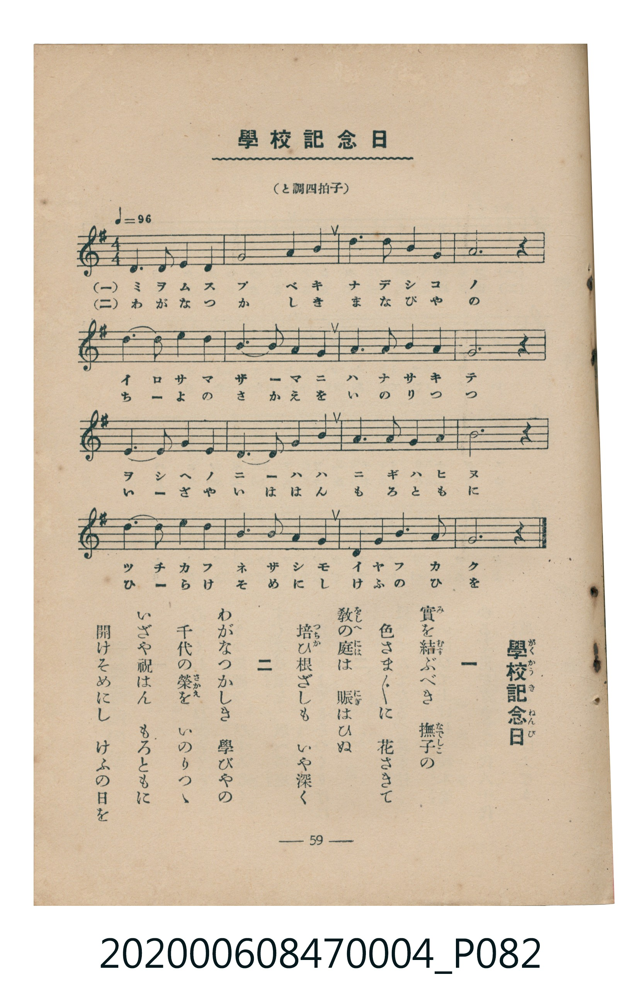

# 學校記念日

> Re:Shōka 使用 AI 協助辨識與重建樂譜，可能會有錯誤。歡迎[回報](https://github.com/TMDLang/reshoka/issues)。

- **鋼琴伴奏版**：<br><audio controls src="gakko_kinenbi.mp3"></audio>
- **NEUTRINO 歌聲合成版**：<br><audio controls src="gakko_kinenbi_neutrino.mp3"></audio>

- 臺灣教育會公認《新定兒童唱歌》尋常科第四學年用（2020.006.0847.0004）

## 說明

原書資訊與歌詞全文（對應 P082.jpg，書頁 p. 59，參考教材第 22 首）：
調性與拍號：と調四拍子（G 大調 4/4 拍）
速度指示：♩=96


## 歌詞

```text
一
實（み）を結（むす）ぶべき　撫子（なでしこ）の
色さま／″＼に　花さきて
敎（をしへ）の庭（には）は　賑（にぎ）はひぬ
培（つちか）ひ根ざしも　いや深く
（譜面第 4 行記為「ツチカフ」）

二
わがなつかしき　學びやの
千代の榮（さかえ）を　いのりつゝ
いざや祝はん　もろともに
開けそめにし　けふの日を
```

## ABC

<div class="abc-score" data-abc-src="gakko_kinenbi.abc" aria-label="五線譜載入中"></div>

[下載 ABC 原始檔](gakko_kinenbi.abc)

## TMD 檔案連結

- [主旋律 TMD 檔案](gakko_kinenbi.tmd) [[在 TMD Studio 編輯](https://tmdlang.github.io/Tmd-TS/#tmd=s7IKdvYPcrWy4qpTUCpJTLdSSM7PyUlNLsnMz7MqzsjMK0nNjM_KTMmPL87Iz05Ugisry88pzU21Si9KTEmNN4k3MjAyiDcwMIs3sDAxBzIMTBBKi_NLi5JTrYqTM_Lzc-JLUitKkvLzsxHyBUX5Zal5iXlANQVFIBtTwIoQClLLMlNSQdKpKZkl-UWZiTlI7kgtKga7FWxJfElRYl5xclFmAcgDCFX5RSUZ-UC3FmRUWmVkFoMMSU7Mic9OzEPyUklGKtBHUGfmZKalIuvPTM_MsypJzAQGAygoyhPjcxMz83IS81LQPRpfkJieahVgYGGkxKWlpfB07Y5nCxa-WDHj6f6tz6YvVdDS4lK0VbA047K3VXDnsjHRN7EDGfCifdfzxsXPps580bTp2Zzmp61rXqzqfdzQ9WzahqfrZj1tnfR89dKnUzY-W9vzuKH76Ybupzt2PF8-8fmaNU9nzwZa8XTnludTVrzf0wGKCD1gROiBIgLIMDB5v6dTiYtLX0vBllqAS0FB4Wnf_Gezd7zY3P5iRdeLjnagu16snPe0dcWzae1AVzzd0PusvVMBFAh6WQXp7_f0ABW_XNCoUKCnYGoJ5D7tb37R0Az07rO5E4CeUDAyUni5bBrQqe_3zAIZ_2LV_mcNy0EGd_e-mDkfKPq4cQVQEOhboMjTtROAlrgrPF2yHCimAAxDBaAoUDdI68uG-U93LXvW0_58yS6gvkczV9oCQxsk82RHA9jp65cBdT9u3A_U8Lhp0vOtIMMeNzU8bpwJEmnc9rhx5-NGYOA3PJu0GmLV48ZVjxuXP26c_rhxMljNOpBBQGd2bnrcOPVx4773e_ofNWx-v2fP48bVQI0vujaCxXsfNy4DqXw2tQ9sxySwETsgRjzdtRZs9OrHjevBIutBOjdPhAkCtYAFG4F2rIHY93T-TrDskseNCx83doMVbHq2AOjcaSCTm5qAJjxubHnc1PJsO9AF_SBdQA0v1s55OXcRKJxNFF4s7AEmxudNux439Dxubnnc3Pi4afXj5qmPG8ABCA6nXT0g6nFT_-PGHrDXgfZ1g50OChVgcnvcuBloBzwYnvY2P9m9GMh9tmwd2H1ArwPVd0ACGOqmxnWPm7pARjXNBZsOEpoGNOX50rkgXzZNBqkD-qAJGGgrQIzG1RDTX04DmjXxcePcx02N4ICZDjYRKLIVZOX0pUA7QCopT9hQoKClz8Xlnpidne-dmZeal5RpFZCZmJfvUGNQUw12ko2Flh2YAcxVGsBUpanwuHn-4-ZNj5sXPG7aqVAD5E573DzzcdNaMLvrcXP746btj5s2g7l9CvpAXbt6gLqQQhgkBQtkMHsfWBwUzmDuOpCrQHbWKFTnptUqmMYr6AIhkDIDscDcGgVDsKCughEQG4NFTCHKwDyQbA1YDgYNQCJgY30MQW6bDxYFegWIF4BYQO-A9AA9BNUB9BdYfC1UvAsq2g4U2w6W2QyV6cNujxFQrqkfoquxB4hXgVlLILoau2H2NE4Hk71Q8X1Q0VVADLIBFC4QmXVY7QFGzeOmJY-b1z5u2vq4eR5IZdM2IONxczfYdf2geAFKQeOoDRgpoEzVBEy968DGQtMwMHGBuYgEDOYuQUQHLITNwCTITaCwBoU_KKSRw9wILANiI2IKSyw0gcICFKZrgeytYNY8iF-btsFjASQC8gskrKHhCYwNqA54_LThjoXGhTDTmjrAYQsKSbDXoWHdDcRgGWAYQGRAYQ5RCQwLMAsWbxA3Y4sFYL4AJv7mGaAUAXJRNzjw-6HspnVgLjiQm3vAsQAtGGDBDiwBQcUD2P-I4gEsuxoRC-BcoAuiQCEL5gGjBp5JQIKQDAGLCpAIJCog0YU9Q2yCBtB2IHsGOIhByRrsdHhUgAIfQiLEgf6Cy0ADD-g73FEBCVhQgIIyGiJxwwJ8PRiDZCZDZIAhALGnFyizAswCiUBCBWdUIMp7sIt6QXkCFDmLwEYCswsQTQUqAHPXg2MDGHvAWmYi2GREEQzmQotgoBqw-kmk5Qlw5MDiBRQXeDNFMzQkmhuBNoF8CPIDJFxBRQTI_9tgRRDQO5AwAiVKoJ_gqkGqYH7DHReQOAep7QSH_URouM6FigJdAA5jSBEFDggwD5zxoMURIkzQ7anl4tK1U0CuXhSAfGUuAA)]
- [鋼琴伴奏 TMD 檔案](gakko_kinenbi_piano.tmd) [[在 TMD Studio 編輯](https://tmdlang.github.io/Tmd-TS/#tmd=s7IKdvYPcrWy4qpTUCpJTLdSyC8qychPL0osyKi0ysgsLskvykxOzInPTsxLVIIrKs4vLUpOjS9ITE-1CjCwMFLi0tJSeLp2x7MFC1-smPF0_9Zn05e-39PxsnvP8wlbnuzZ8nRp__POjvd7OhW0tLgUbRUszbjsbRXcuWxM9E3sQKa-aN_1vHHxs6kzXzRtejan-Wnrmhereh83dD2btuHpullPWyc9X7306ZSNz9b2PG7ofrqh--mOHc-XT3y-Zs3T2bOB9j7dueX5lBVAG40MjAz0DAzM9AwsTMyBDAMToKVKXFzuidnZ-d6Zeal5SZlWAZmJeflBHg41BjXVXApAYGOhZQdm1ChU56bVKpjGK-gCIZAyA7HA3BoFQ7CgroIREBuDRUwhysA8kGwNWA4GDUAiYGN9DGsUHjfPB4s-bt4ExAtArKadYD2Pm6dBdTxungkWXwsV74KKtgPFtoNlNkNl-rDbYwSUa-qH6GrsAeJVYNYSiK7Gbpg9jdPBZC9UfB9UdBUQg2x43NQClVmH1R6Ez83AJEgtKAxA4QIKAeSwMALLgNiIEMQSOk0gN4L8uhbI3gpmzYO4oWkbPHRAIo-bQb4AhQHUn8BQguqAh1sb7tBpXAgzrakD7GeQD0HiU6Fh0A3EYJmmSVAZUFhAVD5uAsUIIjwhbsYMHXCq0QVRIB-DecAggycqkCAkAcGCCCQCCSJIMGJPQJugDt8OZM8Aex2UDEAy8IgFBwqERIg_bgI6HSoD9VRzD54ggngY5FFQwkQkBlhArAdjkMxkiExTE9SeXqDMCjALJALSsxpHEBGTgMAhBgssUADhTUHNUOc1NwKtB1n7uBkUpyAZUDoHOWobLB81L4I6HBSDj5shJDQFAPWCZEAexBVAkIgAqe0EB8hEqGfnQkWBLgB7HJLPQDIgFY8bwakUmqdApoDsAUUIqj212IorH-TiygRRXBXUKhjGK0QbxoIp0_hYUCBBBEzjITRcAEqBAhaqFsQwgMcJVN4EXR_CILhGDMuAFMIgM5Ays_jcWCQWHleALcRtGmFnoZsMIiHhCQ5NXTsF5ACN9gFJo4sZgcWUuQA)]

## 分析

```text
================================================================================
📊 TMD Song Profile: [ 學校記念日 ]
================================================================================
⏱  Duration:       0:40 (40.0s), 16 measures total
🎼 Key & Tempo:    首調基準 G, != 96.0 BPM, <4/4>
   - 分析範圍：      由實際發聲的音符與和弦推測調性；播放脈絡另行呈現
🎤 人聲音域:    D4 (MIDI 62) – E5 (MIDI 76) [跨度: 14 個半音 / 1.2 個八度, 難度: moderate]
   - 最低音:  D4 in [GakkoKinenbi #1 @ m.1, 0:00]
   - 最高音: E5 in [GakkoKinenbi #1 @ m.5, 0:11]
   - 適合: soprano, mezzo-soprano, contralto, tenor, baritone, bass
🏛  結構:      GakkoKinenbi (40.0s)
⚡ 編曲密度:        Peak 1 軌道同時演奏
🗝  調性診斷：       G 大調（純淨自然大調，未偵測到可信轉調）
   - 風格氣質:    純淨自然大調（陽光明朗、易唱易記，無明顯調外色彩）
   - 轉調歷程:    全曲維持單一推測調性（未偵測到可信轉調）
   - 核心骨幹音:  G, D, A, B, E
   - 調性數值:    G 大調 [相關度: 0.84, 穩定度: Moderate, 自然音純度: 100.0%]
   - 候選調性 (K-S): G 大調 (0.84), D 大調 (0.77), B 小調 (0.63)
   - 五度圈歷程:   +1
   - 各段落調性細節:
     • [GakkoKinenbi #1]: G 大調 (r: 0.84, 自然音純度: 100.0%)

  [ 五度圈游移軌跡 ]
               C  
         F           [G ]*
      Bb               D  
      Eb               A  
         Ab           E  
            Db       B  
               F# 
     (* = active key center)

  [ 十二半音累積音高分佈 ]
     C  :                            0.0%
     C# :                            0.0%
     D  : ██████████████████████    23.3%
     D# :                            0.0%
     E  : ██████████                10.0%
     F  :                            0.0%
     F# :                            0.0%
     G  : ████████████████████████  25.0%
     G# :                            0.0%
     A  : ████████████████████      20.8%
     A# :                            0.0%
     B  : ████████████████████      20.8%
--------------------------------------------------------------------------------
Assignment 軌道音域：
  - Piano         : D4 – E5 (14 個半音 / 1.2 個八度, 51 個音符)
================================================================================
```


## 原書掃描頁




