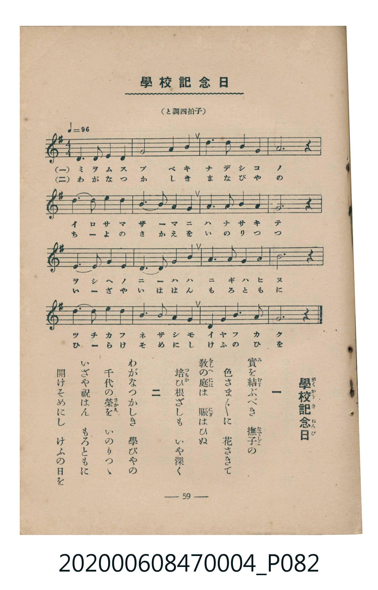

# 學校記念日

> Re:Shōka 使用 AI 協助辨識與重建樂譜，可能會有錯誤。歡迎回報。

<audio controls src="gakko_kinenbi.mp3"></audio>

- 臺灣教育會公認《新定兒童唱歌》尋常科第四學年用（2020.006.0847.0004）

## 說明

原書資訊與歌詞全文（對應 P082.jpg，書頁 p. 59，參考教材第 22 首）：
調性與拍號：と調四拍子（G 大調 4/4 拍）
速度指示：♩=96

## 歌詞

```text
一
實（み）を結（むす）ぶべき　撫子（なでしこ）の
色さま／″＼に　花さきて
敎（をしへ）の庭（には）は　賑（にぎ）はひぬ
培（つちか）ひ根ざしも　いや深く
（譜面第 4 行記為「ツチカフ」）

二
わがなつかしき　學びやの
千代の榮（さかえ）を　いのりつゝ
いざや祝はん　もろともに
開けそめにし　けふの日を
```

## ABC

```abc
X:1
T:學校記念日
M:4/4
L:1/16
Q:1/4=96
K:G
V:V1 name="Piano" snm="Pia"
[V:V1]
!mf! D6 D2 E4 D4 | G8 A4 B4 | d6 d2 B4 G4 | A12 z4 |
w: 1.~ミ ヲ ム ス | ブ ベ キ | ナ デ シ コ | ノ
w: 2.~わ が な つ | か し き | ま な び や | の
d6 d2 e4 d4 | B6 B2 A4 G4 | A6 A2 B4 A4 | G12 z4 |
w: 1.~イ ロ サ マ | ザ _ マ ニ | ハ ナ サ キ | テ
w: 2.~ち _ よ の | さ か え を | い の り つ | つ
E6 E2 G4 E4 | D6 D2 G4 B4 | A6 A2 G4 A4 | B12 z4 |
w: 1.~ヲ シ ヘ ノ | ニ _ ハ ハ | ニ ギ ハ ヒ | ヌ
w: 2.~い _ ざ や | い は は ん | も ろ と も | に
d6 d2 e4 d4 | B6 B2 A4 G4 | D4 G4 B6 A2 | G12 z4 |
w: 1.~ツ チ カ フ | ネ ザ シ モ | イ ヤ フ カ | ク
w: 2.~ひ _ ら け | そ め に し | け ふ の ひ | を
```

## TMD 檔案連結

- [主旋律 TMD 檔案](gakko_kinenbi.tmd) [[在 TMD Studio 編輯](https://tmdlang.github.io/Tmd-TS/#tmd=s7IKdvYPcrWy4qpTUCpJTLdSSM7PyUlNLsnMz7MqzsjMK0nNjM_KTMmPL87Iz05Ugisry88pzU21Si9KTEmNN4k3MjAyiDcwMIs3sDAxBzIMTBBKi_NLi5JTrYqTM_Lzc-JLUitKkvLzsxHyBUX5Zal5iXlANQVFIBtTwIoQClLLMlNSQdKpKZkl-UWZiTlI7kgtKga7FWxJfElRYl5xclFmAcgDCFX5RSUZ-UC3FmRUWmVkFoMMSU7Mic9OzEPyUklGKtBHUGfmZKalKnFpaSk8Xbvj2YKFL1bMeLp_67PpSxW0tLgUbRUszbjsbRXcuWxM9E3sQCa8aN_1vHHxs6kzXzRtejan-Wnrmhereh83dD2btuHpullPWyc9X7306ZSNz9b2PG7ofrqh--mOHc-XT3y-Zs3T2bOBVjzdueX5lBXv93SAAlIPGJB6oIAEMgxM3u_pVOLi0tdSsKUW4FJQUHjaN__Z7B0vNre_WNH1oqMd6K4XK-c9bV3xbFo70BVPN_Q-a-9UCDCwMNLLKkh_v6cHqPjlgkaFAj0FU0sg92l_84uGZqB3n82dAPSEgpGRwstl04BOfb9nFsj4F6v2P2tYDjK4u_fFzPlA0ceNK4CCQN8CRZ6unQC0xF3h6ZLlQDEFYBgqAEWBukFaXzbMf7pr2bOe9udLdgH1PZq50hYY2iCZJzsawE5fvwyo-3HjfqCGx02Tnm8FGfa4qeFx40yQSOO2x407HzcCA7_h2aTVEKseN6563Lj8ceP0x42TwWrWgQwCOrNz0-PGqY8b973f0_-oYfP7PXseN64GanzRtREs3vu4cRlI5bOpfWA7JoGN2AEx4umutWCjVz9uXA8WWQ_SuXkiTBCoBSzYCLRjDcS-p_N3gmWXPG5c-LixG6xg07MFQOdOA5nc1AQ04XFjy-OmlmfbgS7oB-kCanixds7LuYtA4Wyi8GJhDzAxPm_a9bih53Fzy-PmxsdNqx83T33cAA5AcDjt6gFRj5v6Hzf2gL0OtK8b7HRQqACT2-PGzUA74MHwtLf5ye7FQO6zZevA7gN6Hai-AxLAUDc1rnvc1AUyqmku2HSQ0DSgKc-XzgX5smkySB3QB03AQFsBYjSuhpj-chrQrImPG-c-bmoEB8x0sIlAka0gK6cvBdoBUkl5woYCBS19Li73xOzsfO_MvNS8pEyrgMzEvHyHGoOaarCTbCy07MAMYK7SAKYqTYXHzfMfN2963LzgcdNOhRogd9rj5pmPm9aC2V2Pm9sfN21_3LQZzO1T0Afq2tUD1IUUwiApWCCD2fvA4qBwBnPXgVwFsrNGoTo3rVbBNF5BFwiBlBmIBebWKBiCBXUVjIDYGCxiClEG5oFka8ByMGgAEgEb62MIctt8sCjQK0C8AMQCegekB-ghqA6gv8Dia6HiXVDRdqDYdrDMZqhMH3Z7jIByTf0QXY09QLwKzFoC0dXYDbOncTqY7IWK74OKrgJikA2gcIHIrMNqDzBqHjctedy89nHT1sfN80Aqm7YBGY-bu8Gu6wfFC1AKGkdtwEgBZaomYOpdBzYWmoaBiQvMRSRgMHcJIjpgIWwGJkFuAoU1KPxBIY0c5kZgGRAbEVNYYqEJFBagMF0LZG8Fs-ZB_Nq0DR4LIBGQXyBhDQ1PYGxAdcDjpw13LDQuhJnW1AEOW1BIgr0ODetuIAbLAMMAIgMKc4hKYFiAWbB4g7gZWywA8wUw8TfPAKUIkIu6wYHfD2U3rQNzwYHc3AOOBWjBAAt2YAkIKh7A_kcUD2DZ1YhYAOcCXRAFClkwDxg18EwCEoRkCFhUgEQgUQGJLuwZYhM0gLYD2TPAQQxK1mCnw6MCFPgQEiEO9BdcBhp4QN_hjgpIwIICFJTREIkbFuDrwRgkMxkiAwwBiD29QJkVYBZIBBIqOKMCUd6DXdQLyhOgyFkENhKYXYBoKlABmLseHBvA2APWMhPBJiOKYDAXWgQD1YDVTyItT4AjBxYvoLjAmymaoSHR3Ai0CeRDkB8g4QoqIkD-3wYrgoDegYQRKFEC_QRXDVIF8xvuuIDEOUhtJzjsJ0LDdS5UFOgCcBhDiihwQIB54IwHLY4QYYJuTy0Xl66dAnL1ogDkK3MBAA)]
- [鋼琴伴奏 TMD 檔案](gakko_kinenbi_piano.tmd) [[在 TMD Studio 編輯](https://tmdlang.github.io/Tmd-TS/#tmd=s7IKdvYPcrWy4tLSUni6dsezBQtfrJjxdP_WZ9OXvt_T8bJ7z_MJW57s2fJ0af_zzo73ezoVtLS4FG0VLM247G0V3LlsTPRN7LjqFJRetO963rj42dSZL5o2PZvT_LR1zYtVvY8bup5N2_B03aynrZOer176dMrGZ2t7Hjd0P93Q_XTHjufLJz5fs-bp7NlAe5_u3PJ8ygqgjUYGRgZ6BgZmegYWJuZAhoEJ0FIlLi73xOzsfO_MvNS8pEyrgMzEvPwgD4cag5pqLgUgsLHQsgMzahSqc9NqFUzjFXSBEEiZgVhgbo2CIVhQV8EIiI3BIqYQZWAeSLYGLAeDBiARsLE-hjUKj5vng0UfN28C4gUgVtNOsJ7HzdOgOh43zwSLr4WKd0FF24Fi28Eym6EyfdjtMQLKNfVDdDX2APEqMGsJRFdjN8yexulgshcqvg8qugqIQTY8bmqByqzDag_C52ZgEqQWFAagcAGFAHJYGIFlQGxECGIJnSaQG0F-XQtkbwWz5kHc0LQNHjogkcfNIF-AwgDqT2AoQXXAw60Nd-g0LoSZ1tQB9jPIhyDxqdAw6AZisEzTJKgMKCwgKh83gWIEEZ4QN2OGDjjV6IIokI_BPGCQwRMVSBCSgGBBBBKBBBEkGLEnoE1Qh28HsmeAvQ5KBiAZeMSCAwVCIsQfNwGdDpWBeqq5B08QQTwM8igoYSISAywg1oMxSGYyRKapCWpPL1BmBZgFEgHpWY0jiIhJQOAQgwUWKIDwpqBmqPOaG4HWg6x93AyKU5AMKJ2DHLUNlo-aF0EdDorBx80QEpoCgHpBMiAP4gogSESA1HaCA2Qi1LNzoaJAF4A9DslnIBmQiseN4FQKzVMgU0D2gCIE1Z5abMWVD3JxZYIorgpqFQzjFaINY8GUaXwsKJAgAqbxEBouAKVAAQtVC2IYwOMEKm-Crg9hEFwjhmVACmGQGUiZWXxuLBILjyvAFuI2jbCz0E0GkZDwBIemrp0CcoBG-4Ck0cWMwGLKXAA)]

## 分析

```text
================================================================================
📊 TMD Song Profile: [ 學校記念日 ]
================================================================================
⏱  Duration:       0:40 (40.0s), 16 measures total
🎼 Key & Tempo:    首調基準 G, != 96.0 BPM, <4/4>
   - 分析範圍：      由實際發聲的音符與和弦推測調性；播放脈絡另行呈現
🎤 人聲音域:    D4 (MIDI 62) – E5 (MIDI 76) [跨度: 14 個半音 / 1.2 個八度, 難度: moderate]
   - 最低音:  D4 in [GakkoKinenbi #1 @ m.1, 0:00]
   - 最高音: E5 in [GakkoKinenbi #1 @ m.5, 0:11]
   - 適合: soprano, mezzo-soprano, contralto, tenor, baritone, bass
🏛  結構:      GakkoKinenbi (40.0s)
⚡ 編曲密度:        Peak 1 軌道同時演奏
🗝  調性診斷：       G 大調（純淨自然大調，未偵測到可信轉調）
   - 風格氣質:    純淨自然大調（陽光明朗、易唱易記，無明顯調外色彩）
   - 轉調歷程:    全曲維持單一推測調性（未偵測到可信轉調）
   - 核心骨幹音:  G, D, A, B, E
   - 調性數值:    G 大調 [相關度: 0.84, 穩定度: Moderate, 自然音純度: 100.0%]
   - 候選調性 (K-S): G 大調 (0.84), D 大調 (0.77), B 小調 (0.63)
   - 五度圈歷程:   +1
   - 各段落調性細節:
     • [GakkoKinenbi #1]: G 大調 (r: 0.84, 自然音純度: 100.0%)

  [ 五度圈游移軌跡 ]
               C  
         F           [G ]*
      Bb               D  
      Eb               A  
         Ab           E  
            Db       B  
               F# 
     (* = active key center)

  [ 十二半音累積音高分佈 ]
     C  :                            0.0%
     C# :                            0.0%
     D  : ██████████████████████    23.3%
     D# :                            0.0%
     E  : ██████████                10.0%
     F  :                            0.0%
     F# :                            0.0%
     G  : ████████████████████████  25.0%
     G# :                            0.0%
     A  : ████████████████████      20.8%
     A# :                            0.0%
     B  : ████████████████████      20.8%
--------------------------------------------------------------------------------
Assignment 軌道音域：
  - Piano         : D4 – E5 (14 個半音 / 1.2 個八度, 51 個音符)
================================================================================
```


## 原書掃描頁




