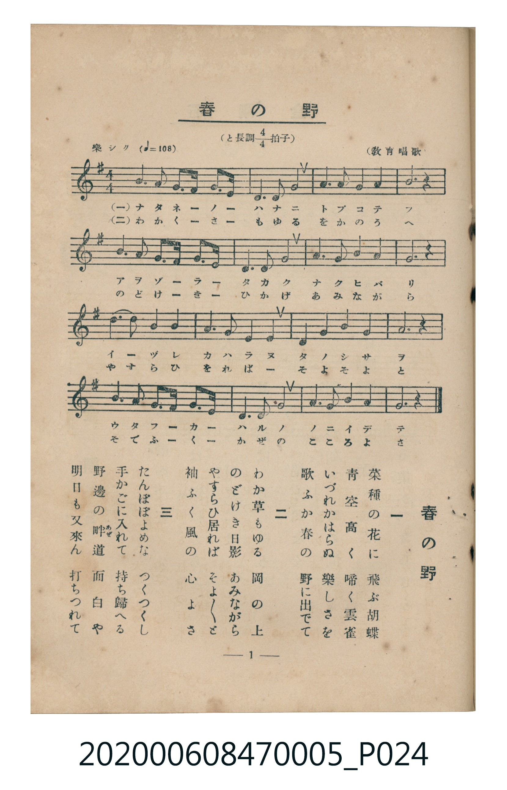

# 春の野

<audio controls src="haru_no_no.mp3"></audio>

- 臺灣教育會公認《新定兒童唱歌》尋常科第五學年用（2020.006.0847.0005）

## 說明

原書資訊與歌詞全文（對應 P024.jpg，書頁 p. 1，第一學期第 1 首）：
調性與拍號：と長調四分之四拍子（G 大調 4/4 拍），樂シク（♩= 108），（教育唱歌）

## 歌詞

```text
一　菜種の花に　飛ぶ胡蝶
青空高く　啼く雲雀
いづれかはらぬ　樂しさを
歌ふか春の　野に出でて

二　わか草もゆる　岡の上
のどけき日影　あみながら
やすらひ居れば　そよ／＼と
袖ふく風の　心よさ

三　たんぽぽよめな　つくつくし
手かごに入れて　持ち歸へる
野邊の畔道（あぜみち）　面白や
明日も又來ん　打ちつれて
```

## ABC

```abc
X:1
T:春の野
C:TMD (Chen, Chih-Han / aguai)
M:4/4
L:1/16
Q:1/4=108
K:G
V:V1 name="Piano" snm="Pia"
[V:V1]
B6 A2 G6 E2 | D4 E4 G8 | A6 A2 B4 d4 | A12 z4 |
B6 A2 G6 E2 | D4 E4 G8 | A6 A2 B4 A4 | G12 z4 |
d6 B2 d4 B4 | A4 G4 E8 | D4 G4 A4 B4 | A12 z4 |
B6 A2 G6 E2 | D4 E4 G8 | A6 G2 B4 A4 | G12 z4 |
```

## TMD 檔案連結

- [主旋律 TMD 檔案](haru_no_no.tmd)
- [鋼琴伴奏 TMD 檔案](haru_no_no_piano.tmd)

## 分析

```text
================================================================================
📊 TMD Song Profile: [ 春の野 ]
================================================================================
⏱  Duration:       0:35 (35.6s), 16 measures total
🎼 Key & Tempo:    首調基準 G, != 108.0 BPM, <4/4>
   - 分析範圍：      由實際發聲的音符與和弦推測調性；播放脈絡另行呈現
🎤 人聲音域:    D4 (MIDI 62) – D5 (MIDI 74) [跨度: 12 個半音 / 1.0 個八度, 難度: easy]
   - 最低音:  D4 in [HaruNoNo #1 @ m.2, 0:02]
   - 最高音: D5 in [HaruNoNo #1 @ m.3, 0:06]
   - 適合: soprano, mezzo-soprano, contralto, tenor, baritone, bass
🏛  結構:      HaruNoNo (35.6s)
⚡ 編曲密度:        Peak 1 軌道同時演奏
🗝  調性診斷：       G 大調（純淨自然大調，未偵測到可信轉調）
   - 風格氣質:    純淨自然大調（陽光明朗、易唱易記，無明顯調外色彩）
   - 轉調歷程:    全曲維持單一推測調性（未偵測到可信轉調）
   - 核心骨幹音:  G, A, B, D, E
   - 調性數值:    G 大調 [相關度: 0.76, 穩定度: Moderate, 自然音純度: 100.0%]
   - 候選調性 (K-S): G 大調 (0.76), D 大調 (0.62), E 小調 (0.57)
   - 五度圈歷程:   +1
   - 各段落調性細節:
     • [HaruNoNo #1]: G 大調 (r: 0.76, 自然音純度: 100.0%)

  [ 五度圈游移軌跡 ]
               C  
         F           [G ]*
      Bb               D  
      Eb               A  
         Ab           E  
            Db       B  
               F# 
     (* = active key center)

  [ 十二半音累積音高分佈 ]
     C  :                            0.0%
     C# :                            0.0%
     D  : █████████                 12.5%
     D# :                            0.0%
     E  : ████████                  10.8%
     F  :                            0.0%
     F# :                            0.0%
     G  : ████████████████████████  31.7%
     G# :                            0.0%
     A  : █████████████████████     28.3%
     A# :                            0.0%
     B  : █████████████             16.7%
--------------------------------------------------------------------------------
Assignment 軌道音域：
  - Piano         : D4 – D5 (12 個半音 / 1.0 個八度, 48 個音符)
================================================================================
```


## 原書掃描頁




