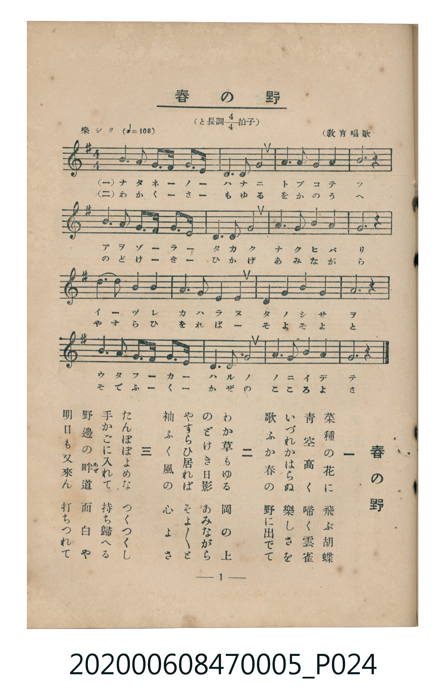

# 春の野

> Re:Shōka 使用 AI 協助辨識與重建樂譜，可能會有錯誤。歡迎[回報](https://github.com/TMDLang/reshoka/issues)。

- **鋼琴伴奏版**：<br><audio controls src="haru_no_no.mp3"></audio>
- **NEUTRINO 歌聲合成版**：<br><audio controls src="haru_no_no_neutrino.mp3"></audio>

- 臺灣教育會公認《新定兒童唱歌》尋常科第五學年用（2020.006.0847.0005）

## 說明

原書資訊與歌詞全文（對應 P024.jpg，書頁 p. 1，第一學期第 1 首）：
調性與拍號：と長調四分之四拍子（G 大調 4/4 拍），樂シク（♩= 108），（教育唱歌）


## 歌詞

```text
一　菜種の花に　飛ぶ胡蝶
青空高く　啼く雲雀
いづれかはらぬ　樂しさを
歌ふか春の　野に出でて

二　わか草もゆる　岡の上
のどけき日影　あみながら
やすらひ居れば　そよ／＼と
袖ふく風の　心よさ

三　たんぽぽよめな　つくつくし
手かごに入れて　持ち歸へる
野邊の畔道（あぜみち）　面白や
明日も又來ん　打ちつれて
```

## ABC

<div class="abc-score" data-abc-src="haru_no_no.abc" aria-label="五線譜載入中"></div>

[下載 ABC 原始檔](haru_no_no.abc)

## TMD 檔案連結

- [主旋律 TMD 檔案](haru_no_no.tmd) [[在 TMD Studio 編輯](https://tmdlang.github.io/Tmd-TS/#tmd=s7IKdvYPcrWy4qpTUCpJTLdSSM7PyUlNLsnMz7MqzsjMK0nNjM_KTMmPL87Iz05Ugisry88pzU21Si9KTEmNN403MjAyiDcwMIs3sDAxBzIMTBFKi_NLi5JTrYqTM_Lzc-JLUitKkvLzsxHyBUX5Zal5iXlANQVFIBtTwIoQClLLMlNSQdKpKZkl-UWZiTlI7kgtKga7FWxJfElRYl5xclFmAcgDCFUlGalAxxanJhbn5xUTFAZakZ6ZZ5Wbn5dUCvQ2hkRJYmZ5Yl58flpaZjKKY_KLSjLygUFSkFFplZFZDHJrcmJOfHZiHlLIQV1akJieahVgYGSixKWlpfBsxtLHjetetvcpaGlxKdoqGBpYcNnbKrhz2Zjom9iB9L5o3_W8cfGzqTNfNG16Nqf5aeuaF6t6Hzd0PZu24em6WU9bJz1fvfTplI3P1vY8buh-uqH76Y4dz5dPfL5mzZNdU56u3fF055bnU1a839MBiik9YEzpgWIKyDAwfb-nU4mLS19LwZZagEtBQeFp3_xns3e82Nz-YkXXi452oLterJz3tHXFs2ntQFc83dD7rL1TAeR_vayC9Pd7eoCKXy5oVCjQUzAE8kDu3tEAdPezOfOBbAVDhZfLpgEd-n7PLJDhL1btf9awHGRsd--LmfOBoo8bV7ycuh0o_nT27KcdbU92dgMZQNmnaycArXNXeLpkOVBSARiaCkBRsEk9z1Y0PW7a_rhpPVDFo5krwaEOkQEKQEIaEqJAQS6QtUAnPW5oeNE_5_mKdcDoetG18XHjaqDIy8WzHzdue9G88MXcbSB1L-dOer5y18vVMx439gOln07dA2S8nL3p5ewGkPTjxpbHjUsfN_U8bux-3Lj-cVPn48Y1QHUg9zROf9w49XHTJJA6UFw2bgUqgqQOkEXtfUAbn7bvety4_HHjMoijdgFjvOFxUz9Q4YvezsdNQE-1PW7qBlm8aSFQ35MdXRBbgW5e-bhx4uPG3mfTlz7duxGkrRFo5f7HjaseN_YA3QFW1wR03UywozY93dgKduYGsNK5j5s63u_pf78H6J0V4GhYNA3swP6Xi1ZAHPh0fzNQEdAL0PDqBGuc_7hp8uPGvSAElGxqBNkHEl8CCh8oOR3s405ggADRFJAvWyFBtAwUMj1APQufrd3xuHEH0GvgMG7ve9nUBbT1-dQpLxsnA2MM7Jc5YO8sBMYYKLjmLno-E2hnC9jsGX1AbwOD52l_x5N9wBCaDDK4E-gwYCAtgVgFUkd58ocCBS19Li6PxKJSv3y_fKuAzMS8fIcag5pqkCUKNhZadmAGtnynAEn-Lxb2KGiYKDzd0P98fYMOPLNoYtEAtApqmAZQo6aVwuPmLpDA46b9QGYvmNm8R6EGSPaDmEDJx83dIGEFsGAHRMU0oIbNIEYbRHgqRAUIQG2oUTBW0AVCI2CWBNFm8UAh03gISxcqqAsUM4IqAyk3RRKBQAOQCNhAH0OgRY2rwKLAlALEa6HsdSAnNK4Hs0HywDQBNx2YAKGqtgHxZDBrGVRmK5I9IDdB7TECyjX1Q3V1AzGMPRWkq6kJxG5qA5PdCHuaJiHpWAdmgdSA7NmB3R5jkNx8iK6myUD2XqgJe8HmdYDFG-G-gvlnCVRVP5QNcR9IZjqGPfgTzq4eihJO0yJIWtgEZO5DSjjAlAQkVoOI9YiEA01l64HMSSClEyDCq6iTcEDsGrgctoQDijZQgE4CsudB2Z3gYANFASjaYEEJC2hYUgMF9CYwawM0qruwRygo4YCjHqR2JRBPhLJ7weZBzIDYA0ksEHugLmsEZkBo8u2B2tOJ3R5wwgElYlhymwJlrwab1wL2G8gMmCqIaTB7FsJdAUqYIBlYMiY24ezopCzhLIGkllYgXgNNK6C0sBIk2INIELC01NwHUrQdRGyFqNyEJdWAyg5QCQJKDiAMSSCgJAFON2ACmpBAgiBJhDJcqQYUlqCQWgoPUVBYwYsbcAwB62Sk2ISkJkgBAMqQoGIDuYDAmmqaYPbMhJsJSi0wXTC7QekPZs9csDi4kEBiIwo87KkGljp3wt0IShUgmTlg3n4wuRDJHlBahxZ6EP809UJdBnEz0akG2MyiLNUsg5QgoHoKXN2g1FOg4gaUTmDFDZgJqrnAqe1xcztEGFhdUVbcGBJZ3IDKflg9BalnQEkHkXAgGRASHZCAhkXNalgWblwOlYFlYmzFDSjqIWoR9vSDdUFsgEQrsj2gOhAkBqxxwFGJSDighIor4cAKD1AChbH3ISV4cM0KrMUQ9sBCAFTcgOspcCLG7p9aLi5dOwVYE0gByFbmAgA)]
- [鋼琴伴奏 TMD 檔案](haru_no_no_piano.tmd) [[在 TMD Studio 編輯](https://tmdlang.github.io/Tmd-TS/#tmd=s7IKdvYPcrWy4qpTUCpJTLdSyC8qychPL0osyKi0ysgsLskvykxOzInPTsxLVIIrKs4vLUpOjS9ITE-1CjAwMlHi0tJSeDZj6ePGdS_b-97v6XjZvef5hC1P9mx5urT_eWfH-z2dClpaXIq2CoYGFlz2tgruXDYm-iZ2IANftO963rj42dSZL5o2PZvT_LR1zYtVvY8bup5N2_B03aynrZOer176dMrGZ2t7Hjd0P93Q_XTHjufLJz5fs-bJrilP1-54unPL8ykrgFYaGRgZ6BkYmOkZWJiYAxkGpkBblbi4PBKLSv3y_fKtAjIT8_KDPBxqDGqquRSAwMZCyw7M0NdSsEUHCiAbdjS8WNijoGGi8HRD__P1DToKIM_qZRWka2LRoKUPNqxGwVhBFwiNFAzBtFk8UMg0HsLShQrqAsWMoMpAyk2RRCDQACQCNtDHsEbhceMqsOjjxvlAvBbKXgfU87hxPZgNkn_cuBpu-uPGFVBV24B4Mpi1DCqzFckekJug9hgB5Zr6obq6gRjGngrS1dQEYje1gcluhD1Nk5B0rAOzQGpA9uzAbo8xSG4-RFfTZCB7L9SEvWDzOsDijXBfwfyzBKqqH8qGuA8kMx3DHvzRuquHTtEKYtfA5bBFKyhQQd6dBGTPg7I7wZ4CBRAoUGEehQUDLCGAgmETmLUBGhFd2IMbFK3giAGpXQnEE6HsXrB5EDMg9kCiEmIP1GWN--GJqwdqTyd2e8DRCkpisMQwBcpeDTavBew3kBkwVRDTYPYshLsClGxAMrBERmy07ugkJ1pBWQ-UAUHxBcKQGATFGThiwQQ0pkGCIEmEMlzRCvIsyCuz4F4GeQaeW8FB-LhxDVJwQ6Ibkn9A6RmU65DzF9ZobYLZMxNuJig6YbpgdoMSCMyeuWBxcB5DYiPKC-zRCks-O-FuBEUbSGYOmLcfTC5EsgeUGKFlBsQ_Tb1Ql0HcTHS0Pp09m-a51ZDI3Aoq2GCFMKQQBUUsIloh6RcSWJBggAXcalgOaFwOlYHlAWy5FRQxELUIe_rBuiA2QAId2R5QAQ8SAxan4IBGRCsoGeGKVljeAyUfGHsfUnIEVxvAIhphDywEQLkVXAiDkxh2_9SiV74-yJWvCaLyfTaj79mc6c9aOp_uX_1kZzcwxp919z5dO-Hp9mXPOrshrQhEzBrGK0QbxsIoTL5pPJBlGo9NBMQwgIYACQbBGchqcJsDV24GYpjF5yJpRBaimbOAAa9rpwAL-2gfoAwK3wiNbwzmK3MBAA)]

## 分析

```text
================================================================================
📊 TMD Song Profile: [ 春の野 ]
================================================================================
⏱  Duration:       0:35 (35.6s), 16 measures total
🎼 Key & Tempo:    首調基準 G, != 108.0 BPM, <4/4>
   - 分析範圍：      由實際發聲的音符與和弦推測調性；播放脈絡另行呈現
🎤 人聲音域:    D4 (MIDI 62) – D5 (MIDI 74) [跨度: 12 個半音 / 1.0 個八度, 難度: easy]
   - 最低音:  D4 in [HaruNoNo #1 @ m.2, 0:02]
   - 最高音: D5 in [HaruNoNo #1 @ m.3, 0:06]
   - 適合: soprano, mezzo-soprano, contralto, tenor, baritone, bass
🏛  結構:      HaruNoNo (35.6s)
⚡ 編曲密度:        Peak 1 軌道同時演奏
🗝  調性診斷：       G 大調（純淨自然大調，未偵測到可信轉調）
   - 風格氣質:    純淨自然大調（陽光明朗、易唱易記，無明顯調外色彩）
   - 轉調歷程:    全曲維持單一推測調性（未偵測到可信轉調）
   - 核心骨幹音:  G, A, B, D, E
   - 調性數值:    G 大調 [相關度: 0.75, 穩定度: Moderate, 自然音純度: 100.0%]
   - 候選調性 (K-S): G 大調 (0.75), D 大調 (0.61), E 小調 (0.58)
   - 五度圈歷程:   +1
   - 各段落調性細節:
     • [HaruNoNo #1]: G 大調 (r: 0.75, 自然音純度: 100.0%)

  [ 五度圈游移軌跡 ]
               C  
         F           [G ]*
      Bb               D  
      Eb               A  
         Ab           E  
            Db       B  
               F# 
     (* = active key center)

  [ 十二半音累積音高分佈 ]
     C  :                            0.0%
     C# :                            0.0%
     D  : █████████                 11.7%
     D# :                            0.0%
     E  : ████████                  10.8%
     F  :                            0.0%
     F# :                            0.0%
     G  : ████████████████████████  31.7%
     G# :                            0.0%
     A  : █████████████████████     28.3%
     A# :                            0.0%
     B  : █████████████             17.5%
--------------------------------------------------------------------------------
Assignment 軌道音域：
  - Piano         : D4 – D5 (12 個半音 / 1.0 個八度, 49 個音符)
================================================================================
```


## 原書掃描頁




