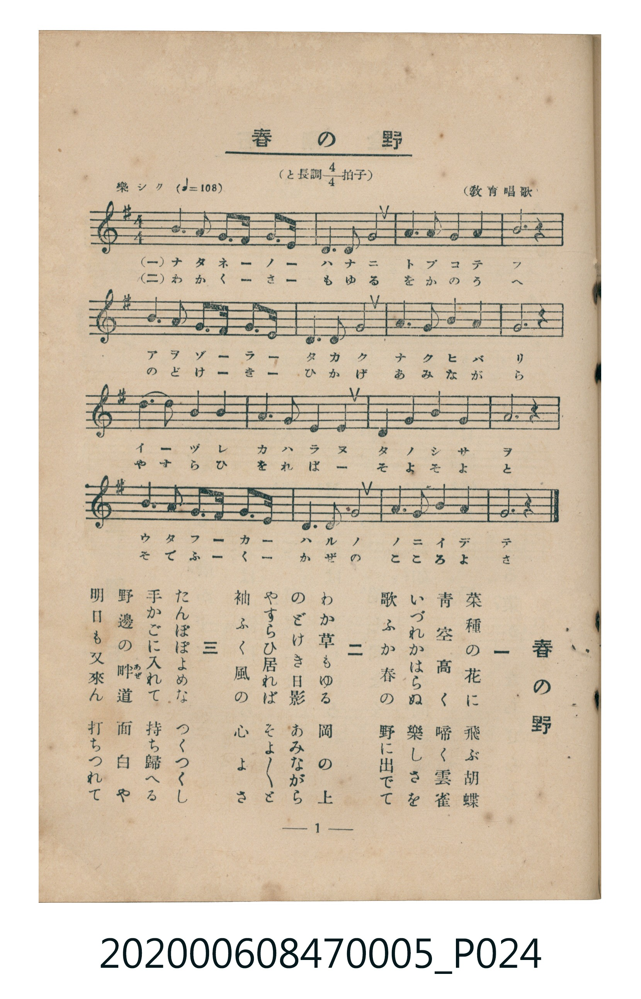

# 春の野

> Re:Shōka 使用 AI 協助辨識與重建樂譜，可能會有錯誤。歡迎回報。

- **NEUTRINO 歌聲合成版**：<br><audio controls src="haru_no_no_neutrino.mp3"></audio>
- **鋼琴伴奏版**：<br><audio controls src="haru_no_no.mp3"></audio>


- 臺灣教育會公認《新定兒童唱歌》尋常科第五學年用（2020.006.0847.0005）

## 說明

原書資訊與歌詞全文（對應 P024.jpg，書頁 p. 1，第一學期第 1 首）：
調性與拍號：と長調四分之四拍子（G 大調 4/4 拍），樂シク（♩= 108），（教育唱歌）


## 歌詞

```text
一　菜種の花に　飛ぶ胡蝶
青空高く　啼く雲雀
いづれかはらぬ　樂しさを
歌ふか春の　野に出でて

二　わか草もゆる　岡の上
のどけき日影　あみながら
やすらひ居れば　そよ／＼と
袖ふく風の　心よさ

三　たんぽぽよめな　つくつくし
手かごに入れて　持ち歸へる
野邊の畔道（あぜみち）　面白や
明日も又來ん　打ちつれて
```

## ABC

```abc
X:1
T:春の野
M:4/4
L:1/16
Q:1/4=108
K:G
V:V1 name="Piano" snm="Pia"
[V:V1]
B6 A2 G6 E2 | D4 E4 G8 | A6 A2 B4 d4 | A12 z4 |
w: 1.~な た ね の | は な に | と ぶ こ て | ふ
w: 2.~わ か く さ | も ゆ る | を か の う | へ
w: 3.~た ん ぽ ぽ | よ め な | つ く つ く | し
B6 A2 G6 E2 | D4 E4 G8 | A6 A2 B4 A4 | G12 z4 |
w: 1.~あ を ぞ ら | た か く | な く ひ ば | り
w: 2.~の ど け き | ひ か げ | あ み な が | ら
w: 3.~て か ご に | い れ て | も ち か へ | る
d6 d2 B4 B4 | A4 G4 E4 E4 | D4 G4 A4 B4 | A12 z4 |
w: 1.~い づ れ か | は ら ぬ _ | た の し さ | を
w: 2.~や す ら ひ | を れ ば _ | そ よ そ よ | と
w: 3.~の べ の あ | ぜ み ち _ | お も し ろ | や
B6 A2 G6 E2 | D4 E4 G8 | A6 G2 B4 A4 | G12 z4 |
w: 1.~う た ふ か | は る の | の に い で | て
w: 2.~そ で ふ く | か ぜ の | こ こ ろ よ | さ
w: 3.~あ す も ま | た こ ん | う ち つ れ | て
```

## TMD 檔案連結

- [主旋律 TMD 檔案](haru_no_no.tmd) [[在 TMD Studio 編輯](https://tmdlang.github.io/Tmd-TS/#tmd=s7IKdvYPcrWy4qpTUCpJTLdSSM7PyUlNLsnMz7MqzsjMK0nNjM_KTMmPL87Iz05Ugisry88pzU21Si9KTEmNN403MjAyiDcwMIs3sDAxBzIMTBFKi_NLi5JTrYqTM_Lzc-JLUitKkvLzsxHyBUX5Zal5iXlANQVFIBtTwIoQClLLMlNSQdKpKZkl-UWZiTlI7kgtKga7FWxJfElRYl5xclFmAcgDCFUlGalAxxanJhbn5xUTFAZakZ6ZZ5Wbn5dUCvQ2hkRJYmZ5Yl58flpaZjLYMVpaCs9mLH3cuO5le5-ClhaXoq2CoYEFl72tgjuXjYm-iR3IhBftu543Ln42deaLpk3P5jQ_bV3zYlXv44auZ9M2PF0362nrpOerlz6dsvHZ2p7HDd1PN3Q_3bHj-fKJz9esebJrytO1O57u3PJ8yor3ezpAQa0HDGo9UFADGQam7_d0KnFx6Wsp2FILcCkoKDztm_9s9o4Xm9tfrOh60dEOdNeLlfOetq54Nq0d6IqnG3qftXcqBBgYmehlFaS_39MDVPxyQaNCgZ6CIZAHcveOBqC7n82ZD2QrGCq8XDYN6ND3e2aBDH-xav-zhuUgY7t7X8ycDxR93Lji5dTtQPGns2c_7Wh7srMbyADKPl07AWidu8LTJcuBkgrA0FQAioJN6nm2oulx0_bHTeuBKh7NXAkOdYgMUAAS0pAQBQpygawFOulxQ8OL_jnPV6wDRteLro2PG1cDRV4unv24cduL5oUv5m4DqXs5d9Lzlbterp7xuLEfKP106h4g4-XsTS9nN4CkHze2PG5c-rip53Fj9-PG9Y-bOh83rgGqA7mncfrjxqmPmyaB1IHisnErUBEkdYAsau8D2vi0fdfjxuWPG5dBHLULGOMNj5v6gQpf9HY-bgJ6qu1xUzfI4k0Lgfqe7OiC2Ap088rHjRMfN_Y-m7706d6NIG2NQCv3P25c9bixB-gOsLomoOtmgh216enGVrAzN4CVzn3c1PF-T__7PUDvrABHw6JpYAf2v1y0AuLAp_ubgYqAXoCGVydY4_zHTZMfN-4FIaBkUyPIPpD4ElD4QMnpYB93AgMEiKaAfNkKCaJloJDpAepZ-GztjseNO4BeA4dxe9_Lpi6grc-nTnnZOBkYY2C_zAF7ZyEwxkDBNXfR85lAO1vAZs_oA3obGDxP-zue7AOG0GSQwZ1AhwEDaQnEKpA6ypM_FCho6XNxeSQWlfrl--VbBWQm5uU71BjUVIMsUbCx0LIDM7DlOwVI8n-xsEdBw0Th6Yb-5-sbdOCZRROLBqBVUMM0gBo1rRQeN3eBBB437Qcye8HM5j0KNUCyH8QESj5u7gYJK4AFOyAqpgE1bAYx2iDCUyEqQABqQ42CsYIuEBoBsySINosHCpnGQ1i6UEFdoJgRVBlIuSmSCAQagETABvoYAi1qXAUWBaYUIF4LZa8DOaFxPZgNkgemCbjpwAQIVbUNiCeDWcugMluR7AG5CWqPEVCuqR-qqxuIYeypIF1NTSB2UxuY7EbY0zQJScc6MAukBmTPDuz2GIPk5kN0NU0GsvdCTdgLNq8DLN4I9xXMP0ugqvqhbIj7QDLTMezBn3B29VCUcJoWQdLCJiBzH1LCAaYkILEaRKxHJBxoKlsPZE4CKZ0AEV5FnYQDYtfA5bAlHFC0gQJ0EpA9D8ruBAcbKApA0QYLSlhAw5IaKKA3gVkboFHdhT1CQQkHHPUgtSuBeCKU3Qs2D2IGxB5IYoHYA3VZIzADQpNvD9SeTuz2gBMOKBHDktsUKHs12LwWsN9AZsBUQUyD2bMQ7gpQwgTJwJIxsQlnRydlCWcJJLW0AvEaaFoBpYWVIMEeRIKApaXmPpCi7SBiK0TlJiypBlR2gEoQUHIAYUgCASUJcLoBE9CEBBIESSKU4Uo1oLAEhdRSeIiCwgpe3IBjCFgnI8UmJDVBCgBQhgQVG8gFBNZU0wSzZybcTFBqgemC2Q1KfzB75oLFwYUEEhtR4GFPNbDUuRPuRlCqAMnMAfP2g8mFSPaA0jq00IP4p6kX6jKIm4lONcBmFmWpZhmkBAHVU-DqBqWeAhU3oHQCK27ATFDNBU5tj5vbIcLA6oqy4saQyOIGVPbD6ilIPQNKOoiEA8mAkOiABDQsalbDsnDjcqgMLBNjK25AUQ9Ri7CnH6wLYgMkWpHtAdWBIDFgjQOOSkTCASVUXAkHVniAEiiMvQ8pwYNrVmAthrAHFgKg4gZcT4ETMXb_1HJx6dopwJpACkC2MhcA)]
- [鋼琴伴奏 TMD 檔案](haru_no_no_piano.tmd) [[在 TMD Studio 編輯](https://tmdlang.github.io/Tmd-TS/#tmd=s7IKdvYPcrWy4tLSUng2Y-njxnUv2_ve7-l42b3n-YQtT_Zsebq0_3lnx_s9nQpaWlyKtgqGBhZc9rYK7lw2Jvomdlx1Ckov2nc9b1z8bOrMF02bns1pftq65sWq3scNXc-mbXi6btbT1knPVy99OmXjs7U9jxu6n27ofrpjx_PlE5-vWfNk15Sna3c83bnl-ZQVQCuNDIwM9AwMzPQMLEzMgQwDU6CtSlxcHolFpX75fvlWAZmJeflBHg41BjXVXApAYGOhZQdm6Gsp2KIDBZANOxpeLOxR0DBReLqh__n6Bh2FAAMjE72sgnRNLBq09MGG1SgYK-gCoZGCIZg2iwcKmcZDWLpQQV2gmBFUGUi5KZIIBBqARMAG-hjWKDxuXAUWfdw4H4jXQtnrgHoeN64Hs0HyjxtXw01_3LgCqmobEE8Gs5ZBZbYi2QNyE9QeI6BcUz9UVzcQw9hTQbqamkDspjYw2Y2wp2kSko51YBZIDcieHdjtMQbJzYfoapoMZO-FmrAXbF4HWLwR7iuYf5ZAVfVD2RD3gWSmY9iDP1p39dApWkHsGrgctmgFBSrIu5OA7HlQdifYU6AAAgUqzKOwYIAlBFAwbAKzNkAjogt7cIOiFRwxILUrgXgilN0LNg9iBsQeSFRC7IG6rHE_PHH1QO3pxG4POFpBSQyWGKZA2avB5rWA_QYyA6YKYhrMnoVwV4CSDUgGlsiIjdYdneREKyjrgTIgKL5AGBKDoDgDRyyYgMY0SBAkiVCGK1pBngV5ZSncyyDPwHMrOAgfN65BCm5IdEPyDyg9g3Idcv7CGq1NMHtmws0ERSdMF8xuUAKB2TMXLA7OY0hsRHmBPVphyWcn3I2gaAPJzAHz9oPJhUj2gBIjtMyA-KepF-oyiJuJjtans2fTPLcaEplbQQUbrBCGFKKgiEVEKyT9QgILEgywgFsNywGNy6EysDyALbeCIgaiFmFPP1gXxAZIoCPbAyrgQWLA4hQc0IhoBSUjXNEKy3ug5ANj70NKjuBqA1hEI-yBhQAot4ILYXASw-6fWvTK1we58jVBVL7PZvQ9mzP9WUvn0_2rn-zsBsb4s-7ep2snPN2-7FlnN6QVgYhZw3iFaMNYGIXJN40HskzjsYmAGAbQECDBIDgDWQ1uc-DKzUAMs_hcJI3IQjRzFjDgde0UYGEf7QOUQeEbofGNwXxlLgA)]

## 分析

```text
================================================================================
📊 TMD Song Profile: [ 春の野 ]
================================================================================
⏱  Duration:       0:35 (35.6s), 16 measures total
🎼 Key & Tempo:    首調基準 G, != 108.0 BPM, <4/4>
   - 分析範圍：      由實際發聲的音符與和弦推測調性；播放脈絡另行呈現
🎤 人聲音域:    D4 (MIDI 62) – D5 (MIDI 74) [跨度: 12 個半音 / 1.0 個八度, 難度: easy]
   - 最低音:  D4 in [HaruNoNo #1 @ m.2, 0:02]
   - 最高音: D5 in [HaruNoNo #1 @ m.3, 0:06]
   - 適合: soprano, mezzo-soprano, contralto, tenor, baritone, bass
🏛  結構:      HaruNoNo (35.6s)
⚡ 編曲密度:        Peak 1 軌道同時演奏
🗝  調性診斷：       G 大調（純淨自然大調，未偵測到可信轉調）
   - 風格氣質:    純淨自然大調（陽光明朗、易唱易記，無明顯調外色彩）
   - 轉調歷程:    全曲維持單一推測調性（未偵測到可信轉調）
   - 核心骨幹音:  G, A, B, D, E
   - 調性數值:    G 大調 [相關度: 0.75, 穩定度: Moderate, 自然音純度: 100.0%]
   - 候選調性 (K-S): G 大調 (0.75), D 大調 (0.61), E 小調 (0.58)
   - 五度圈歷程:   +1
   - 各段落調性細節:
     • [HaruNoNo #1]: G 大調 (r: 0.75, 自然音純度: 100.0%)

  [ 五度圈游移軌跡 ]
               C  
         F           [G ]*
      Bb               D  
      Eb               A  
         Ab           E  
            Db       B  
               F# 
     (* = active key center)

  [ 十二半音累積音高分佈 ]
     C  :                            0.0%
     C# :                            0.0%
     D  : █████████                 11.7%
     D# :                            0.0%
     E  : ████████                  10.8%
     F  :                            0.0%
     F# :                            0.0%
     G  : ████████████████████████  31.7%
     G# :                            0.0%
     A  : █████████████████████     28.3%
     A# :                            0.0%
     B  : █████████████             17.5%
--------------------------------------------------------------------------------
Assignment 軌道音域：
  - Piano         : D4 – D5 (12 個半音 / 1.0 個八度, 49 個音符)
================================================================================
```


## 原書掃描頁




