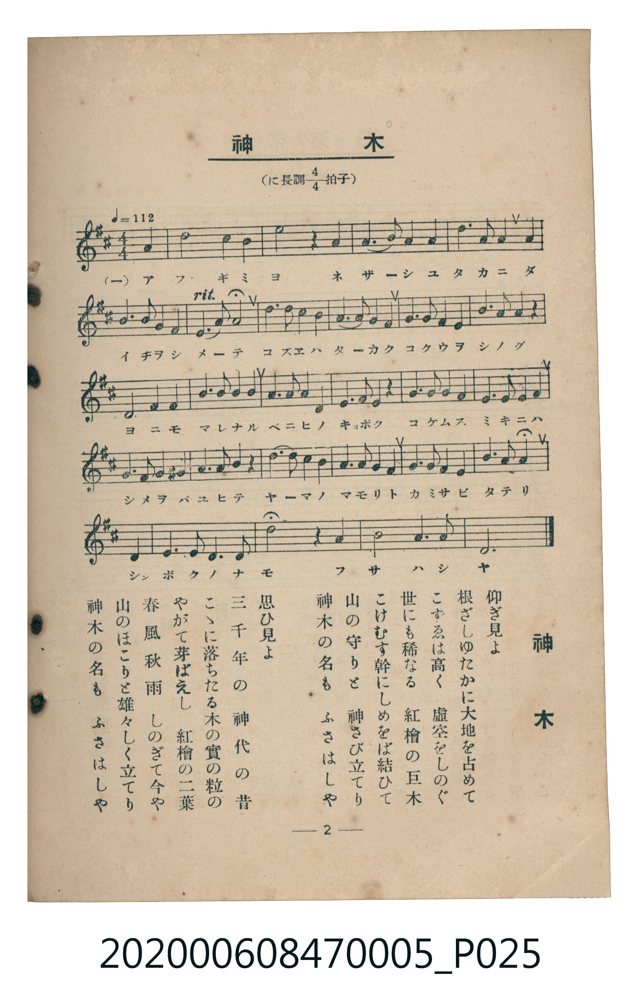

# 神木

<audio controls src="shinboku.mp3"></audio>

- 臺灣教育會公認《新定兒童唱歌》尋常科第五學年用（2020.006.0847.0005）

- note

原書資訊與歌詞全文（對應 P025.jpg，書頁 p. 2，第一學期第 2 首）：
調性與拍號：に長調四分之四拍子（D 大調 4/4 拍），♩= 112

## 歌詞

```text
一　仰ぎ見よ
根ざしゆたかに大地を占めて
こずゑは高く　虛空をしのぐ
世にも稀なる　紅檜の巨木
こけむす幹にしめをば結ひて
山の守りと　神さび立てり
神木の名も　ふさはしや

二　思ひ見よ
三千年の　神代の昔
こゝに落ちたる木の實の粒の
やがて芽ばえし　紅檜の二葉
春風秋雨　しのぎて今や
山のほこりと雄々しく立てり
神木の名も　ふさはしや
```

## 原書掃描頁



## 調性分析

```text
================================================================================
📊 TMD Song Profile: [ 神木 ]
================================================================================
⏱  Duration:       0:55 (55.7s), 26 measures total
🎼 Key & Tempo:    首調基準 D, != 112.0 BPM, <4/4>
   - 分析範圍：      由實際發聲的音符與和弦推測調性；播放脈絡另行呈現
🎤 人聲音域:    D4 (MIDI 62) – D5 (MIDI 74) [跨度: 12 個半音 / 1.0 個八度, 難度: easy]
   - 最低音:  D4 in [Shinboku #1 @ m.1, 0:00]
   - 最高音: D5 in [Shinboku #1 @ m.4, 0:06]
   - 適合: soprano, mezzo-soprano, contralto, tenor, baritone, bass
🏛  結構:      Shinboku (55.7s)
⚡ 編曲密度:        Peak 1 軌道同時演奏
🗝  調性診斷：       D 大調（純淨自然大調，未偵測到可信轉調）
   - 風格氣質:    純淨自然大調（陽光明朗、易唱易記，無明顯調外色彩）
   - 轉調歷程:    全曲維持單一推測調性（未偵測到可信轉調）
   - 核心骨幹音:  A, F#, D, B, E
   - 調性數值:    D 大調 [相關度: 0.86, 穩定度: Moderate, 自然音純度: 100.0%]
   - 候選調性 (K-S): D 大調 (0.86), F# 小調 (0.77), A 大調 (0.73)
   - 五度圈歷程:   +2
   - 各段落調性細節:
     • [Shinboku #1]: D 大調 (r: 0.86, 自然音純度: 100.0%)

  [ 五度圈游移軌跡 ]
               C  
         F            G  
      Bb              [D ]*
      Eb               A  
         Ab           E  
            Db       B  
               F# 
     (* = active key center)

  [ 十二半音累積音高分佈 ]
     C  :                            0.0%
     C# : █████                      4.6%
     D  : ██████████████████████    22.4%
     D# :                            0.0%
     E  : ██████████                10.2%
     F  :                            0.0%
     F# : ███████████████████████   23.0%
     G  : █                          0.5%
     G# :                            0.0%
     A  : ████████████████████████  24.0%
     A# :                            0.0%
     B  : ███████████████           15.3%
--------------------------------------------------------------------------------
Assignment 軌道音域：
  - Piano         : D4 – D5 (12 個半音 / 1.0 個八度, 91 個音符)
================================================================================
```

## ABC

```abc
X:1
T:神木
C:TMD (Chen, Chih-Han / aguai)
M:4/4
L:1/16
Q:1/4=112
K:D

V:V1 name="Piano" snm="Pia"

[V:V1]
d4 f8 e2 e2 | a12 z4 | f4 f6 a2 a2 b2 | d6 b2 a4 a4 |
b6 b2 a6 g2 | f6 e2 d8 | d6 d2 c6 b2 | a6 f2 e4 e4 |
f6 d2 e6 f2 | a6 b2 a4 z4 | d8 f4 a4 | b6 b2 b6 a2 |
a6 f2 a6 a2 | f6 d2 e4 z4 | f6 f2 a6 a2 | b6 b2 c6 c2 |
d6 c2 b6 a2 | f6 a2 e4 z4 | d6 c2 b6 a2 | f6 a2 f6 e2 |
d6 d2 e6 f2 | a6 b2 d8 | f4 f6 e2 d2 e2 | d8 z4 f4 |
b8 a6 f2 | d12 z4 |
```

- [主旋律 TMD 檔案](shinboku.tmd)
- [鋼琴伴奏 TMD 檔案](shinboku_piano.tmd)
