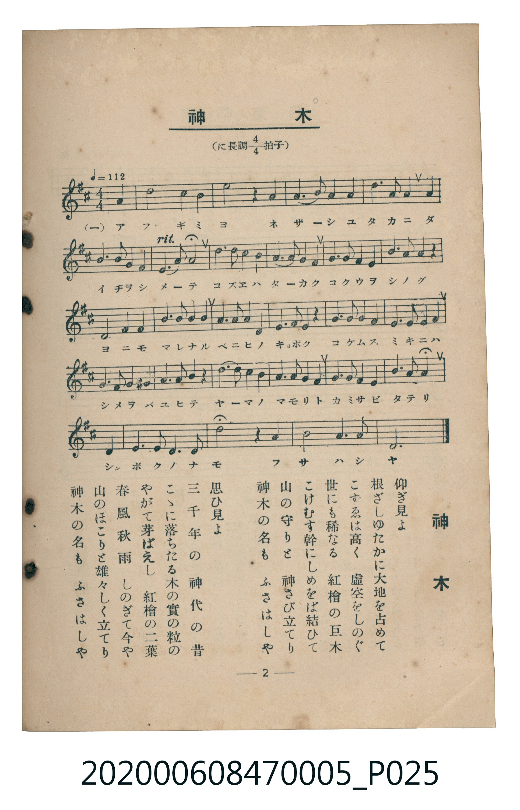

# 神木

> Re:Shōka 使用 AI 協助辨識與重建樂譜，可能會有錯誤。歡迎回報。

- **NEUTRINO 歌聲合成版**：<br><audio controls src="shinboku_neutrino.mp3"></audio>
- **鋼琴伴奏版**：<br><audio controls src="shinboku.mp3"></audio>


- 臺灣教育會公認《新定兒童唱歌》尋常科第五學年用（2020.006.0847.0005）

## 說明

原書資訊與歌詞全文（對應 P025.jpg，書頁 p. 2，第一學期第 2 首）：
調性與拍號：に長調四分之四拍子（D 大調 4/4 拍），♩= 112


## 歌詞

```text
一　仰ぎ見よ
根ざしゆたかに大地を占めて
こずゑは高く　虛空をしのぐ
世にも稀なる　紅檜の巨木
こけむす幹にしめをば結ひて
山の守りと　神さび立てり
神木の名も　ふさはしや

二　思ひ見よ
三千年の　神代の昔
こゝに落ちたる木の實の粒の
やがて芽ばえし　紅檜の二葉
春風秋雨　しのぎて今や
山のほこりと雄々しく立てり
神木の名も　ふさはしや
```

## ABC

```abc
X:1
T:神木
M:4/4
L:1/16
Q:1/4=112
K:D
V:V1 name="Piano" snm="Pia"
[V:V1]
!f! z12 A4 | d8 c4 B4 | !mf! e8 z4 A4 | A6 B2 A4 A4 |
w: 1.~ア | フ ギ ミ | ヨ ネ | ザ ー シ ユ
w: 2.~お | も ひ み | よ さ | ん ー ぜ ん
!mp! d6 A2 A4 A4 | B6 B2 G4 F4 | E6 A2 A8 | !f! d6 d2 c4 B4 |
w: 1.~タ カ ニ ダ | イ チ ヲ シ | メ ー テ | コ ズ エ ハ
w: 2.~ね ん の か | み よ の ー | む か し | こ こ に お
A6 A2 G4 F4 | !mf! G6 G2 F4 E4 | B6 A2 A4 z4 | D8 F4 F4 |
w: 1.~タ ー カ ク | コ ク ウ ヲ | シ ノ グ | ヨ ニ モ
w: 2.~ち ー た る | こ の み の | つ ぶ の | や が て
B6 B2 B4 B4 | A6 A2 A4 D4 | E6 F2 E4 z4 | !mp! G6 G2 G4 F4 |
w: 1.~マ レ ナ ル | ベ ニ ヒ ノ | キョ ボ ク | コ ケ ム ス
w: 2.~め ば え し | べ に ひ の | ふ た ば | しゅ ん ぷ う
E6 E2 E4 F4 | G6 F2 G4 ^G4 | A6 A2 B4 z4 | !f! d6 d2 c4 B4 |
w: 1.~ミ キ ニ ハ | シ メ ヲ バ | ユ ヒ テ | ヤ ー マ ノ
w: 2.~し う う ー | し の ぎ て | い ま や | や ー ま の
A6 A2 G4 F4 | G6 G2 F4 F4 | !mf! B6 A2 A4 D4 | E6 E2 D6 D2 |
w: 1.~マ モ リ ト | カ ミ サ ビ | タ テ リ シン | ボ ク ノ ナ
w: 2.~ほ こ り と | を を し く | た て り しん | ぼ く の な
d8 z4 A4 | B8 A6 A2 | D12 z4 |
w: 1.~モ フ | サ ハ シ | ヤ
w: 2.~も ふ | さ は し | や
```

## TMD 檔案連結

- [主旋律 TMD 檔案](shinboku.tmd) [[在 TMD Studio 編輯](https://tmdlang.github.io/Tmd-TS/#tmd=s7IKdvYPcrWy4qpTUCpJTLdSSM7PyUlNLsnMz7MqzsjMK0nNjM_KTMmPL87Iz05Ugisry88pzU21Si9KTEmNN403MjAyiDcwMIs3sDAxBzIMTBFKi_NLi5JTrYqTM_Lzc-JLUitKkvLzs9Hl4wsS01OtAgyMkHQWFOWXpeYl5gF1FxSB3JIC1o5QkFqWmZIKki5OTsyLL0stykzLTE1BcmVqUTHYJxArSooS84qTizILQN5DqMovKsnIB_qkIKPSKiOzuCS_KDM5MSc-OzEPycMlGalA_-YllpQWpaKLFqXmZKaDjdTSUni-dN6zOSsUtLS4FG0VDA2NuOxtFVy4bEz0TexA2l6073reuPjZ1JkvmjY9m9P8tHXNi1W9jxu6nk3b8HTdrKetk56vXvp0ysZna3seN3Q_3dD9dMeO58snPl-z5smuKU_X7ni6c8vzKSve7-kAhbgeMMT1QCEOZBiYvt_TqcTFpa-lYEstwKWgoPC0b_6z2TtebG5_saLrRUc70F0vVs572rri2bR2oCuebuh91t6pAIo2vayC9Pd7eoCKXy5oVCjQUzAC8kDu3tEAdPezOfOBbAUjhZfLpgEd-n7PLJDhL1btf9awHGRsd--LmfOBoo8bV7-cuh0o_nT27KcdbU92dgMZQNmnaycArXNReLpkOVBSARiaCkBRsEk9j2auhIQ0yEigdY8bGp7s3vC4se_Fsu7HTR0g0WcLdj5unPa4cfrjprbHjfMfN3YDLQKa9XTOhsdNk572Lnjc1Pi4cRlI6ePGyY8bZz1umvi4cf3L1TMeN_YDzXsxc_bzlbuASkFGNK573DgBYhfQyNWPm5qer2h43LjqcVM3UOnzLa3PVs0BKnq6fQUwIcCNnPi4Caho5tOdQJesBrukEWzehudbJzxu3AS1_enGjSCt6zoeN3U9blwBMm_pvMeNUx83bn6-GujoZUBxkDpIKgMpndALdABQ3ePGrWB168Fmt0ACYxcwFTU8a5gLtAARGE92dD7tbQamJJBPwBY82b0YyH42YwrMtU1AHatfTNj7uHEhKLiauqGWrV8GJJ9vAjp7HVhpU8vjxh6gq150AZUCg7wDZDlSGAAd8GJiJzgGZix9uWjF8-XdL2eDfAULxz6g5ie7u0AOhvv-ceNusBtAAfBydsvjhlaw6n4SAwCoiPIsAAUKWvpcXMHA8jApP7vUKiAzMS_focagphpkiYKNhZYdmIEt7yk83bPxxdbtwDQOyQvP1m1V0IDlF00s6oE2gcyqUTBQ0IXD6rRaBVMgXaNgGAcVMgdiM7CQEUwIpKM6F64URILUgGgUzaZgbnVuAVQl2EIfwxqFeCQrHzctAut53DwVLrIORDbPh4qvgIqDdD1u7oWINm2DqG3eA2RvB7OWQWX2Q01ZDRTrBss0IGw3QrO9sQuqqwkusglMgkwBiXcg294IciNIdDLC9sY5YNtAIkCZxrVQ2ycD2WB_NILcUAPOJ9hjDlzo9oAjzEzh6Yb-5-sbdOBFHd6oA8ULKORNgKQx2H4jpIAHwRpwlELjA0ghYhOiwhRJLzhKQVxdIAkSAhkGswRiJCjmEdH4uGkJNBgagRgcbOCoAEXaQkQANbfBHfO4aTM0eHYBMShiHzf3Q2Wg0QaO0NVgNevR9KwHYlAkQ-wCyYBsA_H7gOwN0EhCRDQkEkE6O2CRATQdohOUJCCRA8zGCPc1QiMWSANLJjALmkAakXzUCEqawNIKTc86qI0Qu0Ay0PBp3AYVg7gPf1LY0UlOUjCE-gEUb5DohCUOEI0a5SAapB6WXIzBNDhuIbkVlgjQ05URmAaLIBIBPH_CchssP8-Diq4BYlAgPm4GBShIZiZc_ePmSdAIhETL2sfNy6GSc6ApABxmSKlgI1BuAZi1E2ocKDZA_LVwJ4DTFCIdNLXAnNjYAyZhRUUjVHQDEIMyOiQtgGIOZDaIDyxEoAUCLE63QmXmg_XB3QeqDFqhDgElHnCZ1AhK-mBJqKY2qBg0IeJPCqAmCRlJARJ7xmDaRB3sAFjMg9IBNJ6JLhaQSwTklAUr3UEGIYIbXCzAsuVCWLHQPAEaVaCAB_EnQYsFaOA1wwoSUHEBSjfwFAFPRYuAeBWYBYookC2g1ASpJx43gSLlcTO0DIYXJcDQhuhp2v64GZR-kMsGWJSAci3IMniqaISklseN-6ApB5YCoeLgEmAfVC9Ex26oDmDEN4GTeiMoU4D0gJI3yAFAD4NtBLYvoHqgqRZoK0wPMAWBfUCorpgCThUmpKUKWA6GFBSGyFU8KEVAKm5IzEJ4IBJRrsDUIWd8UMUHLZfB0QUKmy5wpIGKABCEVNmwShOSc2D5ExwtSJGP0IEcS6BsAgk1SGiD2KtQKmxIxQwyG6Qe3ohoBJUdkByNXAIg7Kjl4tK1U4A1thSAbGUuAA)]
- [鋼琴伴奏 TMD 檔案](shinboku_piano.tmd) [[在 TMD Studio 編輯](https://tmdlang.github.io/Tmd-TS/#tmd=s7IKdvYPcrWy4qpTUCpJTLdSSM7PyUlNLsnMz7MqzsjMK0nNjM_KTMmPL87Iz05Ugisry88pzU21Si9KTEmNN403MjAyiDcwMIs3sDAxBzIMTBFKi_NLi5JTrYqTM_Lzc-JLUitKkvLzs9Hl4wsS01OtAgyMkHQWFOWXpeYl5gF1FxSB3JIC1o5QkFqWmZIKki5OTsyLL0stykzLTE1BcmVqUTHIJwWZiXn58YnJyfm5BYl5mbmpeUiG5BeVZOQDPVKQUWmVkVlckl-UmZyYE5-dmIfk35KMVKB38xJLSotS0UWLUnMy04HWKHFpaSk8Xzrv2ZwV7_d0vOze83zClid7tjxd2v-8s-P9nk4FLS0uRVsFQ0MjLntbBRcuGxN9EzuQWS_adz1vXPxs6swXTZuezWl-2rrmxarexw1dz6ZteLpu1tPWSc9XL306ZeOztT2PG7qfbuh-umPH8-UTn69Z82TXlKdrdzzdueX5FJCVoFjQA8aCHigWgAwDU6CtSlxcnnklRflWAaBACPJwqDGoqeZSAAIbCy07MKNGoTqtVsEwTkEXCIGUOZAyA-IaBVOwkKmCCZA0BotU5wKVgiQhEhCyRsEQKgKCBiCFXLUo9vog22uCam-8QrRhrIJpPJA2iQWZBREwgVBQK0E8oCxYlWk8kjIgZQCxLhiYXpPys0vx-hTkOBgE2Q7yAtAsiN91kbxuBBMC6QA7AaIU4mczMI2i2RTMrc4tgKoEW-hjWKMQj2Tl46ZFYD2Pm6fCRdaByOb5UPEVUHGQrsfNvRDRpm0Qtc17gOztYNYyqMx-qCmrgWLdYJkGhO1GaLY3dkF1NcFFNoFJkCkg8Q5k2xtBbgSJTkbY3jgHbBtIBCjTuBZq-2QgG-yPRpAbarigoQ1JKGZI6ccIKaxAkOS0B-LqAkmQEMgwmCUQIyFpDxbyj5uWQF3eCMRgn4JDDxTOCxF-am6DO-Zx02aoj3YBMSguHjf3Q2WgIQ2Og9VgNevR9KwHYlC8QOwCyYBsA_H7gOwN0HBFxA0k3EE6O2DhBzQdohMUi5DwfNw4HeG-RmhcAOnHjWBXwOK0EclHjaDU9LgJHBdIetZBbYTYBZKBhk_jNqgYxH3Q2INlalBQQ2IAFp8gGjWWQDRIPSyGjcE0ODogeQIWb-hJwQhMg0UQ8QbPBbA0Dcs186Cia4AY5O_HzaAwAMnMhKt_3DwJGuaQkFz7uHk5VHIONNLA3kSKuI1AuQVg1k6ocaAABPHXwp0ATgaIqGtqgTmxsQdMwjJkI1R0AxCDshMk-kCBDTIbxAdmVWi2g0XDVqjMfLA-uPsapz9uaoU6BBTf4JzfCEqtYEmopjaoGDTtwGIPEuDGYNpEHawHFlmgqINGDdGZDznfIScGWLEHMggRQuDMB0v8C2GZr3kCNHRBYQXiT4JmPqh_m2HZFZQpQVENj0R4xC8C4lVgFihsQbaAEgCkAH3cBArHx83QwgmeYYEBBNHTtP1xMyjKkXMgLBRBeQNkGTwiGyER_LhxHzSyYYkGKg7OZ_ugeiE6dkN1AOOqCZw6G0HpGKQHlCJBDgB6GGzj40ZoqQLOqRBbYXqAkQ72ASwiYfkEkh0NkasrUCRCKiFiqmRE9gIV4tACCxzCIO90gcMZlNFAEFL9wCoASPqE5QJwSCLFF0IHcsCCEiPEo5AAArFXoVQ-kEoGZDZIPbxCbATlUEi-Qc5nCDsw6nocrQsDKMTRzoC3JaBqwEkY3qiAtD3Q-LCsBTEC3kKBm4TUPCG5aQOSg2gFCoC0gDCoaQMtjNFchuQGZKPh8ihugvgPVArjdTlWLxrFI6sDCuAMUHTfIXkMxsf0F6RpBTMe3XsGYCk4F1_zT9dOAdzgVAAyYMkj2geoBIVvBOYrcwEA)]

## 分析

```text
================================================================================
📊 TMD Song Profile: [ 神木 ]
================================================================================
⏱  Duration:       0:57 (57.9s), 27 measures total
🎼 Key & Tempo:    首調基準 D, != 112.0 BPM, <4/4>
   - 分析範圍：      由實際發聲的音符與和弦推測調性；播放脈絡另行呈現
🎤 人聲音域:    D4 (MIDI 62) – E5 (MIDI 76) [跨度: 14 個半音 / 1.2 個八度, 難度: moderate]
   - 最低音:  D4 in [Shinboku #1 @ m.12, 0:23]
   - 最高音: E5 in [Shinboku #1 @ m.3, 0:04]
   - 適合: soprano, mezzo-soprano, contralto, tenor, baritone, bass
🏛  結構:      Shinboku (57.9s)
⚡ 編曲密度:        Peak 1 軌道同時演奏
🗝  調性診斷：       D 大調（純淨自然大調，未偵測到可信轉調）
   - 風格氣質:    純淨自然大調（陽光明朗、易唱易記，無明顯調外色彩）
   - 轉調歷程:    全曲維持單一推測調性（未偵測到可信轉調）
   - 核心骨幹音:  A, D, B, G, E
   - 調性數值:    D 大調 [相關度: 0.90, 穩定度: High, 自然音純度: 99.0%]
   - 候選調性 (K-S): D 大調 (0.90), A 大調 (0.74), B 小調 (0.63)
   - 五度圈歷程:   +2
   - 各段落調性細節:
     • [Shinboku #1]: D 大調 (r: 0.90, 自然音純度: 99.0%, 調外音: G#)

  [ 五度圈游移軌跡 ]
               C  
         F            G  
      Bb              [D ]*
      Eb               A  
         Ab           E  
            Db       B  
               F# 
     (* = active key center)

  [ 十二半音累積音高分佈 ]
     C  :                            0.0%
     C# : ███                        3.0%
     D  : █████████████████         18.7%
     D# :                            0.0%
     E  : ███████████               12.1%
     F  :                            0.0%
     F# : ██████████                11.1%
     G  : ████████████              12.6%
     G# : █                          1.0%
     A  : ████████████████████████  25.8%
     A# :                            0.0%
     B  : ███████████████           15.7%
--------------------------------------------------------------------------------
Assignment 軌道音域：
  - Piano         : D4 – E5 (14 個半音 / 1.2 個八度, 91 個音符)
================================================================================
```


## 原書掃描頁




