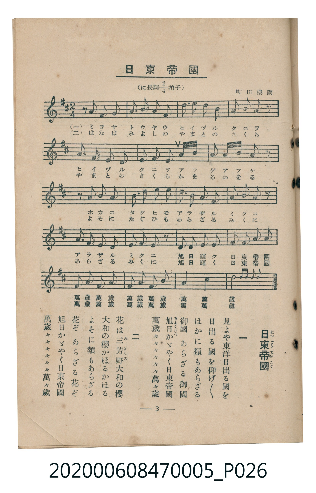

# 日東帝國

> Re:Shōka 使用 AI 協助辨識與重建樂譜，可能會有錯誤。歡迎回報。

- **鋼琴伴奏版**：<br><audio controls src="nitto_teikoku.mp3"></audio>
- **NEUTRINO 歌聲合成版**：<br><audio controls src="nitto_teikoku_neutrino.mp3"></audio>

- 曲：町田櫻園
- 臺灣教育會公認《新定兒童唱歌》尋常科第五學年用（2020.006.0847.0005）

## 說明

原書資訊與歌詞全文（對應 P026.jpg，書頁 p. 3，第一學期第 3 首）：
調性與拍號：に長調四分之二拍子（D 大調 2/4 拍），町田櫻園


## 歌詞

```text
一　見よや東洋日出る國を
日出る國を仰げ／＼
ほかに類もあらざる御國
あらざる御國
旭日（きょくじつ）かゞやく日東帝國
萬歳々々々々々々萬々歳

二　花は三芳野（みよしの）大和の櫻
大和の櫻かほるかほる
よそに類もあらざる花ぞ
あらざる花ぞ
旭日かゞやく日東帝國
萬歳々々々々々々萬々歳
```

## ABC

```abc
X:1
T:日東帝國
C:曲：町田櫻園
M:2/4
L:1/16
Q:1/4=112
K:D
V:V1 name="Piano" snm="Pia"
[V:V1]
z2 A2 A2 F2 | A2 B2 d2 B2 | A3 F E2 F2 | A2 A2 B2 z2 |
w: 1.~み よ や | と う や う | ひ い づ る | く に を
w: 2.~は な は | み よ し の | や ま と の | さ く ら
d3 c B2 A2 | B2 A2 F2 A2 | B2 A2 F2 A2 | B4 A2 z2 |
w: 1.~ひ い づ る | く に を _ | あ ふ げ あ | ふ げ
w: 2.~や ま と の | さ く ら _ | か ほ る か | ほ る
z2 A2 A2 F2 | A2 B2 d2 B2 | A3 F E2 F2 | D2 D2 E2 z2 |
w: 1.~ほ か に | た ぐ ひ も | あ ら ざ る | み く に
w: 2.~よ そ に | た ぐ ひ も | あ ら ざ る | は な ぞ
F2 A2 B2 A2 | F2 E2 D2 z2 | E2 E2 F2 A2 | B2 B2 c2 d2 |
w: 1.~あ ら ざ る | み く に | きょく じつ かが やく | にっ とう てい こく
w: 2.~あ ら ざ る | は な ぞ | きょく じつ かが やく | にっ とう てい こく
e2 d2 c2 B2 | A2 B2 A2 F2 | E4 F4 | D6 z2 |
w: 1.~ばん ざい ばん ざい | ばん ざい ばん ざい | ばん ばん | ざい
w: 2.~ばん ざい ばん ざい | ばん ざい ばん ざい | ばん ばん | ざい
```

## TMD 檔案連結

- [主旋律 TMD 檔案](nitto_teikoku.tmd) [[在 TMD Studio 編輯](https://tmdlang.github.io/Tmd-TS/#tmd=s7IKdvYPcrWy4qpTUCpJTLdSSM7PyUlNLsnMz7MqzsjMK0nNjM_KTMmPL87Iz05Ugisry88pzU21Si9KTEmNN403MjAyiDcwMIs3sDAxBzIMTBFKi_NLi5JTrYqTM_Lzc-JLUitKkvLzsxHyBUX5Zal5iXlANQVFIBtTwIoQClLLMlNSQdKpKZkl-UWZiTlI7kgtKga7FWxJfElRYl5xclFmAcgDCFUlGalAx2bmFqSi6gYalp6ZZ1WSmAn0HsiL5YnxuYmZeTmJeSlKXFpaCs-mL302d-PTHXOfzulW0NLiUrRVMDQ04rK3VXDhsjHSN7EDGfVs9qb3e2Y9n7Lr-ZQNz1bvfjpnEtiGF-27njcufjZ15oumTc_mND9tXfNiVe_jhq5n0zY8XTfraeuk56uXPp2y8dnanscN3U83dD_dseP58onP16x5smvK07U7nu7c8nzKivd7OkBhqwcMWz1Q2AIZBqbv93QqcXHpaynYUgtwKSgoPO2b_2z2jheb21-s6HrR0Q5014uV8562rng2rR3oiqcbep-1dyoEGBiZ6WUVpL_f0wNU_HJBo0KBnoIxkAdy944GoLufzZkPZCsYK7xcNg3oUGDIgAx_sWr_s4blIGO7e1_MnA8Ufdy4-uXU7UDxp7NnP-1oe7Kz-8muHqDs07UTgNa5KDxdshwoqQAMZAWgKNikHuQw5gIZC7TycUPDi2Xdj5s6Hje1AOPq2ZZuYKQ9bd_1uKkbGGmPmyaB1KEJPdm94XHjpPd7-t_v2QOSfty4-3FjN8hFC-c9bmp63Nj0uKnzceM0kIZ9C4F6IIqwiT6bvhZoONDFjxt7Hze1P27sf9w443HjEqCDQUY2Ac1rAQoiJyRweExY82zt5scNrWgIKA4kgVIQ7-0Cpo2GF10bHzeuf7Kj80XX5pftfWC79oM83Dj9ceM6oEXAoHo6qQfIBoYMOCaR-GB_7QY6Gc4A-wWkey5WD4Ntm4fuYYQoxMOU-Q2oiPI0CwUKWvpcXH6ZJSX5IamZ2fnZpVYBmYl5-Q41BjXVIIsUbAzNtOzALGw5RgGScF8s7FHQMFF4uqH_-foGHXgy18SiAWgf1DANoEZNKxBH4XHzfBCxAkQsUVCoAVIdoGBeBhUAs0Cik8Cqm5YAma0gudVg4ab1IHY3iNgENg9mS42CgYKugikUGwNxDZhlBsSGcVAGRAgkbYSiCKYQZEQN2DgfwxqFeCAPmIBAZFMHmGwB63jcuAIs0wYXg7BBMpvA5j9ubAHipWD5bqhMP1h8NVhsEpAEmQ61ywhm13owuQrOBulDsr9xOphcB5EB2wzi74O7CCrTOBXMA9vY1Am3C3_U7uqhJGqJjy-Q4CIQfypIOVAQzAXFOFAAYgZ6zILjT1fBHBxHoLiqgbNAcYhPBARBPNSYJSWeQBAk3gQW3womQeIQEZAMSAxiGma8khJLMJtALgGWQHBXQURAMiAxsGlgcWJiFVgWUpxhZ4PiBBid4HgEeWk_SGADSAAY6Y-bIdEHikUQbyWQuQ2RAMDZHZ4KqJFhDUEKgBgkgi3DggMOGoigaAQF3HwwbwKYBEU9sChHilZIBADLb5SEAM54SMkBS4aFZsu5FNuFnPHnERe1wNYARRkWkglXgmIHb3TVgCoycMMAWGHtmQuq7fohokABYHUGrEV3AEVB7T5E1MIyISLDgkRAMQaKOXCsgXmwWEVkWBA2hyUB5BwLzn_gfEJURAHZ0GYGWBzU0oCki8eNPWDdoAoZqnD148bFYMkV0EK9cRmoZAAxJkNVITI0HodgjUVqO4RAKT6FkkQBbHgA43TtZnDTBMqqwScKAnAGME2ApJABPEEYgaITHKegyEVkbeRSG5IkINkdVhqCkgsMopfhGx43TYbEAiyQ0EVIVgUpqpE4IDmoMhhEK-AH1hm1XFy6dgrIrToFIF-ZCwA)]
- [鋼琴伴奏 TMD 檔案](nitto_teikoku_piano.tmd) [[在 TMD Studio 編輯](https://tmdlang.github.io/Tmd-TS/#tmd=s7IKdvYPcrWy4tLSUng2femzuRuf7pj7dE73-z0dL7v3PJ-w5cmeLU-X9j_v7Hi_p1NBS4tL0VbB0NCIy95WwYXLxkjfxI6rTkHp2exN7_fMej5l1_MpG56t3v10ziQlkPCL9l3PGxc_mzrzRdOmZ3Oan7auebGq93FD17NpG56um_W0ddLz1UufTtn4bG3P44bupxu6n-7Y8Xz5xOdr1jzZNeXp2h1Pd255PmUF0CVGBkYGegYGZnoGFibmQIaBKdAxSlxcfpklJfkhqZnZ-dmlVgGZiXn5QR4ONQY11VwKQGBjaKZlB2bpaynYogMFkDU7Gl4s7FHQMFF4uqH_-foGHYUAAyMzvayCdE0sGrT0wYbVKBgo6CqYQrExENeAWWZAbBgHZUCEQNJGKIpgCkFG1ICN8zGsUYgH8h437geRTR1gsgWs43HjCrBMG1wMwgbJbAKb_7ixBYiXguW7oTL9YPHVYLFJQBJkOtQuI5hd68HkKjgbpA_J_sbpYHIdRAZsM4i_D-4iqEzjVDAPbGNTJ9wu_IG-q4ecQAcHra6COTj4QMFYA2eBghefCAiCeKiBTkoQgiBIvAksvhVMgsQhIiAZkBjENMwgJyUAYTaBXPK4cTfcVRARkAxIDGwaWJyYAN_RScdUbghSAMQgEWypHOwlqPdAAQzy0nwwbwKYBEXK4yZYsIJoSNA8bpyGEkXg1IoUUVhSOTQtz6XYLuTcMo-4QH86ezY5gQ5LuIhEDhIBhSUoTMHhCebBwhuRyEHYHBY5yKkcnGbBaYuoIASyex83tcPEZzxuXAKJsceNPWDdLRApkMLVjxsXgyVXQMuoxmWg3ARiTIaqQmQCPA7BGr7UdgiBQmkKOdFlBApscIiDgh6RJZDLIUiEQbIJLH-DIhMG0UulDY-bJkPCCOYFdBGSVUEKHyQOSA6qDAbRiqyBdUYttrrdB7luN0FU7c9mND3rn_WyYRMwBoENkad7-p9uX_assxvSckGqQeIVog1jgQwTIMMExICLgBggEWwqURmm8fHAGMOqENNI03hUM8EqQCYgzIKogeuHKkaSgRuIKgZyAzCUdO0UkAMq2geoFEPMCCymzAUA)]

## 分析

```text
================================================================================
📊 TMD Song Profile: [ 日東帝國 ]
================================================================================
⏱  Duration:       0:21 (21.4s), 20 measures total
🎼 Key & Tempo:    首調基準 D, != 112.0 BPM, <2/4>
   - 分析範圍：      由實際發聲的音符與和弦推測調性；播放脈絡另行呈現
🎤 人聲音域:    D4 (MIDI 62) – E5 (MIDI 76) [跨度: 14 個半音 / 1.2 個八度, 難度: moderate]
   - 最低音:  D4 in [NittoTeikoku #1 @ m.12, 0:11]
   - 最高音: E5 in [NittoTeikoku #1 @ m.17, 0:17]
   - 適合: soprano, mezzo-soprano, contralto, tenor, baritone, bass
🏛  結構:      NittoTeikoku (21.4s)
⚡ 編曲密度:        Peak 1 軌道同時演奏
🗝  調性診斷：       A 大調（純淨自然大調，未偵測到可信轉調）
   - 風格氣質:    純淨自然大調（陽光明朗、易唱易記，無明顯調外色彩）
   - 轉調歷程:    全曲維持單一推測調性（未偵測到可信轉調）
   - 核心骨幹音:  A, B, F#, D, E
   - 調性數值:    A 大調 [相關度: 0.80, 穩定度: Moderate, 自然音純度: 100.0%]
   - 候選調性 (K-S): A 大調 (0.80), D 大調 (0.75), F# 小調 (0.69)
   - 五度圈歷程:   +3
   - 各段落調性細節:
     • [NittoTeikoku #1]: A 大調 (r: 0.80, 自然音純度: 100.0%)

  [ 五度圈游移軌跡 ]
               C  
         F            G  
      Bb               D  
      Eb              [A ]*
         Ab           E  
            Db       B  
               F# 
     (* = active key center)

  [ 十二半音累積音高分佈 ]
     C  :                            0.0%
     C# : ███                        3.4%
     D  : █████████████             15.8%
     D# :                            0.0%
     E  : ██████████                12.3%
     F  :                            0.0%
     F# : ██████████████            17.8%
     G  :                            0.0%
     G# :                            0.0%
     A  : ████████████████████████  30.1%
     A# :                            0.0%
     B  : ████████████████          20.5%
--------------------------------------------------------------------------------
Assignment 軌道音域：
  - Piano         : D4 – E5 (14 個半音 / 1.2 個八度, 68 個音符)
================================================================================
```


## 原書掃描頁




