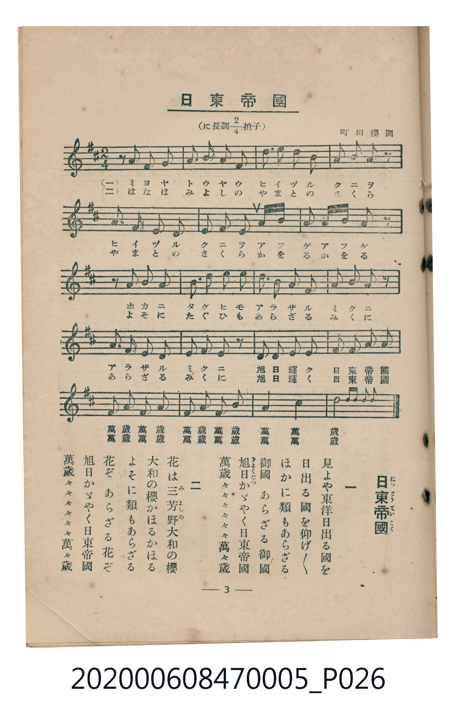

# 日東帝國

<audio controls src="nitto_teikoku.mp3"></audio>

- 曲：町田櫻園
- 臺灣教育會公認《新定兒童唱歌》尋常科第五學年用（2020.006.0847.0005）

## 說明

原書資訊與歌詞全文（對應 P026.jpg，書頁 p. 3，第一學期第 3 首）：
調性與拍號：に長調四分之二拍子（D 大調 2/4 拍），町田櫻園

## 歌詞

```text
一　見よや東洋日出る國を
日出る國を仰げ／＼
ほかに類もあらざる御國
あらざる御國
旭日（きょくじつ）かゞやく日東帝國
萬歳々々々々々々萬々歳

二　花は三芳野（みよしの）大和の櫻
大和の櫻かほるかほる
よそに類もあらざる花ぞ
あらざる花ぞ
旭日かゞやく日東帝國
萬歳々々々々々々萬々歳
```

## 原書掃描頁



## 分析

```text
================================================================================
📊 TMD Song Profile: [ 日東帝國 ]
================================================================================
⏱  Duration:       0:21 (21.4s), 20 measures total
🎼 Key & Tempo:    首調基準 D, != 112.0 BPM, <2/4>
   - 分析範圍：      由實際發聲的音符與和弦推測調性；播放脈絡另行呈現
🎤 人聲音域:    D4 (MIDI 62) – E5 (MIDI 76) [跨度: 14 個半音 / 1.2 個八度, 難度: moderate]
   - 最低音:  D4 in [NittoTeikoku #1 @ m.12, 0:11]
   - 最高音: E5 in [NittoTeikoku #1 @ m.17, 0:17]
   - 適合: soprano, mezzo-soprano, contralto, tenor, baritone, bass
🏛  結構:      NittoTeikoku (21.4s)
⚡ 編曲密度:        Peak 1 軌道同時演奏
🗝  調性診斷：       A 大調（純淨自然大調，未偵測到可信轉調）
   - 風格氣質:    純淨自然大調（陽光明朗、易唱易記，無明顯調外色彩）
   - 轉調歷程:    全曲維持單一推測調性（未偵測到可信轉調）
   - 核心骨幹音:  A, B, F#, D, E
   - 調性數值:    A 大調 [相關度: 0.80, 穩定度: Moderate, 自然音純度: 100.0%]
   - 候選調性 (K-S): A 大調 (0.80), D 大調 (0.75), F# 小調 (0.69)
   - 五度圈歷程:   +3
   - 各段落調性細節:
     • [NittoTeikoku #1]: A 大調 (r: 0.80, 自然音純度: 100.0%)

  [ 五度圈游移軌跡 ]
               C  
         F            G  
      Bb               D  
      Eb              [A ]*
         Ab           E  
            Db       B  
               F# 
     (* = active key center)

  [ 十二半音累積音高分佈 ]
     C  :                            0.0%
     C# : ███                        3.4%
     D  : █████████████             15.8%
     D# :                            0.0%
     E  : ██████████                12.3%
     F  :                            0.0%
     F# : ██████████████            17.8%
     G  :                            0.0%
     G# :                            0.0%
     A  : ████████████████████████  30.1%
     A# :                            0.0%
     B  : ████████████████          20.5%
--------------------------------------------------------------------------------
Assignment 軌道音域：
  - Piano         : D4 – E5 (14 個半音 / 1.2 個八度, 68 個音符)
================================================================================
```

## ABC

```abc
X:1
T:日東帝國
C:曲：町田櫻園
M:2/4
L:1/16
Q:1/4=112
K:D

V:V1 name="Piano" snm="Pia"

[V:V1]
z2 a2 a2 f2 | a2 b2 d2 b2 | a3 f e2 f2 | a2 a2 b2 z2 |
d3 c b2 a2 | b2 a2 f2 a2 | b2 a2 f2 a2 | b4 a2 z2 |
z2 a2 a2 f2 | a2 b2 d2 b2 | a3 f e2 f2 | d2 d2 e2 z2 |
f2 a2 b2 a2 | f2 e2 d2 z2 | e2 e2 f2 a2 | b2 b2 c2 d2 |
e2 d2 c2 b2 | a2 b2 a2 f2 | e4 f4 | d6 z2 |
```

- [主旋律 TMD 檔案](nitto_teikoku.tmd)
- [鋼琴伴奏 TMD 檔案](nitto_teikoku_piano.tmd)
