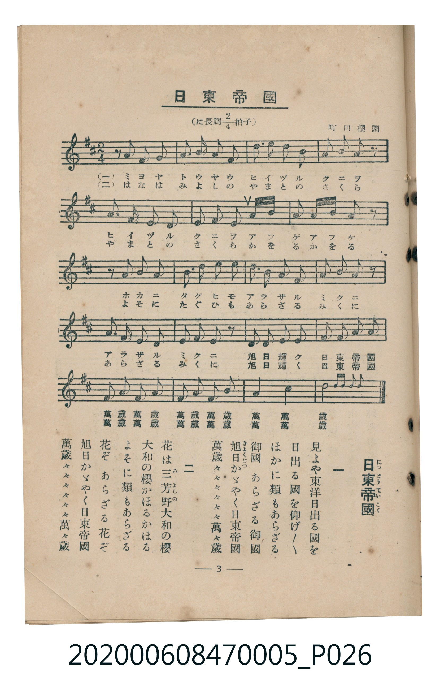

# 日東帝國

> Re:Shōka 使用 AI 協助辨識與重建樂譜，可能會有錯誤。歡迎回報。

- **鋼琴伴奏版**：<br><audio controls src="nitto_teikoku.mp3"></audio>
- **NEUTRINO 歌聲合成版**：<br><audio controls src="nitto_teikoku_neutrino.mp3"></audio>

- 曲：町田櫻園
- 臺灣教育會公認《新定兒童唱歌》尋常科第五學年用（2020.006.0847.0005）

## 說明

原書資訊與歌詞全文（對應 P026.jpg，書頁 p. 3，第一學期第 3 首）：
調性與拍號：に長調四分之二拍子（D 大調 2/4 拍），町田櫻園


## 歌詞

```text
一　見よや東洋日出る國を
日出る國を仰げ／＼
ほかに類もあらざる御國
あらざる御國
旭日（きょくじつ）かゞやく日東帝國
萬歳々々々々々々萬々歳

二　花は三芳野（みよしの）大和の櫻
大和の櫻かほるかほる
よそに類もあらざる花ぞ
あらざる花ぞ
旭日かゞやく日東帝國
萬歳々々々々々々萬々歳
```

## ABC

<div class="abc-score" data-abc-src="nitto_teikoku.abc" aria-label="五線譜載入中"></div>

[下載 ABC 原始檔](nitto_teikoku.abc)

## TMD 檔案連結

- [主旋律 TMD 檔案](nitto_teikoku.tmd) [[在 TMD Studio 編輯](https://tmdlang.github.io/Tmd-TS/#tmd=s7IKdvYPcrWy4qpTUCpJTLdSSM7PyUlNLsnMz7MqzsjMK0nNjM_KTMmPL87Iz05Ugisry88pzU21Si9KTEmNN403MjAyiDcwMIs3sDAxBzIMTBFKi_NLi5JTrYqTM_Lzc-JLUitKkvLzsxHyBUX5Zal5iXlANQVFIBtTwIoQClLLMlNSQdKpKZkl-UWZiTlI7kgtKga7FWxJfElRYl5xclFmAcgDCFUlGalAx2bmFqSi6gYalp6ZZ1WSmAn0HsiL5YnxuYmZeTmJeSnIqkoy8oE-LciotMrILAY5ITkxJz47MQ8pQKAOKEhMT7UKMDAyU-LS0lJ4Nn3ps7kbn-6Y-3ROt4KWFpeirYKhoRGXva2CC5eNkb6JHUj7s9mb3u-Z9XzKrudTNjxbvfvpnElgU1-073reuPjZ1JkvmjY9m9P8tHXNi1W9jxu6nk3b8HTdrKetk56vXvp0ysZna3seN3Q_3dD9dMeO58snPl-z5smuKU_X7ni6c8vzKSve7-kARY0eMGr0QFEDZBiYvt_TqcTFpa-lYEstwKWgoPC0b_6z2TtebG5_saLrRUc70F0vVs572rri2bR2oCuebuh91t6pAAoZvayC9Pd7eoCKXy5oVCjQUzAG8kDu3tEAdPezOfOBbAVjhZfLpgEdCgwZkOEvVu1_1rAcZGx374uZ84GijxtXv5y6HSj-dPbspx1tT3Z2P9nVA5R9unYC0DoXhadLlgMlFYCBrAAUBZvUgxzGXCBjgVY-bmh4saz7cVPH46YWYFw929INjLSn7bseN3UDI-1x0ySQOjShJ7s3PG6c9H5P__s9e0DSjxt3P27sBrlo4bzHTU2PG5seN3U-bpwG0rBvIVAPRBE20WfT1wINB7r4cWPv46b2x439jxtnPG5cAnQwyMgmoHktQEHkhAQOjwlrnq3d_LihFQ0BxYEkUArivV3AtNHwomvj48b1T3Z0vuja_LK9D2zXfpCHG6c_blwHtAgYVE8n9QDZwJABxyQSH-yv3UAnwxlgv4B0z8XqYbBt89A9jBCFeJgyvwEVUZ5moUBBS5-Lyy-zpCQ_JDUzOz-71CogMzEv36HGoKYaZJGCjaGZlh2YhS3HKEAS7ouFPQoaJgpPN_Q_X9-gA0_mmlg0AO2DGqYB1KhpBeIoPG6eDyJWgIglCgo1QKoDFMzLoAJgFkh0Elh10xIgsxUktxos3LQexO4GEZvA5sFsqVEwUNBVMIViYyCuAbPMgNgwDsqACIGkjVAUwRSCjKgBG-djWKMQD-QBExCIbOoAky1gHY8bV4Bl2uBiEDZIZhPY_MeNLUC8FCzfDZXpB4uvBotNApIg06F2GcHsWg8mV8HZIH1I9jdOB5PrIDJgm0H8fXAXQWUap4J5YBubOuF24Y_aXT2URC3x8QUSXATiTwUpBwqCuaAYBwpAzECPWXD86SqYg-MIFFc1cBYoDvGJgCCIhxqzpMQTCILEm8DiW8EkSBwiApIBiUFMw4xXUmIJZhPIJcASCO4qiAhIBiQGNg0sTkysAstCijPsbFCcAKMTHI8gL-0HCWwACQAj_XEzJPpAsQjirQQytyESADi7w1MBNTKsIUgBEINEsGVYcMBBAxEUjaCAmw_mTQCToKgHFuVI0QqJAGD5jZIQwBkPKTlgybDQbDmXYruQM_484qIW2BqgKMNCMuFKUOzgja4aUEUGbhgAK6w9c0G1XT9EFCgArM6AtegOoCio3YeIWlgmRGRYkAgoxkAxB441MA8Wq4gMC8LmsCSAnGPB-Q-cT4iKKCAb2swAi4NaGpB08bixB6wbVCFDFa5-3LgYLLkCWqg3LgOVDCDGZKgqRIbG4xCssUhthxAoxadQkiiADQ9gnK7dDG6aQFk1-ERBAM4ApgmQFDKAJwgjUHSC4xQUuYisjVxqQ5IEJLvDSkNQcoFB9DJ8w-OmyZBYgAUSugjJqiBFNRIHJAdVBoNoBfzAOqOWi0vXTgG5VacA5CtzAQA)]
- [鋼琴伴奏 TMD 檔案](nitto_teikoku_piano.tmd) [[在 TMD Studio 編輯](https://tmdlang.github.io/Tmd-TS/#tmd=s7IKdvYPcrWy4qpTUCpJTLdSyC8qychPL0osyKi0ysgsLskvykxOzInPTsxLVIIrKs4vLUpOjS9ITE-1CjAwMlPi0tJSeDZ96bO5G5_umPt0Tvf7PR0vu_c8n7DlyZ4tT5f2P-_seL-nU0FLi0vRVsHQ0IjL3lbBhcvGSN_EDmTms9mb3u-Z9XzKrudTNjxbvfvpnElgq16073reuPjZ1JkvmjY9m9P8tHXNi1W9jxu6nk3b8HTdrKetk56vXvp0ysZna3seN3Q_3dD9dMeO58snPl-z5smuKU_X7ni6c8vzKSuALjEyMDLQMzAw0zOwMDEHMgxMgY5R4uLyyywpyQ9JzczOzy61CshMzMsP8nCoMaip5lIAAhtDMy07MEtfS8EWHSiArNnR8GJhj4KGicLTDf3P1zfoKIDCQi-rIF0TiwYtfbBhNQoGCroKplBsDMQ1YJYZEBvGQRkQIZC0EYoimEKQETVg43wMaxTigbzHjftBZFMHmGwB63jcuAIs0wYXg7BBMpvA5j9ubAHiWWD5bqhMP1h8NVhsEpAEmQ61ywhm13owuQrOBulDsr9xOphcB5EB2wzi74O7CCrTOBXMA9vY1Am3C3-g7-ohJ9DBQaurYA4OPlAw1sBZoODFJwKCIB5qoJMShCAIEm8Ci28FkyBxiAhIBiQGMQ0zyEkJQJhNIJc8btwNdxVEBCQDEgObBhYnJsB3dNIxlRuCFAAxSARbKgd7Ceo9UACDvDQfzJsAJkGR8rgJFqwgGhI0jxunoUQROLUiRRSWVA5Ny3Mptgs5t8wjLtCfzp5NTqDDEi4ikYNEQGEJClNweIJ5sPBGJHIQNodFDnIqB6dZcNoiKgiB7N7HTe0w8RmPG5dAYuxxYw9YdwtECqRw9ePGxWDJFdAyqnEZKDeBGJOhqhCZAI9DsIYvtR1CoFCaQk50GYECGxzioKBHZAnkcggSYZBsAsvfoMiEQfRSacPjpsmQMIJ5AV2EZFWQwgeJA5KDKoNBtCJrYJ1Ri61u90Gu200QVfuzGU3P-me9bNgEjEFgQ-Tpnv6n25c96-yGtFyQapB4hWjDWCDDBMgwATHgIiAGSASbSlSGaXw8MMawKsQ00jQe1UywCpAJCLMgauD6oYqRZOAGooqB3AAMJV07BeSAivYBKsUQMwKLKXMBAA)]

## 分析

```text
================================================================================
📊 TMD Song Profile: [ 日東帝國 ]
================================================================================
⏱  Duration:       0:21 (21.4s), 20 measures total
🎼 Key & Tempo:    首調基準 D, != 112.0 BPM, <2/4>
   - 分析範圍：      由實際發聲的音符與和弦推測調性；播放脈絡另行呈現
🎤 人聲音域:    D4 (MIDI 62) – E5 (MIDI 76) [跨度: 14 個半音 / 1.2 個八度, 難度: moderate]
   - 最低音:  D4 in [NittoTeikoku #1 @ m.12, 0:11]
   - 最高音: E5 in [NittoTeikoku #1 @ m.17, 0:17]
   - 適合: soprano, mezzo-soprano, contralto, tenor, baritone, bass
🏛  結構:      NittoTeikoku (21.4s)
⚡ 編曲密度:        Peak 1 軌道同時演奏
🗝  調性診斷：       A 大調（純淨自然大調，未偵測到可信轉調）
   - 風格氣質:    純淨自然大調（陽光明朗、易唱易記，無明顯調外色彩）
   - 轉調歷程:    全曲維持單一推測調性（未偵測到可信轉調）
   - 核心骨幹音:  A, B, F#, D, E
   - 調性數值:    A 大調 [相關度: 0.80, 穩定度: Moderate, 自然音純度: 100.0%]
   - 候選調性 (K-S): A 大調 (0.80), D 大調 (0.75), F# 小調 (0.69)
   - 五度圈歷程:   +3
   - 各段落調性細節:
     • [NittoTeikoku #1]: A 大調 (r: 0.80, 自然音純度: 100.0%)

  [ 五度圈游移軌跡 ]
               C  
         F            G  
      Bb               D  
      Eb              [A ]*
         Ab           E  
            Db       B  
               F# 
     (* = active key center)

  [ 十二半音累積音高分佈 ]
     C  :                            0.0%
     C# : ███                        3.4%
     D  : █████████████             15.8%
     D# :                            0.0%
     E  : ██████████                12.3%
     F  :                            0.0%
     F# : ██████████████            17.8%
     G  :                            0.0%
     G# :                            0.0%
     A  : ████████████████████████  30.1%
     A# :                            0.0%
     B  : ████████████████          20.5%
--------------------------------------------------------------------------------
Assignment 軌道音域：
  - Piano         : D4 – E5 (14 個半音 / 1.2 個八度, 68 個音符)
================================================================================
```


## 原書掃描頁




