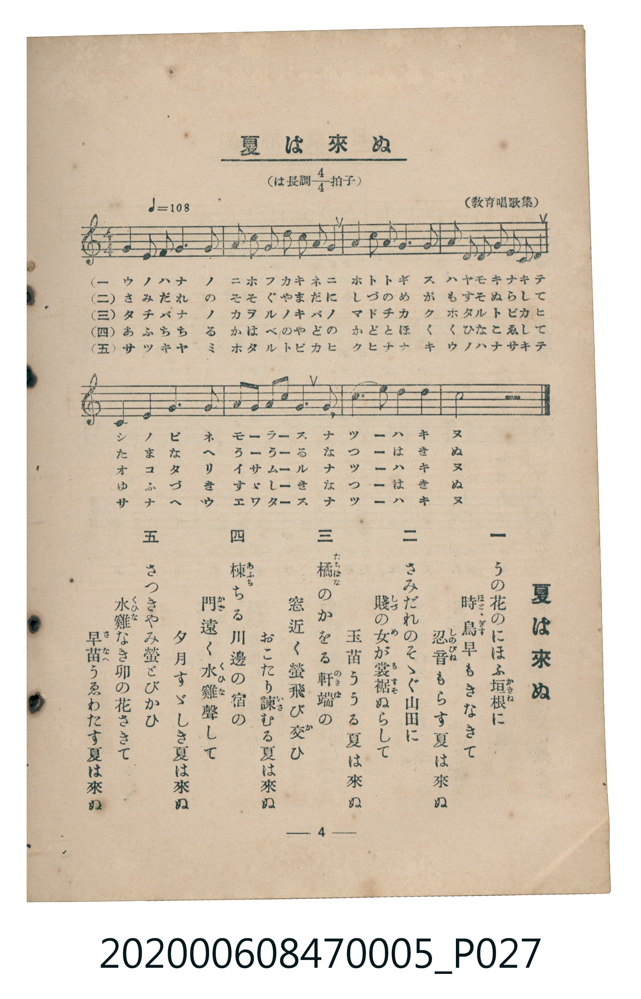

# 夏は來ぬ

<audio controls src="natsu_wa_kinu.mp3"></audio>

- 詞：佐佐木信綱
- 曲：小山作之助
- 臺灣教育會公認《新定兒童唱歌》尋常科第五學年用（2020.006.0847.0005）

## 說明

原書資訊與歌詞全文（對應 P027.jpg，書頁 p. 4，第一學期第 4 首）：
調性與拍號：は長調四分之四拍子（C 大調 4/4 拍），♩= 108，（教育唱歌集）

## 歌詞

```text
一　うの花のにおふ垣根（かきね）に
時鳥（ほとゝぎす）早もきなきて
忍音（しのびね）もらす夏は來ぬ

二　さみだれのそゝぐ山田に
賤（しづ）の女（め）が裳裾（もすそ）ぬらして
玉苗ううる夏は來ぬ

三　橘（たちばな）のかをる軒端（のきば）の
窓近く螢飛び交（か）ひ
おこたり諫（いさ）むる夏は來ぬ

四　楝（あふち）ちる川邊の宿の
門（かど）遠く水雞（くひな）聲して
夕月すゞしき夏は來ぬ

五　さつきやみ螢とびかひ
水雞（くひな）なき卯の花さきて
早苗（さなへ）うゑわたす夏は來ぬ
```

## ABC

```abc
X:1
T:夏は來ぬ
C:曲：小山作之助
M:4/4
L:1/16
Q:1/4=108
K:C
V:V1 name="Piano" snm="Pia"
[V:V1]
C6 D2 E4 G4 | A2 A2 G2 A2 c2 A2 G4 | A4 c2 A2 G4 E4 | D2 D2 E2 G2 E2 D2 C4 |
G4 E4 G4 c4 | A2 c2 d2 c2 A8 | G6 E2 D4 E2 D2 | C12 z4 |
```

## TMD 檔案連結

- [主旋律 TMD 檔案](natsu_wa_kinu.tmd) [[在 TMD Studio 編輯](https://tmdlang.github.io/Tmd-TS/#tmd=s7IKdvYPcrWy4tLSUni6pP9x4_on-9oeN65R0NLiUrRVMDSw4LK3VXDmsjHRN7HjqlNQerFy3vs9s57snQBEz-aseLJ_4fNtG5VAMs9mbwLKPN3Q_3Tjxid75zzZ2f20ayVY5kX7rueNi59NnfmiadOzOc1PW9e8WNX7uKHr2bQNT9fNeto66fnqpU-nbHy2tudxQ_fTDd1Pd-x4vnzi8zVrnuya8nTtjqc7tzyfsuL9ng4jAyMDPQMDMz0DCxNzIMPA9P2eTiUuLn0tBVtqAS4FBYWnffOfzd7xYnP7ixVdLzrage4C-vpp64pn09qBrni6ofdZe6dCgIGRuV5WQfr7PT1AxS8XNCoU6CmYAHkgd-9oALr72Zz5QLaCicLLZdOADgUGDsjwF6v2P2tYDjK2u_fFzPlAUWCgv5y6HSj-dPbspx1toICbPRso-3TtBKB1zsB4WQ6UVADGgAJQFGxSz6OZK8GxA2QC1UCCFhKEL2e3AZVwgawCOuNxQ8PjRmCErnvRtRFIPm5c_bix63Hj1qfzFj9bsBOo9XFj9-PG3seNa4GagLIgbc9mNr3cvBQst_tx44rHTXMfN_Y9bpwJVPFs-srHTU1gDavA5DJweO3vfTl_M1jDdLAlm6HmAZU2AU2diZyyIC7bBYxqoMumPm7c_7hxweOmHrC-uWC7JgAT0PMpG6CuebF5CcxkoJuApq17uhRsV1MjmNvzYvHmF4v3gUWALpsJNAUsvgZsNVAX2InP-zpfdAM5QBe0PW7qxnTQjk6gg56tnAG2a_7jxoWPG4EuWAWxERRITZOA-l7sBqbV9WA1QEGg_zdAFICtWDX5xf6Jjxv7X8xb9HLxbGAoPNkFcXo3WNEmkCJw6E8G2dDU9WL1arB0CzAcwKHVgM1lwLQActlSoK-AaoE-3Ap0HNjAhSDl2-e-bAIaue7pOmBAgt3xcloDLF5XAtW9BAZvY_-zDVtezgbmXKA40PxNEJ-9ADFgIfR0ydRnc4DSMx83zQOL9mKJtSmwWFsC8n0T0OX7gb4FJRJQnANtBHsSq2WQFPO0dz0sMQJNgSUgYLICxg5YA1AUqG4HWAMwpiY-bgIaAYwP1DQE1EN5VocCBS19Li6_xJLi0vBE78y8UquAzMS8fIcagxqFapBFCjYWWnZgBrZyRgGS3V8s7FHQMFEAln7P1zfowAsHTSwagNZBDdMAatS0UnjctAwk8Li5D4j7QYwuCE-hBkh1A_FsIJ4KVLcaiNcC2b1gcYj8bJDaDghuWgfEO0GGQeT6gXgJEC-C6uuC0m1AeagzahQMFXSB0EjBGEiaAnGNghkQmgKxYRyYARHSRXBBKmuAOkB6TIHYCGxGDTiN4A6kXT2UBdJ2aKA8bp4MInohXgR6rXklEO9B-Bzme2AoghS2gGUhoQH0PUSuB6EUHhAwr4FooF8h3gYyjOIgXgcFE0gQJA9SaQQlYUEIgQbgoKjl4tK1U0BKVQpArjIXFwA)]
- [鋼琴伴奏 TMD 檔案](natsu_wa_kinu_piano.tmd) [[在 TMD Studio 編輯](https://tmdlang.github.io/Tmd-TS/#tmd=s7IKdvYPcrWy4tLSUni6pP9x4_on-9oeN655v6fjZfee5xO2PNmz5enS_uedHe_3dCpoaXEp2ioYGlhw2dsqOHPZmOib2HHVKSi9WDnv_Z5ZT_ZOAKJnc1Y82b_w-baNSiCZZ7M3AWWebuh_unHjk71znuzsftq1Eizzon3X88bFz6bOfNG06dmc5qeta16s6n3c0PVs2oan62Y9bZ30fPXSp1M2Plvb87ih--mG7qc7djxfPvH5mjVPdk15unbH051bnk9ZAXSmkYGRgZ6BgZmegYWJOZBhYAp0qRIXl19iSXFpeKJ3Zl6pVUBmYl5-kIdDjUGNQjWXAhDYWGjZgRn6Wgq26EABZMuOhhcLexQ0TBSAjn--vkFHIcDAyFwvqyBdE4sGLX2wYTUKhgq6QGikYAwkTYG4RsEMCE2B2DAOzIAI6SK4IJU1QB0gPaZAbAQ2o4YLv-t29ZDjOph9IBroAIhbgAyjOIh7QG4HCYLkQSqNoCTMXxBoAHZfLZYg9kEJYhNEED_b0QqM12ddk541t4LSwOzZz7p7n66d8HT7smed3ZA0hhSI8QrRhrEwqkbBBMgwwcM3jQeyTOMRIvjNgVJwebh2ZB0GEC_q2ikg-VIBk6vMxQUA)]

## 分析

```text
================================================================================
📊 TMD Song Profile: [ 夏は來ぬ ]
================================================================================
⏱  Duration:       0:17 (17.8s), 8 measures total
🎼 Key & Tempo:    首調基準 C, != 108.0 BPM, <4/4>
   - 分析範圍：      由實際發聲的音符與和弦推測調性；播放脈絡另行呈現
🎤 人聲音域:    C4 (MIDI 60) – D5 (MIDI 74) [跨度: 14 個半音 / 1.2 個八度, 難度: moderate]
   - 最低音:  C4 in [NatsuWaKinu #1 @ m.1, 0:00]
   - 最高音: D5 in [NatsuWaKinu #1 @ m.6, 0:11]
   - 適合: soprano, mezzo-soprano, contralto, tenor, baritone, bass
🏛  結構:      NatsuWaKinu (17.8s)
⚡ 編曲密度:        Peak 1 軌道同時演奏
🗝  調性診斷：       C 大調（純淨自然大調，未偵測到可信轉調）
   - 風格氣質:    純淨自然大調（陽光明朗、易唱易記，無明顯調外色彩）
   - 轉調歷程:    全曲維持單一推測調性（未偵測到可信轉調）
   - 核心骨幹音:  C, G, A, E, D
   - 調性數值:    C 大調 [相關度: 0.87, 穩定度: High, 自然音純度: 100.0%]
   - 候選調性 (K-S): C 大調 (0.87), A 小調 (0.71), G 大調 (0.70)
   - 五度圈歷程:   +0
   - 各段落調性細節:
     • [NatsuWaKinu #1]: C 大調 (r: 0.87, 自然音純度: 100.0%)

  [ 五度圈游移軌跡 ]
              [C ]*
         F            G  
      Bb               D  
      Eb               A  
         Ab           E  
            Db       B  
               F# 
     (* = active key center)

  [ 十二半音累積音高分佈 ]
     C  : ████████████████████████  27.4%
     C# :                            0.0%
     D  : ███████████               12.9%
     D# :                            0.0%
     E  : ██████████████            16.1%
     F  :                            0.0%
     F# :                            0.0%
     G  : █████████████████████     24.2%
     G# :                            0.0%
     A  : █████████████████         19.4%
     A# :                            0.0%
     B  :                            0.0%
--------------------------------------------------------------------------------
Assignment 軌道音域：
  - Piano         : C4 – D5 (14 個半音 / 1.2 個八度, 38 個音符)
================================================================================
```


## 原書掃描頁




