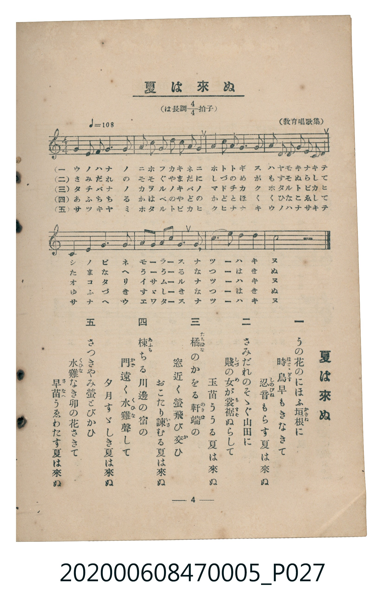

# 夏は來ぬ

> Re:Shōka 使用 AI 協助辨識與重建樂譜，可能會有錯誤。歡迎回報。

- **NEUTRINO 歌聲合成版**：<br><audio controls src="natsu_wa_kinu_neutrino.mp3"></audio>
- **鋼琴伴奏版**：<br><audio controls src="natsu_wa_kinu.mp3"></audio>


- 詞：佐佐木信綱
- 曲：小山作之助
- 臺灣教育會公認《新定兒童唱歌》尋常科第五學年用（2020.006.0847.0005）

## 說明

原書資訊與歌詞全文（對應 P027.jpg，書頁 p. 4，第一學期第 4 首）：
調性與拍號：は長調四分之四拍子（C 大調 4/4 拍），♩= 108，（教育唱歌集）


## 歌詞

```text
一　うの花のにおふ垣根（かきね）に
時鳥（ほとゝぎす）早もきなきて
忍音（しのびね）もらす夏は來ぬ

二　さみだれのそゝぐ山田に
賤（しづ）の女（め）が裳裾（もすそ）ぬらして
玉苗ううる夏は來ぬ

三　橘（たちばな）のかをる軒端（のきば）の
窓近く螢飛び交（か）ひ
おこたり諫（いさ）むる夏は來ぬ

四　楝（あふち）ちる川邊の宿の
門（かど）遠く水雞（くひな）聲して
夕月すゞしき夏は來ぬ

五　さつきやみ螢とびかひ
水雞（くひな）なき卯の花さきて
早苗（さなへ）うゑわたす夏は來ぬ
```

## ABC

```abc
X:1
T:夏は來ぬ
C:曲：小山作之助
M:4/4
L:1/16
Q:1/4=108
K:C
V:V1 name="Piano" snm="Pia"
[V:V1]
C6 D2 E4 G4 | A2 A2 G2 A2 c2 A2 G4 | A4 c2 A2 G4 E4 | D2 D2 E2 G2 E2 D2 C4 |
w: 1.~う の は なの | に ほ ふ か き ね に | ほ と と ぎ す | は や も き な き て
w: 2.~さ み だ れの | そ そ ぐ や ま だ に | し づ の め が | も す そ ぬ ら し て
w: 3.~た ち ば なの | か を る の き ば の | ま ど ち か く | ほ た る と び か ひ
G4 E4 G4 c4 | A2 c2 d2 c2 A8 | G6 E2 D4 E2 D2 | C12 z4 |
w: 1.~し の び ね | も _ ら _ す | な つ _ は き | ぬ
w: 2.~た ま な へ | う _ う _ る | な つ _ は き | ぬ
w: 3.~お こ た り | い _ さ _ むる | な つ _ は き | ぬ
```

## TMD 檔案連結

- [主旋律 TMD 檔案](natsu_wa_kinu.tmd) [[在 TMD Studio 編輯](https://tmdlang.github.io/Tmd-TS/#tmd=s7IKdvYPcrWy4qpTUCpJTLdSSM7PyUlNLsnMz7MqzsjMK0nNjM_KTMmPL87Iz05Ugisry88pzU21Si9KTEmNN403MjAyiDcwMIs3sDAxBzIMTBFKi_NLi5JTrYqTM_Lzc-JLUitKkvLzsxHyBUX5Zal5iXlANQVFIBtTwIoQClLLMlNSQdKpKZkl-UWZiTlI7kgtKga7FWxJfElRYl5xclFmAcgDCFUlGalAxxanJhbn5xUTFAZakZ6ZZ5WbmpmVieReLS2Fp0v6Hzeuf7Kv7XHjGgUtLS5FWwVDAwsue1sFZy4bE30TO5AZL1bOe79n1pO9E4Do2ZwVT_YvfL5tI9j0Z7M3AWWebuh_unHjk71znuzsftq1Eizzon3X88bFz6bOfNG06dmc5qeta16s6n3c0PVs2oan62Y9bZ30fPXSp1M2Plvb87ih--mG7qc7djxfPvH5mjVPdk15unbH051bnk9Z8X5PByge9IDxoAeKByDDwPT9nk4lLi59LQVbagEuBQWFp33zn83e8WJz-4sVXS862oHuAvr6aeuKZ9Paga54uqH3WXunQoCBkbleVkH6-z09QMUvFzQqFOgpmAB5IHfvaAC6-9mc-UC2gonCy2XTgA4FBg7I8Ber9j9rWA4ytrv3xcz5QFFgoL-cuh0o_nT27KcdbaCAmz0bKPt07QSgdc7AeFkOlFQAxoACUBRsUs-jmSvBsQNkAtVAghYShC9ntwGVcIGsAjrjcUPD40ZghK570bURSD5uXP24setx49an8xY_W7ATqPVxY_fjxt7HjWuBmoCyIG3PZja93LwULLf7ceOKx01zHzf2PW6cCVTxbPrKx01NYA2rwOQycHjt7305fzNYw3SwJZuh5gGVNgFNnYmcsiAu2wWMaqDLpj5u3P-4ccHjph6wvrlguyYAE9DzKRugrnmxeQnMZKCbgKate7oUbFdTI5jb82Lx5heL94FFgC6bCTQFLL4GbDVQF9iJz_s6X3QDOUAXtD1u6sZ00I5OoIOerZwBtmv-48aFjxuBLlgFsREUSE2TgPpe7Aam1fVgNUBBoP83QBSArVg1-cX-iY8b-1_MW_Ry8WxgKDzZBXF6N1jRJpAicOhPBtnQ1PVi9WqwdAswHMCh1YDNZcC0AHLZUqCvgGqBPtwKdBzYwIUg5dvnvmwCGrnu6TpgQILd8XJaAyxeVwLVvQQGb2P_sw1bXs4G5lygOND8TRCfvQAxYCH0dMnUZ3OA0jMfN80Di_ZiibUpsFhbAvJ9E9Dl-4G-BSUSUJwDbQR7EqtlkBTztHc9LDECTYElIGCyAsYOWANQFKhuB1gDMKYmPm4CGgGMD9Q0BNRDeVaHAgUtfS4uv8SS4tLwRO_MvFKrgMzEvHyHGoOaapA9CjYWWnZgBrZiRgGS218s7FHQMFEAFn7P1zfowMsGTSwagLZBDdMAatS0UnjctAwk8Li5D4j7QYwuCE-hBkh1A_FsIJ4KVLcaiNcC2b1gcYj8bJDaDghuWgfEO0GGQeT6gXgJEC-C6uuC0m1AeagzahQMFXSB0EjBGEiaAnGNghkQmgKxYRyYARHSRXBBKmuAOkB6TIHYCGxGDdg8H0OgxY1tYDOBEQ3E68EsYJyuA2sD5mog3g3EW4EY6LtGoG8aga4CikPkd4M1rIDiPjBvJlRuPdAHLUDcBNW3CkovQzjACKRuKtQB-4F4AYgFLmCghsyF4gkQwxr3gRUhHDAdrHUpxP1NjWBeD0QObPFMqP41QH4nWD2KA4xBZsyHOmAhEG9ADwGgr5smATHI96AgAvlgA5gNkd8H1rASqr0bzOuHhw7IcIheUPhshobiJrAD8KfTXT2UpdPt0HT5uHkyiOiFpDJg6moGurV5DyLxwRIgMCGDFAIDGSgLSZDABAiR60EohadFWOoC0cDkBkl5QIZRHCT1gcIUJAiSB6k0gpKwVAyBBmipERKfoMAFBReIXAuPTVDS6IQnMYjpoGQFib0lUBqY7ICRBJJZg2RPPFqiA8U5LPJAJgCLMah5oPwAJYERR4E94LTVBVY7GUyC7WwCiYBkWsBioMQPqUzItKqWi0vXTgGpSFQAcpW5AA)]
- [鋼琴伴奏 TMD 檔案](natsu_wa_kinu_piano.tmd) [[在 TMD Studio 編輯](https://tmdlang.github.io/Tmd-TS/#tmd=s7IKdvYPcrWy4tLSUni6pP9x4_on-9oeN655v6fjZfee5xO2PNmz5enS_uedHe_3dCpoaXEp2ioYGlhw2dsqOHPZmOib2HHVKSi9WDnv_Z5ZT_ZOAKJnc1Y82b_w-baNSiCZZ7M3AWWebuh_unHjk71znuzsftq1Eizzon3X88bFz6bOfNG06dmc5qeta16s6n3c0PVs2oan62Y9bZ30fPXSp1M2Plvb87ih--mG7qc7djxfPvH5mjVPdk15unbH051bnk9ZAXSmkYGRgZ6BgZmegYWJOZBhYAp0qRIXl19iSXFpeKJ3Zl6pVUBmYl5-kIdDjUFNNZcCENhYaNmBGfpaCrboQAFkyY6GFwt7FDRMFIBuf76-QUchwMDIXC-rIF0TiwYtfbBhNQqGCrpAaKRgDCRNgbhGwQwITYHYMA7MgAjpIrgglTVAHSA9pkBsBDajBmyej2GNwuPGNrCZjxvXAfF6MGsViAPS9rhxNRDvBuKtQNwNxL1AvBYsDpHfDdawAor7wLyZULn1Co-bWoC4CapvFZRehnCAEUjdVKgD9gPxAhCrqQfhgLlQPAFiWOM-sCKEA6aDtS6FuL-pEczrgciBLZ4J1b8GyO8Eq0dxgDHIjPlQBywE4g3oIQD0ddMkIAb5HhREIB9sALMh8vvAGlZCtXeDef3w0AEZDtELCp_N0FDcBHYA_gSyq4ecBAKLchANTAOQ5ABkGMVBkgTIoyBBkDxIpRGUhCUtCDRASyKQQAb5GOQHELkWHsSg-OqExzvEdFBcQ4J0CZQGpgVgyIFk1iDZE4-WEkARAQtRkAmPG3dAzQMlUigJDE0K7AFHeBdY7WQwCbazCSQCkmkBi4FS5OOmBvKtqsVSPvgglw8miPLh2Y5WYJn0rGvSs-ZWUPk1e_az7t6nayc83b7sWWc3pHxEKgHiFaINY2FUjYIJkGGCh28aD2SZxiNE8JsDpeDycO3IOgwgPtS1U0DyZLQPUBJdyAhTyBgspMwFAA)]

## 分析

```text
================================================================================
📊 TMD Song Profile: [ 夏は來ぬ ]
================================================================================
⏱  Duration:       0:17 (17.8s), 8 measures total
🎼 Key & Tempo:    首調基準 C, != 108.0 BPM, <4/4>
   - 分析範圍：      由實際發聲的音符與和弦推測調性；播放脈絡另行呈現
🎤 人聲音域:    C4 (MIDI 60) – D5 (MIDI 74) [跨度: 14 個半音 / 1.2 個八度, 難度: moderate]
   - 最低音:  C4 in [NatsuWaKinu #1 @ m.1, 0:00]
   - 最高音: D5 in [NatsuWaKinu #1 @ m.6, 0:11]
   - 適合: soprano, mezzo-soprano, contralto, tenor, baritone, bass
🏛  結構:      NatsuWaKinu (17.8s)
⚡ 編曲密度:        Peak 1 軌道同時演奏
🗝  調性診斷：       C 大調（純淨自然大調，未偵測到可信轉調）
   - 風格氣質:    純淨自然大調（陽光明朗、易唱易記，無明顯調外色彩）
   - 轉調歷程:    全曲維持單一推測調性（未偵測到可信轉調）
   - 核心骨幹音:  C, G, A, E, D
   - 調性數值:    C 大調 [相關度: 0.87, 穩定度: High, 自然音純度: 100.0%]
   - 候選調性 (K-S): C 大調 (0.87), A 小調 (0.71), G 大調 (0.70)
   - 五度圈歷程:   +0
   - 各段落調性細節:
     • [NatsuWaKinu #1]: C 大調 (r: 0.87, 自然音純度: 100.0%)

  [ 五度圈游移軌跡 ]
              [C ]*
         F            G  
      Bb               D  
      Eb               A  
         Ab           E  
            Db       B  
               F# 
     (* = active key center)

  [ 十二半音累積音高分佈 ]
     C  : ████████████████████████  27.4%
     C# :                            0.0%
     D  : ███████████               12.9%
     D# :                            0.0%
     E  : ██████████████            16.1%
     F  :                            0.0%
     F# :                            0.0%
     G  : █████████████████████     24.2%
     G# :                            0.0%
     A  : █████████████████         19.4%
     A# :                            0.0%
     B  :                            0.0%
--------------------------------------------------------------------------------
Assignment 軌道音域：
  - Piano         : C4 – D5 (14 個半音 / 1.2 個八度, 38 個音符)
================================================================================
```


## 原書掃描頁




