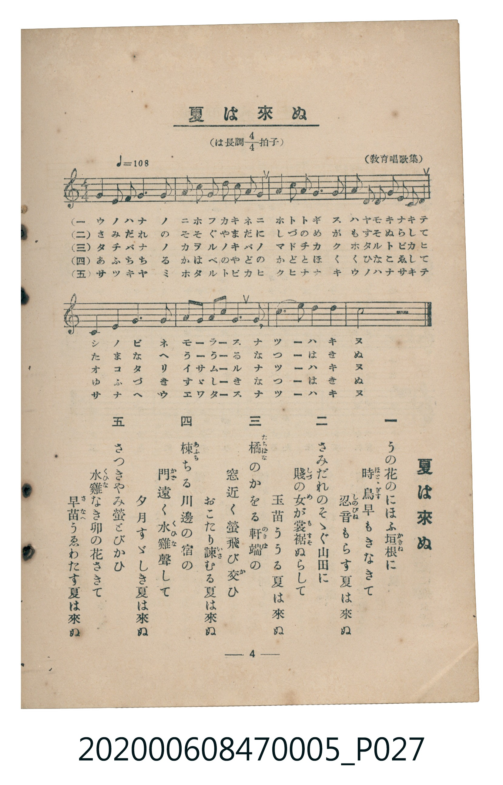

# 夏は來ぬ

> Re:Shōka 使用 AI 協助辨識與重建樂譜，可能會有錯誤。歡迎回報。

- **鋼琴伴奏版**：<br><audio controls src="natsu_wa_kinu.mp3"></audio>
- **NEUTRINO 歌聲合成版**：<br><audio controls src="natsu_wa_kinu_neutrino.mp3"></audio>

- 詞：佐佐木信綱
- 曲：小山作之助
- 臺灣教育會公認《新定兒童唱歌》尋常科第五學年用（2020.006.0847.0005）

## 說明

原書資訊與歌詞全文（對應 P027.jpg，書頁 p. 4，第一學期第 4 首）：
調性與拍號：は長調四分之四拍子（C 大調 4/4 拍），♩= 108，（教育唱歌集）


## 歌詞

```text
一　うの花のにおふ垣根（かきね）に
時鳥（ほとゝぎす）早もきなきて
忍音（しのびね）もらす夏は來ぬ

二　さみだれのそゝぐ山田に
賤（しづ）の女（め）が裳裾（もすそ）ぬらして
玉苗ううる夏は來ぬ

三　橘（たちばな）のかをる軒端（のきば）の
窓近く螢飛び交（か）ひ
おこたり諫（いさ）むる夏は來ぬ

四　楝（あふち）ちる川邊の宿の
門（かど）遠く水雞（くひな）聲して
夕月すゞしき夏は來ぬ

五　さつきやみ螢とびかひ
水雞（くひな）なき卯の花さきて
早苗（さなへ）うゑわたす夏は來ぬ
```

## ABC

<div class="abc-score" data-abc-src="natsu_wa_kinu.abc" aria-label="五線譜載入中"></div>

[下載 ABC 原始檔](natsu_wa_kinu.abc)

## TMD 檔案連結

- [主旋律 TMD 檔案](natsu_wa_kinu.tmd) [[在 TMD Studio 編輯](https://tmdlang.github.io/Tmd-TS/#tmd=s7IKdvYPcrWy4qpTUCpJTLdSSM7PyUlNLsnMz7MqzsjMK0nNjM_KTMmPL87Iz05Ugisry88pzU21Si9KTEmNN403MjAyiDcwMIs3sDAxBzIMTBFKi_NLi5JTrYqTM_Lzc-JLUitKkvLzsxHyBUX5Zal5iXlANQVFIBtTwIoQClLLMlNSQdKpKZkl-UWZiTlI7kgtKga7FWxJfElRYl5xclFmAcgDCFUlGalAxxanJhbn5xUTFAZakZ6ZZ5WbmpmVicW9-UUlGflAjxdkVFplZBaDXJScmBOfnZiHFD5Q9xQkpqdaBRgYmStxaWkpPF3S_7hx_ZN9bY8b1yhoaXEp2ioYGlhw2dsqOHPZmOib2IG0v1g57_2eWU_2TgCiZ3NWPNm_8Pm2jWCDn83eBJR5uqH_6caNT_bOebKz-2nXSrDMi_ZdzxsXP5s680XTpmdzmp-2rnmxqvdxQ9ezaRuerpv1tHXS89VLn07Z-Gxtz-OG7qcbup_u2PF8-cTna9Y82TXl6dodT3dueT5lxfs9HaBo1ANGox4oGoEMA9P3ezqVuLj0tRRsqQW4FBQUnvbNfzZ7x4vN7S9WdL3oaAe6C-jrp60rnk1rB7ri6YbeZ-2dCqBg08sqSH-_pweo-OWCRoUCPQUTIA_k7h0NQHc_mzMfyFYwUXi5bBrQocDAARn-YtX-Zw3LQcZ2976YOR8oCgz0l1O3A8Wfzp79tKMNFHCzZwNln66dALTOGRgvy4GSCsAYUACKgk3qeTRzJTh2gEygGkjQQoLw5ew2oBIukFVAZzxuaHjcCIzQdS-6NgLJx42rHzd2PW7c-nTe4mcLdgK1Pm7sftzY-7hxLVATUBak7dnMppebl4Lldj9uXPG4ae7jxr7HjTOBKp5NX_m4qQmsYRWYXAYOr_29L-dvBmuYDrZkM9Q8oNImoKkzkVMWxGW7gFENdNnUx437HzcueNzUA9Y3F2zXBGACej5lA9Q1LzYvgZkMdBPQtHVPl4LtamoEc3teLN78YvE-sAjQZTOBpoDF14CtBuoCO_F5X-eLbiAH6IK2x03dmA7a0Ql00LOVM8B2zX_cuPBxI9AFqyA2ggKpaRJQ34vdwLS6HqwGKAj0_waIArAVqya_2D_xcWP_i3mLXi6eDQyFJ7sgTu8GK9oEUgQO_ckgG5q6XqxeDZZuAYYDOLQasLkMmBZALlsK9BVQLdCHW4GOAxu4EKR8-9yXTUAj1z1dBwxIsDteTmuAxetKoLqXwOBt7H-2YcvL2cCcCxQHmr8J4rMXIAYshJ4umfpsDlB65uOmeWDRXiyxNgUWa0tAvm8Cunw_0LegRAKKc6CNYE9itQySYp72roclRqApsAQETFbA2AFrAIoC1e0AawDG1MTHTUAjgPGBmoaAeijP6lCgoKXPxeWXWFJcGp7onZlXahWQmZiX71BjUFMNskfBxkLLDszAVswoQHL7i4U9ChomCsDC7_n6Bh142aCJRQPQNqhhGkCNmlYKj5uWgQQeN_cBcT-I0QXhKdQAqW4gng3EU4HqVgPxWiC7FywOkZ8NUtsBwU3rgHgnyDCIXD8QLwHiRVB9XVC6DSgPdUaNgqGCLhAaKRgDSVMgrlEwA0JTIDaMAzMgQroILkhlDVAHSI8pEBuBzagBm-djCLS4sQ1sJjCigXg9mAWM03VgbcBcDcS7gXgrEAN91wj0TSPQVUBxiPxusIYVUNwH5s2Eyq0H-qAFiJug-lZB6WUIBxiB1E2FOmA_EC8AscAFDNSQuVA8AWJY4z6wIoQDpoO1LoW4v6kRzOuByIEtngnVvwbI7wSrR3GAMciM-VAHLATiDeghAPR10yQgBvkeFEQgH2wAsyHy-8AaVkK1d4N5_fDQARkO0QsKn83QUNwEdgD-dLqrh7J0uh2aLh83TwYRvZBUBkxdzUC3Nu9BJD5YAgQmZJBCYCADZSEJEpgAIXI9CKXwtAhLXSAamNwgKQ_IMIqDpD5QmIIEQfIglUZQEpaKIdAALTVC4hMUuKDgApFr4bEJShqd8CQGMR2UrCCxtwRKA5MdMJJAMmuQ7IlHS3SgOIdFHsgEYDEGNQ-UH6AkMOIosAectrrAaieDSbCdTSARkEwLWAyU-CGVCZlW1XJx6dopIBWJCkCuMhcA)]
- [鋼琴伴奏 TMD 檔案](natsu_wa_kinu_piano.tmd) [[在 TMD Studio 編輯](https://tmdlang.github.io/Tmd-TS/#tmd=s7IKdvYPcrWy4qpTUCpJTLdSyC8qychPL0osyKi0ysgsLskvykxOzInPTsxLVIIrKs4vLUpOjS9ITE-1CjAwMlfi0tJSeLqk_3Hj-if72h43rnm_p-Nl957nE7Y82bPl6dL-550d7_d0KmhpcSnaKhgaWHDZ2yo4c9mY6JvYgcx8sXLe-z2znuydAETP5qx4sn_h820bwbY9m70JKPN0Q__TjRuf7J3zZGf3066VYJkX7bueNy5-NnXmi6ZNz-Y0P21d82JV7-OGrmfTNjxdN-tp66Tnq5c-nbLx2dqexw3dTzd0P92x4_nyic_XrHmya8rTtTue7tzyfMoKoDONDIwM9AwMzPQMLEzMgQwDU6BLlbi4_BJLikvDE70z80qtAjIT8_KDPBxqDGqquRSAwMZCyw7M0NdSsEUHCiBLdjS8WNijoGGiAHT78_UNOgqgYNLLKkjXxKJBSx9sWI2CoYIuEBopGANJUyCuUTADQlMgNowDMyBCugguSGUNUAdIjykQG4HNqAGb52NYo_C4sQ1s5uPGdUC8HsxaBeKAtD1uXA3Eu4F4KxB3A3EvEK8Fi0Pkd4M1rIDiPjBvJlRuvcLjphYgboLqWwWllyEcYARSNxXqgP1AvADEaupBOGAuFE-AGNa4D6wI4YDpYK2zIO5vagTzeiByYItnQvWvAfI7wepRHGAMMmM-1AELgXgDeggAfd00CYhBvgcFEcgHG8BsiPw-sIaVUO3dYF4_PHRAhkP0gsJnMzQUN4EdgD-B7OohJ4HAohxEA9MAJDkAGUZxkCQB8ihIECQPUmkEJWFJCwIN0JIIJJBBPgb5AUSuhQcxKL464fEOMR0U15AgXQKlgWkBGHIgmTVI9sSjpQRQRMBCFGTC48YdUPNAiRRKAkOTAnvAEd4FVjsZTILtbAKJgGRawGKgFPm4qYF8q2qxlA8-yOWDCaJ8eLajFVgmPeua9Ky5FVR-zZ79rLv36doJT7cve9bZDSkfkUqAeIVow1gYVaNgAmSY4OGbxgNZpvEIEfzmQCm4PFw7sg4DiA917RSQPBntA5REFzLCFDIGCylzAQA)]

## 分析

```text
================================================================================
📊 TMD Song Profile: [ 夏は來ぬ ]
================================================================================
⏱  Duration:       0:17 (17.8s), 8 measures total
🎼 Key & Tempo:    首調基準 C, != 108.0 BPM, <4/4>
   - 分析範圍：      由實際發聲的音符與和弦推測調性；播放脈絡另行呈現
🎤 人聲音域:    C4 (MIDI 60) – D5 (MIDI 74) [跨度: 14 個半音 / 1.2 個八度, 難度: moderate]
   - 最低音:  C4 in [NatsuWaKinu #1 @ m.1, 0:00]
   - 最高音: D5 in [NatsuWaKinu #1 @ m.6, 0:11]
   - 適合: soprano, mezzo-soprano, contralto, tenor, baritone, bass
🏛  結構:      NatsuWaKinu (17.8s)
⚡ 編曲密度:        Peak 1 軌道同時演奏
🗝  調性診斷：       C 大調（純淨自然大調，未偵測到可信轉調）
   - 風格氣質:    純淨自然大調（陽光明朗、易唱易記，無明顯調外色彩）
   - 轉調歷程:    全曲維持單一推測調性（未偵測到可信轉調）
   - 核心骨幹音:  C, G, A, E, D
   - 調性數值:    C 大調 [相關度: 0.87, 穩定度: High, 自然音純度: 100.0%]
   - 候選調性 (K-S): C 大調 (0.87), A 小調 (0.71), G 大調 (0.70)
   - 五度圈歷程:   +0
   - 各段落調性細節:
     • [NatsuWaKinu #1]: C 大調 (r: 0.87, 自然音純度: 100.0%)

  [ 五度圈游移軌跡 ]
              [C ]*
         F            G  
      Bb               D  
      Eb               A  
         Ab           E  
            Db       B  
               F# 
     (* = active key center)

  [ 十二半音累積音高分佈 ]
     C  : ████████████████████████  27.4%
     C# :                            0.0%
     D  : ███████████               12.9%
     D# :                            0.0%
     E  : ██████████████            16.1%
     F  :                            0.0%
     F# :                            0.0%
     G  : █████████████████████     24.2%
     G# :                            0.0%
     A  : █████████████████         19.4%
     A# :                            0.0%
     B  :                            0.0%
--------------------------------------------------------------------------------
Assignment 軌道音域：
  - Piano         : C4 – D5 (14 個半音 / 1.2 個八度, 38 個音符)
================================================================================
```


## 原書掃描頁




