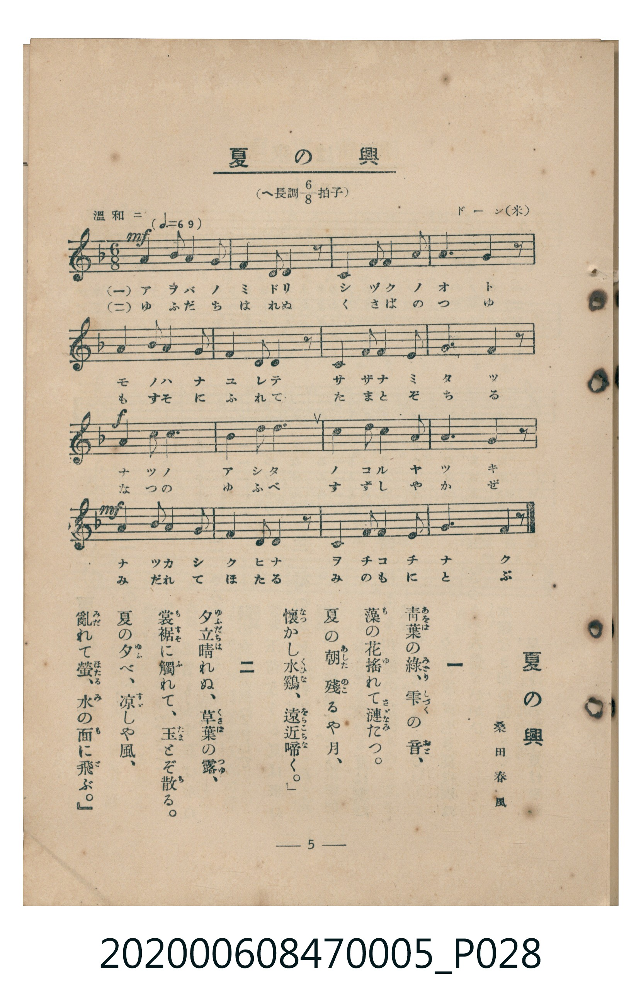

# 夏の興

> Re:Shōka 使用 AI 協助辨識與重建樂譜，可能會有錯誤。歡迎回報。

- **鋼琴伴奏版**：<br><audio controls src="natsu_no_kyo.mp3"></audio>
- **NEUTRINO 歌聲合成版**：<br><audio controls src="natsu_no_kyo_neutrino.mp3"></audio>

- 詞：桑田春風
- 曲：ドーン（米）
- 臺灣教育會公認《新定兒童唱歌》尋常科第五學年用（2020.006.0847.0005）

## 說明

原書資訊與歌詞全文（對應 P028.jpg，書頁 p. 5，第一學期第 5 首）：
調性與拍號：へ長調八分之六拍子（F 大調 6/8 拍），溫和ニ（♩.= 69），桑田春風 作詞、ドーン（米）作曲


## 歌詞

```text
一　青葉（あをば）の綠（みどり）、雫（しづく）の音（おと）、
藻（も）の花搖（ゆ）れて漣（さゞなみ）たつ。
夏の朝（あした）　殘（のこ）るや月、
懷（なつ）かし水雞（くひな）、遠近（をちこち）啼く。」

二　夕立（ゆふだち）晴れぬ、草葉（くさば）の露（つゆ）、
裳裾（もすそ）に觸（ふ）れて、玉（たま）とぞ散（ち）る。
夏の夕（ゆふ）べ、涼（すゞ）しや風、
亂（みだ）れて螢（ほたる）、水（み）の面（も）に飛（と）ぶ。」
```

## ABC

<div class="abc-score" data-abc-src="natsu_no_kyo.abc" aria-label="五線譜載入中"></div>

[下載 ABC 原始檔](natsu_no_kyo.abc)

## TMD 檔案連結

- [主旋律 TMD 檔案](natsu_no_kyo.tmd) [[在 TMD Studio 編輯](https://tmdlang.github.io/Tmd-TS/#tmd=s7IKdvYPcrWy4qpTUCpJTLdSSM7PyUlNLsnMz7MqzsjMK0nNjM_KTMmPL87Iz05Ugisry88pzU21Si9KTEmNN403MjAyiDcwMIs3sDAxBzIMTBFKi_NLi5JTrYqTM_Lzc-JLUitKkvLzsxHyBUX5Zal5iXlANQVFIBtTwIoQClLLMlNSQdKpKZkl-UWZiTlI7kgtKga7FWxJfElRYl5xclFmAcgDCFUlGalAxxanJhbn5xUTFAZakZ6ZZ1WSmAn0NMjj5YnxuYmZeTmJeSlKXFpaCk-X9D9uXPeio0NBS4tL0VbBzJLL3lbBjcvGTN_CDmTMi5Xz3u-Z9WzhxOdTNjybsfTlohVg05_N3gQUftzc-bh5z-Pmze_3dDzfCCQ7wZIv2nc9b1z8bOrMF02bns1pftq65sWq3scNXc-mbXi6btbT1knPVy99OmXjs7U9jxu6n27ofrpjx_PlE5-vWfNk15Sna3c83bnl-ZQVQCNBUaEHjAo9UFQAGQamYBu49LUUbKkFuBQUFJ72zX82e8eLze0vVnS96GgHugvo66etK55Nawe64umG3mftnQoBBkYWelkF6e_39AAVv1zQqFCgpwB0UA_I3TsagO5-Nmc-kK1gqvBy2TSgQ4HhAzL8xar9zxqWg4zt7n0xcz4o1Bp3vJy6HSj-tHX10462Jzu7n7auBco-XTsBaJ0bME6WAyUVgDGgABQFm9TzbNfqp5N6Hjd3A1U8mrlSDxRTUBmkqFF4sncO0OmPGxoxYwYoBYw0LpCTgM593NDwcu6kFxOBJnQ8bmx63DTpceMGoCpgYni-bQFYcP_jxpWPm7pAgg2NL2evBgtOf9y49HFjP0Tly_kg4x83dj1uBEYXSBnYw9N3g0SbmiCKXnRtfDYBGB5AkTaQSFPP48Zlz_YsBuuc-rhp3uPGVUDLwIrnP25c8rihCRwn4IT5bM5cqANBNgMDD2hJw7N1M8CC6x43Tgab2P24qeXZnA6o_c_at4OlgaYuAZvaDdT8bMOWl7OBKRkoDjR3E1AW6q_GBS_2TwS7DhgCC4EmAkmg1NOpe0AqG5oeN_RCwmwXMLE2PF0y9flqUBwAPfO4cevjxgUQ5c9mbgF7bA3QyBe9nbBwBVo1FR6uL-cAswxQcAk0IKChtXjzi8X7IAH2uHHm40agh4GqV79YvgOseis8zIAanvdBzAWGE1ALUNmKx43znk2FhCXIHaCwQA4_oHvhjgVr2Ak05dm2PWANM4GBDxacDgw_YOqBuujJLmDMQeIfmBCglr-YtwgsuBtkeRMwBEDuBwYqRCXUg3PBaqARv_rl4tlgWXDSaNwGDUugBZRnWihQ0NLn4vJLLCku9cv3rsy3CshMzMt3qDGoqQZZo2BjoWUHZmArLxQg2fbFwh4FDROFpxv6n69v0IFnck0sGoCWQQ3TAGrUtFJ43LRIQeFx8yYQMQFE9IHkFRRqgMz5IAYwE4KIVXDhpu0gfiuQaFqPqqEJqOhxcweEDwNQG2sUqnPTahWMFUyA2EhBV8EQKGQaD2YYA0kDINcIDE2BPCMgDyQKgUA5sBk-hkBLGpuAIsCEDmRtALEa14GsbtwPZq8EynQBWfFgselAvBSI-8GqQPJdYPEVcJOB6iAmG4Gc3waU2wrEC4B4IVj9erC3esBqgRkDbjLIxKlgF8BMXgJW2YZiMv5429VDUbw1g-MNGPiPm_tBRBci3pZB4m0NiGhDxM5WUJRtg6qFxi5EZj-I34Ij3ghEmamCeTxYFkjVAGWwRloTONKAQQUKUhBrFTy4QMELzJvwoAUF6zSwClikzgeLL8ERaRCTZwLxXDBrNVj1ViwmzwfifeDoBxY4YLULwa7oJiHSdnRSFmngWAKHNUrGAcYlKHJAOQsUGbCIBMVu02aQ2tUgYglCBmRA01ocMVYNzGhmQO-YgfOSMVDEBEyDYkkXFIdAvilYhSmefLYKmupBAQ_LZZDABuWr-VCzIJE6GRyMwBIYkRcae7FHGDZzIQkBnPd2ws0FReksiG1Qc7vB4nOIj66ns2dTHF3QsAZFACh-YDEGLPpAcpPQsh64HG2ERxuQBZMBGQXRhS3GiCgbicpo4NAFhS0otCBxBSmvQOxNUHlwdgCXoAshcQct7cCZEqwWW7xBMiOwbASXh6CMBRLdDWYDsxY4G0Ey2n5IqgBmTVB2BMmvAItvQzG5lotL104BUfMpAHnKXAA)]
- [鋼琴伴奏 TMD 檔案](natsu_no_kyo_piano.tmd) [[在 TMD Studio 編輯](https://tmdlang.github.io/Tmd-TS/#tmd=s7IKdvYPcrWy4tLSUni6pP9x47oXHR3v93S87N7zfMKWJ3u2PF3a_7wTKNKpoKXFpWirYGbJZW-r4MZlY6ZvYcdVp6D0YuW893tmPVs48fmUDc9mLH25aIUSSPjZ7E1A4cfNnY-b9zxu3gw08vlGINkJlnzRvut54-JnU2e-aNr0bE7z09Y1L1b1Pm7oejZtw9N1s562Tnq-eunTKRufre153ND9dEP30x07ni-f-HzNmie7pjxdu-Ppzi3Pp6wAGmlkYGSgZ2BgpmdgYWIOZBiYgm3g8kssKS71y_euzLcKyEzMyw_ycKgxqKnmUgACGwstOzBDX0vBFh0ogOzY0fBiYY-ChonC0w39z9c36CgEGBhZ6GUVpGti0aClDzasRqE6N61WwVjBBIiNFHQVDIFCpvFghjGQNAByjcDQFMgzAvJAohAIlAOb4WNYo_C4sQko8rhpEpC1AcRqXAdU-7hxP5i9EijTBWTFg8WmA_FSIO4HqwLJd4HFV8BNBqqDmGwEFG9qA8ptBeIFQLwQrH49SH1TD1jt48Y1cJNBJk4FuwBm8hKwyjYUk_GH4q4eckKRQACaKpjHg2WBVA1QBmsQNoGDEOhwkAdBrFVwx4M8-7hxGdyjIE9OA6uABfF8sPgSHEEIMXkmEM8Fs1aDVW_FYvJ8IN4HjozHjfPAaheCXdFNQhDu6CQrIQLToRnQfDNwUjMGipiAaVCw6YICFcg3BaswxZMMV0ETBSgkYIkQ4ntQspsPNQsSypPB_nrc1IJIKo292EMQm7mQmAEnzZ1wc0FhPAtiG9TcbrD4HOLD7-ns2bTKyESlQ7BfQT4FuR0ScpDMBWJvgsqDUws4uy-EhCQ0a4LTLFgttlCEpFVgRgZnXlC6A4nuBrOBKQ-cyiDpcD8kjoApF5RaQfIrwOLbUEyuxSwzfXCUmc92rX46qefZhGnPZm9-srNbAVgPKDzr7n3a0fZi-WKgzNM9yyDVBlqIGsaDgtFQwSRewQxEA4MNKgKhQQFrGg8MVTAPwcKiDmos9U0EZR2gaUAj4UoIGQFVjsdMqnkekryAUaVrp4CIrWgfw1gFNBEjsIgyFwA)]

## 分析

```text
================================================================================
📊 TMD Song Profile: [ 夏の興 ]
================================================================================
⏱  Duration:       0:41 (41.7s), 16 measures total
🎼 Key & Tempo:    首調基準 F, != 69.0 BPM, <6/8>
   - 分析範圍：      由實際發聲的音符與和弦推測調性；播放脈絡另行呈現
🎤 人聲音域:    C4 (MIDI 60) – D5 (MIDI 74) [跨度: 14 個半音 / 1.2 個八度, 難度: moderate]
   - 最低音:  C4 in [NatsuNoKyo #1 @ m.2, 0:02]
   - 最高音: D5 in [NatsuNoKyo #1 @ m.9, 0:20]
   - 適合: soprano, mezzo-soprano, contralto, tenor, baritone, bass
🏛  結構:      NatsuNoKyo (41.7s)
⚡ 編曲密度:        Peak 1 軌道同時演奏
🗝  調性診斷：       F 大調（純淨自然大調，未偵測到可信轉調）
   - 風格氣質:    純淨自然大調（陽光明朗、易唱易記，無明顯調外色彩）
   - 轉調歷程:    全曲維持單一推測調性（未偵測到可信轉調）
   - 核心骨幹音:  A, G, F, C, A#
   - 調性數值:    F 大調 [相關度: 0.75, 穩定度: Moderate, 自然音純度: 100.0%]
   - 候選調性 (K-S): F 大調 (0.75), A 小調 (0.71), C 大調 (0.68)
   - 五度圈歷程:   -1
   - 各段落調性細節:
     • [NatsuNoKyo #1]: F 大調 (r: 0.75, 自然音純度: 100.0%)

  [ 五度圈游移軌跡 ]
               C  
        [F ]*          G  
      Bb               D  
      Eb               A  
         Ab           E  
            Db       B  
               F# 
     (* = active key center)

  [ 十二半音累積音高分佈 ]
     C  : ███████████████           16.9%
     C# :                            0.0%
     D  : █████                      5.6%
     D# :                            0.0%
     E  : ████                       4.5%
     F  : ████████████████          18.0%
     F# :                            0.0%
     G  : ███████████████████       21.3%
     G# :                            0.0%
     A  : ████████████████████████  27.0%
     A# : ██████                     6.7%
     B  :                            0.0%
--------------------------------------------------------------------------------
Assignment 軌道音域：
  - Piano         : C4 – D5 (14 個半音 / 1.2 個八度, 55 個音符)
================================================================================
```


## 原書掃描頁




