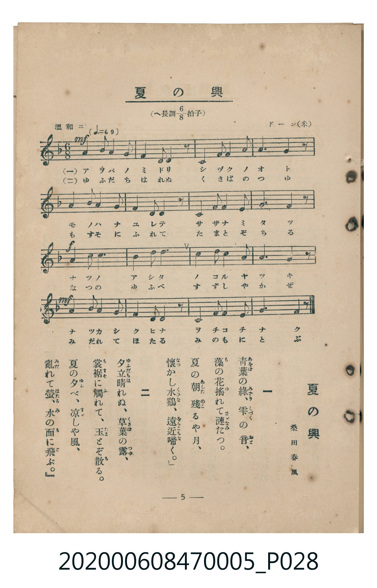

# 夏の興

> Re:Shōka 使用 AI 協助辨識與重建樂譜，可能會有錯誤。歡迎回報。

- **鋼琴伴奏版**：<br><audio controls src="natsu_no_kyo.mp3"></audio>
- **NEUTRINO 歌聲合成版**：<br><audio controls src="natsu_no_kyo_neutrino.mp3"></audio>

- 詞：桑田春風
- 曲：ドーン（米）
- 臺灣教育會公認《新定兒童唱歌》尋常科第五學年用（2020.006.0847.0005）

## 說明

原書資訊與歌詞全文（對應 P028.jpg，書頁 p. 5，第一學期第 5 首）：
調性與拍號：へ長調八分之六拍子（F 大調 6/8 拍），溫和ニ（♩.= 69），桑田春風 作詞、ドーン（米）作曲


## 歌詞

```text
一　青葉（あをば）の綠（みどり）、雫（しづく）の音（おと）、
藻（も）の花搖（ゆ）れて漣（さゞなみ）たつ。
夏の朝（あした）　殘（のこ）るや月、
懷（なつ）かし水雞（くひな）、遠近（をちこち）啼く。」

二　夕立（ゆふだち）晴れぬ、草葉（くさば）の露（つゆ）、
裳裾（もすそ）に觸（ふ）れて、玉（たま）とぞ散（ち）る。
夏の夕（ゆふ）べ、涼（すゞ）しや風、
亂（みだ）れて螢（ほたる）、水（み）の面（も）に飛（と）ぶ。」
```

## ABC

<div class="abc-score" data-abc-src="natsu_no_kyo.abc" aria-label="五線譜載入中"></div>

[下載 ABC 原始檔](natsu_no_kyo.abc)

## TMD 檔案連結

- [主旋律 TMD 檔案](natsu_no_kyo.tmd) [[在 TMD Studio 編輯](https://tmdlang.github.io/Tmd-TS/#tmd=s7IKdvYPcrWy4qpTUCpJTLdSSM7PyUlNLsnMz7MqzsjMK0nNjM_KTMmPL87Iz05Ugisry88pzU21Si9KTEmNN403MjAyiDcwMIs3sDAxBzIMTBFKi_NLi5JTrYqTM_Lzc-JLUitKkvLzsxHyBUX5Zal5iXlANQVFIBtTwIoQClLLMlNSQdKpKZkl-UWZiTlI7kgtKga7FWxJfElRYl5xclFmAcgDCFUlGalAxxanJhbn5xUTFAZakZ6ZZ1WSmAn0NMjj5YnxuYmZeTmJeSnIqkoy8oH-L8iotMrILAY5LDkxJz47MQ8pmKDOKkhMT7UKMDCyUOLS0lJ4uqT_ceO6Fx0dClpaXIq2CmaWXPa2Cm5cNmb6FnYgrS9Wznu_Z9azhROfT9nwbMbSl4tWgE18NnsTUPhxc-fj5j2Pmze_39PxfCOQ7ARLvmjf9bxx8bOpM180bXo2p_lp65oXq3ofN3Q9m7bh6bpZT1snPV-99OmUjc_W9jxu6H66ofvpjh3Pl098vmbNk11Tnq7d8XTnludTVgCNBMWkHjAm9UAxCWQYmIJt4NLXUrClFuBSUFB42jf_2ewdLza3v1jR9aKjHeguoK-ftq54Nq0d6IqnG3qftXcqgIJML6sg_f2eHqDilwsaFQr0FIAO6gG5e0cD0N3P5swHshVMFV4umwZ0KDB8QIa_WLX_WcNykLHdvS9mzgeFWuOOl1O3A8Wftq5-2tH2ZGf309a1QNmnaycArXMDxslyoKQCMAYUgKJgk3qe7Vr9dFLP4-ZuoIpHM1fqgWIKKoMUNQpP9s4BOv1xQyNmzAClgJHGBXIS0LmPGxpezp30YiLQhI7HjU2PmyY9btwAVAVMDM-3LQAL7n_cuPJxUxdIsKHx5ezVYMHpjxuXPm7sh6h8OR9k_OPGrseNwOgCKQN7ePpukGhTE0TRi66NzyYAwwMo0gYSaep53Ljs2Z7FYJ1THzfNe9y4CmgZWPH8x41LHjc0geMEnDCfzZkLdSDIZmDgAS1peLZuBlhw3ePGyWATux83tTyb0wG1_1n7drA00NQlYFO7gZqfbdjycjYwJQPFgeZuAspC_dW44MX-iWDXAUNgIdBEIAmUejp1D0hlQ9Pjhl5ImO0CJtaGp0umPl8NigOgZx43bn3cuACi_NnMLWCPrQEa-aK3ExauQKumwsP15RxglgEKLoEGBDS0Fm9-sXgfJMAeN8583Aj0MFD16hfLd4BVb4WHGVDD8z6IucBwAmoBKlvxuHHes6mQsAS5AxQWyOEHdC_csWANO4GmPNu2B6xhJjDwwYLTgeEHTD1QFz3ZBYw5SPwDEwLU8hfzFoEFd4MsbwKGAMj9wECFqIR6cC5YDTTiV79cPBssC04ajdugYQm0gPJMCwUKWvpcXH6JJcWlfvnelflWAZmJefkONQY11SBrFGwstOzADGzlhQIk275Y2KOgYaLwdEP_8_UNOvBMrolFA9AyqGEaQI2aVgqPmxYpKDxu3gQiJoCIPpC8gkINkDkfxABmQhCxCi7ctB3EbwUSTetRNTQBFT1u7oDwYQBqY41CdW5arYKxggkQGynoKhgChUzjwQxjIGkA5BqBoSmQZwTkgUQhECgHNsPHEGhJYxNQBJjQgawNIFbjOpDVjfvB7JVAmS4gKx4sNh2IlwJxP1gVSL4LLL4CbjJQHcRkI5Dz24ByW4F4ARAvBKtfD_ZWD1gtMGPATQaZOBXsApjJS8Aq21BMxh9vu3ooirdmcLwBA_9xcz-I6ELE2zJIvK0BEW2I2NkKirJtULXQ2IXI7AfxW3DEG4EoM1UwjwfLAqkaoAzWSGsCRxowqEBBCmKtggcXKHiBeRMetKBgnQZWAYvU-WDxJTgiDWLyTCCeC2atBqveisXk-UC8Dxz9wAIHrHYh2BXdJETajk7KIg0cS-CwRsk4wLgERQ4oZ4EiAxaRoNht2gxSuxpELEHIgAxoWosjxqqBGc0M6B0zcF4yBoqYgGlQLOmC4hDINwWrMMWTz1ZBUz0o4GG5DBLYoHw1H2oWJFIng4MRWAIj8kJjL_YIw2YuJCGA895OuLmgKJ0FsQ1qbjdYfA7x0fV09myKowsa1qAIAMUPLMaARR9IbhJa1gOXo43waAOyYDIgoyC6sMUYEWUjURkNHLqgsAWFFiSuIOUViL0JKg_ODuASdCEk7qClHThTgtViizdIZgSWjeDyEJSxQKK7wWxg1gJnI0hG2w9JFcCsCcqOIPkVYPFtKCbXcnHp2ikgaj4FIE-ZCwA)]
- [鋼琴伴奏 TMD 檔案](natsu_no_kyo_piano.tmd) [[在 TMD Studio 編輯](https://tmdlang.github.io/Tmd-TS/#tmd=s7IKdvYPcrWy4qpTUCpJTLdSyC8qychPL0osyKi0ysgsLskvykxOzInPTsxLVIIrKs4vLUpOjS9ITE-1CjAwslDi0tJSeLqk_3HjuhcdHe_3dLzs3vN8wpYne7Y8Xdr_vBMo0qmgpcWlaKtgZsllb6vgxmVjpm9hBzLvxcp57_fMerZw4vMpG57NWPpy0QqwNc9mbwIKP27ufNy853HzZqCRzzcCyU6w5Iv2Xc8bFz-bOvNF06Znc5qftq55sar3cUPXs2kbnq6b9bR10vPVS59O2fhsbc_jhu6nG7qf7tjxfPnE52vWPNk15enaHU93bnk-ZQXQSCMDIwM9AwMzPQMLE3Mgw8AUbAOXX2JJcalfvndlvlVAZmJefpCHQ41BTTWXAhDYWGjZgRn6Wgq26EABZMeOhhcLexQ0TBSebuh_vr5BRwEUQnpZBemaWDRo6YMNq1Gozk2rVTBWMAFiIwVdBUOgkGk8mGEMJA2AXCMwNAXyjIA8kCgEAuXAZvgY1ig8bmwCijxumgRkbQCxGtcB1T5u3A9mrwTKdAFZ8WCx6UC8FIj7wapA8l1g8RVwk4HqICYbAcWb2oByW4F4ARAvBKtfD1Lf1ANW-7hxDdxkkIlTwS6AmbwErLINxWT8obirh5xQJBCApgrm8WBZIFUDlMEahE3gIAQ6HORBEGsV3PEgzz5uXAb3KMiT08AqYEE8Hyy-BEcQQkyeCcRzwazVYNVbsZg8H4j3gSPjceM8sNqFYFd0kxCEOzrJSojAdGgGNN8MnNSMgSImYBoUbLqgQAXyTcEqTPEkw1XQRAEKCVgihPgelOzmQ82ChPJksL8eN7UgkkpjL_YQxGYuJGbASXMn3FxQGM-C2AY1txssPof48Hs6ezatMjJR6RDsV5BPQW6HhBwkc4HYm6Dy4NQCzu4LISEJzZrgNAtWiy0UIWkVmJHBmReU7kCiu8FsYMoDpzJIOtwPiSNgygWlVpD8CrD4NhSTazHLTB8cZeazXaufTup5NmHas9mbn-zsVgDWAwrPunufdrS9WL4YKPN0zzJItYEWoobxoGA0VDCJVzAD0cBgg4pAaFDAmsYDQxXMQ7CwqIMaS30TQVkHaBrQSLgSQkZAleMxk2qehyQvYFTp2ikgYivaxzBWAU3ECCyizAUA)]

## 分析

```text
================================================================================
📊 TMD Song Profile: [ 夏の興 ]
================================================================================
⏱  Duration:       0:41 (41.7s), 16 measures total
🎼 Key & Tempo:    首調基準 F, != 69.0 BPM, <6/8>
   - 分析範圍：      由實際發聲的音符與和弦推測調性；播放脈絡另行呈現
🎤 人聲音域:    C4 (MIDI 60) – D5 (MIDI 74) [跨度: 14 個半音 / 1.2 個八度, 難度: moderate]
   - 最低音:  C4 in [NatsuNoKyo #1 @ m.2, 0:02]
   - 最高音: D5 in [NatsuNoKyo #1 @ m.9, 0:20]
   - 適合: soprano, mezzo-soprano, contralto, tenor, baritone, bass
🏛  結構:      NatsuNoKyo (41.7s)
⚡ 編曲密度:        Peak 1 軌道同時演奏
🗝  調性診斷：       F 大調（純淨自然大調，未偵測到可信轉調）
   - 風格氣質:    純淨自然大調（陽光明朗、易唱易記，無明顯調外色彩）
   - 轉調歷程:    全曲維持單一推測調性（未偵測到可信轉調）
   - 核心骨幹音:  A, G, F, C, A#
   - 調性數值:    F 大調 [相關度: 0.75, 穩定度: Moderate, 自然音純度: 100.0%]
   - 候選調性 (K-S): F 大調 (0.75), A 小調 (0.71), C 大調 (0.68)
   - 五度圈歷程:   -1
   - 各段落調性細節:
     • [NatsuNoKyo #1]: F 大調 (r: 0.75, 自然音純度: 100.0%)

  [ 五度圈游移軌跡 ]
               C  
        [F ]*          G  
      Bb               D  
      Eb               A  
         Ab           E  
            Db       B  
               F# 
     (* = active key center)

  [ 十二半音累積音高分佈 ]
     C  : ███████████████           16.9%
     C# :                            0.0%
     D  : █████                      5.6%
     D# :                            0.0%
     E  : ████                       4.5%
     F  : ████████████████          18.0%
     F# :                            0.0%
     G  : ███████████████████       21.3%
     G# :                            0.0%
     A  : ████████████████████████  27.0%
     A# : ██████                     6.7%
     B  :                            0.0%
--------------------------------------------------------------------------------
Assignment 軌道音域：
  - Piano         : C4 – D5 (14 個半音 / 1.2 個八度, 55 個音符)
================================================================================
```


## 原書掃描頁




