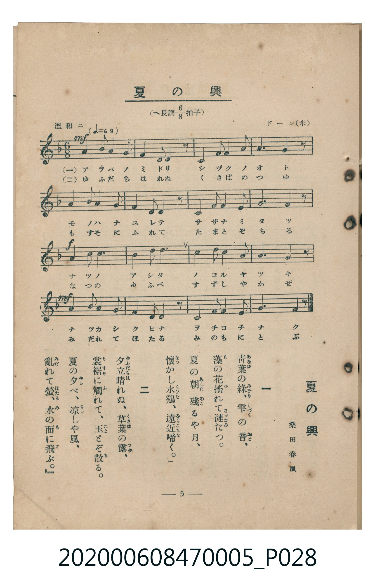

# 夏の興

> Re:Shoka 使用 AI 辨識樂譜，可能會有錯誤。歡迎回報。

<audio controls src="natsu_no_kyo.mp3"></audio>

- 詞：桑田春風
- 曲：ドーン（米）
- 臺灣教育會公認《新定兒童唱歌》尋常科第五學年用（2020.006.0847.0005）

## 說明

原書資訊與歌詞全文（對應 P028.jpg，書頁 p. 5，第一學期第 5 首）：
調性與拍號：へ長調八分之六拍子（F 大調 6/8 拍），溫和ニ（♩.= 69），桑田春風 作詞、ドーン（米）作曲

## 歌詞

```text
一　青葉（あをば）の綠（みどり）、雫（しづく）の音（おと）、
藻（も）の花搖（ゆ）れて漣（さゞなみ）たつ。
夏の朝（あした）　殘（のこ）るや月、
懷（なつ）かし水雞（くひな）、遠近（をちこち）啼く。」

二　夕立（ゆふだち）晴れぬ、草葉（くさば）の露（つゆ）、
裳裾（もすそ）に觸（ふ）れて、玉（たま）とぞ散（ち）る。
夏の夕（ゆふ）べ、涼（すゞ）しや風、
亂（みだ）れて螢（ほたる）、水（み）の面（も）に飛（と）ぶ。」
```

## ABC

```abc
X:1
T:夏の興
C:曲：ドーン（米）
M:6/8
L:1/16
Q:3/8=46
K:F
V:V1 name="Piano" snm="Pia"
[V:V1]
!mf! A2 B2 A2 G4 F2 | C4 F2 A4 z2 | G2 G2 G2 c4 G2 | A10 z2 |
A2 B2 A2 G4 F2 | C4 F2 A4 z2 | G2 c2 E2 G4 E2 | F10 z2 |
!f! d4 d2 c4 A2 | B4 A2 G6 | c2 B2 c2 d4 c2 | A10 z2 |
!mf! A2 B2 A2 G4 F2 | C4 F2 A4 z2 | G2 c2 E2 G4 E2 | F10 z2 |
```

## TMD 檔案連結

- [主旋律 TMD 檔案](natsu_no_kyo.tmd) [[在 TMD Studio 編輯](https://tmdlang.github.io/Tmd-TS/#tmd=s7IKdvYPcrWy4qpTUCpJTLdSSM7PyUlNLsnMz7MqzsjMK0nNjM_KTMmPL87Iz05Ugisry88pzU21Si9KTEmNN403MjAyiDcwMIs3sDAxBzIMTBFKi_NLi5JTrYqTM_Lzc-JLUitKkvLzsxHyBUX5Zal5iXlANQVFIBtTwIoQClLLMlNSQdKpKZkl-UWZiTlI7kgtKga7FWxJfElRYl5xclFmAcgDCFUlGalAxxanJhbn5xXjFNbSUni6pP9x47oXHR0KWlpcirYKZpZc9rYKblw2ZvoWdiB9L1bOe79n1rOFE59P2fBsxtKXi1aAjXs2exNQ-HFz5-PmPY-bN7_f0_F8I5DsBEu-aN_1vHHxs6kzXzRtejan-Wnrmhereh83dD2btuHpullPWyc9X7306ZSNz9b2PG7ofrqh--mOHc-XT3y-Zs2TXVOert3xdOeW51NWAI0EBbIeMJD1QIEMZBiYgm3g0tdSsKUW4FJQUHjaN__Z7B0vNre_WNH1oqMd6C6gr5-2rng2rR3oiqcbep-1dyoEGBhZ6GUVpL_f0wNU_HJBo0KBngLQQT0gd-9oALr72Zz5QLaCqcLLZdOADgWGD8jwF6v2P2tYDjK2u_fFzPmgUGvc8XLqdqD409bVTzvanuzsftq6Fij7dO0EoHVuwDhZDpRUAMaAAlAUbFLPs12rn07qedzcDVTxaOZKPVBMQWWQokbhyd45QKc_bmjEjBmgFDDSuEBOAjr3cUPDy7mTXkwEmtDxuLHpcdOkx40bgKqAieH5tgVgwf2PG1c-buoCCTY0vpy9Giw4_XHj0seN_RCVL-eDjH_c2PW4ERhdIGVgD0_fDRJtaoIoetG18dkEYHgARdpAIk09jxuXPduzGKxz6uOmeY8bVwEtAyue_7hxyeOGJnCcgBPmszlzoQ4E2QwMPKAlDc_WzQALrnvcOBlsYvfjppZnczqg9j9r3w6WBpq6BGxqN1Dzsw1bXs4GpmSgONDcTUBZqL8aF7zYPxHsOmAILASaCCSBUk-n7gGpbGh63NALCbNdwMTa8HTJ1OerQXEA9Mzjxq2PGxdAlD-buQXssTVAI1_0dsLCFWjVVHi4vpwDzDJAwSXQgICG1uLNLxbvgwTY48aZjxuBHgaqXv1i-Q6w6q3wMANqeN4HMRcYTkAtQGUrHjfOezYVEpYgd4DCAjn8gO6FOxasYSfQlGfb9oA1zAQGPlhwOjD8gKkH6qInu4AxB4l_YEKAWv5i3iKw4G6Q5U3AEAC5HxioEJVQD84Fq4FG_OqXi2eDZcFJo3EbNCyBFlCeaaFAQUufi8svsaS41C_fuzLfKiAzMS_focagRqEaZI-CjYWWHZiBrcBQgOTbFwt7FDRMFJ5u6H--vkEHnss1sWgA2gY1TAOoUdNK4XHTIgWFx82bQMQEENEHkldQqAEy54MYwFwIIlbBhZu2g_itQKJpPaqGJqCix80dED4MQG0E-ic3rVbBWMEEiI0UdBUMgUKm8WCGMZA0AHKNwNAUyDMC8kCiEAiUA6df3GGwq4eiMGgGhwHQI4-b-0FEFyIMlkHCYA2IaEP4dCvI-9ugaqEhBZHZD-K34AgDAt43VTCPB8sCqRqgDPEBsKOTsgAA-xjsbpQIBYYLyKOgGAd5DBYooJBq2gxSuxpELEHIgAxoWovD99XABGAG9I4ZOI6NgSImYBrkY11QeAD5pmAVpqTF_9PZsyn2PtTtIA-B_AsLAWASB8lNQksW4PzSCA8GIAsmAzIKogtbCBCRB_AlglouLl07BURxoQDkKXNxAQA)]
- [鋼琴伴奏 TMD 檔案](natsu_no_kyo_piano.tmd) [[在 TMD Studio 編輯](https://tmdlang.github.io/Tmd-TS/#tmd=s7IKdvYPcrWy4tLSUni6pP9x47oXHR3v93S87N7zfMKWJ3u2PF3a_7wTKNKpoKXFpWirYGbJZW-r4MZlY6ZvYcdVp6D0YuW893tmPVs48fmUDc9mLH25aIUSSPjZ7E1A4cfNnY-b9zxu3gw08vlGINkJlnzRvut54-JnU2e-aNr0bE7z09Y1L1b1Pm7oejZtw9N1s562Tnq-eunTKRufre153ND9dEP30x07ni-f-HzNmie7pjxdu-Ppzi3Pp6wAGmlkYGSgZ2BgpmdgYWIOZBiYgm3g8kssKS71y_euzLcKyEzMyw_ycKgxqFGo5lIAAhsLLTswQ19LwRYdKIAs2dHwYmGPgoaJwtMN_c_XN-goBBgYWehlFaRrYtGgpQ82DGh6blqtgrGCCRAbKegqGAKFTOPBDGMgaQDkGoGhKZBnBOSBRCEQKMeF30W7eshxEQHHmCqYx4NlgVQNUIZ45-zoJCuAgOFjBjTfDBwExkAREzANcoIuyIFAvilYhSlpwfN09mxaRRi-MKrFTGg-uBLas12rn07qeTZh2rPZm5_s7FYA5h6FZ929TzvaXixfDJR5umcZJLOhOc8wHuQmQwWTeAUzEA10A1QEQoNcaRoPdCKYh2BhUQc1lvomguIVaBrQSLgSQkZAleMxk2qeh8eVrp0CIroUMHjKXFwA)]

## 分析

```text
================================================================================
📊 TMD Song Profile: [ 夏の興 ]
================================================================================
⏱  Duration:       0:41 (41.7s), 16 measures total
🎼 Key & Tempo:    首調基準 F, != 69.0 BPM, <6/8>
   - 分析範圍：      由實際發聲的音符與和弦推測調性；播放脈絡另行呈現
🎤 人聲音域:    C4 (MIDI 60) – D5 (MIDI 74) [跨度: 14 個半音 / 1.2 個八度, 難度: moderate]
   - 最低音:  C4 in [NatsuNoKyo #1 @ m.2, 0:02]
   - 最高音: D5 in [NatsuNoKyo #1 @ m.9, 0:20]
   - 適合: soprano, mezzo-soprano, contralto, tenor, baritone, bass
🏛  結構:      NatsuNoKyo (41.7s)
⚡ 編曲密度:        Peak 1 軌道同時演奏
🗝  調性診斷：       F 大調（純淨自然大調，未偵測到可信轉調）
   - 風格氣質:    純淨自然大調（陽光明朗、易唱易記，無明顯調外色彩）
   - 轉調歷程:    全曲維持單一推測調性（未偵測到可信轉調）
   - 核心骨幹音:  A, G, F, C, A#
   - 調性數值:    F 大調 [相關度: 0.75, 穩定度: Moderate, 自然音純度: 100.0%]
   - 候選調性 (K-S): F 大調 (0.75), A 小調 (0.71), C 大調 (0.68)
   - 五度圈歷程:   -1
   - 各段落調性細節:
     • [NatsuNoKyo #1]: F 大調 (r: 0.75, 自然音純度: 100.0%)

  [ 五度圈游移軌跡 ]
               C  
        [F ]*          G  
      Bb               D  
      Eb               A  
         Ab           E  
            Db       B  
               F# 
     (* = active key center)

  [ 十二半音累積音高分佈 ]
     C  : ███████████████           16.9%
     C# :                            0.0%
     D  : █████                      5.6%
     D# :                            0.0%
     E  : ████                       4.5%
     F  : ████████████████          18.0%
     F# :                            0.0%
     G  : ███████████████████       21.3%
     G# :                            0.0%
     A  : ████████████████████████  27.0%
     A# : ██████                     6.7%
     B  :                            0.0%
--------------------------------------------------------------------------------
Assignment 軌道音域：
  - Piano         : C4 – D5 (14 個半音 / 1.2 個八度, 55 個音符)
================================================================================
```


## 原書掃描頁




