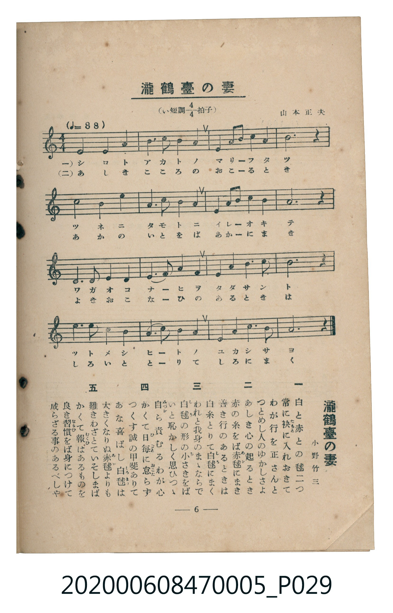

# 瀧鶴臺の妻

> Re:Shōka 使用 AI 協助辨識與重建樂譜，可能會有錯誤。歡迎回報。

- **鋼琴伴奏版**：<br><audio controls src="taki_kakudai_no_tsuma.mp3"></audio>
- **NEUTRINO 歌聲合成版**：<br><audio controls src="taki_kakudai_no_tsuma_neutrino.mp3"></audio>

- 詞：小野竹三
- 曲：山本正夫
- 臺灣教育會公認《新定兒童唱歌》尋常科第五學年用（2020.006.0847.0005）

## 說明

原書資訊與歌詞全文（對應 P029.jpg，書頁 p. 6，第一學期第 6 首）：
調性與拍號：い短調四分之四拍子（A 小調 4/4 拍），♩= 88，小野竹三 作詞、山本正夫 作曲


## 歌詞

```text
一　白と赤との毬二つ
常に袂（たもと）に入れおきて
わが行を正さんと
つとめし人のゆかしさよ

二　あしき心の起るとき
赤の糸をば赤毬（あかまり）にまき
善き行のあるときは
白糸とりて白毬（しろまり）にまく

三　われと我身のまゝならで
白毬（しろまり）の形の小さきをば
いと恥かしく思ひつゝ
自ら責むるわが心

四　かくて日毎（ひごと）に怠（おこた）らず
つくす誠の甲斐ありて
あな喜ばし白毬（しろまり）は
大きくなりぬ赤毬（あかまり）よりも

五　難きわざとていそしまば
かくて報（むくひ）はあるものを
良き習慣（ならひ）をば身につけて
成らざる事のあるべしや
```

## ABC

<div class="abc-score" data-abc-src="taki_kakudai_no_tsuma.abc" aria-label="五線譜載入中"></div>

[下載 ABC 原始檔](taki_kakudai_no_tsuma.abc)

## TMD 檔案連結

- [主旋律 TMD 檔案](taki_kakudai_no_tsuma.tmd) [[在 TMD Studio 編輯](https://tmdlang.github.io/Tmd-TS/#tmd=s7IKdvYPcrWy4qpTUCpJTLdSSM7PyUlNLsnMz7MqzsjMK0nNjM_KTMmPL87Iz05Ugisry88pzU21Si9KTEmNN403MjAyiDcwMIs3sDAxBzIMTBFKi_NLi5JTrYqTM_Lzc-JLUitKkvLzsxHyBUX5Zal5iXlANQVFIBtTwIoQClLLMlNSQdKpKZkl-UWZiTlI7kgtKga7FWxJfElRYl5xclFmAcgDCFUlGalAx-YllpQWpSJEgUalZ-ZZlSRmAj0H8mB5YnxuYmZeTmJeCrKqkox8oD8LMiqtMjKLQQ5ITsyJz07MQwoOqPUFiempVgEGRpZKXFpaCs8blr_ctuVF-67HjeueLtutoKXFpWirYGHBZW-r4MyVnVppq-CYy2Vjom9iBzLoxcp57_fMerqh_2V73_PVO5_s6ASb_2z2JpDwxo3P5qx5tnbx0yWrwcJAY583Ln42deaLpk3P5jQ_bV3zYlXv44auZ9M2PF0362nrpOerlz6dsvHZ2p7HDd1PN3Q_3bHj-fKJz9esebJrytO1O57u3PJ8yor3ezpAMacHjDk9UMwBGQam7_cALebS11KwpRbgUlBQeNo3_9nsHS82t79Y0fWiox3oLqB_n7aueDatHeiKpxt6n7V3KoCCTi-rIP39nh6g4pcLGhUK9BTMgDyQu3c0AN39bM58IFvBTOHlsmlAhwJDBmT4i1X7nzUsBxnb3fti5nyg6OPGlufz1wLFn86e_bSj7cnObiADKPt07QSgdY4KwGAGSioAw14BKAo2qefRzJWg6AGykCNB4cneOUCnPm5oRI4DkCgwZrhAtgNd9rih4fnMvY8bV7zYugRIAiP82XpgSPc8blwC9vyOHY8bV79Y1AS0-3Hj_MdNTUBFQEuBgk9blz5uAqrretzY-7hxGUj146b-x409Lxb2PG6aBLTtcePUx02TgRrAco1g85saHzdOf7ILlLIeN7U9buwGcsHqOiAuAtrc0PC4EWgNULj36f5moMIXW7c_bgIqBLquFxxoIKeue755B9Cax40bgFygm8EOBGoDqtv3uKkL4kYQG6Ln6bQWIAvkNKDFQHUw8x43rgdJA8MAZB7IgUD_LANyYUZOf9wEVIRmZD80-DpBjgV6GhQOK551THyxCygPNB-ofO7jxlWPm4A6lkPNx2Hguqd7F4HIDcCgmwpyENhPkBADOnnFs8alsFDqf9YANHUTKCSb5oIDoh1kxYtNax43AZ3RDQl-YJiBXQdMNuCgBOoFCi97Nn3ps_V9YBcATZgCj8ZnDQvAgkBvA6MKmAI7wa4Gp05wnAE1z3yxagEoxKdsejZtAjj0QIEEUQEM8lVPp80BuhnoRtzeBIfy0yXLwUEONBLocKAZa3DGXVMHSEFTEzRVTAF65eVsYIoChg9Q9zRw5C0DhxAwSIBhA4wUaKBB_ft0wUaQscCAAXGBJRHIEdCYB6ViYPKbBA7DTqBo7_P9k561Lga7AxJrYA2Q5AWKUyACBsVEqK-fdUwAK5oGNOzJLqCF8CS1E-zxFpAiyksfKFDQ0ufiCknMzvROzC5NScz0yw8pLs1NtArITMzLd6gxqKkGWadgY6FlB2ZgKwAVIOUQMP0raJiAypDn6xt04KWWJhYNQEuhhmkANWpaATP3dpAAMIib14KIDgWFGqDgIlC2Xw0VeNzcBxZtngdirwIRe4B4KlDJfohEC8QMEIDaUKNgrKALhiDaBIghImZQESOwiCGQNI8HUiAuSLhGwSweqg8EDUBCYPN8DIH2NE6HigNTIYhsXAHWAowmMK8bLgaMO6jMPrDqLoiuxq1APB8qswTJHpCdUHuMYOZBdIBsBKYkqJ7JYB6YhLoAZg_IBogMSK4byW0gdVjsMQYFcz_cPz3I_gGLAzM9mNyP6R8wCaJXAdV2QmWWY9iDP93sAhXp5KcbWJw_bu4FEd2QdANMD4-bQYkHkm6goktA7DXQdNMEcjQwrYHSTRuWdANKISAIos3BfjOMgzJBQqZgIVCCMgamGliSQiQ3bMkGFtWPG9eCydXQIAMlBWCxAQ96hEwLPFJAol1ISWAZ9uhESzaQpAiLNLBpEBuaJoHZG6AyoOIRGqOgVApxACR-CaQdcFEMtw-RzEFSIHthBoP9CHfJQphjpkI19kKdBJIEOYqUFLSjk7IUtB5UyICSBTBJAInNkDTRBUknQGISiNiElLAaQMq2glhQtcBEhpF-QEUJrDhBlDtGwEIGWNLASxkgCUtg4ORVA2biSEAo-RGR00FhtgoeBZvg0QtPWo0L4GENbDJBZUDJAEcCauqAxglBe-ARCk68wPIGkYRhCXU9dnvAaQcpQYLVPW5cCtUFMgliD6TkA_kcXr5BswrEBaBMhb0cxZtqgA0YissdaOmyEJQcgNUXKCWA0wo41SBXWMtg1RhIGTjpgERXYEk1KGUMJI2glDFgn4HTFbTOIqq-AoUNLOM3wkMVJAMKQ0g4o9RXTW1gHiQ-ITEASj2wtIGr4AGrBNcEyHGLnNoghQOk-EIqPXAVPLCKCVvigVRIoAQDdSi8CpoNt6wBTIJk0bMPogoFyWAWcLVcXLp2CpgNIwWgqDIXAA)]
- [鋼琴伴奏 TMD 檔案](taki_kakudai_no_tsuma_piano.tmd) [[在 TMD Studio 編輯](https://tmdlang.github.io/Tmd-TS/#tmd=s7IKdvYPcrWy4qpTUCpJTLdSyC8qychPL0osyKi0ysgsLskvykxOzInPTsxLVIIrKs4vLUpOjS9ITE-1CjAwslTi0tJSeN6w_OW2LS_adz1uXPd02e73ezpedu95PmHLkz1bni7tf97Z8X5Pp4KWFpeirYKFBZe9rYIzV3Zqpa2CYy6XjYm-iR3I9Bcr573fM-vphv6X7X3PV-98sqMTbOmz2ZtAwhs3Ppuz5tnaxU-XrAYLA-163rj42dSZL5o2PZvT_LR1zYtVvY8bup5N2_B03aynrZOer176dMrGZ2t7Hjd0P93Q_XTHjufLJz5fs-bJrilP1-54unPL8ykrgO40MjAy0DMwMNMzsDAxBzIMTIFOVeLiCknMzvROzC5NScz0yw8pLs1NtArITMzLD_JwqDGoqeZSAAIbCy07MENfS8EWHSiA7NrR8GJhj4KGiQLQW8_XN-gogEJML6sgXROLBi19sGE1CsYKumAIok2AGCJiBhUxAosYAknzeCAF4oKEaxTM4qH6QNAAJAQ2z8ewRuFx43So-OOmXhDZuAKs5XFjE5jXDRcDRiBUZh9YdRdEV-NWIJ4PlVmCZA_ITqg9RjDzIDpANj5uBNkGEp8M5oFJqAtg9oBsgMiA5LqR3AZSh8UeY6BcUz_cPz3I_gGLP26EiO3H9A-YBNGrgGo7oTLLMezBH6u7esiJVVD8gSCINgfbbBgHZYKETMFCoOg2BsYpLMIRiQFbpMIi4nHjWjC5GuohUEQ9boJELSRSYTIt8CADiXYhRdAy7IGNFqmQhAILUrBpEBuaJoHZG6AyTTCl-8BpCOIASOgTiNnG6ZAEArEPkQhBUiB7YQaD_Qh3yUKYY6ZCNfZCnQSSBDmKlPjd0UlO_IIyIiwzInKtETCLAvMpPI8CSVgCAEd_DZiJI4JRUjMin4D8tAoeRJvgwQ-P-sYF8LB43ATTAYomHBHc1AENM4L2wAMcnLiAuRWRxGAJaT12e8Bxi5RgwOoeN86C6gKZBLEHUm6AfA4vHaBJGeICUKLHXgrhjdWns2eTE6soeRQShyh5FGwzON6hJTJRpTHI7bCM0wj3NUgG5EdIOKCUxk1tYB4kvCEhBIpdWNzhyrhgleByDjnskVMDJHNBsj9S7sOVcWHFLrbIhRS3oAiFOhRewM6GW9YAJkGy6MkbUUGAZDALiFrcdbIPcp1sgqiTn69e_6Kv62nr8udzGp_sBLYC-l-s2g9MB8-6e5-unfB0-7Jnnd2QFgpSKR0frxBtFp8bi8RCFjUCMozQxIyBDGNUIRDLABo6uAw1BDINUYVgpiOLQU0HUggDYepIcA0-47CrxOYYmBgeLwMjStdOATOuon2AnsUhY4RTBmgJUEaZCwA)]

## 分析

```text
================================================================================
📊 TMD Song Profile: [ 瀧鶴臺の妻 ]
================================================================================
⏱  Duration:       0:43 (43.6s), 16 measures total
🎼 Key & Tempo:    首調基準 C, != 88.0 BPM, <4/4>
   - 分析範圍：      由實際發聲的音符與和弦推測調性；播放脈絡另行呈現
🎤 人聲音域:    A3 (MIDI 57) – C5 (MIDI 72) [跨度: 15 個半音 / 1.2 個八度, 難度: moderate]
   - 最低音:  A3 in [TakiKakudaiNoTsuma #1 @ m.4, 0:08]
   - 最高音: C5 in [TakiKakudaiNoTsuma #1 @ m.6, 0:13]
   - 適合: soprano, mezzo-soprano, contralto, tenor, baritone, bass
🏛  結構:      TakiKakudaiNoTsuma (43.6s)
⚡ 編曲密度:        Peak 1 軌道同時演奏
🗝  調性診斷：       A 小調（純淨自然小調，未偵測到可信轉調）
   - 風格氣質:    純淨自然小調（陰鬱抒情、旋律集中，無明顯調外色彩）
   - 轉調歷程:    全曲維持單一推測調性（未偵測到可信轉調）
   - 核心骨幹音:  E, A, B, D, C
   - 調性數值:    A 小調 [相關度: 0.81, 穩定度: Moderate, 自然音純度: 100.0%]
   - 候選調性 (K-S): A 小調 (0.81), A 大調 (0.73), E 大調 (0.60)
   - 五度圈歷程:   +3
   - 各段落調性細節:
     • [TakiKakudaiNoTsuma #1]: A 小調 (r: 0.81, 自然音純度: 100.0%)

  [ 五度圈游移軌跡 ]
               C  
         F            G  
      Bb               D  
      Eb              [A ]*
         Ab           E  
            Db       B  
               F# 
     (* = active key center)

  [ 十二半音累積音高分佈 ]
     C  : ████████                  10.0%
     C# :                            0.0%
     D  : █████████                 10.8%
     D# :                            0.0%
     E  : ████████████████████████  28.3%
     F  : ██████                     6.7%
     F# :                            0.0%
     G  : █                          1.7%
     G# :                            0.0%
     A  : ███████████████████████   26.7%
     A# :                            0.0%
     B  : █████████████             15.8%
--------------------------------------------------------------------------------
Assignment 軌道音域：
  - Piano         : A3 – C5 (15 個半音 / 1.2 個八度, 54 個音符)
================================================================================
```


## 原書掃描頁




