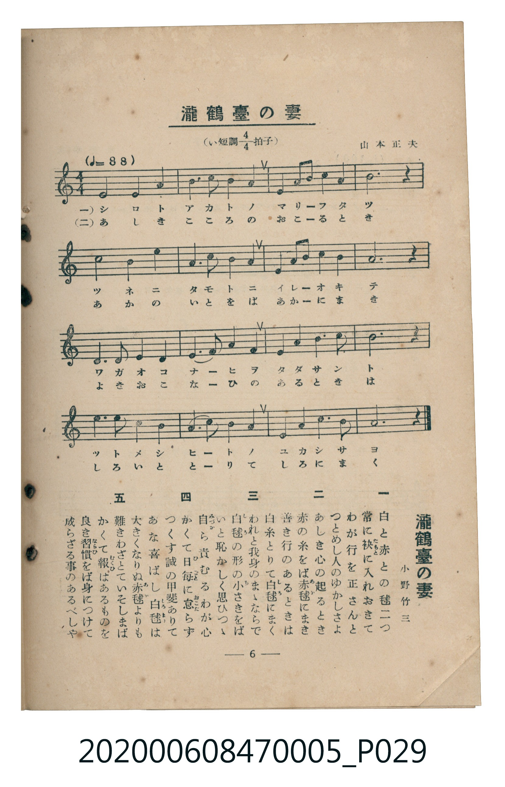

# 瀧鶴臺の妻

> Re:Shoka 使用 AI 辨識樂譜，可能會有錯誤。歡迎回報。

<audio controls src="taki_kakudai_no_tsuma.mp3"></audio>

- 詞：小野竹三
- 曲：山本正夫
- 臺灣教育會公認《新定兒童唱歌》尋常科第五學年用（2020.006.0847.0005）

## 說明

原書資訊與歌詞全文（對應 P029.jpg，書頁 p. 6，第一學期第 6 首）：
調性與拍號：い短調四分之四拍子（A 小調 4/4 拍），♩= 88，小野竹三 作詞、山本正夫 作曲

## 歌詞

```text
一　白と赤との毬二つ
常に袂（たもと）に入れおきて
わが行を正さんと
つとめし人のゆかしさよ

二　あしき心の起るとき
赤の糸をば赤毬（あかまり）にまき
善き行のあるときは
白糸とりて白毬（しろまり）にまく

三　われと我身のまゝならで
白毬（しろまり）の形の小さきをば
いと恥かしく思ひつゝ
自ら責むるわが心

四　かくて日毎（ひごと）に怠（おこた）らず
つくす誠の甲斐ありて
あな喜ばし白毬（しろまり）は
大きくなりぬ赤毬（あかまり）よりも

五　難きわざとていそしまば
かくて報（むくひ）はあるものを
良き習慣（ならひ）をば身につけて
成らざる事のあるべしや
```

## ABC

```abc
X:1
T:瀧鶴臺の妻
C:曲：山本正夫
M:4/4
L:1/16
Q:1/4=88
K:Am
V:V1 name="Piano" snm="Pia"
[V:V1]
E8 E4 F4 | E4 A4 E4 D4 | C4 B,2 C2 D4 E4 | A,12 z4 |
A8 A4 B4 | c4 B4 A4 G4 | F4 E2 D2 E4 A4 | E12 z4 |
D4 D4 E4 F4 | E4 D2 C2 B,4 E4 | A4 A4 B4 c4 | B12 z4 |
c4 B4 A4 E4 | F4 E2 D2 E4 A,4 | D4 C4 B,4 E4 | A,12 z4 |
```

## TMD 檔案連結

- [主旋律 TMD 檔案](taki_kakudai_no_tsuma.tmd) [[在 TMD Studio 編輯](https://tmdlang.github.io/Tmd-TS/#tmd=s7IKdvYPcrWy4qpTUCpJTLdSSM7PyUlNLsnMz7MqzsjMK0nNjM_KTMmPL87Iz05Ugisry88pzU21Si9KTEmNN403MjAyiDcwMIs3sDAxBzIMTBFKi_NLi5JTrYqTM_Lzc-JLUitKkvLzsxHyBUX5Zal5iXlANQVFIBtTwIoQClLLMlNSQdKpKZkl-UWZiTlI7kgtKga7FWxJfElRYl5xclFmAcgDCFUlGalAx-YllpQWpSpxaWkpPG9Y_nLblhftux43rnu6bLeClhaXoq2ChQWXva2CM1d2aqWtgmMul42JvokdyJAXK-e93zPr6Yb-l-19z1fvfLKjE2z2s9mbQMIbNz6bs-bZ2sVPl6wGCwONfd64-NnUmS-aNj2b0_y0dc2LVb2PG7qeTdvwdN2sp62Tnq9e-nTKxmdrex43dD_d0P10x47nyyc-X7Pmya4pT9fueLpzy_MpK97v6QAFqh4wUPVAgQpkGJi-3wO0mEtfS8GWWoBLQUHhad_8Z7N3vNjc_mJF14uOdqC7gP592rri2bR2oCuebuh91t6pEGBgZKmXVZD-fk8PUPHLBY0KBXoKZkAeyN07GoDufjZnPpCtYKbwctk0oEOBIQMy_MWq_c8aloOM7e59MXM-UPRxY8vz-WuB4k9nz37a0fZkZzeQAZR9unYC0DpHBWAwAyUVgGGvABQFm9TzaOZKUPQAWciRoPBk7xygUx83NCLHAUgUGDNcINuBLnvc0PB85t7HjStebF0CJIER_mw9MKR7HjcuAXt-x47HjatfLGoC2v24cf7jpiagIqClQMGnrUsfNwHVdT1u7H3cuAyk-nFT_-PGnhcLex43TQLa9rhx6uOmyUANYLlGsPlNjY8bpz_ZBUpZj5vaHjd2A7lgdR0QFwFtbmh43Ai0Bijc-3R_M1Dhi63bHzcBFQJd1wsONJBT1z3fvANozePGDUAu0M1gBwK1AdXte9zUBXEjiA3R83RaC5AFchrQYqA6mHmPG9eDpIFhADIP5ECgf5YBuTAjpz9uAipCM7IfGnydIMcCPQ0KhxXPOia-2AWUB5oPVD73ceOqx01AHcuh5uMwcN3TvYtA5AZg0E0FOQjsJ0iIAZ284lnjUlgo9T9rAJq6CRSSTXPBAdEOsuLFpjWPm4DO6IYEPzDMwK4DJhtwUAL1AoWXPZu-9Nn6PrALgCZMgUfjs4YFYEGgt4FRBUyBnWBXg1MnOM6Amme-WLUAFOJTNj2bNgEceqBAgqgABvmqp9PmAN0MdCNub4JD-emS5eAgBxoJdDjQjDU4466pA6SgqQmaKqYAvfJyNjBFAcMHqHsaOPKWgUMIGCTAsAFGCjTQoP59umAjyFhgwIC4wJII5AhozINSMTD5TQKHYSdQtPf5_knPWheD3QGJNbAGSPICxSkQAYNiItTXzzomgBVNAxr2ZBfQQniS2gn2eAtIEeWlDxQoaOlzcYUkZmd6J2aXpiRm-uWHFJfmJloFZCbm5TvUGNQoVIPsU7Cx0LIDM7CVgAqQggiYARQ0TECFyPP1DTrwYksTiwagrVDDNIAaNa2AuXs7SAAYxs1rQUSHgkINUHARKN-vhgo8bu4DizbPA7FXgYg9QDwVqGQ_RKIFYgYIQG2oUTBW0AVDEG0CxBARM6iIEVjEEEiaxwMpEBckXKNgFg_VB4IGICFwasHt_12gsol8_8Pc_ri5F0R0Q_wP9NfjZlAgQPwPFV0CYq-B-r9pFRADwwzk_zYs_gf5FARBtDnEt3FQJkjIFCwEChhjoO9hQYMINmK9v6OTMu-vB8U0yE9A_wCJzRAPdUE8CSQmgYhNSKHSAFK2FcSCqgWGEIbnQfEJi1NE5BsBYxoY3fCoRgodcNjUgJkk-B5YHFIc-dAoXgjyFjAvgHwE9jPY98ipfxksT4CUgYMAJLoCi-9RIhriV5SIBgUBJIygGQBP4q_l4tK1U8AsKRSAospcXAA)]
- [鋼琴伴奏 TMD 檔案](taki_kakudai_no_tsuma_piano.tmd) [[在 TMD Studio 編輯](https://tmdlang.github.io/Tmd-TS/#tmd=s7IKdvYPcrWy4tLSUnjesPzlti0v2nc9blz3dNnu93s6XnbveT5hy5M9W54u7X_e2fF-T6eClhaXoq2ChQWXva2CM1d2aqWtgmMul42JvokdV52C0ouV897vmfV0Q__L9r7nq3c-2dGpBBJ-NnsTSHjjxmdz1jxbu_jpktVgYaBdzxsXP5s680XTpmdzmp-2rnmxqvdxQ9ezaRuerpv1tHXS89VLn07Z-Gxtz-OG7qcbup_u2PF8-cTna9Y82TXl6dodT3dueT5lBdCdRgZGBnoGBmZ6BhYm5kCGgSnQqUpcXCGJ2ZneidmlKYmZfvkhxaW5iVYBmYl5-UEeDjUGNQrVXApAYGOhZQdm6Gsp2KIDBZBlOxpeLOxR0DBRAPrr-foGHYUAAyNLvayCdE0sGrT0wYbVKBgr6IIhiDYBYoiIGVTECCxiCCTN44EUiAsSrlEwi4fqA0EDkBAXftft6iHHdSB3gCCINoe4JQ7KBAmZgoVAzjYGug3mcISniHXcjk5yHAcKDViIIILOCBhOwMCCBxSS68FurwEzSXDd09mzyXEdSkBB3IISUCAnQvwAjV48UVuLO5H6oCRSE0Qifb56_Yu-rqety5_PaXyyE5gv-l-s2g_0y7Pu3qdrJzzdvuxZZzckzyJFd3y8QrRZfG4sEgtZ1AjIMEITMwYyjFGFQCwDoLPxGWoIZBqiCsFMRxaDmg6kEAbC1JHgGnzGYVeJzTEwMTxeBsaUrp0CZmQp4BRV5uICAA)]

## 分析

```text
================================================================================
📊 TMD Song Profile: [ 瀧鶴臺の妻 ]
================================================================================
⏱  Duration:       0:43 (43.6s), 16 measures total
🎼 Key & Tempo:    首調基準 C, != 88.0 BPM, <4/4>
   - 分析範圍：      由實際發聲的音符與和弦推測調性；播放脈絡另行呈現
🎤 人聲音域:    A3 (MIDI 57) – C5 (MIDI 72) [跨度: 15 個半音 / 1.2 個八度, 難度: moderate]
   - 最低音:  A3 in [TakiKakudaiNoTsuma #1 @ m.4, 0:08]
   - 最高音: C5 in [TakiKakudaiNoTsuma #1 @ m.6, 0:13]
   - 適合: soprano, mezzo-soprano, contralto, tenor, baritone, bass
🏛  結構:      TakiKakudaiNoTsuma (43.6s)
⚡ 編曲密度:        Peak 1 軌道同時演奏
🗝  調性診斷：       A 小調（純淨自然小調，未偵測到可信轉調）
   - 風格氣質:    純淨自然小調（陰鬱抒情、旋律集中，無明顯調外色彩）
   - 轉調歷程:    全曲維持單一推測調性（未偵測到可信轉調）
   - 核心骨幹音:  E, A, B, D, C
   - 調性數值:    A 小調 [相關度: 0.81, 穩定度: Moderate, 自然音純度: 100.0%]
   - 候選調性 (K-S): A 小調 (0.81), A 大調 (0.73), E 大調 (0.60)
   - 五度圈歷程:   +3
   - 各段落調性細節:
     • [TakiKakudaiNoTsuma #1]: A 小調 (r: 0.81, 自然音純度: 100.0%)

  [ 五度圈游移軌跡 ]
               C  
         F            G  
      Bb               D  
      Eb              [A ]*
         Ab           E  
            Db       B  
               F# 
     (* = active key center)

  [ 十二半音累積音高分佈 ]
     C  : ████████                  10.0%
     C# :                            0.0%
     D  : █████████                 10.8%
     D# :                            0.0%
     E  : ████████████████████████  28.3%
     F  : ██████                     6.7%
     F# :                            0.0%
     G  : █                          1.7%
     G# :                            0.0%
     A  : ███████████████████████   26.7%
     A# :                            0.0%
     B  : █████████████             15.8%
--------------------------------------------------------------------------------
Assignment 軌道音域：
  - Piano         : A3 – C5 (15 個半音 / 1.2 個八度, 54 個音符)
================================================================================
```


## 原書掃描頁




