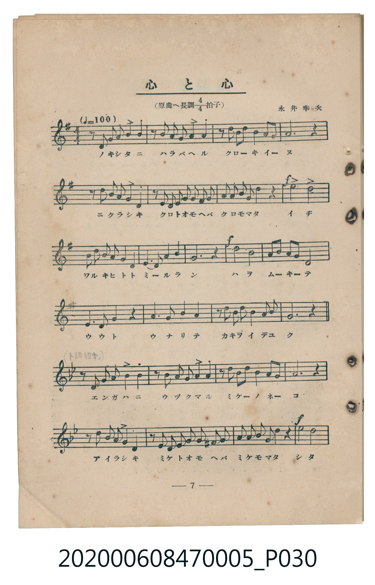
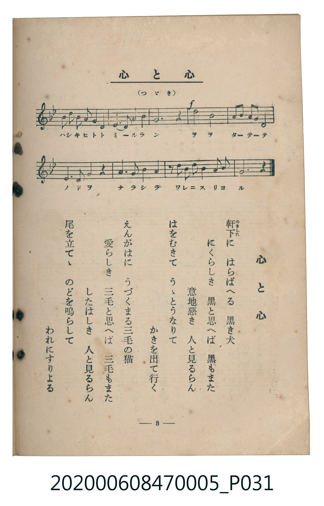

# 心と心

> Re:Shoka 使用 AI 協助辨識與重建樂譜，可能會有錯誤。歡迎回報。

<audio controls src="kokoro_to_kokoro.mp3"></audio>

- 曲：永井幸次
- 臺灣教育會公認《新定兒童唱歌》尋常科第五學年用（2020.006.0847.0005）

## 說明

原書資訊與歌詞全文（對應 P030.jpg – P031.jpg，書頁 pp. 7–8，第一學期第 7 首）：
調性與拍號：原曲へ長調四分之四拍子（前半 G 大調、後半轉 F 大調 4/4 拍），♩= 100，永井幸次 作曲

## 歌詞

```text
軒下（のきした）に　はらばへる　黒き犬
にくらしき　黒と思へば　黒もまた
意地惡き　人と見るらん
はをむきて　うゝとうなりて
かきを出て行く

えんがはに　うづくまる三毛の猫
愛らしき　三毛と思へば　三毛もまた
したはしき　人と見るらん
尾を立てゝ　のどを鳴らして
われにすりよる
```

## ABC

```abc
X:1
T:心と心
C:曲：永井幸次
M:4/4
L:1/16
Q:1/4=100
K:G
V:V1 name="Piano" snm="Pia"
[V:V1]
z2 D2 G2 A2 B4 A4 | z2 A2 B2 c2 d4 B4 | z2 d2 e2 d2 B4 A4 | G12 z4 |
z2 D2 G2 A2 B4 A4 | z2 D2 E2 F2 G2 A2 B2 c2 | d2 B2 d2 e2 d4 z4 | !f! g8 e8 |
d2 B2 d2 e2 d4 B4 | A6 B2 c4 A4 | !f! B8 z4 g4 | e4 d4 B2 d2 B2 G2 |
D6 D2 D4 z4 | G6 G2 A4 A4 | z2 B2 A2 B2 c4 A4 | G12 z4 |
[K:F] z2 C2 F2 G2 A4 G4 | z2 G2 A2 B2 c4 A4 | z2 c2 d2 c2 A4 G4 | F12 z4 |
z2 C2 F2 G2 A4 G4 | z2 C2 D2 E2 F2 G2 A2 =B2 | c2 A2 c2 d2 c4 z4 | !f! f8 d8 |
c2 A2 c2 d2 c4 A4 | G6 A2 B4 G4 | !f! A8 z4 f4 | d4 c4 A2 c2 A2 F2 |
C6 C2 C4 z4 | F6 F2 G4 G4 | z2 A2 G2 A2 B4 G4 | F12 z4 |
```

## TMD 檔案連結

- [主旋律 TMD 檔案](kokoro_to_kokoro.tmd) [[在 TMD Studio 編輯](https://tmdlang.github.io/Tmd-TS/#tmd=s7IKdvYPcrWy4qpTUCpJTLdSSM7PyUlNLsnMz7MqzsjMK0nNjM_KTMmPL87Iz05Ugisry88pzU21Si9KTEmNN403MjAyiDcwMIs3sDAxBzIMTBFKi_NLi5JTrYqTM_Lzc-JLUitKkvLzsxHyBUX5Zal5iXlANQVFIBtTwIoQClLLMlNSQdKpKZkl-UWZiTlI7kgtKga7FWxJfElRYl5xclFmAcgDCFUlGalAx6YVZabmpQB9VYAuk5qbD9GgpaXwdH_z48YVQFJBS4tL0VbB0MCAy95WwZ3LxkTfxA6k8dnsTe_3zHq2YceTXVOf7tzxbM1CsHkv2nc9b1z8bOrMF02bns1pftq65sWq3scNXc-mbXi6btbT1knPVy99OmXjs7U9jxu6n27ofrpjx_PlE5-vWfNk15Sna3c83bnl-ZQV7_d0gMJSDxiWeqCwBDIMTN_v6VTi4tLXUrClFuBSUFB42jf_2ewdLza3v1jR9aKjHeiuFyvnPW1d8WxaO9AVTzf0PmvvVAgwMDbQyypIV3jUMBnEMQRx3u_pAep8uaBRoaBAT8EcKGUBFAL5ZEcD0CfP5swHshXMFV4umwZ0OjCsQNa9WLX_WcNykEXdvS9mzgeKgh2w6XHjjpdTtwNln86e_bSj7cnObiADqObp2gkgZ3T2Pu3tUnBXeLpkOVDN44bGp_t6gCIv9nYquEEFFYARowDUAbar59HMleBIAzkSKYoUnuydA7SNC-yU3ZOe7OgGmv64cd3jxt7HjdMfNwId1Pm4cfXjhobHjesfNwHZG4Aue9zUDRR5uXsSUNnzrjUgzSBFjf1gFUBtwAiGSK941jAXpAGoDSLS1PS4cR_QXJCeZy39T-dseNa8EKLhya5dQA0vlnWDjAca1DQZYjDQXqA-oAOATloGdknb4yagqStAjMZVj5u6gOIQpd0gRU2TnrYDTVr2YmEP0Elgrz1u7AAa97gRKLAe5h2g3qUgJwOd09T9ZEfns_WzgR5_3rMa4rTZyH6BSaN4ByqI7CNImIEtgenE6qmnG4CWAlM-0L3LQH4BuQcY5iuBgi83b4HZDPFUEzBUge4GBu9MkFebgD7pBklQntyhQEFLn4vLOz87vyg_JB9CWwVkJublO9QY1ChUg-xSsLHQsgMzsGU3BUhyBKZdSGJ_v3ceMLECg19Bw9AM6Nf-5-sbdOB5RhOLAUAXQA1_3NwH9PJaIN4OxPuB_m_uVlCoAckCmf1AvBKIJwDxDJDAarhc03ogF6iveQ9YP5BYApJ73NwDlgcDqDU1CgYKpvEKhgpGCsYKukBSFywE4pkomAJ5IFGwIgUzIEaoMQSSMGgAEkG4uhvqAqDrgC6HOAHdZR1A9iogvQjsepAvgO6Dy4JE50H8DHEk2AcQfzcR436gkFm8gjlMwgQoCHI8xBNQBytUp9UqGMZB_WAGpZH8AXLNakgMNE8CuxlCgEJyPsQxwAAGhTvIr2DhzYgABsUQWGwTiL0AqhpsGEhXG5IXkJ0GCW-QP0BsE7ifQOKwsIY7vAbsbIg2kCGGSM5vWgYJ8WUQR8PCESLa3AXEq0AMoDtgcQPz6yZIcD9ubgfiZdCIwUw4wDAGOQhIgVmQMIUkC1CoIyLDGBoHuJMOnuwELsuh2WnXFFB2al2NKzuhVEF48lY1sLZ2q0WE1ApwzD1uWgOJNORsBg6-VmjSnIeazYCJ4HHTRmh89oEEeiFhjJQKaJfNmoCZBBhNWLMZ3GVYsxlcFks2AxoE8TdUjLRspk5WPgOWZOASjtx8BsxgsHwGKSUh-YtO-QwU8yBLOyFOgAYkMIOBRWGRg5TPwOUKKKmBysmdIAFQDC0H6wL6ESPlUDGf1XJx6dopoNZvCkARZS4uAA)]
- [鋼琴伴奏 TMD 檔案](kokoro_to_kokoro_piano.tmd) [[在 TMD Studio 編輯](https://tmdlang.github.io/Tmd-TS/#tmd=s7IKdvYPcrWy4tLSUni6v_lx4wog-X5Px8vuPc8nbHmyZ8vTpf3POzve7-lU0NLiUrRVMDQw4LK3VXDnsjHRN7HjqlNQejZ70_s9s55t2PFk19SnO3c8W7NQCST8on3X88bFz6bOfNG06dmc5qeta16s6n3c0PVs2oan62Y9bZ30fPXSp1M2Plvb87ih--mG7qc7djxfPvH5mjVPdk15unbH051bnk9ZAXSJkYGRgZ6BgZmegYWJOZBhYAp0jBIXl3d-dn5Rfkg-hLYKyEzMyw_ycKgxqFGo5lIAAhsLLTswQ19LwRYdKDzt7H3a26WgYWim8HRD__P1DToKAQbGBnpZBemaWJRr6YONqlEwUDCNVzBUMFIwVtAFkrpgIRDPRMEUyAOJghUpmAExQo0hkIRBA5AIPuOAQmbxCuYwCROgIMgsiJlQ_QrVabUKhnFQI82gNMxYZOUQJ4HMBrFN4PaAxGHOgRtWAzYKog1kiCHCyHiwaiAFZkEcAfEWyJkI1xtDHY3b63hiZV8PrlhReNQwGcQxJBBF1cDU6VY7gLGlPtyiqxZ7ZvNByWwmiMz2fMr8p91Tn23Z_WzvxCc7u5_Onv2su_fp2gnPps54sqv76fZlzzq7ISULIlsZxitEG8YC3QqkTeNjwR6AMqFSEDUmKGqgUkDKAO5xYk2CqgFqBAenCcRwKIVmGFwj3ChMRxiA9NaADUDSAY8NJH0gKzFdiVME6jvMxE2XMDMC0kYYXh8yoQZMu7p2CqjJVwEooszFBQA)]

## 分析

```text
================================================================================
📊 TMD Song Profile: [ 心と心 ]
================================================================================
⏱  Duration:       1:16 (76.8s), 32 measures total
🎼 Key & Tempo:    首調基準 G, != 100.0 BPM, <4/4>
   - 分析範圍：      由實際發聲的音符與和弦推測調性；播放脈絡另行呈現
🎤 人聲音域:    C4 (MIDI 60) – G5 (MIDI 79) [跨度: 19 個半音 / 1.6 個八度, 難度: challenging]
   - 最低音:  C4 in [KokoroToKokoro #1 @ m.17, 0:38]
   - 最高音: G5 in [KokoroToKokoro #1 @ m.8, 0:16]
   - 適合: soprano, mezzo-soprano, tenor, baritone
🏛  結構:      KokoroToKokoro (76.8s)
⚡ 編曲密度:        Peak 1 軌道同時演奏
🗝  調性診斷：       G 大調（流行色彩大調，未偵測到可信轉調）
   - 風格氣質:    流行大調（略帶和弦色彩音與裝飾副屬和弦）
   - 轉調歷程:    全曲維持單一推測調性（未偵測到可信轉調）
   - 核心骨幹音:  G, A, D, C, F
   - 調性數值:    G 大調 [相關度: 0.76, 穩定度: Moderate, 自然音純度: 86.2%]
   - 候選調性 (K-S): G 大調 (0.76), C 大調 (0.69), A 小調 (0.63)
   - 五度圈歷程:   +1
   - 各段落調性細節:
     • [KokoroToKokoro #1]: G 大調 (r: 0.76, 自然音純度: 86.2%, 調外音: F, A#)

  [ 五度圈游移軌跡 ]
               C  
         F           [G ]*
      Bb               D  
      Eb               A  
         Ab           E  
            Db       B  
               F# 
     (* = active key center)

  [ 十二半音累積音高分佈 ]
     C  : ███████████████           13.4%
     C# :                            0.0%
     D  : █████████████████         15.2%
     D# :                            0.0%
     E  : ██████                     4.9%
     F  : █████████████             11.6%
     F# : █                          0.4%
     G  : ████████████████████████  21.4%
     G# :                            0.0%
     A  : ███████████████████████   20.1%
     A# : ███                        2.2%
     B  : ████████████              10.7%
--------------------------------------------------------------------------------
Assignment 軌道音域：
  - Piano         : C4 – G5 (19 個半音 / 1.6 個八度, 132 個音符)
================================================================================
```


## 原書掃描頁






