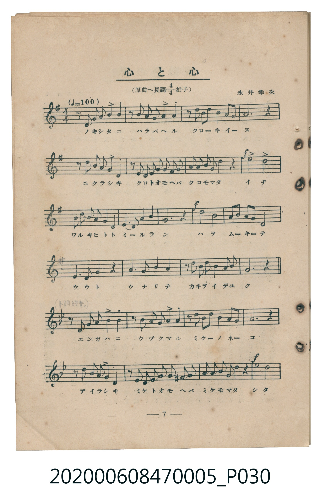
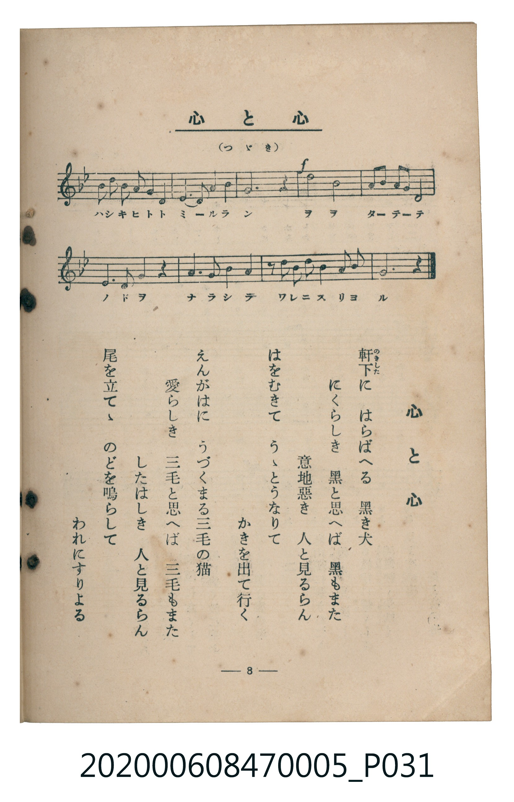

# 心と心

> Re:Shōka 使用 AI 協助辨識與重建樂譜，可能會有錯誤。歡迎[回報](https://github.com/TMDLang/reshoka/issues)。

- **鋼琴伴奏版**：<br><audio controls src="kokoro_to_kokoro.mp3"></audio>
- **NEUTRINO 歌聲合成版**：<br><audio controls src="kokoro_to_kokoro_neutrino.mp3"></audio>

- 曲：永井幸次
- 臺灣教育會公認《新定兒童唱歌》尋常科第五學年用（2020.006.0847.0005）

## 說明

原書資訊與歌詞全文（對應 P030.jpg – P031.jpg，書頁 pp. 7–8，第一學期第 7 首）：
調性與拍號：原曲へ長調四分之四拍子（前半 G 大調、後半轉 F 大調 4/4 拍），♩= 100，永井幸次 作曲


## 歌詞

```text
軒下（のきした）に　はらばへる　黒き犬
にくらしき　黒と思へば　黒もまた
意地惡き　人と見るらん
はをむきて　うゝとうなりて
かきを出て行く

えんがはに　うづくまる三毛の猫
愛らしき　三毛と思へば　三毛もまた
したはしき　人と見るらん
尾を立てゝ　のどを鳴らして
われにすりよる
```

## ABC

<div class="abc-score" data-abc-src="kokoro_to_kokoro.abc" aria-label="五線譜載入中"></div>

[下載 ABC 原始檔](kokoro_to_kokoro.abc)

## TMD 檔案連結

- [主旋律 TMD 檔案](kokoro_to_kokoro.tmd) [[在 TMD Studio 編輯](https://tmdlang.github.io/Tmd-TS/#tmd=s7IKdvYPcrWy4qpTUCpJTLdSSM7PyUlNLsnMz7MqzsjMK0nNjM_KTMmPL87Iz05Ugisry88pzU21Si9KTEmNN403MjAyiDcwMIs3sDAxBzIMTBFKi_NLi5JTrYqTM_Lzc-JLUitKkvLzsxHyBUX5Zal5iXlANQVFIBtTwIoQClLLMlNSQdKpKZkl-UWZiTlI7kgtKga7FWxJfElRYl5xclFmAcgDCFUlGalAx6YVZabmpQB9VYAuk5qbj6oBaEt6Zp5VSWIm0N8gv5cnxucmZublJOalIKsqycgHBkFBRqVVRmYxyG3JiTnx2Yl5SCEFdVlBYnqqVYCBsYEukDBU4tLSUni6v_lx4wogqaClxaVoq2BoYMBlb6vgzmVjom9iBzLg2exN7_fMerZhx5NdU5_u3PFszUKwuS_adz1vXPxs6swXTZuezWl-2rrmxarexw1dz6ZteLpu1tPWSc9XL306ZeOztT2PG7qfbuh-umPH8-UTn69Z82TXlKdrdzzdueX5lBXv93SAYk0PGGt6oFgDMgxM3-_pVOLi0tdSsKUW4FJQUHjaN__Z7B0vNre_WNH1oqMd6K4XK-c9bV3xbFo70BVPN_Q-a-9UAIWNXlZBusKjhskgjiGI835PD1DnywWNCgUFegrmQCkLoBDIJzsagD55Nmc-kK1grvBy2TSg04FhBbLuxar9zxqWgyzq7n0xcz5QFOyATY8bd7ycuh0o-3T27KcdbU92dgMZQDVP104AOaOz92lvl4K7wtMly4FqHjc0Pt3XAxR5sbdTwQ0qqACMGAWgDrBdPY9mrgRHGsiRSFGk8GTvHKBtXGCn7J70ZEc30PTHjeseN_Y-bpz-uBHooM7HjasfNzQ8blz_uAnI3gB02eOmbqDIy92TgMqed60BaQYpauwHqwBqA0YwRHrFs4a5IA1AbRCRpqbHjfuA5oL0PGvpfzpnw7PmhRANT3btAmp4sawbZDzQoKbJEIOB9gL1AR0AdNIysEvaHjcBTV0BYjSuetzUBRSHKO0GKWqa9LQdaNKyFwt7gE4Ce-1xYwfQuMeNQIH1MO8A9S4FORnonKbuJzs6n62fDfT4857VEKfNRvYLTBrFO1BBZB9BwgxsCUwnVk893QC0FJjyge5dBvILyD3AMF8JFHy5eQvMZoinmoChCnQ3MHhngrzaBPRJN0iC8uQOBQpa-lxc3vnZ-UX5IfkQ2iogMzEv36HGoKYaZJWCjYWWHZiBLbcpQFIjMOlC0vr7vfOAaRUY-goahmZAr_Y_X9-gA88ymlgMADoAavjj5j6gj9cC8XYg3g_0fnO3gkINSBbI7AfilUA8AYhngARWw-Wa1gO5QH3Ne8D6gcQSkNzj5h6wPBhAralRMFAwjVcwVDBSMFbQBZK6YCEQz0TBFMgDiYIVKZgBMUKNIZCEQQOQCNg4nxqFeGDErwPiXlACAOL5QElgjIE1geSAbmvqBNIbgHgHSK6pGy4H9FNTL1g9hGwByzxuXINkWTzcMnAQdUO9CwwKYDBB_IseDB1A9iogvQgcVKAgAxoKlwWJzoMEMCREwMEFCeQmYgILKGQWr2AOkzABCoJCChJi0NBRqE6rVTCMg_rBDEqjBNpqaACAAmc6PBCQAwaYeYC4C8huAgceKBBBwQOVBYvugwY5OJigQQiCjxsXoVgKDjxQEACtBaWx5knggIIQoLQyHxICwCQESlmgAAYLb0YkIVAaBIttArEXQFWDDQPpakMKN-TwgKQoUOCB2CbwgASJw1ITPLRqwGEF0QYyxBARZsDCAJx4IEltEzh0QP4EkSCf74f5HJzAQOEKFm-ajJSQQMkRIjoJrKYBKfEtQwmrpmWQNLUMEkKwlAIRbQbGSfMqEAPoaVjqgwUs0GWgBPW4uR2Il0GTHmY-BKYikKuAFJgFSTWQXAZKV4jkZgxNZQRzIrBYh0Z9GzRYYIkCJg7MFE1dCM-Ckxo0QIEBAkk8jxuXP24CaYCkNPSMiKckBNfC0JJw1xRQSdi6GldJiNJ4wFMsVtvbutUiIgWYH4Ap8nHTGkhiRC4gwTHVCs3n81ALSGDifty0EZpO-0ACvZDoRErdNC0gQSXSZCDdA02ByAUkKLKWQnI1MDejFpD7gXgiWP06MLkWGi-wNI1ZQDYBizdg8sNaQMKDAWsBCZfFUkACDYIEMlSMtAJSncwSElS-teAoISEhg6uEhMpiLSFBJkGyA0gUrYQEFTGg2pfcEhJYNMJKSEgNDikZ6VRCgipbcCVMQQkJLhnhJSS0OgcVF-glJCgjgXwIjB2Qf6FJBVg0gkVhyQ-phARXP6CcC6rDd4IEQGlwOVgXMEAxMiItSkhQNgJ5BeQ8kAdhiWIVNGAQSQ1eQoKrHVDGBVXYM8GqQC1RaCiBQhI1J9ZycenaKaC2KRWAIspcAA)]
- [鋼琴伴奏 TMD 檔案](kokoro_to_kokoro_piano.tmd) [[在 TMD Studio 編輯](https://tmdlang.github.io/Tmd-TS/#tmd=s7IKdvYPcrWy4qpTUCpJTLdSyC8qychPL0osyKi0ysgsLskvykxOzInPTsxLVIIrKs4vLUpOjS9ITE-1CjAwNtAFEoZKXFpaCk_3Nz9uXAEk3-_peNm95_mELU_2bHm6tP95Z8f7PZ0KWlpcirYKhgYGXPa2Cu5cNib6JnYgU5_N3vR-z6xnG3Y82TX16c4dz9YsBFv2on3X88bFz6bOfNG06dmc5qeta16s6n3c0PVs2oan62Y9bZ30fPXSp1M2Plvb87ih--mG7qc7djxfPvH5mjVPdk15unbH051bnk9ZAXSJkYGRgZ6BgZmegYWJOZBhYAp0jBIXl3d-dn5Rfkg-hLYKyEzMyw_ycKgxqKnmUgACGwstOzBDX0vBFh0oPO3sfdrbpaBhaKbwdEP_8_UNOgqgwNDLKkjXxKJcSx9sVI2CgYJpvIKhgpGCsYIukNQFC4F4JgqmQB5IFKxIwQyIEWoMgSQMGoBEwMb51CjEKzxuXAfEvUA8HYjnAyUfN64GawLJrVd43NQJpDcA8Q6QXFM3XK4fyOsFq4eQLWCZx41rkCyLh1uGw-1AIbN4BXOYhAlQEORwiAegjlWoTqtVMIyDGmkGpVH8sBrqHpBbp8PdhOxOYNIC4i4guwnsF5CfQK6FyoJF90FDAOxqqI9A8HHjIhRLUd0ICXSQh0BsE7jnQOKwAIf7oAbsfog2kCGGCH88bgK5pRsaG5vALgbZDSJBrtkPcw04DkB-BYs3TUYKa1CMQUQngdU0IMXPMmT3gxQD3REPYUGCGZJKQBGBiB9jaLQQTEmPG9ugYdUGdTMsFGHiq4Du6UK4BBw3UN8CXQsJ7ceNyx83gTRAogY9IeHJUPt6cGUohUcNk0EcQwK5q9re1q2WhvmsAxxXjxt7oLGEnM9AYbYUkhqBqRA1n-0H4olg9evA5Fpo8MDinax8pk5mRgNlkxYcGQ3iUFwZDSqLNaOBTIIkEpAozTMaqFgDF3cUZDRwBoNnNGjBCUrYtM9ooGQAsmcl1HZYKK6CuhoRN_CMBi5aQAkPVFDOBKvqetzUAfUCyJuoKakWewXng1zBmSAquOdT5j_tnvpsy-5neyc-2dn9dPbsZ929T9dOeDZ1xpNd3U-3L3vW2Q2pzBFVmWG8QrRhLDBYgLRpfCw4rKBMqBREjQmKGqgUkDKAhzGxJkHVADWCk4kJxHAohWYYXCPcKExHGID01oANQNIBj3gkfSArMV2JUwTqO4xSiS5BZgSkjTB8PmQCDZhyde0UUBOvAlBEmQsA)]

## 分析

```text
================================================================================
📊 TMD Song Profile: [ 心と心 ]
================================================================================
⏱  Duration:       1:16 (76.8s), 32 measures total
🎼 Key & Tempo:    首調基準 G, != 100.0 BPM, <4/4>
   - 分析範圍：      由實際發聲的音符與和弦推測調性；播放脈絡另行呈現
🎤 人聲音域:    C4 (MIDI 60) – G5 (MIDI 79) [跨度: 19 個半音 / 1.6 個八度, 難度: challenging]
   - 最低音:  C4 in [KokoroToKokoro #1 @ m.17, 0:38]
   - 最高音: G5 in [KokoroToKokoro #1 @ m.8, 0:16]
   - 適合: soprano, mezzo-soprano, tenor, baritone
🏛  結構:      KokoroToKokoro (76.8s)
⚡ 編曲密度:        Peak 1 軌道同時演奏
🗝  調性診斷：       G 大調（流行色彩大調，未偵測到可信轉調）
   - 風格氣質:    流行大調（略帶和弦色彩音與裝飾副屬和弦）
   - 轉調歷程:    全曲維持單一推測調性（未偵測到可信轉調）
   - 核心骨幹音:  G, A, D, C, F
   - 調性數值:    G 大調 [相關度: 0.76, 穩定度: Moderate, 自然音純度: 86.2%]
   - 候選調性 (K-S): G 大調 (0.76), C 大調 (0.69), A 小調 (0.63)
   - 五度圈歷程:   +1
   - 各段落調性細節:
     • [KokoroToKokoro #1]: G 大調 (r: 0.76, 自然音純度: 86.2%, 調外音: F, A#)

  [ 五度圈游移軌跡 ]
               C  
         F           [G ]*
      Bb               D  
      Eb               A  
         Ab           E  
            Db       B  
               F# 
     (* = active key center)

  [ 十二半音累積音高分佈 ]
     C  : ███████████████           13.4%
     C# :                            0.0%
     D  : █████████████████         15.2%
     D# :                            0.0%
     E  : ██████                     4.9%
     F  : █████████████             11.6%
     F# : █                          0.4%
     G  : ████████████████████████  21.4%
     G# :                            0.0%
     A  : ███████████████████████   20.1%
     A# : ███                        2.2%
     B  : ████████████              10.7%
--------------------------------------------------------------------------------
Assignment 軌道音域：
  - Piano         : C4 – G5 (19 個半音 / 1.6 個八度, 132 個音符)
================================================================================
```


## 原書掃描頁






