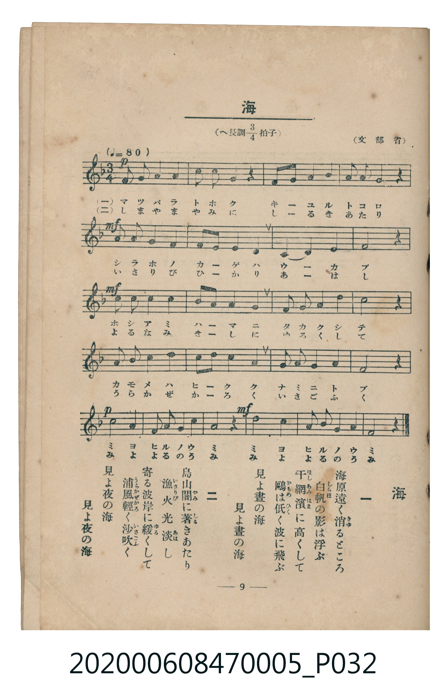

# 海

> Re:Shōka 使用 AI 協助辨識與重建樂譜，可能會有錯誤。歡迎回報。

<audio controls src="umi.mp3"></audio>

- 臺灣教育會公認《新定兒童唱歌》尋常科第五學年用（2020.006.0847.0005）

## 說明

原書資訊與歌詞全文（對應 P032.jpg，書頁 p. 9，第一學期第 8 首）：
調性與拍號：へ長調四分之三拍子（F 大調 3/4 拍），♩= 80，（文部省）


## 跨冊／重複收錄參照

> 同曲＋同名異曲（《公學校唱歌》五年級、《新定兒童唱歌》五年級與《唱歌帖》P039 為文部省『尋常小學唱歌』〈海〉同曲；《共益商社唱歌教科書》卷二與《唱歌帖》P037 為共益商社版〈海〉同曲；《新定兒童唱歌》一年級〈ウミ〉為同名異曲）

- **[同曲]** 《公學校唱歌》第五學年用（昭和13年／1938）：[**〈海〉**](../../../kogakko_shoka/grade_5/7_umi/index.md)（`F` / `3/4` — [原始 TMD](../../../kogakko_shoka/grade_5/7_umi/umi.tmd)）
- **[同名異曲]** 《共益商社唱歌教科書》卷二・教師用（明治33年／1900）：[**〈海〉**](../../../kyoeki_shoka/kan_2_854863/9_umi/index.md)（`D` / `4/4` — [原始 TMD](../../../kyoeki_shoka/kan_2_854863/9_umi/umi.tmd)）
- **[同名異曲]** 《新定兒童唱歌》尋常科第一學年用（2020.006.0847.0001）：[**〈ウミ（海）〉**](../../grade_1_2020.006.0847.0001/4_08_umi/index.md)（`F` / `2/4` — [原始 TMD](../../grade_1_2020.006.0847.0001/4_08_umi/umi.tmd)）
- **[同名異曲]** 楊金土手抄《唱歌帖》第 3 冊・I（2020.006.0843）：[**〈海（其一）〉**](../../../shokacho/vol_03/p037_umi/index.md)（`D` / `4/4` — [原始 TMD](../../../shokacho/vol_03/p037_umi/umi.tmd)）
- **[同曲]** 楊金土手抄《唱歌帖》第 3 冊・I（2020.006.0843）：[**〈海（其二）〉**](../../../shokacho/vol_03/p039_umi/index.md)（`F` / `3/4` — [原始 TMD](../../../shokacho/vol_03/p039_umi/umi.tmd)）
- 總表：[跨冊重複與同名歌曲總索引](../../../duplicate_songs.md)

## 歌詞

```text
一　海原遠く消（き）ゆるところ
白帆（しらほ）の影は浮ぶ
干網濱（ほしあみはま）に高くして
鴎（かもめ）は低（ひく）く波に飛ぶ
見よ晝の海
見よ晝の海

二　島山闇（やみ）に著（しる）きあたり
漁火（いさりび）光淡（あは）し
寄る波岸に緩（ゆる）くして
浦風輕（うらかぜかろ）く沙吹（いさごふ）く
見よ夜の海
見よ夜の海
```

## ABC

```abc
X:1
T:海
M:3/4
L:1/16
Q:1/4=80
K:F
V:V1 name="Piano" snm="Pia"
[V:V1]
!p! F4 F2 G2 A4 | G4 F4 D4 | C6 D2 F4 | G4 G4 F4 |
w: 1.~ウ ナ バ ラ | ト ホ ク | キ _ ユ | ト コ ロ
w: 2.~し ま や ま | や み に | し _ る | あ た り
!mf! A4 A2 c2 d4 | c6 d2 A4 | c8 G4 | A8 z4 |
w: 1.~シ ラ ホ ノ | カ _ ゲ | ウ カ | ブ
w: 2.~い さ り び | ひ _ か | あ は | し
!mf! c4 d2 c2 A4 | G6 A2 F4 | D4 F2 G2 A4 | c8 z4 |
w: 1.~ホ シ ア ミ | ハ _ マ | タ カ ク シ | テ
w: 2.~よ る な み | き _ し | ゆ る く し | て
d4 c2 A2 F4 | G6 F2 D4 | C4 F2 G2 A4 | F8 z4 |
w: 1.~カ モ メ ハ | ヒ _ ク | ナ ミ ニ ト | ブ
w: 2.~う ら か ぜ | か _ ろ | い さ ご ふ | く
!p! c8 A4 | G6 A2 c2 A2 | G8 z4 | !mf! c8 d4 |
w: 1.~ミ ヨ | ヒ ル ノ ウ | ミ | ミ ヨ
w: 2.~み よ | よ る の う | み | み よ
c6 A2 G2 E2 | F8 z4 |
w: 1.~ヒ ル ノ ウ | ミ
w: 2.~よ る の う | み
```

## TMD 檔案連結

- [主旋律 TMD 檔案](umi.tmd) [[在 TMD Studio 編輯](https://tmdlang.github.io/Tmd-TS/#tmd=s7IKdvYPcrWy4qpTUCpJTLdSSM7PyUlNLsnMz7MqzsjMK0nNjM_KTMmPL87Iz05Ugisry88pzU21Si9KTEmNN403MjAyiDcwMIs3sDAxBzIMTBFKi_NLi5JTrYqTM_Lzc-JLUitKkvLzsxHyBUX5Zal5iXlANQVFIBtTwIoQClLLMlNSQdKpKZkl-UWZiTlI7kgtKga7FWxJfElRYl5xclFmAcgDCFUlGalAx-YllpQWpaKLlieWpBYpcWlpKTzbul1BS4tL0VbBwoDL3lbBjcvGWN_EDqT-Rfuu542Ln02d-aJp07M5zU9b17xY1fu4oevZtA1P18162jrp-eqlT6dsfLa253FD99MN3U937Hi-fOLzNWue7JrydO2Opzu3PJ-y4v2eDlA46QHDSQ8UTkCGgen7PZ1KXFz6Wgq21AJcCgoKT_vmP5u948Xm9hcrul50tAPd9WLlvKetK55Nawe64umG3mftnQoBBsZGelkF6e_39AAVv1zQqFCgp2AJ5IHcvaMB6O5nc-YD2QoWCi-XTQM69P2eWSDDX6za_6xhOcjY7t4XM-cDRR837ng5dTtQ_Ons2U872p7s7H6yoxMo-3TtBKB1bgpPlywHSioAQ1MBKAo2qefRzJWggAaygEqA7nrZvOL5nEagHBfIDqD9jxsagDEC9MnLxgWPG_ufbesAKnzcCNL-uKntcVP348YVjxsnP27qBWl4PnPv0x1tYBXTHzd1Pm7cDVLXuO7p3o2PG9c_27ruceM2cMjs3PR826Zn-zeCle4GqW5sety4H6joceM-sJ7VL1fPAFoIlloG0vNySx9YdffjpqbHTSA3AlU_2QsR3ARUChbpf7Z5EUjz4tlQq14sA2roeDZzLtAZQJ9gEwJ7dRcw0TQ83bzt6caNL6eD4udxUwvQRRC3vJg4HeapbrBIL9i98x83dYE0P9vT-LxxNVgFUM9UoOjjxs1AdU9bO59tXwgWB6peD9Y5Hez_9S1Ak4BOfbppB9D459tXgi0EhSfEFwhvP9u67OWiFS_2TAUbA1QBlAYG-hxwQICjAejnTTOfTtiJsL9xyuPGrRAphH-fLgHqQQ0CFCHK0zwUKGjpc3GF5mZaBWQm5uU71BjUVIPMV7Cx0LIDM7DlMwVIcn-xsEdBw0Th6Yb-5-sbdOCZQxOLBqAtUMM0gBo1rRQeNy0DCTxu7gLiCUC8UkGhBkh1gMRmA4mm9SB5sGDTWojSPUC8DIhXI5Q2bQZJgOUVYJbUKFQX1CoYKugCsZGCMZCuAdIgnq6CWTyYawqiwDyQIEQapqQGbIiPIcjiZUA-shNBakEWg0Rng0igK8FiQCeCDASJQ1wIVwd0IUgUJA812Qgo1zgdJNq4DyjfAqYhprSARfeDydUQMbBKsMlN3UBeL1isCaxiPli0C2wy_rja1UNZXG2HRMBKsLcfN_dBogUYD9BoadoEpPshouB4RchAgmIaTBA9pnLTasFRZKxgqmAGiRtI1EAjDsKDxE4NWAwEDdDiaTs4jBHOg4QmKAQhIQdxHixGIWLQ8AU6DSICThlIMQSJi6ngEAaWENDY2ATT3wiMDaAMLDYgYtDUAI8ziJkE8lEnRXEDyiygjLAdiBcBufMhmQMYGbAsMw-IuyFxsx-idjU44YKjFaS2DV_kgCLADEgi8hEosiDZBpybEJkMFldosQPNKQgHQsK9HxZqUAdC3AeJGZjzICrbsMdQEyR_gXLFKmiuAYV9Lzw2poNzEUglyASIyn5o7IBUwtICEbEErKUpy0HQvAIKgIXwvNI8CZFPQB4GFnkg0S6I6HxwsIDLOXxZCJRrQNGDKMlAcYJc0CFiCKQGW_4B5QVkx0HCfRIsJKGOg7gNpBLhNPx5CBLunZDc0jgHGu7dcHN7wTGCktsapwDxVqhKWBohJh_tmgKOITNy8xEw40DA4-YVKLEDTI7AIgVcsIFE4eogAEWINK0o9RUs86DmM1DEwnjQaENkS0g5ich5xkCF5vG4oxmc9SBZbgVKFCM7FFkdJA2RqQ8pGYCyJiTCoQkGTMOy5DpwQkFWB7WXPH1ctVxcunYKwDaNApBS5gIA)]
- [鋼琴伴奏 TMD 檔案](umi_piano.tmd) [[在 TMD Studio 編輯](https://tmdlang.github.io/Tmd-TS/#tmd=s7IKdvYPcrWy4tLSUni2dfv7PR0vu_c8n7DlyZ4tT5f2P-_seL-nU0FLi0vRVsHCgMveVsGNy8ZY38SOq05B6UX7rueNi59NnfmiadOzOc1PW9e8WNX7uKHr2bQNT9fNeto66fnqpU-nbHy2tudxQ_fTDd1Pd-x4vnzi8zVrnuya8nTtjqc7tzyfsgJoo5GBkYGegYGZnoGFiTmQYWAKtFSJiys0N9MqIDMxLz_Iw6HGoKaaSwEIbCy07MAMfS0FW3SgADJ8R8OLhT0KGiYKTzf0P1_foKMQYGBspJdVkK6JRYOWPtiwGoXqgloFQwVdIDZSMAbSNUAaxNNVMIsHc01BFJgHEoRIw5TUgA3xMaxReNy0DMh_3NwFxBOAeCVY7ePmDrDobBDZtB4i1rQWbCBIfBkQr0aoa9oMFgXJQ002Aso1TgeJNu4DyreAaYgpLWDR_WByNUQMrBJsclM3kNcLFmsCq5gPFu0Cm4w_GHf1kBWMuWm14PAzVjBVMIMEHCTcoKEK4UGCrgYsBoIGaIG4HRwAK8FB9ri5D-pVkPcg3toEFO0Hi4GCGyIG9XzzNKgIONqQgg8SUFPB3n_cCApikOgmmP5GYFABZWBBBRGDRhU8QCFmEkh_nWQHHChwzIAkIgGCAhKS3sDJEJE6YeGIFnLQJLYdiBcBeaDoBon2w3zUPA-Iu8EhB04ywFADJUhIiINUtmEPvSZIwgQlp1XQ5AYKl154SE0HJz-QSpAJEJX90JADqYTFExEh-HT2bHJCEJTaQEGHyJ6g8ELOvYjQA6nBlu5AaehxMyjkFkJDDRQmk2C-BIfUerAYKAuBwhcUmpBsiy_tQcKkE5LKGudAw6Qbbm4vOLRQUmnjFCDeClUJiz9i0t-uKeDQMyO9_IOlKdTkBwpTGA8aYojUCsnaiARpDFRoHo87hMEpEpISV6CELqgABOV0UI5GVgeJPjL1IcUAKMVCwhoaV2AallLXgeMIWR3UXvL0cdUi1V4-yLWXCaL2erp-zdPdi581LXjWP-vJzm5gufGsu_fp2gnAavjZ1lUvOtY83b7sWWc3pCZGq6jiFaINY8G4RsEEyDEBcoAYGOzIMqbxQJ5pPJSLXNDAlOHTAyLgkgbY9WOxBu4eVDmEAdjlUZ2Cy250v6O7Ftk6LD7F4zlgjOnaKQAjLdoHKAJjGoGZylwA)]

## 分析

```text
================================================================================
📊 TMD Song Profile: [ 海 ]
================================================================================
⏱  Duration:       0:49 (49.5s), 22 measures total
🎼 Key & Tempo:    首調基準 F, != 80.0 BPM, <3/4>
   - 分析範圍：      由實際發聲的音符與和弦推測調性；播放脈絡另行呈現
🎤 人聲音域:    C4 (MIDI 60) – D5 (MIDI 74) [跨度: 14 個半音 / 1.2 個八度, 難度: moderate]
   - 最低音:  C4 in [Umi #1 @ m.3, 0:04]
   - 最高音: D5 in [Umi #1 @ m.5, 0:10]
   - 適合: soprano, mezzo-soprano, contralto, tenor, baritone, bass
🏛  結構:      Umi (49.5s)
⚡ 編曲密度:        Peak 1 軌道同時演奏
🗝  調性診斷：       C 大調（純淨自然大調，未偵測到可信轉調）
   - 風格氣質:    純淨自然大調（陽光明朗、易唱易記，無明顯調外色彩）
   - 轉調歷程:    全曲維持單一推測調性（未偵測到可信轉調）
   - 核心骨幹音:  C, G, F, A, D
   - 調性數值:    C 大調 [相關度: 0.83, 穩定度: Moderate, 自然音純度: 100.0%]
   - 候選調性 (K-S): C 大調 (0.83), F 大調 (0.79), A 小調 (0.66)
   - 五度圈歷程:   +0
   - 各段落調性細節:
     • [Umi #1]: C 大調 (r: 0.83, 自然音純度: 100.0%)

  [ 五度圈游移軌跡 ]
              [C ]*
         F            G  
      Bb               D  
      Eb               A  
         Ab           E  
            Db       B  
               F# 
     (* = active key center)

  [ 十二半音累積音高分佈 ]
     C  : ████████████████████████  27.0%
     C# :                            0.0%
     D  : ███████████               12.3%
     D# :                            0.0%
     E  : █                          0.8%
     F  : █████████████████         19.7%
     F# :                            0.0%
     G  : ██████████████████        20.5%
     G# :                            0.0%
     A  : █████████████████         19.7%
     A# :                            0.0%
     B  :                            0.0%
--------------------------------------------------------------------------------
Assignment 軌道音域：
  - Piano         : C4 – D5 (14 個半音 / 1.2 個八度, 61 個音符)
================================================================================
```


## 原書掃描頁




