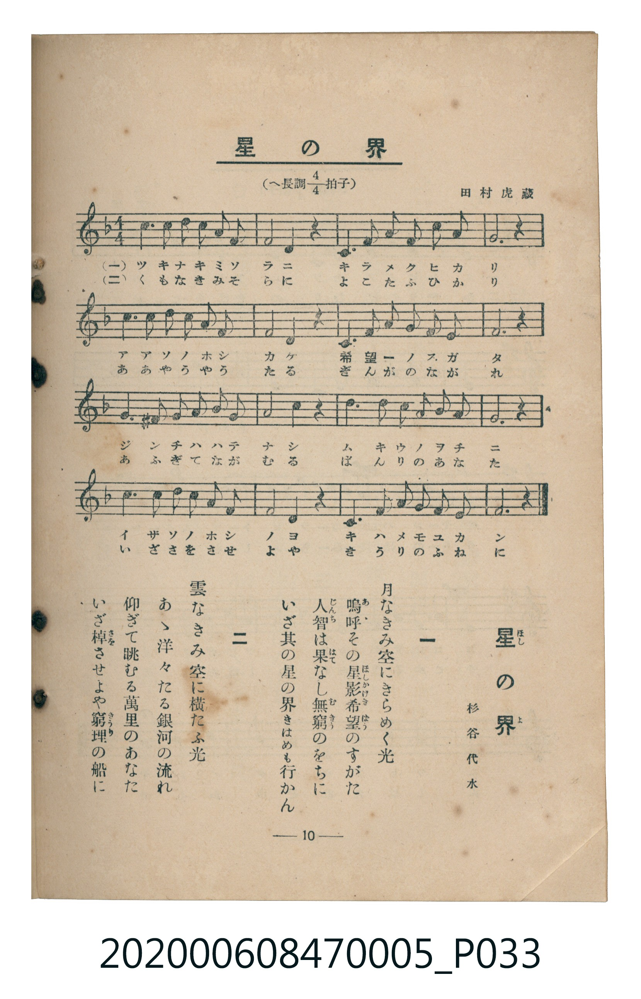

# 星の界

<audio controls src="hoshi_no_yo.mp3"></audio>

- 詞：杉谷代水
- 曲：田村虎藏（編）
- 臺灣教育會公認《新定兒童唱歌》尋常科第五學年用（2020.006.0847.0005）

## 說明

原書資訊與歌詞全文（對應 P033.jpg，書頁 p. 10，第一學期第 9 首）：
調性與拍號：へ長調四分之四拍子（F 大調 4/4 拍），杉谷代水 作詞、田村虎藏

## 歌詞

```text
一　月なきみ空にきらめく光
嗚呼（あゝ）その星影（ほしかげ）希望（きばう）のすがた
人智（じんち）は果（はて）なし無窮（むきう）のをちに
いざ其の星の界（よ）きはめも行かん

二　雲なきみ空に横たふ光
あゝ洋々たる銀河の流れ
仰ぎて眺むる萬里のあなた
いざ棹（さを）させよや窮理（きうり）の船に
```

## ABC

```abc
X:1
T:星の界
C:曲：田村虎藏（編）
M:4/4
L:1/16
Q:1/4=92
K:F
V:V1 name="Piano" snm="Pia"
[V:V1]
c6 c2 d2 c2 A2 F2 | F8 D4 z4 | C6 F2 A2 F2 c4 | A12 z4 |
c6 c2 d2 c2 A2 F2 | F8 D4 z4 | C6 F2 A2 G2 F2 E2 | F12 z4 |
G6 ^F2 G2 A2 B2 G2 | A8 c4 z4 | d6 d2 c2 A2 B2 A2 | G12 z4 |
c6 c2 d2 c2 A2 F2 | F8 D4 z4 | C6 F2 A2 G2 F2 E2 | F12 z4 |
```

## TMD 檔案連結

- [主旋律 TMD 檔案](hoshi_no_yo.tmd)
- [鋼琴伴奏 TMD 檔案](hoshi_no_yo_piano.tmd)

## 分析

```text
================================================================================
📊 TMD Song Profile: [ 星の界 ]
================================================================================
⏱  Duration:       0:41 (41.7s), 16 measures total
🎼 Key & Tempo:    首調基準 F, != 92.0 BPM, <4/4>
   - 分析範圍：      由實際發聲的音符與和弦推測調性；播放脈絡另行呈現
🎤 人聲音域:    C4 (MIDI 60) – D5 (MIDI 74) [跨度: 14 個半音 / 1.2 個八度, 難度: moderate]
   - 最低音:  C4 in [HoshiNoYo #1 @ m.3, 0:05]
   - 最高音: D5 in [HoshiNoYo #1 @ m.1, 0:01]
   - 適合: soprano, mezzo-soprano, contralto, tenor, baritone, bass
🏛  結構:      HoshiNoYo (41.7s)
⚡ 編曲密度:        Peak 1 軌道同時演奏
🗝  調性診斷：       F 大調（純淨自然大調，未偵測到可信轉調）
   - 風格氣質:    純淨自然大調（陽光明朗、易唱易記，無明顯調外色彩）
   - 轉調歷程:    全曲維持單一推測調性（未偵測到可信轉調）
   - 核心骨幹音:  F, C, A, D, G
   - 調性數值:    F 大調 [相關度: 0.93, 穩定度: High, 自然音純度: 99.1%]
   - 候選調性 (K-S): F 大調 (0.93), C 大調 (0.73), A 小調 (0.62)
   - 五度圈歷程:   -1
   - 各段落調性細節:
     • [HoshiNoYo #1]: F 大調 (r: 0.93, 自然音純度: 99.1%, 調外音: F#)

  [ 五度圈游移軌跡 ]
               C  
        [F ]*          G  
      Bb               D  
      Eb               A  
         Ab           E  
            Db       B  
               F# 
     (* = active key center)

  [ 十二半音累積音高分佈 ]
     C  : █████████████████████     25.9%
     C# :                            0.0%
     D  : █████████                 11.6%
     D# :                            0.0%
     E  : █                          1.8%
     F  : ████████████████████████  29.5%
     F# : █                          0.9%
     G  : █████████                 11.6%
     G# :                            0.0%
     A  : ██████████████            17.0%
     A# : █                          1.8%
     B  :                            0.0%
--------------------------------------------------------------------------------
Assignment 軌道音域：
  - Piano         : C4 – D5 (14 個半音 / 1.2 個八度, 59 個音符)
================================================================================
```


## 原書掃描頁




