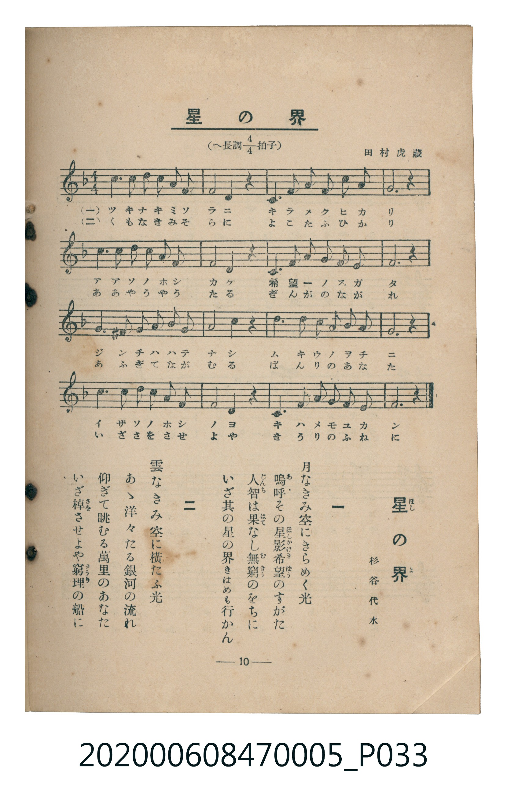

# 星の界

> Re:Shōka 使用 AI 協助辨識與重建樂譜，可能會有錯誤。歡迎回報。

- **鋼琴伴奏版**：<br><audio controls src="hoshi_no_yo.mp3"></audio>
- **NEUTRINO 歌聲合成版**：<br><audio controls src="hoshi_no_yo_neutrino.mp3"></audio>

- 詞：杉谷代水
- 曲：田村虎藏（編）
- 臺灣教育會公認《新定兒童唱歌》尋常科第五學年用（2020.006.0847.0005）

## 說明

原書資訊與歌詞全文（對應 P033.jpg，書頁 p. 10，第一學期第 9 首）：
調性與拍號：へ長調四分之四拍子（F 大調 4/4 拍），杉谷代水 作詞、田村虎藏


## 歌詞

```text
一　月なきみ空にきらめく光
嗚呼（あゝ）その星影（ほしかげ）希望（きばう）のすがた
人智（じんち）は果（はて）なし無窮（むきう）のをちに
いざ其の星の界（よ）きはめも行かん

二　雲なきみ空に横たふ光
あゝ洋々たる銀河の流れ
仰ぎて眺むる萬里のあなた
いざ棹（さを）させよや窮理（きうり）の船に
```

## ABC

<div class="abc-score" data-abc-src="hoshi_no_yo.abc" aria-label="五線譜載入中"></div>

[下載 ABC 原始檔](hoshi_no_yo.abc)

## TMD 檔案連結

- [主旋律 TMD 檔案](hoshi_no_yo.tmd) [[在 TMD Studio 編輯](https://tmdlang.github.io/Tmd-TS/#tmd=s7IKdvYPcrWy4qpTUCpJTLdSSM7PyUlNLsnMz7MqzsjMK0nNjM_KTMmPL87Iz05Ugisry88pzU21Si9KTEmNN403MjAyiDcwMIs3sDAxBzIMTBFKi_NLi5JTrYqTM_Lzc-JLUitKkvLzsxHyBUX5Zal5iXlANQVFIBtTwIoQClLLMlNSQdKpKZkl-UWZiTlI7kgtKga7FWxJfElRYl5xclFmAcgDCFUlGalAx-YllpQWpSJEgUalZ-ZZ5aZmZmVicVd-UUlGPtCDBRmVVhmZxSCbkxNz4rMT85DCAWpvQWJ6qlWAgbGxEpeWlsKzGfMfN657PrVHQUuLS9FWwdKIy95WwY3LxkTfxA6k9cXKee_3zHo2t_PFhu1Pdi9-tmEL2MRnszcBhZ9P2fBs7sQXM_teTO9_v6fj-fYV7_d0guVftO963rj42dSZL5o2PZvT_LR1zYtVvY8bup5N2_B03aynrZOer176dMrGZ2t7Hjd0P93Q_XTHjufLJz5fs-bJrilP1-54unPL8ylAwzpAsaUHjC09UGwBGQamYBu49LUUbKkFuBQUFJ72zX82e8eLze0vVnS96GgHugvo8aetK55Nawe64umG3mftnQqgUNPLKkh_v6cHqPjlgkaFAj0FQwMgF-TwHQ1Ahz-bMx_IVrBUeLlsGtClwDACmf5i1f5nDctB5nb3vpg5Hyj6uHHHy6nbgeJPZ89-2tH2ZGc3kAGUfbp2AtA-N4WnS5YDJRWAsaAAFAWb1IMcCQpP9s4BuvBxQyNyHHCBLAM65HFDw7M5HY8bVz1u7H3cuP_5yl2PG1eD2E2dj5saHzf2P23tBPt6-qynE_cALXzc2PS4aS7QmseNc4HpAZgqnu7dCBbf_bhx-uPG7seNk4CyT3f0PJszGywONHfD48Y2sJZ1jxtnPm7sedw4H2z_rl3PZu4CK5rxuGny48aFYEXrn82bAxZc_7hxGVgE6Lrpz1sWPl-1DiTe1AA2FGZi0ySgRqCrQSY-bmx53Djtaes2iNMgCRaspwOsGqhtPchfTU0vFgJd0Q20FRISu4Cpq-Hl7E1oIfFsBZALNGYrNBggvn-2pftxQytIoqn7ZVfDs02bQdZtBRrbAzZsN9C_fUC3P5-zC-TYpu4XE9a8bAfaB_R-E9gGsPchjn22eCfYs1OBHgG7cerjxtlA9z5uagH69_kEoDchgdj2uKkL4uUXHTuh_qU8SUOBgpY-F5dHPrB09MuPzLcKyEzMy3eoMaipBtmiYGOhZQdmYMtMCpAkDQxQBQ0Thacb-p-vb9CB5wBNLBqAdkEN0wBq1LRSeNzcAhJ43LQWyOyC0vOB9F6FGiBrJUgSKN3cDWEAxYAqwCIrgXghkLseSE8C0qvBGlZB1IEA1K4aBVMFXSA0VTADYmMFQ6CIIVhEV8EsHkgYADFQEYipC5QBqQDpqAGyIKpAEKwIbJ6PIcieFrAobmdDdIHcrasAMhnicIgYLpcjbAPrgNhmBJRr7Ifa1gRkrwLiXiDeD8RzweZ2wmxrXI1kWwdUbDIQA13WuBWINwFxN1i2C8M2_LG8q4eiWG5aBInlReAgetzcB8SzgeztYMeshsZy0yZYLAMLERADWJAAFe6BaGjaCcRrwBr2UyGWjYCkeTySMizRDHQvJOBxuRsa8ECHY0bzhMdNy8AMdLfjjucmaJwB47mpBUi3wWmQ7Hy4dUipqrEPKgaK5x4gXgdNIz1g23pIjOcdnZTF8w5I5twMxI1A3A_FYA8AMwo0nrfDc3PzAogIMP8AQwsSwMBUCtQMkoTmepR4NoLEoDqQYaxgAiQRGRWUBCDxbAaJeHBSMAFimDbssbwDGmO4XA0L9u2IYAe6G14AYHU44UgGZUigrkagbqQIa8AayRsQkQzMupBIhhQGyAmDyEgGtiIoi-QlkDjbhi1TAHmQSG5eAY9kWJENClNgwdcMzE3NQF9DC77N9MrMS6CBiMvd0IAHOhwzM-NyOu5ohtYQjdOAeCpQB7CkB9GNs5FKZ5BrQOpg0dwL1QPK97BoBiWTtWBZWHGDsK2Wi0vXTgFeeSsAOcpcAA)]
- [鋼琴伴奏 TMD 檔案](hoshi_no_yo_piano.tmd) [[在 TMD Studio 編輯](https://tmdlang.github.io/Tmd-TS/#tmd=s7IKdvYPcrWy4qpTUCpJTLdSyC8qychPL0osyKi0ysgsLskvykxOzInPTsxLVIIrKs4vLUpOjS9ITE-1CjAwNlbi0tJSeDZj_uPGdc-n9rzf0_Gye8_zCVue7NnydGn_886O93s6FbS0uBRtFSyNuOxtFdy4bEz0TexA5r1YOe_9nlnP5na-2LD9ye7FzzZsAVvzbPYmoPDzKRuezZ34Ymbfi-n9QFOfb18BNAks_6J91_PGxc-mznzRtOnZnOanrWterOp93ND1bNqGp-tmPW2d9Hz10qdTNj5b2_O4ofvphu6nO3Y8Xz7x-Zo1T3ZNebp2x9OdW55PARrWYWRgZKBnYGCmZ2BhYg5kGJiCbeDyyC_OyPTLj8y3CshMzMsP8nCoMaip5lIAAhsLLTswQ19LwRYdKICs2NHwYmGPgoaJwtMN_c_XN-gogMJIL6sgXROLBi19sGE1CqYKukBoqmAGxMYKhkARQ7CIroJZPJAwAGKgIhBTFygDUgHSUQNkQVSBIFgR2DwfwxqFx80tYNHHTWuB7C4oPR9I7wXqe9y8EqrrcXM3kASZDBQFqoGIrQTihUD-eiA9CUivButZhWQbWAfENiOgXGM_1LYmIHsVEPcC8X4gngs2txNmW-NqJNs6oGKTgRjossatQLwJiLvBsl0YtuEP-V099Ah5IyBpHo-kDEvQNy2CBsYicHA_bu4D4tlA9nawx0BBAJHfhCXoJzxuWgZmADU17QTiNWDp_XjCvgkajsCwb2oB0m1wGiQ7H24dUkw39kHFQGHfA8TroPHWA7ath8Sw39FJTtgbQUJVHcgwVjABkogEDYoWSNibQSIDHD0mQAzThj3kd0BDcTMQNwJxPxSDgwKYDWBBsR0RFM0LoGLADAIMekhsAZMhUD9IFhRohAIelHCBuhqBupECsQFrwG9ABDwwiUMCHpJpkCOLyIB_Onv2oEn0S6Ae24Yt0QN50MBoXoEIDHiiB0URsLxpBmaYZmAgQsubzXiCHlq6NU4D4qlAHcBSCkQ3zkYqWUCuAamDBX0vVA8of8CCHhR1a8GysGyJsK0Woy7wQa4LTBB1wdP1y1_OnfOir-tle--Tnd0vGqe9WLng6Z5-YPw86-59unbC0-3LnnV2QypFRDwYxitEG8bCqBoFEyDDJBZEGWCRNY0HskzjY8EMoAJSDIHrRVaPMAPFaGzqYKbS1jHAANe1U4CHebQPUApVwAgsoMwFAA)]

## 分析

```text
================================================================================
📊 TMD Song Profile: [ 星の界 ]
================================================================================
⏱  Duration:       0:41 (41.7s), 16 measures total
🎼 Key & Tempo:    首調基準 F, != 92.0 BPM, <4/4>
   - 分析範圍：      由實際發聲的音符與和弦推測調性；播放脈絡另行呈現
🎤 人聲音域:    C4 (MIDI 60) – D5 (MIDI 74) [跨度: 14 個半音 / 1.2 個八度, 難度: moderate]
   - 最低音:  C4 in [HoshiNoYo #1 @ m.3, 0:05]
   - 最高音: D5 in [HoshiNoYo #1 @ m.1, 0:01]
   - 適合: soprano, mezzo-soprano, contralto, tenor, baritone, bass
🏛  結構:      HoshiNoYo (41.7s)
⚡ 編曲密度:        Peak 1 軌道同時演奏
🗝  調性診斷：       F 大調（純淨自然大調，未偵測到可信轉調）
   - 風格氣質:    純淨自然大調（陽光明朗、易唱易記，無明顯調外色彩）
   - 轉調歷程:    全曲維持單一推測調性（未偵測到可信轉調）
   - 核心骨幹音:  F, C, A, D, G
   - 調性數值:    F 大調 [相關度: 0.93, 穩定度: High, 自然音純度: 99.1%]
   - 候選調性 (K-S): F 大調 (0.93), C 大調 (0.73), A 小調 (0.62)
   - 五度圈歷程:   -1
   - 各段落調性細節:
     • [HoshiNoYo #1]: F 大調 (r: 0.93, 自然音純度: 99.1%, 調外音: F#)

  [ 五度圈游移軌跡 ]
               C  
        [F ]*          G  
      Bb               D  
      Eb               A  
         Ab           E  
            Db       B  
               F# 
     (* = active key center)

  [ 十二半音累積音高分佈 ]
     C  : █████████████████████     25.9%
     C# :                            0.0%
     D  : █████████                 11.6%
     D# :                            0.0%
     E  : █                          1.8%
     F  : ████████████████████████  29.5%
     F# : █                          0.9%
     G  : █████████                 11.6%
     G# :                            0.0%
     A  : ██████████████            17.0%
     A# : █                          1.8%
     B  :                            0.0%
--------------------------------------------------------------------------------
Assignment 軌道音域：
  - Piano         : C4 – D5 (14 個半音 / 1.2 個八度, 59 個音符)
================================================================================
```


## 原書掃描頁




