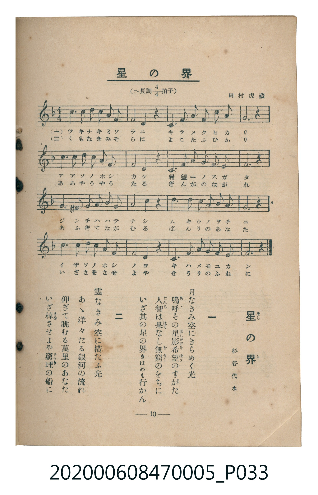

# 星の界

> Re:Shōka 使用 AI 協助辨識與重建樂譜，可能會有錯誤。歡迎回報。

- **鋼琴伴奏版**：<br><audio controls src="hoshi_no_yo.mp3"></audio>
- **NEUTRINO 歌聲合成版**：<br><audio controls src="hoshi_no_yo_neutrino.mp3"></audio>

- 詞：杉谷代水
- 曲：田村虎藏（編）
- 臺灣教育會公認《新定兒童唱歌》尋常科第五學年用（2020.006.0847.0005）

## 說明

原書資訊與歌詞全文（對應 P033.jpg，書頁 p. 10，第一學期第 9 首）：
調性與拍號：へ長調四分之四拍子（F 大調 4/4 拍），杉谷代水 作詞、田村虎藏


## 歌詞

```text
一　月なきみ空にきらめく光
嗚呼（あゝ）その星影（ほしかげ）希望（きばう）のすがた
人智（じんち）は果（はて）なし無窮（むきう）のをちに
いざ其の星の界（よ）きはめも行かん

二　雲なきみ空に横たふ光
あゝ洋々たる銀河の流れ
仰ぎて眺むる萬里のあなた
いざ棹（さを）させよや窮理（きうり）の船に
```

## ABC

```abc
X:1
T:星の界
C:曲：田村虎藏（編）
M:4/4
L:1/16
Q:1/4=92
K:F
V:V1 name="Piano" snm="Pia"
[V:V1]
c6 c2 d2 c2 A2 F2 | F8 D4 z4 | C6 F2 A2 F2 c4 | A12 z4 |
w: 1.~ツ キ ナ キ ミ ソ | ラ ニ | キ ラ メ ク ヒ | リ
w: 2.~く も な き み そ | ら に | よ こ た ふ ひ | り
c6 c2 d2 c2 A2 F2 | F8 D4 z4 | C6 F2 A2 G2 F2 E2 | F12 z4 |
w: 1.~ア ア ソ ノ ホ シ | カ ゲ | キ バウ _ ノ ス ガ | タ
w: 2.~あ あ や う や う | た る | ぎ ん が の な が | れ
G6 ^F2 G2 A2 B2 G2 | A8 c4 z4 | d6 d2 c2 A2 B2 A2 | G12 z4 |
w: 1.~ジ ン チ ハ ハ テ | ナ シ | ム キ ウ ノ ヲ チ | ニ
w: 2.~あ ふ ぎ て な が | む る | ば ん り の あ な | た
c6 c2 d2 c2 A2 F2 | F8 D4 z4 | C6 F2 A2 G2 F2 E2 | F12 z4 |
w: 1.~イ ザ ソ ノ ホ シ | ノ ヨ | キ ハ メ モ ユ カ | ン
w: 2.~い ざ さ を さ せ | よ や | き う り の ふ ね | に
```

## TMD 檔案連結

- [主旋律 TMD 檔案](hoshi_no_yo.tmd) [[在 TMD Studio 編輯](https://tmdlang.github.io/Tmd-TS/#tmd=s7IKdvYPcrWy4qpTUCpJTLdSSM7PyUlNLsnMz7MqzsjMK0nNjM_KTMmPL87Iz05Ugisry88pzU21Si9KTEmNN403MjAyiDcwMIs3sDAxBzIMTBFKi_NLi5JTrYqTM_Lzc-JLUitKkvLzsxHyBUX5Zal5iXlANQVFIBtTwIoQClLLMlNSQdKpKZkl-UWZiTlI7kgtKga7FWxJfElRYl5xclFmAcgDCFUlGalAx-YllpQWpSJEgUalZ-ZZ5aZmZmUiuUtLS-HZjPmPG9c9n9qjoKXFpWirYGnEZW-r4MZlY6JvYgfS_2LlvPd7Zj2b2_liw_Ynuxc_27AFbOyz2ZuAws-nbHg2d-KLmX0vpve_39PxfPuK93s6wfIv2nc9b1z8bOrMF02bns1pftq65sWq3scNXc-mbXi6btbT1knPVy99OmXjs7U9jxu6n27ofrpjx_PlE5-vWfNk15Sna3c83bnl-RSgYR2g4NYDBrceKLiBDANTsA1c-loKttQCXAoKCk_75j-bvePF5vYXK7pedLQD3QX0-NPWFc-mtQNd8XRD77P2ToUAA2NjvayC9Pd7eoCKXy5oVCjQUzA0AHJBDt_RAHT4sznzgWwFS4WXy6YBXQoMI5DpL1btf9awHGRud--LmfOBoo8bd7ycuh0o_nT27KcdbU92dgMZQNmnaycA7XNTeLpkOVBSARgLCkBRsEk9yJGg8GTvHKALHzc0IscBF8gyoEMeNzQ8m9PxuHHV48bex437n6_c9bhxNYjd1Pm4qfFxY__T1k6wr6fPejpxD9DCx41Nj5vmAq153DgXmB6AqeLp3o1g8d2PG6c_bux-3DgJKPt0R8-zObPB4kBzNzxubANrWfe4cebjxp7HjfPB9u_a9WzmLrCiGY-bJj9uXAhWtP7ZvDlgwfWPG5eBRYCum_68ZeHzVetA4k0NYENhJjZNAmoEuhpk4uPGlseN0562boM4DZJgwXo6wKqB2taD_NXU9GIh0BXdQFshIbELmLoaXs7ehBYSz1YAuUBjtkKDAeL7Z1u6Hze0giSaul92NTzbtBlk3VagsT1gw3YD_dsHdPvzObtAjm3qfjFhzct2oH1A7zeBbQB7H-LYZ4t3gj07FegRsBunPm6cDXTv46YWoH-fTwB6ExKIbY-buiBeftGxE-pfypM0FCho6XNxeeQDize__Mh8q4DMxLx8hxqDmmqQLQo2Flp2YAa2zKQASdLAAFXQMFF4uqH_-foGHXgO0MSiAWgX1DANoEZNK4XHzS0ggcdNa4HMLig9H0jvVagBslaCJIHSzd0QBlAMqAIsshKIFwK564H0JCC9GqxhFUQdCEDtqlEwVdAFQlMFMyA2VjAEihiCRXQVzOKBhAEQAxWBmLpAGZAKkI4aIAuiCgTBisDm-RiC7GkBi-J2NkQXyN26CiCTIQ6HiOFyOcI2sA6IbUZAucZ-qG1NQPYqIO4F4v1APBdsbifMtsbVSLZ1QMUmAzHQZY1bgXgTEHeDZbswbMMfy7t6KIrlpkWQWF4EDqLHzX1APBvI3g52zGpoLDdtgsUysBABMYAFCVDhHoiGpp1AvAasYT8VYtkISJrHIynDEs1A90ICHpe7oQEPdDhmNE943LQMzEB3O-54boLGGTCem1qAdBucBsnOh1uHlKoa-6BioHjuAeJ10DTSA7ath8R43tFJWTzvgGTOzUDcCMT9UAz2ADCjQON5Ozw3Ny-AiADzDzC0IAEMTKVAzSBJaK5HiWcjSAyqAxnGCiZAEpFRQUkAEs9mkIgHJwUTIIZpwx7LO6AxhsvVsGDfjgh2oLvhBQBWhxOOZFCGBOpqBOpGirAGrJG8ARHJwKwLiWRIYYCcMIiMZGArgrJIXgKJs23YMgWQB4nk5hXwSIYV2aAwBRZ8zcDc1Az0NbTg20yvzLwEGoi43A0NeKDDMTMzLqfjjmZoDdE4DYinAnUAS3oQ3TgbqXQGuQakDhbNvVA9oHwPi2ZQMlkLloUVNwjbarm4dO0U4JW3ApCjzAUA)]
- [鋼琴伴奏 TMD 檔案](hoshi_no_yo_piano.tmd) [[在 TMD Studio 編輯](https://tmdlang.github.io/Tmd-TS/#tmd=s7IKdvYPcrWy4tLSUng2Y_7jxnXPp_a839PxsnvP8wlbnuzZ8nRp__POjvd7OhW0tLgUbRUsjbjsbRXcuGxM9E3suOoUlF6snPd-z6xncztfbNj-ZPfiZxu2KIGEn83eBBR-PmXDs7kTX8zsezG9H2jq8-0rgCaB5V-073reuPjZ1JkvmjY9m9P8tHXNi1W9jxu6nk3b8HTdrKetk56vXvp0ysZna3seN3Q_3dD9dMeO58snPl-z5smuKU_X7ni6c8vzKUDDOowMjAz0DAzM9AwsTMyBDANTsA1cHvnFGZl--ZH5VgGZiXn5QR4ONQY11VwKQGBjoWUHZuhrKdiiAwWQFTsaXizsUdAwUXi6of_5-gYdhQADY2O9rIJ0TSwatPTBhtUomCroAqGpghkQGysYAkUMwSK6CmbxQMIAiIGKQExdoAxIBUhHDZAFUQWCYEVg83wMaxQeN7eARR83rQWyu6D0fCC9F6jvcfNKqK7Hzd1AEmQyUBSoBiK2EogXAvnrgfQkIL0arGcVkm1gHRDbjIByjf1Q25qA7FVA3AvE-4F4LtjcTphtjauRbOuAik0GYqDLGrcC8SYg7gbLdmHYhj_kd_XQI-SNgKR5PJIyLEHftAgaGIvAwf24uQ-IZwPZ28EeAwUBRH4TlqCf8LhpGZgB1NS0E4jXgKX34wn7Jmg4AsO-qQVIt8FpkOx8uHVIMd3YBxUDhX0PEK-DxlsP2LYeEsN-Ryc5YW8ECVV1IMNYwQRIIhI0KFogYW8GiQxw9JgAMUwb9pDfAQ3FzUDcCMT9UAwOCmA2gAXFdkRQNC-AigEzCDDoIbEFTIZA_SBZUKARCnhQwgXqagTqRgrEBqwBvwER8MAkDgl4SKZBjiwiA_7p7NmDJtEvgXpsG7ZED-RBA6N5BSIw4IkeFEXA8qYZmGGagYEILW824wl6aOnWOA2IpwJ1AEspEN04G6lkAbkGpA4W9L1QPaD8AQt6UNStBcvCsiXCtlqMusAHuS4wQdQFT9cvfzl3zou-rpftvU92dr9onPZi5YKne_qB8fOsu_fp2glPty971tkNqRQR8WAYrxBtGAujahRMgAyTWBBlgEXWNB7IMo2PBTOACkgxBK4XWT3CDBSjsamDmUpbxwADXNdOAR7m0T5AKVQBI7CAMhcA)]

## 分析

```text
================================================================================
📊 TMD Song Profile: [ 星の界 ]
================================================================================
⏱  Duration:       0:41 (41.7s), 16 measures total
🎼 Key & Tempo:    首調基準 F, != 92.0 BPM, <4/4>
   - 分析範圍：      由實際發聲的音符與和弦推測調性；播放脈絡另行呈現
🎤 人聲音域:    C4 (MIDI 60) – D5 (MIDI 74) [跨度: 14 個半音 / 1.2 個八度, 難度: moderate]
   - 最低音:  C4 in [HoshiNoYo #1 @ m.3, 0:05]
   - 最高音: D5 in [HoshiNoYo #1 @ m.1, 0:01]
   - 適合: soprano, mezzo-soprano, contralto, tenor, baritone, bass
🏛  結構:      HoshiNoYo (41.7s)
⚡ 編曲密度:        Peak 1 軌道同時演奏
🗝  調性診斷：       F 大調（純淨自然大調，未偵測到可信轉調）
   - 風格氣質:    純淨自然大調（陽光明朗、易唱易記，無明顯調外色彩）
   - 轉調歷程:    全曲維持單一推測調性（未偵測到可信轉調）
   - 核心骨幹音:  F, C, A, D, G
   - 調性數值:    F 大調 [相關度: 0.93, 穩定度: High, 自然音純度: 99.1%]
   - 候選調性 (K-S): F 大調 (0.93), C 大調 (0.73), A 小調 (0.62)
   - 五度圈歷程:   -1
   - 各段落調性細節:
     • [HoshiNoYo #1]: F 大調 (r: 0.93, 自然音純度: 99.1%, 調外音: F#)

  [ 五度圈游移軌跡 ]
               C  
        [F ]*          G  
      Bb               D  
      Eb               A  
         Ab           E  
            Db       B  
               F# 
     (* = active key center)

  [ 十二半音累積音高分佈 ]
     C  : █████████████████████     25.9%
     C# :                            0.0%
     D  : █████████                 11.6%
     D# :                            0.0%
     E  : █                          1.8%
     F  : ████████████████████████  29.5%
     F# : █                          0.9%
     G  : █████████                 11.6%
     G# :                            0.0%
     A  : ██████████████            17.0%
     A# : █                          1.8%
     B  :                            0.0%
--------------------------------------------------------------------------------
Assignment 軌道音域：
  - Piano         : C4 – D5 (14 個半音 / 1.2 個八度, 59 個音符)
================================================================================
```


## 原書掃描頁




