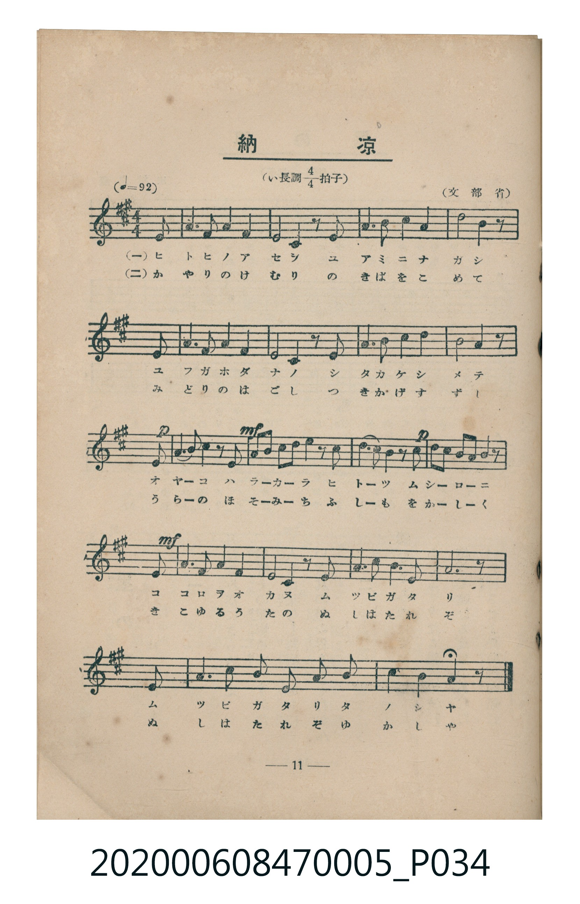
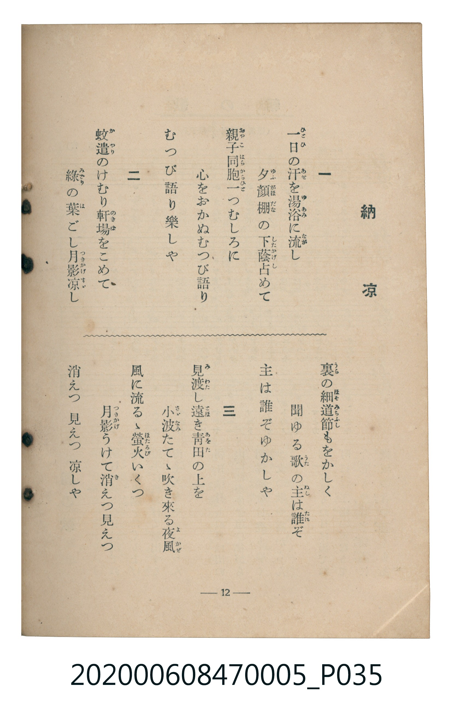

# 納涼

> Re:Shōka 使用 AI 協助辨識與重建樂譜，可能會有錯誤。歡迎回報。

- **鋼琴伴奏版**：<br><audio controls src="noryo.mp3"></audio>
- **NEUTRINO 歌聲合成版**：<br><audio controls src="noryo_neutrino.mp3"></audio>

- 詞：文部省（尋常小學唱歌）
- 曲：文部省（尋常小學唱歌）
- 臺灣教育會公認《新定兒童唱歌》尋常科第五學年用（2020.006.0847.0005）

## 說明

原書資訊與歌詞全文（對應 P034.jpg – P035.jpg，書頁 pp. 11–12，第一學期第 10 首）：
調性與拍號：い長調四分之四拍子（A 大調 4/4 拍，弱起半拍），（♩= 92），（文部省）
註：P034 譜面第 7 小節第 1 段印作「タ カ ケ シ」（「ケ」未印濁點），P035 歌詞頁振假名印作「したかげ」；譜面依原圖如實保留。


## 歌詞

```text
一　一日（ひとひ）の汗（あせ）を湯浴（ゆあみ）に流（なが）し
夕顔棚（ゆふがほだな）の下蔭（したかげ）占（し）めて
親子同胞（おやこはらから）一（ひと）つむしろに
心をおかぬむつび語り
むつび語り樂しや

二　蚊遣（かやり）のけむり軒場（のきば）をこめて
綠（みどり）の葉（は）ごし月影涼（つきかげすゞ）し
裏（うら）の細道節（ほそみちふし）もをかしく
聞ゆる歌（うた）の主（ぬし）は誰（たれ）ぞ
主は誰ぞゆかしや

三　見渡（みわた）し遠（とほ）き青田（あをた）の上を
小波（さゞなみ）たてゝ吹き來る夜風（よかぜ）
風に流るゝ螢火（ほたるび）いくつ
月影（つきかげ）うけて消（き）えつ見えつ
消えつ　見えつ　涼しや
```

## ABC

<div class="abc-score" data-abc-src="noryo.abc" aria-label="五線譜載入中"></div>

[下載 ABC 原始檔](noryo.abc)

## TMD 檔案連結

- [主旋律 TMD 檔案](noryo.tmd) [[在 TMD Studio 編輯](https://tmdlang.github.io/Tmd-TS/#tmd=s7IKdvYPcrWy4qpTUCpJTLdSSM7PyUlNLsnMz7MqzsjMK0nNjM_KTMmPL87Iz05Ugisry88pzU21Si9KTEmNN403MjAyiDcwMIs3sDAxBzIMTBFKi_NLi5JTrYqTM_Lzc-JLUitKkvLzs9Hl4wsS01OtAgyMTRAyBUX5Zal5iXlA3QVFILekgLUjFKSWZaakgqSLkxPz4stSizLTMlNTEPL5RSUZ-UA3FmRUWmVkFpfkF2UmJ-bEZyfmIXsltagY7F2IO0qKEvOKk4syC0BhgFBVkpEK9G9xamJxfl4xsg2Z6Zl5Vrn5eUmlwCDCkChJzCwHOi0_LS0zOTMxR4lLS0vh-ZbeZ9v2KGhpcSnaKlgacdnbKjhy2Zjom9iBdL9YOe_9nlnPprW_bF7xfE7j-z0dTzd0P92x4-mG_qdrdzydsvHZ2p73ezrBNj2bvYlotS_adz1vXPxs6swXTZuezWl-2rrmxarexw1dz6ZteLpu1tPWSc9XL4XoeNzQDTHm-fKJz9esebJrCsiwnVueT1kBtAEU1XrAqNYDRTWQYWAKtoFLX0vBllqAS0FB4Wnf_Gezd7zY3P5iRdeLjnagu4Ah87R1BdC3YH_2PmvvVAClF72sgnSFRw2TQRxTEOf9nh6gzpcLGhUKCvQUDA2BcoZGQEGQX3Y0AP3ybM58IFvB0EDh5bJpQNcDwxBk44tV-581LAfZ1d37YuZ8oOjjxpaXU7cDxZ_Onv20o-3Jzm4gAyj7dO0EoBscFZ4uWQ6UVABGnQJQFGjF0z0bX2zd_rS3C8wFGgwM_o5HM1eC4hnOR4qvTrC9K3YD7QJ5ReHF2jkv5y4COc5cARiJz9c3gB2q8Gzd1qe9G57snfO4oedx036Fx02rgXgjEG9_3AC0qQMsvhHIfjZnFVDls_2NL3cD0xHIRlCwKECCDxgmz3rWP21sfzqhF2Fe4_THjfMfN3Y_bpwENmw2xBVP9s0FxsHTOdOeLmt6un7Zk_1zn0-d-bihiQvkZmBAPm5oAJLPpi8FWd-46XHjCiAJtPJx47pnG6eDBZseN84GiTRNerZz_bOtW0CCTW1g8f1glaufbQWl2seNqx43glIq0C3guF8y9eXCKc8Wz4Jp2AqUfty4-3HjAqBSiB1PdnS_mLIWrBnhfqDU094FEEGwxY2PG5eBw3jZKmCkPZ3Q86IZGCxA6a7HTS2PGyc_blz_uAloXDeQBGoAegjuG7A1Sx43NYAsaOoFOhbstP3NQO-A9IMsXAOWXvK4cfOLVfMeN3WBVKAJPVsB9C3QgBZIuO0CZq-GF7O6XjYuBtsEtLgFqArip8eNE0G6m7pe7J70dAE4uECCQLs3QIIR5GK4n55vg_h0_-PGlXAjXkwE-gMouB7MnQK0-tmcjqd7NwJLHLA40GFA48Bx3TjzcRMojUAD_cXifrCKNkhQAM16vmXDy8bJwEQIFgeG_lywZQvB8QEJ3yawo4DGAeOgH2xKI9DTQCO6wUUP2LhGYFaCxBgwnQNF1kA1N65_sQroL6DI_MdNkNifB0lbQKtAckA-OPbBxsMCcEcnKACXdT_bsRDq-6Z-mBXTXzZCggSYFIF2AUV6X86d9HwKxBaIW-GOAaaASeAY3dD_bPMisIqpwAABp0VI6gQmqmWPm-Y-nbATaNCTfSBfPV0y5-UiUDH4uAkceY1zoJkYKApJzkBFQD0v5i163rgaFm5A_wGVbgYbCkx1QPcuAemBxAxatIAVAT09EWj5s20dYFlQWfK4EaQM6HEIA6x_G5AF1gwOETgbGNfQEAMqorw0hgIFLX0uLr_8osp8q4DMxLx8hxpdw5pqkBUKNhZadmAGtkpAAVLuvljYo6ABKR8VtBVMoMWbDrwI18SiE2gjyNQaBQMFXTCE0KbxQCFDMNMsHswAUrpAMaAERJ0xiGGArNBIwRhIgtg1QMshqozgisDW-BjWKMAMgNCPmycBlT9u7oDzHjf3gVhNi8AGPW7aDVX_uHkTWNfj5mVgcZA8SHQ-EHeDWV1QHWtgOpq2I3RA7DfCsL-xG6ynBaqjCyiyDiw-EWpaA9w0kPlA04DyQPHGXqj-DUCZSWDWZKiORpiOxmVQHfth9htj-n8-2P_roXaAKh6QqyEhApKZDbd_LcQ0oM9B4qDQgOqAhhjINpDMDPQQa9oKtB9_6tnVA049JCYaslIIKG3UgFMGCIJkDBSqC2pRU8nj5qlQ_62BhsHjZlBMgGRA8QDxH8jfIP9tB4f7fqgOSMUNi3-QjoVwHW1QHauQUgSwcIfHMCz2QfEBkpkCj8vp0LhcghL73UAMif2ZUB2zMHS0IcX-46ZtUJcA7QLGPSQGIa4EuQ3FlcAwAOkAxTtI3XqgyGqw_AqIDqBPYWljD9RfqwnG9I5O8mMaEoHA6MpNg8QXUBwkZqJgChY3hmd9Y2jWB0UsRBQkAlKNoh8pvpfA_bIZ6vt-cKiA4gbiUwgbJINcZoDEQbkXJL4AHCqQ_AMKNUjJAAqXzcjx3dQJjyNQbIPiaDc47uaCxUDxAayDoTLAvAONS4jrmqAmgt0AjH9YTAMrHaiOXpT4BsUMxJVQtwBjHlZKweITRIJkZiOnY6Do42ZQmQKyDZzqgCkA3ccthOIb2JymQ86GRDdKvQGBaIU_JHIh0QMpnkBZES0xN_cgRyfYqyDRyfCiHRREIBmQThiEqkfK1KCgA6ltA2JINIGyFUgGlO1Qo38NUiSDMj9MDbDVBJaZh2oTSD1SFMMyKKjggfgJWhSDiyHUgmctWByUgSHRCCkEQHpWIPkWbhNIPaGiewo4go3IiWBQvAEjCJQva8B5GxSNkCIZ6AGk3IkaCZBaZxU8IiD1DyTfgfIxOL0gRQVqwIICFRSkoKhBy0PgehhJNzh4UQMLxAezm3aCg3IXVrtrubh07RTAbSkFIEOZCwA)]
- [鋼琴伴奏 TMD 檔案](noryo_piano.tmd) [[在 TMD Studio 編輯](https://tmdlang.github.io/Tmd-TS/#tmd=s7IKdvYPcrWy4qpTUCpJTLdSyC8qychPL0osyKi0ysgsLskvykxOzInPTsxLVIIrKs4vLUpOjS9ITE-1CjAwNtEFEqZKXFpaCs-39D7btuf9no6X3XueT9jyZM-Wp0v7n3d2vN_TqaClxaVoq2BpxGVvq-DIZWOib2IHMvFF-67njYufTZ35omnTsznNT1vXvFjV-7ih69m0DU_XzXraOun56qVPp2x8trbncUP30w3dT3fseL584vM1a57smvJ07Y6nO7c8n7ICaKORgZGBnoGBmZ6BhYk5kGFgCrRUiYvLL7-oMt8qIDMxLz_Iw6FG17CmmksBCGwstOzADH0tBVt0oAAyf0fDi4U9ChpP92x8sXW7graCicLTDf3P1zfoKIA8rZdVkK6JRaeWPtjUGgUDBV0whNCm8UAhQzDTLB7MAFK6QDGgBESdMYhhgKzQSMEYSILYNUDLIaqM4IrA1vgY1ijADIDQj5snAZU_bu6A8x4394FYTYvABj1u2g1V_7h5E1jX4-ZlYHGQPEh0PhB3g1ldUB1rYDqatiN0QOw3wrC_sRuspwWqowsosg4sPhFqWgPcNJD5QNOA8kDxxl6o_g1AmUlg1mSojkaYjsZlUB37YfYbY_p_Ptj_66F27Ie6GhIiIJnZcPvXQkwD-hwkDgoNqA5oiIFsA8nMQA-xpq1A-_Gnnl094NRDYqIhK4WA0kYNOGWAIEjGQKG6oBY1lTxungr13xpoGDxuBsUESAYUDxD_gfwN8t92cLjvh-pYDcQbwSxQSIJ0LITraIPqWIWUIh43roTHMCz2QfEBkpkCj8vp0LhcghL73UAMif2ZUB2zMHS0IcX-46ZtUJcA7QLGPSQGIa4EuQ3FlcAwAOkAxTtI3XqgyGqw_AqIDqBPYWljD9RfqwnG9I5O8mMaEoHA6MpNg8QXUBwkZqJgChY3hmd9Y2jWB0UsRBQkAlKNoh8pvpfA_bIZ6vt-cKiA4gbiUwgbJINcZoDEQbkXJL4AHCqQ_AMKNUjJAAqXzcjx3dQJjyNQbIPiaDc47uaCxUDx8bgRlGZAMsC8A41LiOuaoCaC3QCMf1hMP27sh-roRYlvUMxAXAl1CzDmYaUULD5BJEhmNnI6Boo-bgaVKSDbwKkOmALQfdxCKL6fzp5Nh5wNiW6UegMC0Qp_SORCogdSPIGyIlpibu5Bjk6wV0Gik-FFOyiIQDIgnTAIVY-UqUFBB1LbBsSQaAJlK5AMKNuhRv8apEgGZX6YmsdNPWCZeag2gdQjRTEsg4IKHoifoEUxuBhCLXjWgsVBGRgSjZBCAKRnBZJv4TaB1BMquqeAI9iInAgGxRswgkD5sgact0HRCCmSgR5Ayp2okQCpdVbBIwJS_0DyHSgfg9MLUlSgBiwoUEFBCooatDwEroeRdIODFzWwQHwwu2knOCh3YbW7FqUp5YPSlDJBNKWAzb_nHXtfTpv0snHlk53dT5f0P10yB5hlnnX3Pl074en2Zc86uyHNQuSWEgQCwzBewQQYePHADAJO9_EK0YaxIAoqaQoUBklFm8XnxoLqPCDTCMgCiQOVwGKCSFOAukF5EChtGg-ThxoBKmWhKqH6wCUskA0VBQkB9YOMgXFBelCFYIZBteJ1FEwb2C1o8gh_wVQBjYJ7BaoGGEG6dgrgOIr2AWpFcIyQOcZgjjIXAA)]

## 分析

```text
================================================================================
📊 TMD Song Profile: [ 納涼 ]
================================================================================
⏱  Duration:       0:46 (47.0s), 18 measures total
🎼 Key & Tempo:    首調基準 A, != 92.0 BPM, <4/4>
   - 分析範圍：      由實際發聲的音符與和弦推測調性；播放脈絡另行呈現
🎤 人聲音域:    C#4 (MIDI 61) – E5 (MIDI 76) [跨度: 15 個半音 / 1.2 個八度, 難度: moderate]
   - 最低音:  C#4 in [Noryo #1 @ m.3, 0:06]
   - 最高音: E5 in [Noryo #1 @ m.11, 0:27]
   - 適合: soprano, mezzo-soprano, contralto, tenor, baritone, bass
🏛  結構:      Noryo (47.0s)
⚡ 編曲密度:        Peak 1 軌道同時演奏
🗝  調性診斷：       A 大調（純淨自然大調，未偵測到可信轉調）
   - 風格氣質:    純淨自然大調（陽光明朗、易唱易記，無明顯調外色彩）
   - 轉調歷程:    全曲維持單一推測調性（未偵測到可信轉調）
   - 核心骨幹音:  A, E, B, C#, D
   - 調性數值:    A 大調 [相關度: 0.95, 穩定度: High, 自然音純度: 100.0%]
   - 候選調性 (K-S): A 大調 (0.95), E 大調 (0.61), F# 小調 (0.58)
   - 五度圈歷程:   +3
   - 各段落調性細節:
     • [Noryo #1]: A 大調 (r: 0.96, 自然音純度: 100.0%)

  [ 五度圈游移軌跡 ]
               C  
         F            G  
      Bb               D  
      Eb              [A ]*
         Ab           E  
            Db       B  
               F# 
     (* = active key center)

  [ 十二半音累積音高分佈 ]
     C  :                            0.0%
     C# : ███████████               15.8%
     D  : ██████                     8.3%
     D# :                            0.0%
     E  : █████████████             18.8%
     F  :                            0.0%
     F# : █████                      6.8%
     G  :                            0.0%
     G# :                            0.0%
     A  : ████████████████████████  33.8%
     A# :                            0.0%
     B  : ████████████              16.5%
--------------------------------------------------------------------------------
Assignment 軌道音域：
  - Piano         : C#4 – E5 (15 個半音 / 1.2 個八度, 71 個音符)
================================================================================
```


## 原書掃描頁






