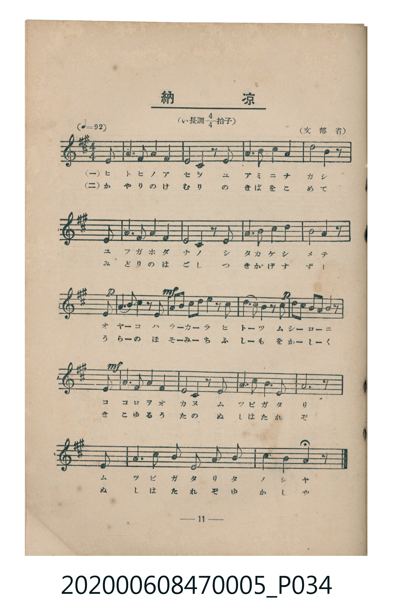
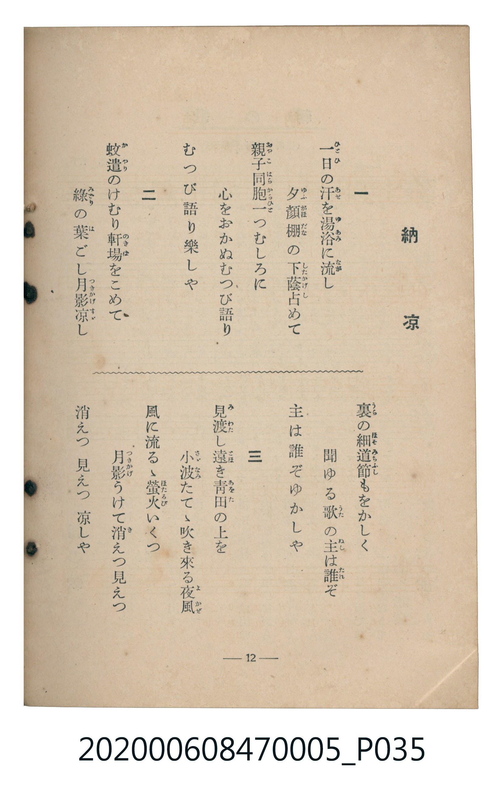

# 納涼

> Re:Shōka 使用 AI 協助辨識與重建樂譜，可能會有錯誤。歡迎回報。

<audio controls src="noryo.mp3"></audio>

- 臺灣教育會公認《新定兒童唱歌》尋常科第五學年用（2020.006.0847.0005）

## 說明

原書資訊與歌詞全文（對應 P034.jpg – P035.jpg，書頁 pp. 11–12，第一學期第 10 首）：
調性與拍號：い長調四分之四拍子（A 大調 4/4 拍），♩= 92，（文部省）


## 跨冊／重複收錄參照

> 同曲＋同名異曲（《新定兒童唱歌》高等科男、女用為同曲；尋常科五年級為同名異曲）

- **[同名異曲]** 《新定兒童唱歌》高等科男子用（2020.006.0848）：[**〈納涼〉**](../../koto_boys_2020.006.0848/2_2_01_noryo/index.md)（`A` / `4/4` — [原始 TMD](../../koto_boys_2020.006.0848/2_2_01_noryo/noryo.tmd)）
- **[同名異曲]** 《新定兒童唱歌》高等科女子用（2020.006.0849）：[**〈納涼〉**](../../koto_girls_2020.006.0849/2_2_01_noryo/index.md)（`A` / `4/4` — [原始 TMD](../../koto_girls_2020.006.0849/2_2_01_noryo/noryo.tmd)）
- 總表：[跨冊重複與同名歌曲總索引](../../../duplicate_songs.md)

## 歌詞

```text
一　一日（ひとひ）の汗（あせ）を湯浴（ゆあみ）に流（なが）し
夕顔棚（ゆふがほだな）の下蔭（したかげ）占めて
親子同胞（おやこはらから）一つむしろに
心をおかぬむつび語り
むつび語り樂しや

二　蚊遣（かやり）のけむり軒場（のきば）をこめて
綠（みどり）の葉ごし月影涼（つきかげすゞ）し
裏（うら）の細道節（ほそみちふし）をもかしく
聞ゆる歌の主（ぬし）は誰（たれ）ぞ
主は誰ぞゆかしや

三　見渡（みわた）し遠（とほ）き青田（あをた）の上を
小波（さゞなみ）たてゝ吹き來る夜風（よかぜ）
風に流るゝ螢火（ほたるび）いくつ
月影うけて消えつ見えつ
消えつ見えつ涼しや
```

## ABC

```abc
X:1
T:納涼
M:4/4
L:1/16
Q:1/4=92
K:A
V:V1 name="Piano" snm="Pia"
[V:V1]
z8 z6 E2 | A6 A2 B4 c4 | A8 E4 z2 E2 | F6 A2 B4 A4 |
w: 1.~ヒ | ト ヒ ノ ア | セ ヲ ユ | ア ミ ニ ナ
w: 2.~か | や り の け | む り の | き ば を こ
w: 3.~ミ | ワ タ シ ト | ホ キ ア | ヲ タ ノ ウ
c8 B4 z2 E2 | A6 A2 B4 c4 | A8 E4 z2 E2 | F6 F2 B4 c4 |
w: 1.~ガ シ ユ | フ ガ ホ ダ | ナ ノ シ | タ カ ゲ シ
w: 2.~め て み | ど り の は | ご し つ | き か げ す
w: 3.~ヘ ヲ サ | ザ ナ ミ タ | テ テ フ | キ ク ル ヨ
B8 A4 z2 E2 | !p! !mf! F6 F2 F2 z2 B4 | G6 E2 E4 z2 E2 | !p! c6 B2 B2 z2 c4 |
w: 1.~メ テ オ | ヤ コ _ ハ | ラ カ ラ ヒ | ト ツ _ ム
w: 2.~ず し う | ら の _ ほ | そ み ち ふ | し も _ を
w: 3.~カ ゼ カ | ゼ ニ _ ナ | ガ ル ル ホ | タ ル _ ビ
A4 F4 E4 z2 E2 | !mf! A6 B2 c4 e4 | A8 B4 z2 B2 | c6 e2 c4 A4 |
w: 1.~シ ロ ニ コ | コ ロ ヲ オ | カ ヌ ム | ツ ビ ガ タ
w: 2.~か し く き | こ ゆ る う | た の ぬ | し は た れ
w: 3.~イ ク ツ ツ | キ カ ゲ ウ | ケ テ キ | エ ツ ミ エ
B12 z2 E2 | A6 A2 B4 c4 | B4 e8 c4 | B8 G8 |
w: 1.~リ ム | ツ ビ ガ タ | リ タ ノ | _ シ
w: 2.~ぞ ぬ | し は た れ | ぞ ゆ か | _ し
w: 3.~ツ キ | エ ツ ミ エ | ツ ス ズ | _ シ
A12 z4 |
w: 1.~ヤ
w: 2.~や
w: 3.~ヤ
```

## TMD 檔案連結

- [主旋律 TMD 檔案](noryo.tmd) [[在 TMD Studio 編輯](https://tmdlang.github.io/Tmd-TS/#tmd=s7IKdvYPcrWy4qpTUCpJTLdSSM7PyUlNLsnMz7MqzsjMK0nNjM_KTMmPL87Iz05Ugisry88pzU21Si9KTEmNN403MjAyiDcwMIs3sDAxBzIMTBFKi_NLi5JTrYqTM_Lzc-JLUitKkvLzsxHyBUX5Zal5iXlANQVFIBtTwIoQClLLMlNSQdKpKZkl-UWZiTlI7kgtKga7FWxJfElRYl5xclFmAcgDCFUlGalAxxanJhbn5xXjFNbSUni-pffZtj0KWlpcirYKlkZc9rYKjlw2JvomdiBNL9p3PW9c_GzqzBdNm57NaX7auubFqt7HDV3Ppm14um7W09ZJz1cvfTpl47O1PY8bup9u6H66Y8fz5ROfr1nzZNeUp2t3PN255fmUFe_3dIBCSw8YWnqg0AIyDEzf7-lU4uLS11KwpRbgUlBQeNo3_9nsHS82t79Y0fWiox3orhcr5z1tXfFsWjvQFU839D5r71QIMDA20csqSFd41DAZxDEFcd7v6QHqfLmgUaGgQE_B0BAoZ2gEFAT5ZUcD0C_P5swHshUMDRReLpsGdP37PbNANr5Ytf9Zw3KQXd29L2bOB4o-bmx5OXU7UPzp7NlPO9qe7OwGMoCyT9dOALrBUeHpkuVASQVgECsARcEm9TyauRIU-kAWUAnQsS-bVzyf0wiU4wLZAXTA44YGIPls-lKg_OPGTY8bVwBJoPzjxnXPNk4HCzY9bpwNEmma9Gzn-mdbt4AEm9rA4vvBKlc_2wo0Eqhy1eNGoD1AkengMFsy9eXCKc8Wz4Jp2AqUfty4-3HjAqBSiB1PdnS_mLIWrHn648b5jxu7HzdOAko97V3wuKnxceMycFAsWwX049MJPS-a54GVdj1uanncOPlx4_rHTUBTuoEkUA_IN41LHjcByemPm3qB7gK7Yn8z0OUgPSCz14Cllzxu3Pxi1bzHTV0gFWhCz1YAPQY0oAUSRLuAKbDhxayul42LwXYDLWsBqoI4_3HjRJDupq4Xuyc9XQAOGZAg0O4NkBADuRLuj-fbFoBV7H_cuBJuxIuJQHIK0MZnczqe7t0IzDNgNUD3AE0BhcbjxpmPm4D-hgXri8X9YBVtEF8DjXi-ZcPLxsnP1zeAxYHhOxdsx0JwiAPjEOyQJqCvgMYBQ7kfbEoj0K9AI7pBWQwUD7vBmtdANTSuf7EK6AWgyPzHTZA4nQdJMUDjQXJAPjhOwUbCwmpHJyislnU_27EQ6tGmfqAJELe_bIT4HpjAgHYBRXpfzp30fArEliZwWEFUAh0DjOBJ4Mjb0P9s8yKwiqnAQACnMEiaAyaVZY-b5j6dsBNo0JN9IJ88XTLn5SJQofC4CRxPjXNA6RxoClAUkkiBioB6Xsxb9LxxNSysgP4DKt0MNhSYqIDuXQLSA4kNUCgDo7hx2bNtQNWgaAH6DsIAK8IQBUYfNECA0pQXPVCgoKXPxeWXX1SZbxWQmZiX71BjUFMNskHBxkLLDszAVuApPN2z8cXW7cAyBFLYvFjYo6ABK6Q0sagHWgM1CxU8bp6kUAMkO2Ccx819oHyzSAEk3LQbpmoThFoGFgVKgjjzgbgbxOiCKF4DVdy0HaYYamuNgoGCLhhCaNN4oJAhmGmoYAQkjYEYJgKWBqkEqzIDsWHKQApqwIpBECQCUQW2xMewRgGiWBdKI_wG44E8B2QBPQAyCOQ9iHqQ_0C6EB6EiEJ8CGJ1QXWsgekAehKuA2K_EYb9jd1gPS1QHV1AkXVg8YlQ0xrgpoHMB5oGlAeKN_ZC9W8AykwCsyZDdTTCdDQug-rYD7PfGNP_88H-Xw-1Yz_U1ZAQAcnMhtu_FmIa0OcgcVBoQHVAQwxkG0hmBnqINW0F2o87nYLr9R5w8jQB5XlgUaYDr03xJ9THzVMhyWkN2KVAogGczkDJDZLAgCkVktxAIbMfwlkNxMDECk6EIMULYYrbIPKrEImSpBQIpBDqQCyIXowkCHI1JPAgzgYFFSiaIQ6HBR4oUEGBB3M6RAfE7bDEBXE9TEcbVMcqpOQGrGzgyQeWtECRDZKZAk8o06EJZQlK0uoGYkjSmgnVMQtDRxtS0nrctA3qEqBdwIQFSR4QV4LchuJKYBiAdIASFUjdeqDIarD8CogOoE9hCW8P1F-rCSajHZ1kJqMloOjfA7RjMyQl9ENSxkqYMDDYQTREAF4cQsRaIFoWQEo4YJqCCK-F0qDiD2gsPElVF9QiJRggMlCozk2rBSeYGgVziAwwvSAnMEh5ZgSEQMVA_YikCDYJSSlSIlsCDb7N0ADvh0YFLEGA_ARig-RQS0FQaQQSXQCNCkiJAIoqSFkHiozNyImsqROaLEAJDJQsQKUmKMHMhYoDS4lGUEIFyQFLA2gCArmiCWoeKKGBxMFlKVgWWB1DdfSiJDJQckByCVq5C0pGkKQEkpuNnHngorCSEhRCoKSH7OcWQokM2OwmL5HB0hYoYYCLn1WQFLMaVvz0wBISKC6gqWoypNIEl10gYaAeBACpRaQrUCKClE5G4ARiCk8kEDFQEjGCJyZTMA2pLmFlFQiiJyNw8oFEP6RAB7kbLYcCXQ5LMBCnQ0QhbkcuBUA6YRCqHqmkAkULSHUbEEOSAaisAMmAyhLUBLYGOREBSzSIGmBrFapjHqpNIPVISQhW6iBKU2jl1bQR7idYaboWLA4qlSDJBFayQcspqG_hNoHUE6rsppBZSuFOE9C6DQJAYuB6D97QgogBCzlkgKeSA7FAyQcEUaszaPmEnLIgqQYoglT24E8CsBwJq-Zq4OZAyhqI-bASDBa0cBvAiQV_1IMSESzJgJISkg1QnZDoRo08uA3gRII_yh837YS7eRdJfqjl4tK1UwA36BWADGUuAA)]
- [鋼琴伴奏 TMD 檔案](noryo_piano.tmd) [[在 TMD Studio 編輯](https://tmdlang.github.io/Tmd-TS/#tmd=s7IKdvYPcrWy4tLSUni-pffZtj3v93S87N7zfMKWJ3u2PF3a_7yz4_2eTgUtLS5FWwVLIy57WwVHLhsTfRM7rjoFpRftu543Ln42deaLpk3P5jQ_bV3zYlXv44auZ9M2PF0362nrpOerlz6dsvHZ2p7HDd1PN3Q_3bHj-fKJz9esebJrytO1O57u3PJ8ygqgjUYGRgZ6BgZmegYWJuZAhoEp0FIlLi6__KLKfKuAzMS8_CAPhxqDmmouBSCwsdCyAzP0tRRs0YHC0z0bX2zd_qKjHWTPjoYXC3sUNAIMjE30sgrSNbGo19IHm1WjYKCgC4YQ2jQeKGQIZhoqGAFJYyCGiYClQSrBqsxAbJgykIIasGIQBIlAVIEt8TGsUYAo1oXSj5snAZU_bu6A8x4394FYTYvABj1u2g1V_7h5E1jX4-ZlYHGQPEh0PhB3g1ldUB1rYDqatiN0QOw3wrC_sRuspwWqowsosg4sPhFqWgPcNJD5QNOA8kDxxl6o_g1AmUlg1mSojkaYjsZlUB37YfYbY_p_Ptj_66F27Ie6GhIiIJnZcPvXQkwD-hwkDgoNqA5oiIFsA8nMQA-xpq1A-3GnGHCC7AEnFBOFpxv6n69v0FEgKsmQlD6AFEIdiAXRi5FAHjdPhXptDdT7j5tBkQCSAUUBxGsgL4O8th0c5PuhOlYDMcjTkEAE6VgI19EG1bEKKTE8blwJj1xYxIOiAiQzBR6N06HRuAQl4ruBGBLxM6E6ZmHoaEOK-MdN26AuAdoFjHZI5EFcCXIbiiuBYQDSAYpykLr1QJHVYPkVEB1An8KSxR6ov1YTjOQdneREcnVBLVIUApGBQnVuWi04CmsUzCEywBhEjnJI_jcCQqBioH5E4gCbhKQUKdqXQD20GRoE_dDAgUURMHLBbJAcaqkByr0g0QXQwIHkIFDgQcoGUPBsRo72pk5oRIGiHBRRoFIGFIVzoeLAXNUISjogOWDugUYpyBVNUPNAUQ8SB5c9YNnHjSAXg3T0okQ7KIKQXIJWToEiFhK5ILnZyMkZLgorWUAhBEoMyH5uIRTtT2fPJivaQXEMyc5G4PgzhcchRAwUg0bwuDYF05DSH5a5QRA9lsGxC4kdSPkEypBoSbq5Bx6foFiGls3AUICEGSLbgHTCIFQ9UtYGhRpIdRsQQ2IJlLlAMqDMhxr_a5DjGFgEQNQ8bgK5BCQzD9UmkHqkGIZlU0TxAy2LmzbC_QQrftaCxUHZGBKLsKIAmrGhvoXbBFJPqOyeQp2yG8QCRTIIopbS0EyOHP-QuAWKIGVg_BEFS9aw0rsGbg4kw0LMhxUDsACA2wCOUvwRBIpqWMSCIhzJBqhOSKSgBjHcBnBU4o-Yx0074W7eRZIfalGacz7IzTkTRHMO2AJ93rH35bRJLxtXPtnZ_XRJ_9Mlc4AZ-Fl379O1E55uX_assxvSMkVut0EgMG7iFaINY4EZDkibxsciRIAUSN4EyDOJhVEo6oHSsHRBnCFGQMooFyQNVwlRgFRrQJVCagtc6hF8MxDDLB6sCKoV1WmQIgnuGhCFrhImjmwW3AJCHkV2GcRwmKtxhQYoWnXtFMAxG-0DFEZwjJA5xmCOMhcA)]

## 分析

```text
================================================================================
📊 TMD Song Profile: [ 納涼 ]
================================================================================
⏱  Duration:       0:54 (54.8s), 21 measures total
🎼 Key & Tempo:    首調基準 A, != 92.0 BPM, <4/4>
   - 分析範圍：      由實際發聲的音符與和弦推測調性；播放脈絡另行呈現
🎤 人聲音域:    E4 (MIDI 64) – E5 (MIDI 76) [跨度: 12 個半音 / 1.0 個八度, 難度: easy]
   - 最低音:  E4 in [Noryo #1 @ m.1, 0:02]
   - 最高音: E5 in [Noryo #1 @ m.14, 0:35]
   - 適合: soprano, mezzo-soprano, contralto, tenor, baritone, bass
🏛  結構:      Noryo (54.8s)
⚡ 編曲密度:        Peak 1 軌道同時演奏
🗝  調性診斷：       A 大調（純淨自然大調，未偵測到可信轉調）
   - 風格氣質:    純淨自然大調（陽光明朗、易唱易記，無明顯調外色彩）
   - 轉調歷程:    全曲維持單一推測調性（未偵測到可信轉調）
   - 核心骨幹音:  A, B, C#, E, F#
   - 調性數值:    A 大調 [相關度: 0.80, 穩定度: Moderate, 自然音純度: 100.0%]
   - 候選調性 (K-S): A 大調 (0.80), E 大調 (0.73), F# 小調 (0.56)
   - 五度圈歷程:   +3
   - 各段落調性細節:
     • [Noryo #1]: A 大調 (r: 0.80, 自然音純度: 100.0%)

  [ 五度圈游移軌跡 ]
               C  
         F            G  
      Bb               D  
      Eb              [A ]*
         Ab           E  
            Db       B  
               F# 
     (* = active key center)

  [ 十二半音累積音高分佈 ]
     C  :                            0.0%
     C# : ███████████████           17.4%
     D  :                            0.0%
     D# :                            0.0%
     E  : ██████████████            16.1%
     F  :                            0.0%
     F# : ████████                   9.4%
     G  :                            0.0%
     G# : ████                       4.7%
     A  : ████████████████████████  28.2%
     A# :                            0.0%
     B  : █████████████████████     24.2%
--------------------------------------------------------------------------------
Assignment 軌道音域：
  - Piano         : E4 – E5 (12 個半音 / 1.0 個八度, 68 個音符)
================================================================================
```


## 原書掃描頁






