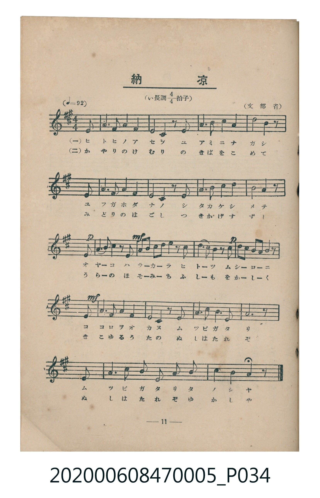
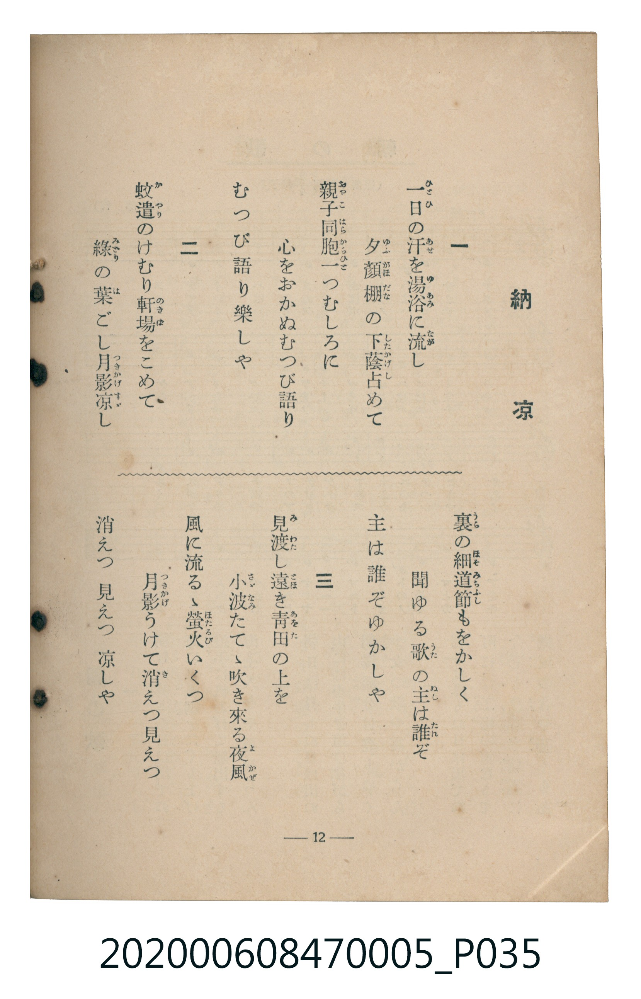

# 納涼

<audio controls src="noryo.mp3"></audio>

- 臺灣教育會公認《新定兒童唱歌》尋常科第五學年用（2020.006.0847.0005）

## 說明

原書資訊與歌詞全文（對應 P034.jpg – P035.jpg，書頁 pp. 11–12，第一學期第 10 首）：
調性與拍號：い長調四分之四拍子（A 大調 4/4 拍），♩= 92，（文部省）

## 歌詞

```text
一　一日（ひとひ）の汗（あせ）を湯浴（ゆあみ）に流（なが）し
夕顔棚（ゆふがほだな）の下蔭（したかげ）占めて
親子同胞（おやこはらから）一つむしろに
心をおかぬむつび語り
むつび語り樂しや

二　蚊遣（かやり）のけむり軒場（のきば）をこめて
綠（みどり）の葉ごし月影涼（つきかげすゞ）し
裏（うら）の細道節（ほそみちふし）をもかしく
聞ゆる歌の主（ぬし）は誰（たれ）ぞ
主は誰ぞゆかしや

三　見渡（みわた）し遠（とほ）き青田（あをた）の上を
小波（さゞなみ）たてゝ吹き來る夜風（よかぜ）
風に流るゝ螢火（ほたるび）いくつ
月影うけて消えつ見えつ
消えつ見えつ涼しや
```

## ABC

```abc
X:1
T:納涼
C:TMD (Chen, Chih-Han / aguai)
M:4/4
L:1/16
Q:1/4=92
K:A
V:V1 name="Piano" snm="Pia"
[V:V1]
z8 z6 e2 | a6 a2 b4 c4 | a8 e4 z2 e2 | f6 a2 b4 a4 |
c8 b4 z2 e2 | a6 a2 b4 c4 | a8 e4 z2 e2 | f6 f2 b4 c4 |
b8 a4 z2 e2 | !p! !mf! f6 f2 f2 z2 b4 | g6 e2 e4 z2 e2 | !p! c6 b2 b2 z2 c4 |
a4 f4 e4 z2 e2 | !mf! a6 b2 c4 e4 | a8 b4 z2 b2 | c6 e2 c4 a4 |
b12 z2 e2 | a6 a2 b4 c4 | b4 e8 c4 | b8 g8 |
a12 z4 |
```

## TMD 檔案連結

- [主旋律 TMD 檔案](noryo.tmd)
- [鋼琴伴奏 TMD 檔案](noryo_piano.tmd)

## 分析

```text
================================================================================
📊 TMD Song Profile: [ 納涼 ]
================================================================================
⏱  Duration:       0:54 (54.8s), 21 measures total
🎼 Key & Tempo:    首調基準 A, != 92.0 BPM, <4/4>
   - 分析範圍：      由實際發聲的音符與和弦推測調性；播放脈絡另行呈現
🎤 人聲音域:    E4 (MIDI 64) – E5 (MIDI 76) [跨度: 12 個半音 / 1.0 個八度, 難度: easy]
   - 最低音:  E4 in [Noryo #1 @ m.1, 0:02]
   - 最高音: E5 in [Noryo #1 @ m.14, 0:35]
   - 適合: soprano, mezzo-soprano, contralto, tenor, baritone, bass
🏛  結構:      Noryo (54.8s)
⚡ 編曲密度:        Peak 1 軌道同時演奏
🗝  調性診斷：       A 大調（純淨自然大調，未偵測到可信轉調）
   - 風格氣質:    純淨自然大調（陽光明朗、易唱易記，無明顯調外色彩）
   - 轉調歷程:    全曲維持單一推測調性（未偵測到可信轉調）
   - 核心骨幹音:  A, B, C#, E, F#
   - 調性數值:    A 大調 [相關度: 0.80, 穩定度: Moderate, 自然音純度: 100.0%]
   - 候選調性 (K-S): A 大調 (0.80), E 大調 (0.73), F# 小調 (0.56)
   - 五度圈歷程:   +3
   - 各段落調性細節:
     • [Noryo #1]: A 大調 (r: 0.80, 自然音純度: 100.0%)

  [ 五度圈游移軌跡 ]
               C  
         F            G  
      Bb               D  
      Eb              [A ]*
         Ab           E  
            Db       B  
               F# 
     (* = active key center)

  [ 十二半音累積音高分佈 ]
     C  :                            0.0%
     C# : ███████████████           17.4%
     D  :                            0.0%
     D# :                            0.0%
     E  : ██████████████            16.1%
     F  :                            0.0%
     F# : ████████                   9.4%
     G  :                            0.0%
     G# : ████                       4.7%
     A  : ████████████████████████  28.2%
     A# :                            0.0%
     B  : █████████████████████     24.2%
--------------------------------------------------------------------------------
Assignment 軌道音域：
  - Piano         : E4 – E5 (12 個半音 / 1.0 個八度, 68 個音符)
================================================================================
```


## 原書掃描頁






