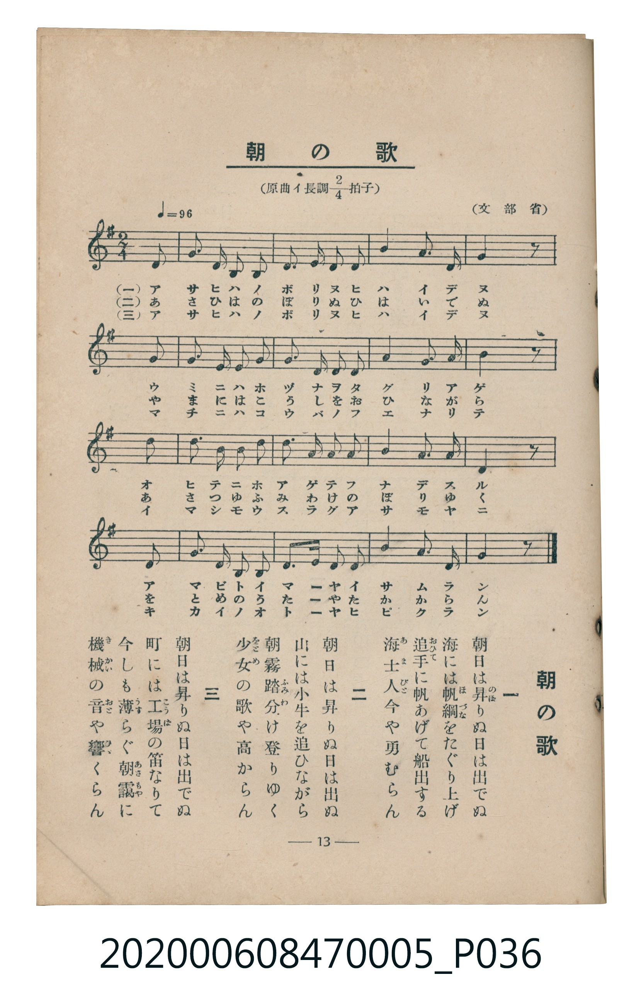

# 朝の歌

> Re:Shōka 使用 AI 協助辨識與重建樂譜，可能會有錯誤。歡迎回報。

- **鋼琴伴奏版**：<br><audio controls src="asa_no_uta.mp3"></audio>
- **NEUTRINO 歌聲合成版**：<br><audio controls src="asa_no_uta_neutrino.mp3"></audio>

- 臺灣教育會公認《新定兒童唱歌》尋常科第五學年用（2020.006.0847.0005）

## 說明

原書資訊與歌詞全文（對應 P036.jpg，書頁 p. 13，第二學期第 1 首）：
調性與拍號：原曲イ長調二分之二拍子（譜面移調為ト長調 G 大調 2/4 拍），♩= 96，（文部省）


## 歌詞

```text
一　朝日は昇（のぼ）りぬ日は出でぬ
海には帆綱（ほづな）をたぐり上げ
追手（おひて）に帆あげて船出する
海士人（あまびと）今や勇むらん

二　朝日は昇りぬ日は出でぬ
山には小牛を追ひながら
朝霧踏分け（ふみわ）登りゆく
少女（をとめ）の歌や高からん

三　朝日は昇りぬ日は出でぬ
町には工場（こうば）の笛なりて
今しも薄（うす）らぐ朝靄（あさもや）に
機械（きかい）の音（おと）や響（ひゞ）くらん
```

## ABC

```abc
X:1
T:朝の歌
M:2/4
L:1/16
Q:1/4=96
K:G
V:V1 name="Piano" snm="Pia"
[V:V1]
z4 z2 D2 | G3 F G2 A2 | B3 A B2 d2 | c2 B2 A2 G2 |
w: 1.~ア | サ ヒ ハ ノ | ボ リ ヌ ヒ | ハ イ デ ヌ
w: 2.~あ | さ ひ は の | ぼ り ぬ ひ | は い で ぬ
w: 3.~ア | サ ヒ ハ ノ | ボ リ ヌ ヒ | ハ イ デ ヌ
A4 z2 D2 | G3 F G2 A2 | B3 c d2 B2 | A2 d2 ^c2 A2 |
w: 1.~_ ウ | ミ ニ ハ ホ | ヅ ナ ヲ タ | グ リ ア ゲ
w: 2.~_ や | ま に は こ | う し を お | ひ な が ら
w: 3.~_ マ | チ ニ ハ コ | ウ バ ノ フ | エ ナ リ テ
d4 z2 d2 | e2 B2 c2 A2 | d2 A2 B2 G2 | c2 B2 A2 G2 |
w: 1.~_ オ | ヒ テ ニ ホ | ア ゲ テ フ | ナ デ ス ル
w: 2.~_ あ | さ ぎ り ふ | み わ け の | ぼ り ゆ く
w: 3.~_ イ | マ シ モ ウ | ス ラ グ ア | サ モ ヤ ニ
B4 A2 D2 | G2 B2 A2 c2 | B3 c d2 e2 | d2 G2 B2 A2 |
w: 1.~_ _ ア | マ ビ ト イ | マ ヤ イ サ | ム ラ ン _
w: 2.~_ _ を | と め の う | た や た か | か ら ん _
w: 3.~_ _ キ | カ イ ノ オ | ト ヤ ヒ ビ | ク ラ ン _
G4 z4 |
w: 1.~_
w: 2.~_
w: 3.~_
```

## TMD 檔案連結

- [主旋律 TMD 檔案](asa_no_uta.tmd) [[在 TMD Studio 編輯](https://tmdlang.github.io/Tmd-TS/#tmd=s7IKdvYPcrWy4qpTUCpJTLdSSM7PyUlNLsnMz7MqzsjMK0nNjM_KTMmPL87Iz05Ugisry88pzU21Si9KTEmNN403MjAyiDcwMIs3sDAxBzIMTBFKi_NLi5JTrYqTM_Lzc-JLUitKkvLzsxHyBUX5Zal5iXlANQVFIBtTwIoQClLLMlNSQdKpKZkl-UWZiTlI7kgtKga7FWxJfElRYl5xclFmAcgDCFUlGalAx5Zk5qbG56fFpyRWIqSA5qVn5lmVJGaWJ-YBZdMyk8EWaGkpPJsz93HjumdrexS0tLgUbRUszbjsbRXcuWyM9E3sQAa8aN_1vHHxs6kzXzRtejan-Wnrmhereh83dD2btuHpullPWyc9X7306ZSNQBMeN3Q_3dD9dMeO58snPl-z5smuKU_X7ni6c8vzKSve7-kAhZ4eMPT0QKEHZBiYvt_TqcTFpa-lYEstwKWgoPC0b_6z2TtebG5_saLrRUc70F0vVs572rri2bR2oCuebuh91t6pEGBgbKaXVZD-fk8PUPHLBY0KBXoKhsZALtjhPUCHP5szH8hWMFR4uWwa0KXv98wCmf5i1f5nDctB5nb3vpg5HygKtm_T46YlL6duB8qCNHe0PdnZDWQA1TxdOwFo64u1c17OXfR8-W6ggudNux43d0AUK7grPF2yHMQAhrYCUDnYop5HM1eCIgLIAuoFuvtl84rncxqBclwgJzzZ0fC4oQEYb8-mL33cuP7ZDJC_gHH4uHEPUMnjpq7HjWsgUk_bdz1uXA7kgrQ927r9ceNqkOiOtufbNoL17H7cCFS3Cqxt0uPG-Y8bJwD1P9kBNGIS2Lf79z7r7AYrBQptety4DKS0cTXQiMeNTUBFQJEXHTvB9sx83NQNtefp4tVPdu0CawMq2ve4cfPjRmAS6Hyyu-txU8vT7vbHTQ2Pm4B2ToZ4aBcw6aB4CKcnnm7cCPXEhv7nnbOBrgY6EeyyVY8be4Bmgl0wZ-7LOctf7OgHRsTjxolgd2x93Lj_cVM_0BHPZ-4GGd8ElOoHG7lh4tOlm0GKQEGw4nETKKAhWQLo2JerZzxu7EZ27I5OYh37fAqQA3bs9qVPF2wBu2Py40agxRsgVjxfMxvkcJD-ZWCzgeHTOP1xU9OLaS1g1UClM8GRA1Q9AeStuRBxYKhOBSoDug8SH2Bfr5z_bBHQYKB0L8jJjRC5dS_ngz0HikBQHID8NH8_WASYaOeB1fRD_Qc0hfI8CAUKWvpcXI7FiX75oSWJVgGZiXn5DjUGNdUgSxRsDM207MAsbLlf4emejS-2bgdmMlBm3NHwYmGPggYsx2piUQ-0CmoWKnjctEhBoQZIbQXzmicBcT-I0QcWbp4DEV4FxD0QebAwSEnTEpBAO4gAStWgGLpMAWZjjYKBgi4YgmjTeCBRAywxQALm8WCGEVjIGCxkBKZNwSImQBLEA8mD1NWAWagmga3wMaxRAPFAEESD_ARSDvIUSAzmKxCrDyID9BdEBuIxiBqIDFgd0G8gsXYwCZKvgZoPs2EZwnYjNNsbmyAmNU6F2NG4CYjXg1nroDJ7IDJNXUD2GqgaiAxEXQuYXA4mQfLotoPkobYb093vzfPAtuNOm5D6AZwkTYBlR__z9Q068OoEf-J83DwfkuC6YelwNiTBtUKEgQHWvAmUwPZDUu0GSOKEJOPHTUAp1HQIlIKnQ5yJzgSc4EBsSBID8UzU4YpAXHiqQwQ8MNGBXAsJSohzQazZ0KBshcpAXAwK1v3QiNkADXxYZIGcjRnFIHlEAgNWERDzGlfDE8lkiHmNbVCZ6UBdoIgElmNQGbC9jWCbGsER3dSJaRMkucIT0-PmRnQ_NW2GuhyU6EEyE6CJ6XEzKImDZFZA_Qr3WTPIVeh-AiUsQglnRyeZCQdYMoFsBTscnm7gyQIqNRWSmrpgJVfTThBrNXqyAeqCJxszoKNBaQNUHCESBIgFEoUUTJhFFSRlQUTQiipIdoOEEMixSKkGKT3A5KEhDA1bcKYEOhrEXo0SwpACBZz5kVINSPfjRnBcAQsbEBtULIBkQKkRWNuDxSaCSeTCCaq6CeyGRpAqdJvARQZSqgEVCo-btoNdBvEFuIiEu3YlWAyc9lGKKKjqZkihAwoNdJvWgm3Cm2qezp5NZqqZB4r_ySCiA1qlQTwDLm2WQCs5UOUIEl4AElwJIjZDUgpyqgEBlLIGliBAiQO1qAElKUgyQlYHK6EgJQ0IIqcZcPgCXQoiO8DhAs5NUBlICEKLbnC4QtwLD3mgi6FmwkMWVm0gpxdwPm4ClQCQ9AApXUAy0JIOWPVA2MD2E1QGnILBJQuwgUTIFlBaaQKlXFg1A0mb4NIO6jOoX6C5BFrKNYHLPCL8UsvFpWunAGtVKQDZylwA)]
- [鋼琴伴奏 TMD 檔案](asa_no_uta_piano.tmd) [[在 TMD Studio 編輯](https://tmdlang.github.io/Tmd-TS/#tmd=s7IKdvYPcrWy4tLSUng2Z-7jxnXP1va839PxsnvP8wlbnuzZ8nRp__POjvd7OhW0tLgUbRUszbjsbRXcuWyM9E3suOoUlF6073reuPjZ1JkvmjY9m9P8tHXNi1W9jxu6nk3b8HTdrKetk56vXvp0ykagsY8bup9u6H66Y8fz5ROfr1nzZNeUp2t3PN255fmUFUAbjQyMDPQMDMz0DCxMzIEMA1OgpUpcXI7FiX75oSWJVgGZiXn5QR4ONbqGNdVcCkBgY2imZQdm6Wsp2KIDhad7Nr7Yuv1FRzvIsh0NLxb2KGgEGBib6WUVpGtiUa-lDzarRsFAQRcMQbRpPJCoUTAEC5jHgxlGYCFjsJARmDYFi5gASRAPJA9SVwNmoZoEtsLHsEYBxANBEP24aRFY-eOmrWCxx82TgLgfzOqDyDTPgcqsAuIeqBqIDFhd0xKwWDuYBMnXQM2H2bAMYbsRmu2NTRCTGqdC7GjcBMTrwax1UJk9EJmmLiB7DVQNRAairgVMLgeTIHl020HyUNuN6e735nlg23GnFHBq7AEnEBOFpxv6n69v0FEgKqngTBcm4DQBYkNSAYhnog5XBOLCEwYibIDp4nHzfKhvu-HhMBvq21aoDDAWmkHh_7hpPzTsNkDDBxaej5sg8YMaCyB5RBp43LgPYl7jang8ToaY19gGlZkO1AUK68eNXVAZsL2NYJsawXHR1IlpEyRFweP7cXMjup-aNkNdDkqXIJkJ0Ph-3AxKhSCZFVC_wn3WDHIVup9AcU8obnd0khO3ZkCTQREIytaIWAOxQKKQDI6Z5SHRDxFBy_KQZAvxBigokKIWKdJg8tBggAYAOHE37QSzV6MEAyRjgjMRUtSCdD9uBAcoMNOC2KDsBZIBJZnHTeBIaJwIJpEzOVR1E9gNjSBV6DaBsx5S1IIy1-Om7WCXQXwBLmrgrl0JFgMnUJSsDlXdDMm8oNBAt2kt2Ca8Uft09mxysy0s2kBRiJprQREPiWxkdbDMDsm0IIgcs-BQaAZln8fNHWDXgxMmVAbiT2hBBfY9SGYBInyaQdkBbCbc_7BCEjlWwVmiCZSZILEGyaggGWihASxoIezHjZAQhdCQTPq4CeQ-vLaAYrQJlL5ghSokBYELDqjPoH6BpmVogdEELj6I8Esteo3ug1KjWyAqdGBz5NmGxS8mr3na3fxkZzewgH7W3ft07YSn25c96-yGNE0w62xgLMUrRBvGAvMekDaNj0WIQClgpgUyTJD4cKUghgE0KIgxyAjIMIqFUTgNMgMJm8XnQlUCaSSlVHMVVD-aRgyXg0wCRoKunQIsHqJ9gDIofKBnUPjGYL4yFwA)]

## 分析

```text
================================================================================
📊 TMD Song Profile: [ 朝の歌 ]
================================================================================
⏱  Duration:       0:21 (21.2s), 17 measures total
🎼 Key & Tempo:    首調基準 G, != 96.0 BPM, <2/4>
   - 分析範圍：      由實際發聲的音符與和弦推測調性；播放脈絡另行呈現
🎤 人聲音域:    D4 (MIDI 62) – E5 (MIDI 76) [跨度: 14 個半音 / 1.2 個八度, 難度: moderate]
   - 最低音:  D4 in [AsaNoUta #1 @ m.1, 0:00]
   - 最高音: E5 in [AsaNoUta #1 @ m.10, 0:11]
   - 適合: soprano, mezzo-soprano, contralto, tenor, baritone, bass
🏛  結構:      AsaNoUta (21.2s)
⚡ 編曲密度:        Peak 1 軌道同時演奏
🗝  調性診斷：       G 大調（純淨自然大調，未偵測到可信轉調）
   - 風格氣質:    純淨自然大調（陽光明朗、易唱易記，無明顯調外色彩）
   - 轉調歷程:    全曲維持單一推測調性（未偵測到可信轉調）
   - 核心骨幹音:  B, A, D, G, C
   - 調性數值:    G 大調 [相關度: 0.80, 穩定度: Moderate, 自然音純度: 98.4%]
   - 候選調性 (K-S): G 大調 (0.80), D 大調 (0.70), B 小調 (0.64)
   - 五度圈歷程:   +1
   - 各段落調性細節:
     • [AsaNoUta #1]: G 大調 (r: 0.80, 自然音純度: 98.4%, 調外音: C#)

  [ 五度圈游移軌跡 ]
               C  
         F           [G ]*
      Bb               D  
      Eb               A  
         Ab           E  
            Db       B  
               F# 
     (* = active key center)

  [ 十二半音累積音高分佈 ]
     C  : ████████                   8.2%
     C# : ██                         1.6%
     D  : ████████████████████      19.7%
     D# :                            0.0%
     E  : ███                        3.3%
     F  :                            0.0%
     F# : ██                         1.6%
     G  : ████████████████████      19.7%
     G# :                            0.0%
     A  : ██████████████████████    22.1%
     A# :                            0.0%
     B  : ████████████████████████  23.8%
--------------------------------------------------------------------------------
Assignment 軌道音域：
  - Piano         : D4 – E5 (14 個半音 / 1.2 個八度, 57 個音符)
================================================================================
```


## 原書掃描頁




