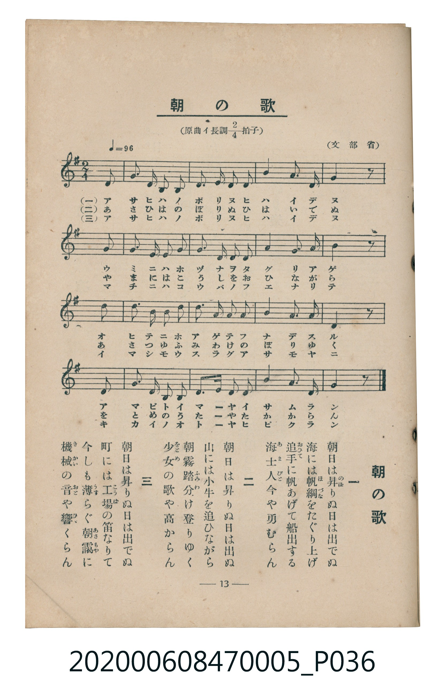

# 朝の歌

> Re:Shōka 使用 AI 協助辨識與重建樂譜，可能會有錯誤。歡迎[回報](https://github.com/TMDLang/reshoka/issues)。

- **鋼琴伴奏版**：<br><audio controls src="asa_no_uta.mp3"></audio>
- **NEUTRINO 歌聲合成版**：<br><audio controls src="asa_no_uta_neutrino.mp3"></audio>

- composer: 文部省
- 臺灣教育會公認《新定兒童唱歌》尋常科第五學年用（2020.006.0847.0005）

## 說明

原書資訊與歌詞全文（對應 P036.jpg，書頁 p. 13，第二學期第 1 首）：
調性與拍號：原曲イ長調二分之四拍子（譜面移調為ト長調 G 大調 2/4 拍），♩= 96，（文部省）
版面校勘：


## 歌詞

```text
1. 相較於大正二年文部省《尋常小學唱歌 第五學年用》原曲，本譜第二行（m.5–8：`1. 6_ 6_ 1 | 1. 5_ 5_ 5_ | 2 - 1. 2 | 3 - 0`）與第三行（m.9–12：`5. 3 3 5 | 5. 2 2 2 | 3 - 2. 2 | 5_ - 0`）之樂句順序互調。
2. 第二段第三句於五線譜下印作「あさつゆ」（朝露，同文部省原詞），底欄歌詞全文則印作「朝霧」。本檔 L2 依五線譜面假名「あさつゆ」轉錄。

一　朝日は昇（のぼ）りぬ日は出でぬ
海には帆綱（ほづな）をたぐり上げ
追手（おひて）に帆あげて船出する
海士人（あまびと）今や勇むらん

二　朝日は昇りぬ日は出でぬ
山には小牛を追ひながら
朝霧踏分（ふみわ）け登りゆく
少女（をとめ）の歌や高からん

三　朝日は昇りぬ日は出でぬ
町には工場（こうば）の笛なりて
今しも薄（うす）らぐ朝靄（あさもや）に
機械（きかい）の音（おと）や響（ひゞ）くらん
```

## ABC

<div class="abc-score" data-abc-src="asa_no_uta.abc" aria-label="五線譜載入中"></div>

[下載 ABC 原始檔](asa_no_uta.abc)

## TMD 檔案連結

- [主旋律 TMD 檔案](asa_no_uta.tmd) [[在 TMD Studio 編輯](https://tmdlang.github.io/Tmd-TS/#tmd=s7IKdvYPcrWy4qpTUCpJTLdSSM7PyUlNLsnMz7MqzsjMK0nNjM_KTMmPL87Iz05Ugisry88pzU21Si9KTEmNN403MjAyiDcwMIs3sDAxBzIMTBFKi_NLi5JTrYqTM_Lzc-JLUitKkvLzs9Hl4wsS01OtAgyMzRAyBUX5Zal5iXlA3QVFILekgLUjFKSWZaakgqSLkxPz4stSizLTMlNTEPL5RSUZ-UA3FmRUWmVkFpfkF2UmJ-bEZyfmIXsltagY7F2IO0qKEvOKk4syC0BhgFBVkpEK9G9JZm5qfH5afEpiJbpUeX4RkqeANqVn5lnl5ucllQKDDkOiJDGzHOjk_LS0zOTMxBwlLi0thWdz5j5uXPdsbY-ClhaXoq2CpRmXva2CO5eNkb6JHciA5Pzcgvzi1CIrhWfT2l82r3g-pxFs8Iv2Xc8bFz-bOvNF06Znc5qftq55sar3cUPXs2kbnq6b9bR10vPVS59O2Qg0-XFD99MN3U937Hi-fOLzNWue7JrydO2Opzu3PJ-y4v2eDlAs6gFjUQ8Ui0CGgen7PZ1KXFz6Wgq21AJcCgoKT_vmP5u948Xm9hcrul50tAPd9WLlvKetK4C-Arri6YbeZ-2dCqCkoJdVkP5-Tw9Q8csFjQoFegqGxkAu2OE9QIc_mzMfyFYwVHi5bBrQpe_3zAKZ_mLV_mcNy0Hmdve-mDkfKAq2b9PjpiUvp24HyoI0d7Q92dn9dPZsoJqnaycAbX2xds7LuYueL98NVPC8adfj5g6IYgV3hadLloMYwFhQACoHW9TzaOZKUAQBWUC98NgAyoFc8LyzA2jWswULn3bPgDrKUE_hOdDLe5qfTdsDNO_Z2sUgV-zcAtcKjC5IzDzd0A-KE3B0KaDFESj6wH4BBcqcNUA3Q8LixUKQM3L1TB81TLYA2pgAtM4sHoQMFWpAdpvGQ1GNgpGCLkjECMg0BjINEoCOBgYWyKAdnTCDLIEGGRqBTDLVAyozVjAFKgcyjcAQotMIYgjQUKgpwBB9tqLpaf_Slwvanu7qf7JrEjDYHjc0gfwPVAxx6rN1WyFWAdUBwwLou-fbZwE98mRH99PeDU_2znnc0PO4selx49THjUseN7U9bgCGeAcwa7ycA_L10wk98CADBgUw3UDi4-muqc_WtCCnpKed7XADwdqXA40CugYYbs9WTVHwMVJ4sm8u3HpgfD1tbH86AagC3foXeztf9rSA_AHyyJMdDY8bGoAGPpu-9HHj-mczQEkWmG0fN-4BuuRxU9fjxjUQqaftux43LgdyQdqebd3-uHE1SHRH2_NtG8F6dj9uBKpbBdY26XHj_MeNE4D6n-wAGjEJnJD3733W2Q1WChTa9LhxGUhp42qgEWAnAvUse9GxE2zPzMdN3VB7ni5e_WTXLrA2oKJ9jxs3P24E5u7OJ7u7Hje1PO1uf9zU8LgJaOdkiId2AUsFFA_h9MTTjRuhntjQ_7xzNtDVQCeCXbbqcWMP0EywC8Bh_WJHPzCPgR2x9XHj_sdN_WC3T3w-czfIeGDANvaDjdww8enSzSB1oCBY8bgJlIcgpSDQsS9Xz3jc2I3s2B2dxDr2-RQgB-zY7UufLtgCdsrkx41AizdArHi-ZjbI4SD9y8BmA8OncfrjpqYX01rAqoFKZ4IjB6h6AshbcyHi4NTR1AR0HyQ-wL5eOf_ZIqDBQOlekJMbIXLrXs4Hew4UgaA4APlp_n6wCLA8AqVdYDhA_Qc0hfLiFQoUtPS5uByLE_3yQ0sSrQIyE_PyHWp0DWuqQbYo2BiaadmBWdhKdoWneza-2LodViY0AMsEBQ1YaayJRT3QLpBZNQoGwJIABEE0uFgAlj1gASDHGMQHE9AiQxdUPIFZUKWgMgUEQQUUWBCmG2IgiF0DtsjHsEYBYoIumH7ctAhswOOmrWCxx82TgLgfzOqDyDTPgcqsAuIeqBqIDEgdWK5pCVRNO1gcpAphwzKE7UZotjc2QUxqnArR37gJiNeDWeugMnugNnQB2WugaiAyIHUQXS1QejlYHKQKYTtIDmq7Md393jwPbDvu9AKvgxQ0TIAZuv_5-gYdePWNN8FA4hdSU0FjGJFikNMGJE1AlIBSCCK1gNMaIniASeNx83yoZ7rhQTEb6uFWqAwwIppBUfC4aT80-DbAggIYTJAgWQQWB6lCBDZIDpEMgKUrRG3janiUT4aY19gGlZkO1AUKbmARAJWBmQgsfKB0D9imTmSbIIkKHuWPmxvR_dS0GepyUNIEyUyARvnjZlBCBMmsgPsJZDfEbyCzIG6D-QkU9YSiF9wyIDl6QfECzPTguALHEVQE1IaA5HP0XA9vUMCjFhz_SHELCkuQT9rAYYEUt-CMAPIPMPuBfQgPB6jvIckbomYnWHw1SjiAMxJS3MKy8xKgHNi8RlAWA8mA0gxIRz-QPREsg5rRIVkdQreBxWEZDWITOPshxS0og4HEtwPZIFdAixuwOyHuXglNoejZHSQH9XfzErCfQGGCsGkt2Ca8cQtsBJOfdalRsIMgcgxDQ6N5MhB3gH0BTqFwGYhfkcSRwmIBPLxA6kE5BBYWSLaAYxeSN4DtDWjsQXIsSAZSesCKXQgfJA4LWRgLlGNBtoNyPBZbQDHbBElhIJdC8yakBIH6DMkv8CIZZtrjJkjVgNsvtVxcunYKsEo-2scwVgGFb4TGNwbzlbkA)]
- [鋼琴伴奏 TMD 檔案](asa_no_uta_piano.tmd) [[在 TMD Studio 編輯](https://tmdlang.github.io/Tmd-TS/#tmd=s7IKdvYPcrWy4qpTUCpJTLdSyC8qychPL0osyKi0ysgsLskvykxOzInPTsxLVIIrKs4vLUpOjS9ITE-1CjAwNlPi0tJSeDZn7uPGdc_W9rzf0_Gye8_zCVue7NnydGn_886O93s6FbS0uBRtFSzNuOxtFdy5bIz0TexA5iXn5xbkF6cWWSk8m9b-snnF8zmNYHtetO963rj42dSZL5o2PZvT_LR1zYtVvY8bup5N2_B03aynrZOer176dMpGoHWPG7qfbuh-umPH8-UTn69Z82TXlKdrdzzdueX5lBVAlxgZGBnoGRiY6RlYmJgDGQamQMcocXE5Fif65YeWJFoFZCbm5Qd5ONToGtZUcykAgY2hmZYdmKWvpWCLDhSe7tn4Yuv2Fx3tIMt2NLxY2KOgAQoEvayCdE0s6rX0wWbVKBgo6IIhiDaNBxI1CoZgASDHGMQHEzUQOV0Fs3gIC6rUGKrbCKYFphtiIIhdA7bIx7BGAWKCLph-3LQIbMDjpq1gscfNk4C4H8zqg8g0z4HKrALiHqgaiAxIHViuaQlUTTtYHKQKYcMyhO1GaLY3NkFMapwK0d-4CYjXg1nroDJ7oDZ0AdlroGogMiB1EF0tUHo5WBykCmE7SA5quzHd_d48D2w77vQCTpM94GRiovB0Q__z9Q06CkQlGEj8AtMBEEFjGJFikNMGJE1AlIBSCCK1gNMaIniASeNx83yoZ7rhQTEbGki7oDLAiGgGRcHjpv1QmQ2woAAGEyRIFoHFQaoQgQ2SQySDx437IGobV8OjfDLEvMY2qMx0oC5QcD9u7ILKwEx83Ai1qbEHbFMnsk2QRAWP8sfNjeh-atoMdTkoaYJkJkCj_HEzKCGCZFbA_QSyG-I3kFkQt8H8BIp6QtG7o5Oc6AXFCzDTg-MKHEdQESNwfIIweq4HxSy0dEAuRpDiFhSWIJ-0gcMCOW5BGQHkH2D2A_sQHg5Q30OSN0TNTrD4apRwAGckpLiFZeclQDmweY2gLAaSAaUZkI5-IHsiWAY1o0OyOoRuA4vDMhrEJnD2Q4pbUAYDiW8HskGugBY3YHdC3L0SmkLRsztIDurv5iVgP4HCBGHTWrBNeOP26ezZ5GddahTsIIgcw9DQaJ4MxB1gX4BTKFwG4lckcaSwWAAPL5B6UA6BhQWSLeDYheSNx02N0NiD5FiQDKT0gBW7ED5IHBayMBYox4JsB-V4LLaAYrYJksJALoXmTUgJAvUZkl_gRTLMtMdNkKoBt19q0et4H5Q63gRRxQMbLs82LH4xec3T7uYnO7uBhfWz7t6nayc83b7sWWc3pBGDXIsbgGIoXiHaMBYcp0CWaTyICRKDs4CKoBpMQCpM4CoQusAsFKVweRSjoCyQHixK8TkAGAa6dgqwYIj2AWpA4Ruh8Y3BfGUuAA)]

## 分析

```text
================================================================================
📊 TMD Song Profile: [ 朝の歌 ]
================================================================================
⏱  Duration:       1:00 (60.0s), 48 measures total
🎼 Key & Tempo:    首調基準 G, != 96.0 BPM, <2/4>
   - 分析範圍：      由實際發聲的音符與和弦推測調性；播放脈絡另行呈現
🎤 人聲音域:    B3 (MIDI 59) – D5 (MIDI 74) [跨度: 15 個半音 / 1.2 個八度, 難度: moderate]
   - 最低音:  B3 in [AsaNoUta[L1] #1 @ m.2, 0:01]
   - 最高音: D5 in [AsaNoUta[L1] #1 @ m.9, 0:10]
   - 適合: soprano, mezzo-soprano, contralto, tenor, baritone, bass
🏛  結構:      AsaNoUta[L1] (20.0s) -> AsaNoUta[L2] (20.0s) -> AsaNoUta[L3] (20.0s)
⚡ 編曲密度:        Peak 1 軌道同時演奏
🗝  調性診斷：       D 調性不明確（純淨自然大調，未偵測到可信轉調）
   - 風格氣質:    純淨自然大調（陽光明朗、易唱易記，無明顯調外色彩）
   - 轉調歷程:    全曲維持單一推測調性（未偵測到可信轉調）
   - 核心骨幹音:  D, G, B, A, E
   - 調性數值:    D 調性不明確 [相關度: 0.81, 穩定度: Ambiguous, 自然音純度: 100.0%]
   - 候選調性 (K-S): D 大調 (0.81), G 大調 (0.81), B 小調 (0.71)
   - 五度圈歷程:   +2 -> +2 -> +2
   - 各段落調性細節:
     • [AsaNoUta[L1] #1]: D 大調 (r: 0.82, 自然音純度: 100.0%)
     • [AsaNoUta[L2] #1]: D 調性不明確 (r: 0.81, 自然音純度: 100.0%)
     • [AsaNoUta[L3] #1]: D 調性不明確 (r: 0.81, 自然音純度: 100.0%)

  [ 五度圈游移軌跡 ]
               C  
         F            G  
      Bb              [D ]*
      Eb               A  
         Ab           E  
            Db       B  
               F# 
     (* = active key center)

  [ 十二半音累積音高分佈 ]
     C  :                            0.0%
     C# :                            0.0%
     D  : ████████████████████████  34.2%
     D# :                            0.0%
     E  : ███                        4.2%
     F  :                            0.0%
     F# :                            0.0%
     G  : ████████████████          22.5%
     G# :                            0.0%
     A  : ████████████              16.7%
     A# :                            0.0%
     B  : ████████████████          22.5%
--------------------------------------------------------------------------------
Assignment 軌道音域：
  - Piano         : B3 – D5 (15 個半音 / 1.2 個八度, 156 個音符)
================================================================================
```


## 原書掃描頁




