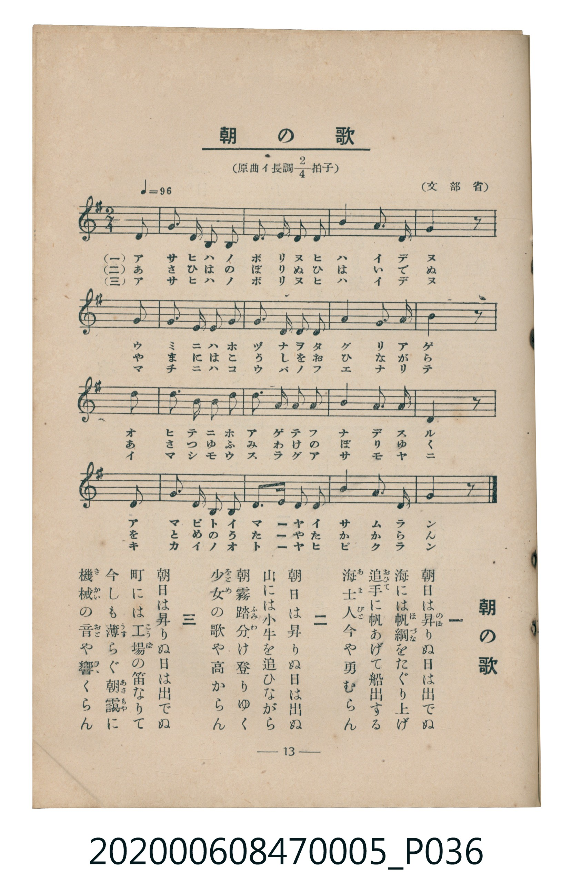

# 朝の歌

<audio controls src="asa_no_uta.mp3"></audio>

- 臺灣教育會公認《新定兒童唱歌》尋常科第五學年用（2020.006.0847.0005）

## 說明

原書資訊與歌詞全文（對應 P036.jpg，書頁 p. 13，第二學期第 1 首）：
調性與拍號：原曲イ長調二分之二拍子（譜面移調為ト長調 G 大調 2/4 拍），♩= 96，（文部省）

## 歌詞

```text
一　朝日は昇（のぼ）りぬ日は出でぬ
海には帆綱（ほづな）をたぐり上げ
追手（おひて）に帆あげて船出する
海士人（あまびと）今や勇むらん

二　朝日は昇りぬ日は出でぬ
山には小牛を追ひながら
朝霧踏分け（ふみわ）登りゆく
少女（をとめ）の歌や高からん

三　朝日は昇りぬ日は出でぬ
町には工場（こうば）の笛なりて
今しも薄（うす）らぐ朝靄（あさもや）に
機械（きかい）の音（おと）や響（ひゞ）くらん
```

## 原書掃描頁



## 分析

```text
================================================================================
📊 TMD Song Profile: [ 朝の歌 ]
================================================================================
⏱  Duration:       0:21 (21.2s), 17 measures total
🎼 Key & Tempo:    首調基準 G, != 96.0 BPM, <2/4>
   - 分析範圍：      由實際發聲的音符與和弦推測調性；播放脈絡另行呈現
🎤 人聲音域:    D4 (MIDI 62) – E5 (MIDI 76) [跨度: 14 個半音 / 1.2 個八度, 難度: moderate]
   - 最低音:  D4 in [AsaNoUta #1 @ m.1, 0:00]
   - 最高音: E5 in [AsaNoUta #1 @ m.10, 0:11]
   - 適合: soprano, mezzo-soprano, contralto, tenor, baritone, bass
🏛  結構:      AsaNoUta (21.2s)
⚡ 編曲密度:        Peak 1 軌道同時演奏
🗝  調性診斷：       G 大調（純淨自然大調，未偵測到可信轉調）
   - 風格氣質:    純淨自然大調（陽光明朗、易唱易記，無明顯調外色彩）
   - 轉調歷程:    全曲維持單一推測調性（未偵測到可信轉調）
   - 核心骨幹音:  B, A, D, G, C
   - 調性數值:    G 大調 [相關度: 0.80, 穩定度: Moderate, 自然音純度: 98.4%]
   - 候選調性 (K-S): G 大調 (0.80), D 大調 (0.70), B 小調 (0.64)
   - 五度圈歷程:   +1
   - 各段落調性細節:
     • [AsaNoUta #1]: G 大調 (r: 0.80, 自然音純度: 98.4%, 調外音: C#)

  [ 五度圈游移軌跡 ]
               C  
         F           [G ]*
      Bb               D  
      Eb               A  
         Ab           E  
            Db       B  
               F# 
     (* = active key center)

  [ 十二半音累積音高分佈 ]
     C  : ████████                   8.2%
     C# : ██                         1.6%
     D  : ████████████████████      19.7%
     D# :                            0.0%
     E  : ███                        3.3%
     F  :                            0.0%
     F# : ██                         1.6%
     G  : ████████████████████      19.7%
     G# :                            0.0%
     A  : ██████████████████████    22.1%
     A# :                            0.0%
     B  : ████████████████████████  23.8%
--------------------------------------------------------------------------------
Assignment 軌道音域：
  - Piano         : D4 – E5 (14 個半音 / 1.2 個八度, 57 個音符)
================================================================================
```

## ABC

```abc
X:1
T:朝の歌
C:TMD (Chen, Chih-Han / aguai)
M:2/4
L:1/16
Q:1/4=96
K:G
V:V1 name="Piano" snm="Pia"
[V:V1]
z4 z2 d2 | g3 f g2 a2 | b3 a b2 d2 | c2 b2 a2 g2 |
a4 z2 d2 | g3 f g2 a2 | b3 c d2 b2 | a2 d2 ^c2 a2 |
d4 z2 d2 | e2 b2 c2 a2 | d2 a2 b2 g2 | c2 b2 a2 g2 |
b4 a2 d2 | g2 b2 a2 c2 | b3 c d2 e2 | d2 g2 b2 a2 |
g4 z4 |
```

- [主旋律 TMD 檔案](asa_no_uta.tmd)
- [鋼琴伴奏 TMD 檔案](asa_no_uta_piano.tmd)
