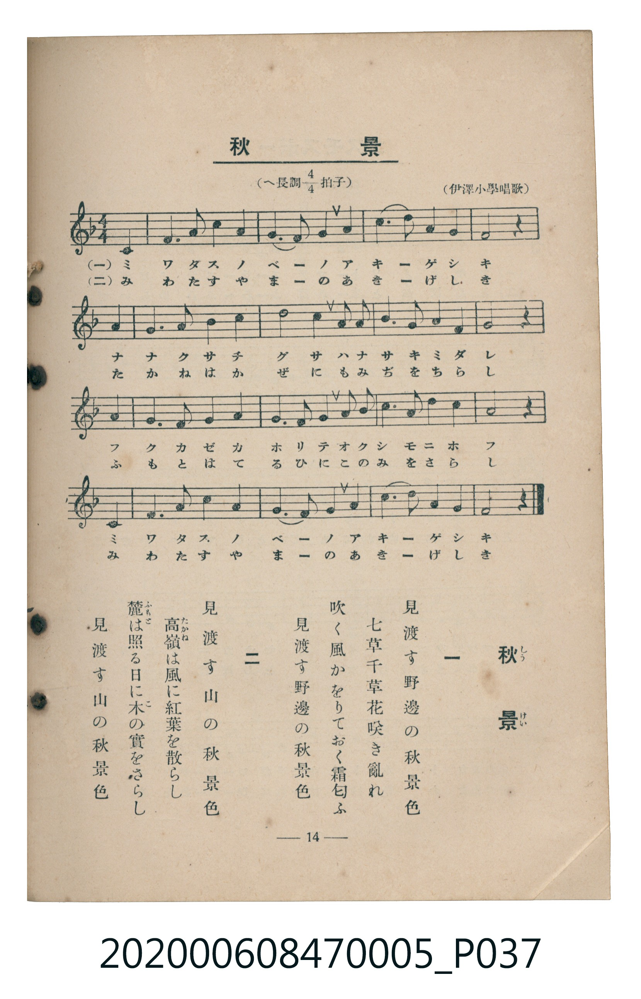

# 秋景

> Re:Shōka 使用 AI 協助辨識與重建樂譜，可能會有錯誤。歡迎回報。

- **鋼琴伴奏版**：<br><audio controls src="shukei.mp3"></audio>
- **NEUTRINO 歌聲合成版**：<br><audio controls src="shukei_neutrino.mp3"></audio>

- 臺灣教育會公認《新定兒童唱歌》尋常科第五學年用（2020.006.0847.0005）

## 說明

原書資訊與歌詞全文（對應 P037.jpg，書頁 p. 14，第二學期第 2 首）：
調性與拍號：へ長調四分之四拍子（F 大調 4/4 拍），（伊澤小學唱歌）


## 歌詞

```text
一　見渡す野邊の秋景色
七草千草花咲き亂れ
吹く風かをりておく霜匂ふ
見渡す野邊の秋景色

二　見渡す山の秋景色
高嶺（たかね）は風に紅葉を散らし
麓（ふもと）は照る日に木の實をさらし
見渡す山の秋景色
```

## ABC

<div class="abc-score" data-abc-src="shukei.abc" aria-label="五線譜載入中"></div>

[下載 ABC 原始檔](shukei.abc)

## TMD 檔案連結

- [主旋律 TMD 檔案](shukei.tmd) [[在 TMD Studio 編輯](https://tmdlang.github.io/Tmd-TS/#tmd=s7IKdvYPcrWy4qpTUCpJTLdSSM7PyUlNLsnMz7MqzsjMK0nNjM_KTMmPL87Iz05Ugisry88pzU21Si9KTEmNN403MjAyiDcwMIs3sDAxBzIMTBFKi_NLi5JTrYqTM_Lzc-JLUitKkvLzsxHyBUX5Zal5iXlANQVFIBtTwIoQClLLMlNSQdKpKZkl-UWZiTlI7kgtKga7FWxJfElRYl5xclFmAcgDCFUlGalAxxanJhbn5xUTFAZakZ6ZZ1WSmFmemBefn5aWmYxiZ35RSUY-0OcFGZVWGZnFICclJ-bEZyfmIQUQ1EEFiempVgEGxuZKXFpaCs-Xdz-buV5BS4tL0VbB0ozL3lbBjcvGRN_EDqTvRfuu542Ln02d-aJp07M5zU9b17xY1fu4oevZtA1P18162jrp-eqlT6dsfLa253FD99MN3U937Hi-fOLzNWue7JrydO2Opzu3PJ-y4v2eDlBk6AEjQw8UGUCGgen7PZ1KXFz6Wgq21AJcCgoKT_vmP5u948Xm9hcrul50tAPd9WLlvKetK55Nawe64umG3mftnQogv-tlFaS_39MDVPxyQaNCgZ6CoQmQC3Z4D9Dhz-bMB7IVjBReLpsGdOn7PbNApr9Ytf9Zw3KQud29L2bOB4o-btzxcup2oPjT2bOfdrQ92dkNZABln66dALTPTeHpkuVASQVgcCoARcEm9QAlnuzperZvydMN_aAwAgcfUIoLZMWTHQ2PGxpeLOt-tmPh48aZL9v7XjZ1PW5cB4mmF52bIIqaX_R2Pu0FkS-6Nj6dtOlxY--TXU2Pm3rAgTBh5-PG_peLVjxu7H7cNOkxyIBljxuBZP_LOXOe9jQ9btwK9g4eW8DW7ALGKsItTzduRHfIy9Uznm7bBfTQ48b5IMsa1wL98bhxPdju1c-3tL6Y2Al0wbOpix83AcWng_XsmgzWsPVxE9AhwMQB0vC8dfnjpu5n05cCtT2bA9S87un6ZSC3N05F6MTnEsqTDxQoaOlzcQVnlGanZloFZCbm5TvUGNRUg6xQsLHQsgMzsKVahad7Nr7Yuh2YOECJaEfDi4U9ChqwlKaJRT3QHqhZqOBx83wFhRogtR7Ma9oPxDtBwn0Q4ZkwZXsQgk2LIGrXQoWbNkGEt0PVAiXAWroUYNbWKBgo6IIhiDaNBxI1CoZgAUNgstcF4xoFY6gikAyIXaNgCuabKpjARUAqYQaBRcAW-BjWKIBMBUEQDfIWSDXIXyAxmMdAMn1QmZlQ9WB5mCjQbxD1a6H0Jqj4dphKsAzIc3C7jdDsbtwP1dMP0dE4H4hBtj1uaoHINO5DtrtxHVS0CcrvhdKToOLT4SpBMiDzQHbjThyQggWcJkwUgPn--foGHXg5hD91gGMNFIfrgXgrKBYbIZG7ARa5YMF-sEKQOJALSwvAlPS4uQGSbtagJrKpSEnBDOwXM3DcgjAwJcRBPQjimgCjFRbNxuCIR00coIgHi8AjHhIZoOCFOBoUPY3QKNgAjzaIOLLDYdEJSSwgp0MSxhrkyAQ6HTmigeUONCqA-hpBiQsiApKZA4-m1WCTm8BJASQDS1STgOyFYFYnWtRCEg7ITYQidkcneRELDBxwTK0GYnCuXQ2JqdmQGFoFxG0gYSADqBSenx83LwLibhADqBKkARiXyFELjHV41EKytBE4rkAxhxqPpsBIh2VpUCzDYhYiglw2IKIW6BRI0EGcDWFBogmUM0ERBHE5SAbZ6RA5iNtBrNlQXaDoRCslEJELjDJIBK6AR-4yiL4mWLRvgkVv42RwzgVFIii_w6IXZD6u6AWXC_ijF1ihk5lvqV6AgwBazBJfWEPUQHRBYhYEkfMsbQpmpOQDjlDaFMEQW2q5uHTtFCC1twKQpcwFAA)]
- [鋼琴伴奏 TMD 檔案](shukei_piano.tmd) [[在 TMD Studio 編輯](https://tmdlang.github.io/Tmd-TS/#tmd=s7IKdvYPcrWy4qpTUCpJTLdSyC8qychPL0osyKi0ysgsLskvykxOzInPTsxLVIIrKs4vLUpOjS9ITE-1CjAwNlfi0tJSeL68-9nM9e_3dLzs3vN8wpYne7Y8Xdr_vLPj_Z5OBS0tLkVbBUszLntbBTcuGxN9EzuQYS_adz1vXPxs6swXTZuezWl-2rrmxarexw1dz6ZteLpu1tPWSc9XL306ZeOztT2PG7qfbuh-umPH8-UTn69Z82TXlKdrdzzdueX5lBVAG40MjAz0DAzM9AwsTMyBDANToKVKXFzBGaXZqZlWAZmJeflBHg41BjXVXApAYGOhZQdm6Gsp2KIDhad7Nr7Yuv1FRzvIoh0NLxb2KGiAfKmXVZCuiUW9lj7YrBoFAwVdMATRpvFAokbBECxgqGAEJEG4RsEYqggkA2LXKJiC-aYKJnARkEqYQWARsAU-hjUKIFNBEEQ_bp4PVv24eT1Y7HHTfiDeCZbpg8rMhKoHy8NEmxZB1a-F0pug4tthKsEyj5u7EHYbodnduB-qpx-io3E-EINse9zUApFp3Idsd-M6qGgTlN8LpSdBxafDVYJkQOaB7MYdS-BU0AOOHBOFpxv6n69v0FEgKprMwPaYgcMdhIGxFAe1HMQ1AQY5LAqMwZGCGnGgSAGLwCMFElAgr68H4q3goGuEBs8GeJBCxPvBqkEyID4kqCER-bi5AaKneQ1yQDdPRYmEx43d0GAC6msERTxEBCQzBx6Eq8EmN4GjCSQzA2rXJCB7IZjViRbskEgFuYlQoO_oJCfQIRnBCByKoDBFDWFTYHTAMgIo_GFhDhFBzlGIQAcGNsRTq4F4D5QFCUBQegYF3SogbgPLAFlA9Yg0_rh5ERCDAu5x82yoLlBAo-UtRLADAxMStCvgwb4Moq8JFiGbYAHfOBmc3kHBC8olsIAHmY8r4MG5CX_AP509m_yAJ74EgqiB6IIEPAgiJ3balDZIsQsOb9qUKxBbalGrBh_kqsEEUTW8nNb9cnrX8469z-ZMf7KzG1LBAaPhWXfv07UTnm5f9qyzG1LNIdcBEAgMwniFaMNYYLIF0qbxsQgRKAXnmwApExAfrhTEABoBNRIqD9eGzkfRhmEVwhyc1sFFoCqMgJQRHgcR9hlhJwGjQNdOARIL0T5AcSQe0G4gT5kLAA)]

## 分析

```text
================================================================================
📊 TMD Song Profile: [ 秋景 ]
================================================================================
⏱  Duration:       0:42 (42.5s), 17 measures total
🎼 Key & Tempo:    首調基準 F, != 96.0 BPM, <4/4>
   - 分析範圍：      由實際發聲的音符與和弦推測調性；播放脈絡另行呈現
🎤 人聲音域:    C4 (MIDI 60) – F5 (MIDI 77) [跨度: 17 個半音 / 1.4 個八度, 難度: challenging]
   - 最低音:  C4 in [Shukei #1 @ m.1, 0:01]
   - 最高音: F5 in [Shukei #1 @ m.7, 0:15]
   - 適合: soprano, mezzo-soprano, contralto, tenor, baritone, bass
🏛  結構:      Shukei (42.5s)
⚡ 編曲密度:        Peak 1 軌道同時演奏
🗝  調性診斷：       F 大調（純淨自然大調，未偵測到可信轉調）
   - 風格氣質:    純淨自然大調（陽光明朗、易唱易記，無明顯調外色彩）
   - 轉調歷程:    全曲維持單一推測調性（未偵測到可信轉調）
   - 核心骨幹音:  G, A, C, F, A#
   - 調性數值:    F 大調 [相關度: 0.81, 穩定度: Moderate, 自然音純度: 100.0%]
   - 候選調性 (K-S): F 大調 (0.81), C 大調 (0.71), A 小調 (0.60)
   - 五度圈歷程:   -1
   - 各段落調性細節:
     • [Shukei #1]: F 大調 (r: 0.81, 自然音純度: 100.0%)

  [ 五度圈游移軌跡 ]
               C  
        [F ]*          G  
      Bb               D  
      Eb               A  
         Ab           E  
            Db       B  
               F# 
     (* = active key center)

  [ 十二半音累積音高分佈 ]
     C  : ███████████████████████   21.7%
     C# :                            0.0%
     D  : ████                       4.2%
     D# :                            0.0%
     E  :                            0.0%
     F  : ████████████████████      19.2%
     F# :                            0.0%
     G  : ████████████████████████  22.5%
     G# :                            0.0%
     A  : ████████████████████████  22.5%
     A# : ███████████               10.0%
     B  :                            0.0%
--------------------------------------------------------------------------------
Assignment 軌道音域：
  - Piano         : C4 – F5 (17 個半音 / 1.4 個八度, 55 個音符)
================================================================================
```


## 原書掃描頁




