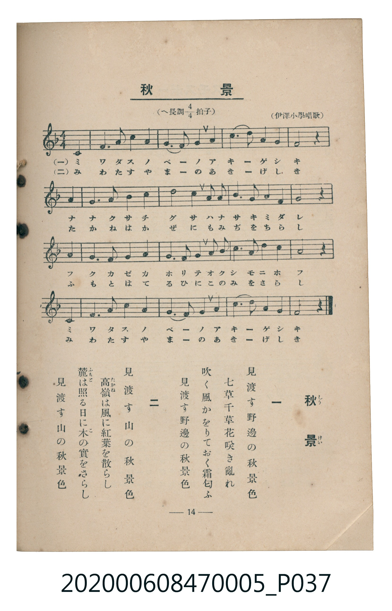

# 秋景

> Re:Shōka 使用 AI 協助辨識與重建樂譜，可能會有錯誤。歡迎回報。

- **鋼琴伴奏版**：<br><audio controls src="shukei.mp3"></audio>
- **NEUTRINO 歌聲合成版**：<br><audio controls src="shukei_neutrino.mp3"></audio>

- 臺灣教育會公認《新定兒童唱歌》尋常科第五學年用（2020.006.0847.0005）

## 說明

原書資訊與歌詞全文（對應 P037.jpg，書頁 p. 14，第二學期第 2 首）：
調性與拍號：へ長調四分之四拍子（F 大調 4/4 拍），（伊澤小學唱歌）


## 歌詞

```text
一　見渡す野邊の秋景色
七草千草花咲き亂れ
吹く風かをりておく霜匂ふ
見渡す野邊の秋景色

二　見渡す山の秋景色
高嶺（たかね）は風に紅葉を散らし
麓（ふもと）は照る日に木の實をさらし
見渡す山の秋景色
```

## ABC

<div class="abc-score" data-abc-src="shukei.abc" aria-label="五線譜載入中"></div>

[下載 ABC 原始檔](shukei.abc)

## TMD 檔案連結

- [主旋律 TMD 檔案](shukei.tmd) [[在 TMD Studio 編輯](https://tmdlang.github.io/Tmd-TS/#tmd=s7IKdvYPcrWy4qpTUCpJTLdSSM7PyUlNLsnMz7MqzsjMK0nNjM_KTMmPL87Iz05Ugisry88pzU21Si9KTEmNN403MjAyiDcwMIs3sDAxBzIMTBFKi_NLi5JTrYqTM_Lzc-JLUitKkvLzsxHyBUX5Zal5iXlANQVFIBtTwIoQClLLMlNSQdKpKZkl-UWZiTlI7kgtKga7FWxJfElRYl5xclFmAcgDCFUlGalAxxanJhbn5xUTFAZakZ6ZZ1WSmFmemBefn5aWmQy2U0tL4fny7mcz1ytoaXEp2ipYmnHZ2yq4cdmY6JvYgXS_aN_1vHHxs6kzXzRtejan-Wnrmhereh83dD2btuHpullPWyc9X7306ZSNz9b2PG7ofrqh--mOHc-XT3y-Zs2TXVOert3xdOeW51NWvN_TAQpNPWBo6oFCE8gwMH2_p1OJi0tfS8GWWoBLQUHhad_8Z7N3vNjc_mJF14uOdqC7Xqyc97R1xbNp7UBXPN3Q-6y9UyHAwNhcL6sg_f2eHqDilwsaFQr0FAxNgFyww3uADn82Zz6QrWCk8HLZNKBL3--ZBTL9xar9zxqWg8zt7n0xcz5Q9HHjjpdTtwPFn86e_bSj7cnObiADKPt07QSgfW4KT5csB0oqAINTASgKNqkHKPFkT9ezfUuebugHhRE4-IBSXCArnuxoeNzQ8GJZ97MdCx83znzZ3veyqetx4zpINL3o3ARR1Pyit_NpL4h80bXx6aRNjxt7n-xqetzUAw6ECTsfN_a_XLTicWP346ZJj0EGLHvcCCT7X86Z87Sn6XHjVrB38NgCtmYXMFYRbnm6cSO6Q16unvF02y6ghx43zgdZ1rgW6I_HjevBdq9-vqX1xcROoAueTV38uAkoPh2sZ9dksIatj5uADgEmDpCG563LHzd1P5u-FKjt2Ryg5nVP1y8Dub1xKkInPpdQnnygQEFLn4srOKM0OzXTKiAzMS_focagphpkhYKNhZYdmIEt1So83bPxxdbtwMQBSkQ7Gl4s7FHQgKU0TSzqgfZAzUIFj5vnKyjUAKn1YF7TfiDeCRLugwjPhCnbgxBsWgRRuxYq3LQJIrwdqhYoAdbSpQCztkbBQEEXDEG0aTyQqFEwBAsYApO9LhjXKBhDFYFkQOwaBVMw31TBBC4CUgkzCCwCtsDHsEYBZCoIgmiQt0CqQf4CicE8BpLpg8rMhKoHy8NEgX6DqF8LpTdBxbfDVIJlQJ6D222EZnfjfqiefoiOxvlADLLtcVMLRKZxH7Ldjeugok1Qfi-UngQVnw5XCZIBmQeyG3figBQs4DRhogDM98_XN-jAyyH8qQMca6A4XA_EW0Gx2AiJ3A2wyAUL9oMVgsSBXFhaAKakx80NkHSzBjWRTUVKCmZgv5iB4xaEgSkhDupBENcEGK2waDYGRzxq4gBFPFgEHvGQyAAFL8TRoOhphEbBBni0QcSRHQ6LTkhiATkdkjDWIEcm0OnIEQ0sd6BRAdTXCEpcEBGQzBx4NK0Gm9wETgogGViimgRkLwSzOtGiFpJwQG4iFLE7OsmLWGDggGNqNRCDc-1qSEzNhsTQKiBuAwkDGUCl8Pz8uHkREHeDGECVIA3AuESOWmCsw6MWkqWNwHEFijnUeDQFRjosS4NiGRazEBHksgERtUCnQIIO4mwICxJNoJwJiiCIy0EyyE6HyEHcDmLNhuoCRSdaKYGIXGCUQSJwBTxyl0H0NcGifRMsehsng3MuKBJB-R0WvSDzcUUvuFzAH73ACp3MfEv1AhwE0GKW-MIaogaiCxKzIIicZ2lTMCMlH3CE0qYIhthSy8Wla6cAqb0VgCxlLgA)]
- [鋼琴伴奏 TMD 檔案](shukei_piano.tmd) [[在 TMD Studio 編輯](https://tmdlang.github.io/Tmd-TS/#tmd=s7IKdvYPcrWy4tLSUni-vPvZzPXv93S87N7zfMKWJ3u2PF3a_7yz4_2eTgUtLS5FWwVLMy57WwU3LhsTfRM7rjoFpRftu543Ln42deaLpk3P5jQ_bV3zYlXv44auZ9M2PF0362nrpOerlz6dsvHZ2p7HDd1PN3Q_3bHj-fKJz9esebJrytO1O57u3PJ8ygqgjUYGRgZ6BgZmegYWJuZAhoEp0FIlLq7gjNLs1EyrgMzEvPwgD4cag5pqLgUgsLHQsgMz9LUUbNGBwtM9G19s3f6iox1k0Y6GFwt7FDQCDIzN9bIK0jWxqNfSB5tVo2CgoAuGINo0HkjUKBiCBQwVjIAkCNcoGEMVgWRA7BoFUzDfVMEELgJSCTMILAK2wMewRgFkKgiC6MfN88GqHzevB4s9btoPxDvBMn1QmZlQ9WB5mGjTIqj6tVB6E1R8O0wlWOZxcxfCbiM0uxv3Q_X0Q3Q0zgdikG2Pm1ogMo37kO1uXAcVbYLye6H0JKj4dLhKkAzIPJDduGMJnAp6wJFjovB0Q__z9Q06CkRFkxnYHjNwuIMwMJbioJaDuCbAIIdFgTE4UlAjDhQpYBF4pEACCuT19UC8FRx0jdDg2QAPUoh4P1g1SAbEhwQ1JCIfNzdA9DSvQQ7o5qkokfC4sRsaTEB9jaCIh4iAZObAg3A12OQmcDSBZGARPgnIXghmdaIFOyRSQW4iFOg7OskJdEhGMAKHIihMUUPYFBgdsIwACn9YmENEkHMUItCBgQ3x1Gog3gNlQQIQlJ5BQbcKiNvAMkAWUD0ijT9uXgTEoIB73DwbqgsU0Gh5CxHswMCEBO0KeLAvg-hrgkXIJljAN04Gp3dQ8IJyCSzgQebjCnhwbsIf8E9nzyY_4IkvgSBqILogAQ-CyImdNqUNUuyCw5s25QrEllrUqsEHuWowQVQNL6d1v5ze9bxj77M505_s7IZUcMBoeNbd-3TthKfblz3r7IZUc8h1AAQCgzBeIdowFphsgbRpfCxCBErB-SZAygTEhysFMYBGQI2EysO1ofNRtGFYhTAHp3VwEagKIyBlhMdBhH1G2EnAKNC1U4DEQrQPUByJB7QbyFPmAgA)]

## 分析

```text
================================================================================
📊 TMD Song Profile: [ 秋景 ]
================================================================================
⏱  Duration:       0:42 (42.5s), 17 measures total
🎼 Key & Tempo:    首調基準 F, != 96.0 BPM, <4/4>
   - 分析範圍：      由實際發聲的音符與和弦推測調性；播放脈絡另行呈現
🎤 人聲音域:    C4 (MIDI 60) – F5 (MIDI 77) [跨度: 17 個半音 / 1.4 個八度, 難度: challenging]
   - 最低音:  C4 in [Shukei #1 @ m.1, 0:01]
   - 最高音: F5 in [Shukei #1 @ m.7, 0:15]
   - 適合: soprano, mezzo-soprano, contralto, tenor, baritone, bass
🏛  結構:      Shukei (42.5s)
⚡ 編曲密度:        Peak 1 軌道同時演奏
🗝  調性診斷：       F 大調（純淨自然大調，未偵測到可信轉調）
   - 風格氣質:    純淨自然大調（陽光明朗、易唱易記，無明顯調外色彩）
   - 轉調歷程:    全曲維持單一推測調性（未偵測到可信轉調）
   - 核心骨幹音:  G, A, C, F, A#
   - 調性數值:    F 大調 [相關度: 0.81, 穩定度: Moderate, 自然音純度: 100.0%]
   - 候選調性 (K-S): F 大調 (0.81), C 大調 (0.71), A 小調 (0.60)
   - 五度圈歷程:   -1
   - 各段落調性細節:
     • [Shukei #1]: F 大調 (r: 0.81, 自然音純度: 100.0%)

  [ 五度圈游移軌跡 ]
               C  
        [F ]*          G  
      Bb               D  
      Eb               A  
         Ab           E  
            Db       B  
               F# 
     (* = active key center)

  [ 十二半音累積音高分佈 ]
     C  : ███████████████████████   21.7%
     C# :                            0.0%
     D  : ████                       4.2%
     D# :                            0.0%
     E  :                            0.0%
     F  : ████████████████████      19.2%
     F# :                            0.0%
     G  : ████████████████████████  22.5%
     G# :                            0.0%
     A  : ████████████████████████  22.5%
     A# : ███████████               10.0%
     B  :                            0.0%
--------------------------------------------------------------------------------
Assignment 軌道音域：
  - Piano         : C4 – F5 (17 個半音 / 1.4 個八度, 55 個音符)
================================================================================
```


## 原書掃描頁




