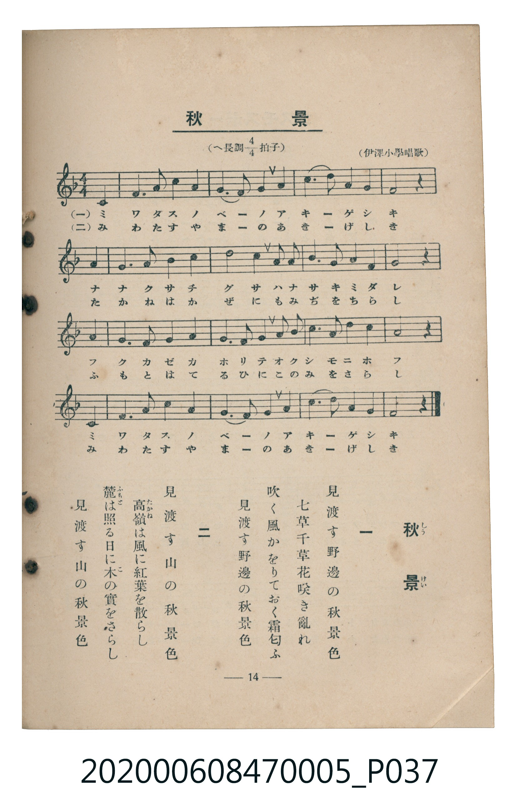

# 秋景

<audio controls src="shukei.mp3"></audio>

- 臺灣教育會公認《新定兒童唱歌》尋常科第五學年用（2020.006.0847.0005）

## 說明

原書資訊與歌詞全文（對應 P037.jpg，書頁 p. 14，第二學期第 2 首）：
調性與拍號：へ長調四分之四拍子（F 大調 4/4 拍），（伊澤小學唱歌）

## 歌詞

```text
一　見渡す野邊の秋景色
七草千草花咲き亂れ
吹く風かをりておく霜匂ふ
見渡す野邊の秋景色

二　見渡す山の秋景色
高嶺（たかね）は風に紅葉を散らし
麓（ふもと）は照る日に木の實をさらし
見渡す山の秋景色
```

## 原書掃描頁



## 分析

```text
================================================================================
📊 TMD Song Profile: [ 秋景 ]
================================================================================
⏱  Duration:       0:42 (42.5s), 17 measures total
🎼 Key & Tempo:    首調基準 F, != 96.0 BPM, <4/4>
   - 分析範圍：      由實際發聲的音符與和弦推測調性；播放脈絡另行呈現
🎤 人聲音域:    C4 (MIDI 60) – F5 (MIDI 77) [跨度: 17 個半音 / 1.4 個八度, 難度: challenging]
   - 最低音:  C4 in [Shukei #1 @ m.1, 0:01]
   - 最高音: F5 in [Shukei #1 @ m.7, 0:15]
   - 適合: soprano, mezzo-soprano, contralto, tenor, baritone, bass
🏛  結構:      Shukei (42.5s)
⚡ 編曲密度:        Peak 1 軌道同時演奏
🗝  調性診斷：       F 大調（純淨自然大調，未偵測到可信轉調）
   - 風格氣質:    純淨自然大調（陽光明朗、易唱易記，無明顯調外色彩）
   - 轉調歷程:    全曲維持單一推測調性（未偵測到可信轉調）
   - 核心骨幹音:  G, A, C, F, A#
   - 調性數值:    F 大調 [相關度: 0.81, 穩定度: Moderate, 自然音純度: 100.0%]
   - 候選調性 (K-S): F 大調 (0.81), C 大調 (0.71), A 小調 (0.60)
   - 五度圈歷程:   -1
   - 各段落調性細節:
     • [Shukei #1]: F 大調 (r: 0.81, 自然音純度: 100.0%)

  [ 五度圈游移軌跡 ]
               C  
        [F ]*          G  
      Bb               D  
      Eb               A  
         Ab           E  
            Db       B  
               F# 
     (* = active key center)

  [ 十二半音累積音高分佈 ]
     C  : ███████████████████████   21.7%
     C# :                            0.0%
     D  : ████                       4.2%
     D# :                            0.0%
     E  :                            0.0%
     F  : ████████████████████      19.2%
     F# :                            0.0%
     G  : ████████████████████████  22.5%
     G# :                            0.0%
     A  : ████████████████████████  22.5%
     A# : ███████████               10.0%
     B  :                            0.0%
--------------------------------------------------------------------------------
Assignment 軌道音域：
  - Piano         : C4 – F5 (17 個半音 / 1.4 個八度, 55 個音符)
================================================================================
```

## ABC

```abc
X:1
T:秋景
C:TMD (Chen, Chih-Han / aguai)
M:4/4
L:1/16
Q:1/4=96
K:F
V:V1 name="Piano" snm="Pia"
[V:V1]
z8 z4 c4 | f6 f2 g4 g4 | a8 f4 a4 | c6 c2 b4 a4 |
g8 z4 a4 | d6 d2 c4 c4 | f8 c4 b2 a2 | g6 a2 b4 g4 |
a8 z4 g4 | f6 g2 a4 b4 | g6 a2 b4 c2 d2 | c6 b2 a4 g4 |
c8 z4 c4 | f6 f2 g4 g4 | a8 f4 a4 | c6 c2 b4 g4 |
f8 z8 |
```

- [主旋律 TMD 檔案](shukei.tmd)
- [鋼琴伴奏 TMD 檔案](shukei_piano.tmd)
