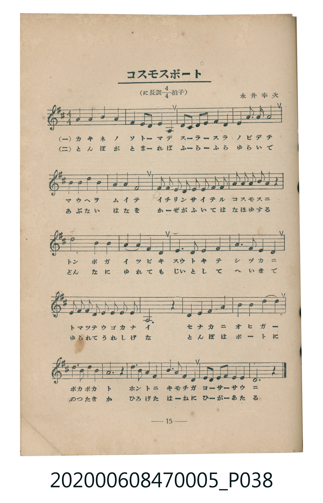
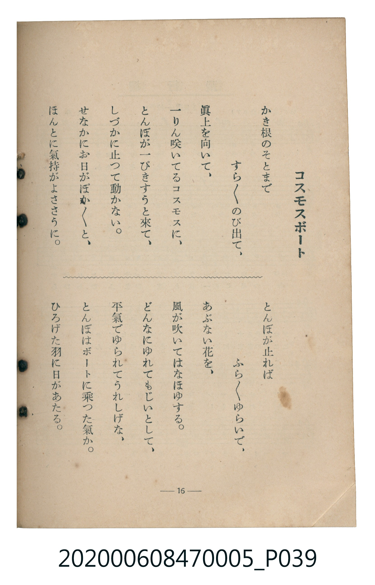

# コスモスボート

> Re:Shoka 使用 AI 辨識樂譜，可能會有錯誤。歡迎回報。

<audio controls src="kosumosu_boto.mp3"></audio>

- 臺灣教育會公認《新定兒童唱歌》尋常科第五學年用（2020.006.0847.0005）
- 永井幸次

## 說明

原書資訊與歌詞全文（對應 P038.jpg – P039.jpg，書頁 pp. 15–16，第二學期第 3 首）：
調性與拍號：に長調四分之四拍子（D 大調 4/4 拍），永井幸次

## 歌詞

```text
一　かき根のそとまで
すら／＼のび出て、
眞上を向いて、
一りん咲いてるコスモスに、
とんぼが一ぴきすうと來て、
しづかに止つて動かない。
せなかにお日がぽか／＼と、
ほんとに氣持がよささうに。

二　とんぼが止れば
ふら／＼ゆらいで、
あぶない花を、
風が吹いてはなほゆする。
どんなにゆれてもじいとして、
平氣でゆられてうれしげな、
とんぼはボートに乗つた氣か。
ひろげた羽に日があたる。
```

## ABC

```abc
X:1
T:コスモスボート
M:4/4
L:1/16
Q:1/4=104
K:D
V:V1 name="Piano" snm="Pia"
[V:V1]
F4 F4 G4 F4 | E4 F2 E2 D8 | D2 D2 E2 F2 G4 F4 | E4 A6 A2 A4 |
B4 B4 d4 B4 | A4 F4 E8 | G2 G2 F2 F2 E2 E2 F2 G2 | A2 A2 B2 A2 F4 z4 |
d8 B4 B4 | A4 A4 F4 E4 | D6 D2 E4 F4 | A6 A2 A4 A4 |
E2 E2 F2 G2 A2 G2 F2 E2 | D12 z4 | D4 E4 F4 G4 | A4 A4 B4 A4 |
d6 B2 d4 B4 | A12 z4 | d3 B B2 A2 F3 G F2 E2 | D2 D2 E2 F2 G4 E4 |
D12 z4 |
```

## TMD 檔案連結

- [主旋律 TMD 檔案](kosumosu_boto.tmd) [[在 TMD Studio 編輯](https://tmdlang.github.io/Tmd-TS/#tmd=s7IKdvYPcrWy4qpTUCpJTLdSSM7PyUlNLsnMz7MqzsjMK0nNjM_KTMmPL87Iz05Ugisry88pzU21Si9KTEmNN403MjAyiDcwMIs3sDAxBzIMTBFKi_NLi5JTrYqTM_Lzc-JLUitKkvLzsxHyBUX5Zal5iXlANQVFIBtTwIoQClLLMlNSQdKpKZkl-UWZiTlI7kgtKga7FWxJfElRYl5xclFmAcgDCFUlGalAx4IlC_KLgEZraSk8btr8uGnn4-ZFYHLO4-Y9j5s7FLS0uBRtFQwNTLjsbRVcuGxM9E3sQMa8aN_1vHHxs6kzXzRtejan-Wnrmhereh83dD2btuHpullPWyc9X7306ZSNz9b2PG7ofrqh--mOHc-XT3y-Zs2TXVOert3xdOeW51NWvN_TAQooPWBA6YECCsgwMH2_pxPs0GcbdjzZNfXpzh3P1ixU4uLS11KwpRbgUlBQeNo3_9nsHS82t79Y0fWiox3o0Bcr5z1tXfFsWjvQWU839D5r71QIMDC20MsqSFd41DAZxLEEcd7v6QHqfLmgUaGgQE_B0BQoZ2gGFAR7rgfouWdz5gPZCsYKL5dNA_rm_Z5ZIAtfrNr_rGE5yKru3hcz5wNFHzeufjl1O1D86ezZTzvanuzsBjKAsk_XTgA6wUXh6ZLlQEkFYJArAEXBJvUghwoXyNgnOxoeNzQ8bux-3Nj7bMHOx43rHjfOfdy44nHjvseNy0EqHjfOfNwE1Nv_fs8esPTmp-27Hjcue9zQCJJ-Pmfekx1dj5smPZ0w8XFjC0ICZHITUGLy00mboBJN3SippHE1VCnIvqbJjxuB5veAtDVuAboGZG9jG1DqyT4gCTP1ceP0x41Lwe5d_WztoseNS4ByT7ungkVWgexpaIKomw3mg9Q9bux6Nh2op-dx416gCMwrK-BG7gbbDvTz6mcbFj_raQQpbep43Ag0FYiAtgMd2gQJrl3ABAl0IMK9IEc0AU3eADFqKyKsmtqAbLDPl8NtanrcuA3izhddG4GBBpV4uQhoec_TCcAwAQdU43qwIqC7gJYDg78b7quVYIuBcqvB5gMtBgYr0NQZYJ1AU4DBAwurpzs3A_0Dsh7iFIhqoH9ADKC6SSCDMGJgPTz3Ai15shOoDhjE88EGIZyx6XETMIKABsx_vg8Ypqth4Qt0yXyEcynPalCgoKXPxeWdX1yaC8RO-SX5VgGZiXn5DjUGNQrVIJsUbAzNtOzALGw5XQGUuXY0vFjYo6BhovB0Q__z9Q068OypiUUD0EKoYY-bVoNYQF83rYUymnthjD4IowYouRcm1gEi9oCIeTChdoSynXDZlTAWSAyiDigEVQcz-XHzZAgDbtDj5jYID-rEGmBJoQuGMNoEjV-jYIQkAmIbQvkwWAMWAWGQLEgVbjNMkfSB2DB-DTiD4A7-XT3kBT88FJuWwUJhBoyxCRFeC2CqlsAkocEEA6DAB8o9bm4EEatAxGaQ-q1QTWANj5uBkQ1SCZYCx9UiOKsb1UB4-JtBQwBGG8ahCdTAAwkWnLDAREQAKMBBGKQCFk3IkQExA4RBpoJomFkGREbAjk4yIwCYoCEhCgwUCGMOLLDXoIQtRLIFxpgCUwXNN9DkDxEDRiYkqyByFTTCQMq2w8RaYephmRAWC_DQh4c2DKJHByL0ccUCJPnDICwboCZ_XMmeyOQPrJrJD31wHgAHLCSRggOvaQs0WB43d6HEAC4AUrIbFopALdjDFaQKmDkgYpNgqqDxDC6vQAAe-ujJFBQcsGQMEkcNWmQIT7ZwFeiBDiuDMCMQFrVElz1TwIFvSnLgz0UKJlQeNKxgmQMXACmZDQm6zbDIBIY0NNWDShdIgQQKYZDaFfBKAVQuwVkQa6EFIEgdWlmEDrDnDlCw4Smc8MQQRJMZWtljghbN2CoQ7HkMqzVctVxcunYKyPW8ApCvzMUFAA)]
- [鋼琴伴奏 TMD 檔案](kosumosu_boto_piano.tmd) [[在 TMD Studio 編輯](https://tmdlang.github.io/Tmd-TS/#tmd=s7IKdvYPcrWy4tLSUnjctPlx087HzYvA5JzHzXseN3e839PxsnvP8wlbnuzZ8nRp__NOoEingpYWl6KtgqGBCZe9rYILl42JvokdV52C0ov2Xc8bFz-bOvNF06Znc5qftq55sar3cUPXs2kbnq6b9bR10vPVS59O2fhsbc_jhu6nG7qf7tjxfPnE52vWPNk15enaHU93bnk-ZQXQSiMDIwM9AwMzPQMLE3Mgw8AUaKsSyIZnG3Y82TX16c4dz9YsVOLi8s4vLs0FYqf8knyrgMzEvPwgD4cagxqFai4FILAxNNOyA7P0tRRs0YECyOIdDS8W9ihomCg83dD_fH2DjkKAgbGFXlZBuiYWDVr6YMNqFIwVdMEQRpug8WsUjJBEQGxDKB8Ga8AiIAySBanCbYYpkj4QG8av4cLvt1095PjNDGo6jDaMQxOogTsA5lSYQxGeA3kGhEEqYEGA7FGIGSAMMhVEw8wyINJzOzrJ8RzcMzCI7luE53B5EhJzMAiLQdSYwxVjRMbc09mzyfEceiCDbINFAkgc1eXIEB7ocBXofoKlTszwgYUc0alyCthvphREHMhKPMkSj-8gmszQUp0JWhBhy5bYox-rNVy12EomH5SSyQRRML3YM_Xp9uXPJkx7Nnvzk53dwMh_1t37dO2Ep9uXPevshhS8SAERrxBtGKtgAqRMYkGejgeyTONjYRJ4VMAZNVCzoErgKqE6Eeqw6YWpAlIGJJgEFTECUka5-J1F0FLKvQg1ByoMDzooH6dngRGra6eAHLcKWPjKXFwA)]

## 分析

```text
================================================================================
📊 TMD Song Profile: [ コスモスボート ]
================================================================================
⏱  Duration:       0:48 (48.5s), 21 measures total
🎼 Key & Tempo:    首調基準 D, != 104.0 BPM, <4/4>
   - 分析範圍：      由實際發聲的音符與和弦推測調性；播放脈絡另行呈現
🎤 人聲音域:    D4 (MIDI 62) – D5 (MIDI 74) [跨度: 12 個半音 / 1.0 個八度, 難度: easy]
   - 最低音:  D4 in [KosumosuBoto #1 @ m.2, 0:03]
   - 最高音: D5 in [KosumosuBoto #1 @ m.5, 0:10]
   - 適合: soprano, mezzo-soprano, contralto, tenor, baritone, bass
🏛  結構:      KosumosuBoto (48.5s)
⚡ 編曲密度:        Peak 1 軌道同時演奏
🗝  調性診斷：       D 大調（純淨自然大調，未偵測到可信轉調）
   - 風格氣質:    純淨自然大調（陽光明朗、易唱易記，無明顯調外色彩）
   - 轉調歷程:    全曲維持單一推測調性（未偵測到可信轉調）
   - 核心骨幹音:  D, A, F#, E, B
   - 調性數值:    D 大調 [相關度: 0.94, 穩定度: High, 自然音純度: 100.0%]
   - 候選調性 (K-S): D 大調 (0.94), A 大調 (0.72), B 小調 (0.61)
   - 五度圈歷程:   +2
   - 各段落調性細節:
     • [KosumosuBoto #1]: D 大調 (r: 0.94, 自然音純度: 100.0%)

  [ 五度圈游移軌跡 ]
               C  
         F            G  
      Bb              [D ]*
      Eb               A  
         Ab           E  
            Db       B  
               F# 
     (* = active key center)

  [ 十二半音累積音高分佈 ]
     C  :                            0.0%
     C# :                            0.0%
     D  : ████████████████████████  24.1%
     D# :                            0.0%
     E  : ████████████████          15.6%
     F  :                            0.0%
     F# : ██████████████████        17.8%
     G  : ████████                   8.4%
     G# :                            0.0%
     A  : ███████████████████████   23.1%
     A# :                            0.0%
     B  : ███████████               10.9%
--------------------------------------------------------------------------------
Assignment 軌道音域：
  - Piano         : D4 – D5 (12 個半音 / 1.0 個八度, 90 個音符)
================================================================================
```


## 原書掃描頁






