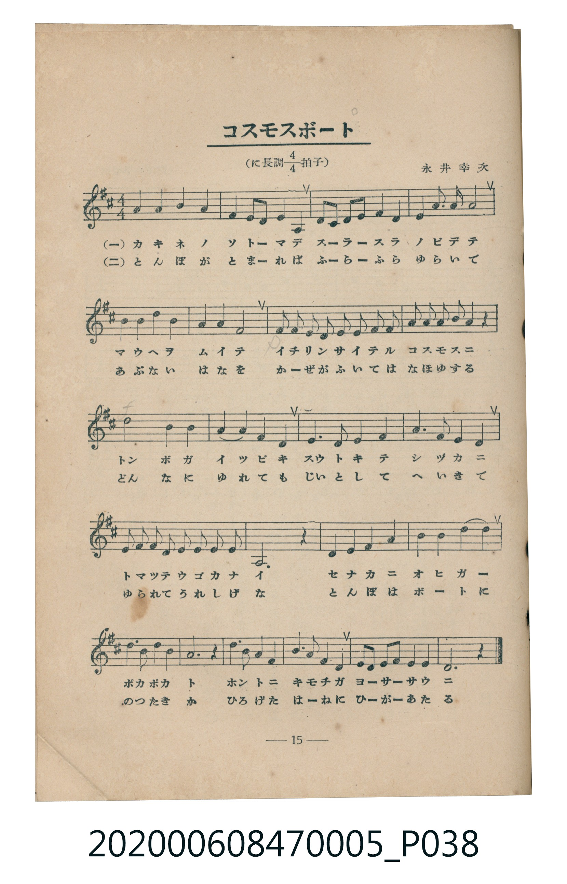
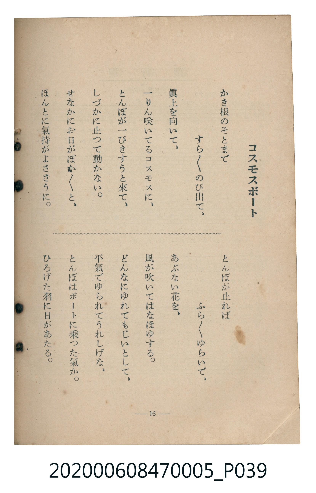

# コスモスボート

> Re:Shōka 使用 AI 協助辨識與重建樂譜，可能會有錯誤。歡迎回報。

- **鋼琴伴奏版**：<br><audio controls src="kosumosu_boto.mp3"></audio>
- **NEUTRINO 歌聲合成版**：<br><audio controls src="kosumosu_boto_neutrino.mp3"></audio>

- 臺灣教育會公認《新定兒童唱歌》尋常科第五學年用（2020.006.0847.0005）
- 永井幸次

## 說明

原書資訊與歌詞全文（對應 P038.jpg – P039.jpg，書頁 pp. 15–16，第二學期第 3 首）：
調性與拍號：に長調四分之四拍子（D 大調 4/4 拍），永井幸次


## 歌詞

```text
一　かき根のそとまで
すら／＼のび出て、
眞上を向いて、
一りん咲いてるコスモスに、
とんぼが一ぴきすうと來て、
しづかに止つて動かない。
せなかにお日がぽか／＼と、
ほんとに氣持がよささうに。

二　とんぼが止れば
ふら／＼ゆらいで、
あぶない花を、
風が吹いてはなほゆする。
どんなにゆれてもじいとして、
平氣でゆられてうれしげな、
とんぼはボートに乗つた氣か。
ひろげた羽に日があたる。
```

## ABC

<div class="abc-score" data-abc-src="kosumosu_boto.abc" aria-label="五線譜載入中"></div>

[下載 ABC 原始檔](kosumosu_boto.abc)

## TMD 檔案連結

- [主旋律 TMD 檔案](kosumosu_boto.tmd) [[在 TMD Studio 編輯](https://tmdlang.github.io/Tmd-TS/#tmd=s7IKdvYPcrWy4qpTUCpJTLdSSM7PyUlNLsnMz7MqzsjMK0nNjM_KTMmPL87Iz05Ugisry88pzU21Si9KTEmNN403MjAyiDcwMIs3sDAxBzIMTBFKi_NLi5JTrYqTM_Lzc-JLUitKkvLzsxHyBUX5Zal5iXlANQVFIBtTwIoQClLLMlNSQdKpKZkl-UWZiTlI7kgtKga7FWxJfElRYl5xclFmAcgDCFUlGalAx4IlC_KLkIwGmpaemWdVkpgJ9B_Ij-WJ8bmJmXk5iXkpyKpKMvKBXi3IqLTKyCwGuSE5MSc-OzEPKUSgLihITE-1CjAwttAFEpZKXFpaCo-bNj9u2vm4eRGYnPO4ec_j5g4FLS0uRVsFQwMTLntbBRcuGxN9EzuQYS_adz1vXPxs6swXTZuezWl-2rrmxarexw1dz6ZteLpu1tPWSc9XL306ZeOztT2PG7qfbuh-umPH8-UTn69Z82TXlKdrdzzdueX5lBXv93SAokQPGCV6oCgBMgxM3-_pBDv32YYdT3ZNfbpzx7M1C5W4uPS1FGypBbgUFBSe9s1_NnvHi83tL1Z0vehoBzr0xcp5T1tXPJvWDnTW0w29z9o7FUAhpJdVkK7wqGEyiGMJ4rzf0wPU-XJBo0JBgZ6CoSlQztAMKAj2XA_Qc8_mzAeyFYwVXi6bBvTN-z2zQBa-WLX_WcNykFXdvS9mzgeKPm5c_XLqdqD409mzn3a0PdnZDWQAZZ-unQB0govC0yXLgZIKwCBXAIqCTepBDhUukLFPdjQ8bmh43Nj9uLH32YKdjxvXPW6c-7hxxePGfY8bl4NUPG6c-bgJqLf__Z49YOnNT9t3PW5c9rihEST9fM68Jzu6HjdNejph4uPGFoQEyOQmoMTkp5M2QSWaulFSSeNqqFKQfU2THzcCze8BaWvcAnQNyN7GNqDUk31AEmbq48bpjxuXgt27-tnaRY8blwDlnnZPBYusAtnT0ARRNxvMB6l73Nj1bDpQT8_jxr1AEZhXVsCN3A22Hejn1c82LH7W0whS2tTxuBFoKhABbQc6tAkSXLuACRLoQIR7QY5oApq8AWLUVkRYNbUB2WCfL4fb1PS4cRvEnS-6NgIDDSrxchHQ8p6nE4BhAg6oxvVgRUB3AS0HBn833FcrwRYD5VaDzQdaDAxWoKkzwDqBpgCDBxZWT3duBvoHZD3EKRDVQP-AGEB1k0AGYcTAenjuBVryZCdQHTCI54MNQjhj0-MmYAQBDZj_fB8wTFfDwhfokvkI51Ke1aBAQUufi8s7v7g0F4id8kvyrQIyE_PyHWoMaqpBFinYGJpp2YFZ2DK6Aihv7Wh4sbBHQcNE4emG_ufrG3TguVMTiwagfVDDHjetBrGAnm5aC2U098IYfRBGDVByL0ysA0TsARHzYELtCGU74bIrYSyQGEQdUAiqDmby4-bJEAbcoMfNbRAe1Ik1wIJCFwxhtAkav0bBCEkExDaE8mGwBiwCwiBZkCrcZpgi6QOxYfwasGt8DEGeXA0VAwUZlAUMMxirD24mKNRgoh1w1jw4qx1J5U646Eq46ZhikKCDiU5GcivENFDoobjXCKijcQXcRJgOYE6As3oQZiNUNu6D64HJA8sAJJVb4fKdcHlMMZDPYC5CiEJUt4DJ5XD34k_eu3rIS97wVNq0DJbKZsAYmxDpcQFM1RKYJDQZwgDIJ0C5x82NIGIViNgMUr8Vqgms4XEzMDOBVIKlwHlhEZzVjWogPH2bQUMARhvGoQnUwBMhLLnCEisM1oATNAiDVMCyAXJih5gBwiBTQTTMLAN4BMATOCKJAgMNlrxmwFmb4LaCwg2mcglcHhbhCNdBZEFhByJXgcnNYF2gJAOTBekDhSBEB0QelAVAgYhgd0NNjUd1NzihN8Hc0LgNzgLZhkhwUPc0rseUb5qE6e5GmG2PG-eASVBmgCR0WAIGhRDEPJB6sN8ad4PNA_uncSaYjelqAqV5J5nJHVg8Q9IvMAlCGHNgSXsNSkqGSLbAGFNgqqC1ALQwh4gBsw6k4EfUEdDsAVK2HSbWClMPq1JgaR6e1uFpGwbREz8ireNK85DCHAZhhTqySoQZMHPQzURO64iCGZTiICxQXEPSxBq4mcgpHJaSQMEGU7kWSSW84AbnH4gdyJUFvJAGhx7CraAgBKmEVzDw1I6cyhEVBKI4R6RymF7UohdRiMNzdBMst4DMhOduaKoGVQTARhSGLpDaHcguhqrvhfOJLNCBbXnyUzi4VAcnXkixC06gTVugSe9xcxdKKscFQEp2w1IqUAv2tAtSBSzuIWKTYKqgeQncwgEBeApHL3hBSQ5WMIPEUZMvMoQXxHAV6Akb1mrBzCSw7IMrgUOKdEjChRa0kKQJDDRYggOFAWpCR4fwwgsccNAIB-uCJCgsyRYceDBRWAGLyFYwiJS8IcUmuK0ASbawIhYiDhEBJUxg-xxiAzzx43EvgTYQrDoAhRc88wPjFsaCFxKI7EWovTIFnLxNSU7ec5ESIioPmhphRTwuAFIyG5I4N8OyCzAtQ8tuUGUKacSA0jBI7Qp4Qx3UloGzINZCG00gdWjtF3SAvYwHJUw8DRp0iJQHIJrM0NorJmgZCVujHntNgdUapGwyF0keliFgYoikjVxjoEOk5AaMAEjCgcQALEvA6gBYJMCyAiQaYHYhmtEIFlL5C89cOO1HqivWIfuqEdzOapwP5_ciTIW3dPD4qhHS8gP2jaGZD2IWLPs8boT6DpxJEOpBIoj6B9FGg7kDlOkJ-6mWi0vXTgG5k6wA5CtzAQA)]
- [鋼琴伴奏 TMD 檔案](kosumosu_boto_piano.tmd) [[在 TMD Studio 編輯](https://tmdlang.github.io/Tmd-TS/#tmd=s7IKdvYPcrWy4qpTUCpJTLdSyC8qychPL0osyKi0ysgsLskvykxOzInPTsxLVIIrKs4vLUpOjS9ITE-1CjAwttAFEpZKXFpaCo-bNj9u2vm4eRGYnPO4ec_j5o73ezpedu95PmHLkz1bni7tf94JFOlU0NLiUrRVMDQw4bK3VXDhsjHRN7ED2fCifdfzxsXPps580bTp2Zzmp61rXqzqfdzQ9WzahqfrZj1tnfR89dKnUzY-W9vzuKH76Ybupzt2PF8-8fmaNU92TXm6dsfTnVueT1kBtNLIwMhAz8DATM_AwsQcyDAwBdoK9sOzDTue7Jr6dOeOZ2sWKnFxeecXl-YCsVN-Sb5VQGZiXn6Qh0ONQU01lwIQ2BiaadmBWfpaCrboQAFk746GFwt7FDRMFJ5u6H--vkFHARQmelkF6ZpYNGjpgw2rUTBW0AVDGG2Cxq9RMEISAbENoXwYrAGLgDBIFqQKtxmmSPpAbBi_BuwaH8MaYNSthoo9bloLYzX3wll9cDMfN-2Fi3bAWfPgrHYklTvhoivhpmOKAVXCzX_cPBnJrRDTHje3obrXCKijcQXcRJiOx4174KwehNkIlY374Hpg8o8bNyCp3AqX74TLY4qBfAZzEUIUoroFTC6Huxd_2tnVQ07aMYOaDqMN49AEauARDEsKsIQAgzXgxALCIBWwJIackCBmgDDIVBANM8sA7jl44kFEf9MyGKt5Bpy1CW7r4-YFcJVL4PKwwES4DiL7uLkRTK4Ck5vBukDRAZMF6XvcDEq4IB0QeVDyApZASOxuqKnxqO4GJ6ImmBsat8FZINsQkQl1T-N6TPmmSZjuboTZ9rhxDpgEJTRIIoIlDlAIQcwDqQf7rXE32DywfxpngtmYriZQDHWSk5TgSQcG0dMWIinhSlKQcggGYeURskqEGTBz0M1ETkqIMgUUoRAWKCghQb4GbiZyAoJF1OPmKXCVa5FUwssccPKE2IFczsHLF6DodiS3Pm5uBauEl43wxISciBBlG6IkQiQimF7UUgNR_sAzTBMsMYLMhGceaKIBlWGPG6dj6AKp3YHsYqj6XjifyLLo6ezZ5CQg9GIDFKOwYgUkjpo6kCG8GIGrQE83sPoMMw3CUieu9AMpkCDpAlpMQGK-aQuYBMXJ4-YusNmIdIQO4VkPqAaUQcHhCdYFiS8sqQIoCo_5ZljxgEi1MIiUeiCZHlyLQFIFrICAiENEQPH-uBFkHqzIIOBeArUjrDADhRc8bzXD5RF5EJF6CdVkU8Cpx5SC4gcUqXiqMnSIlH4gmszQaioTtESIramEvRDDag1SEpuLJA9LTDAxRLJALszQIVJUNc-G6AMWd7DEC0pOsOIJVJdB60FwMgLpQEQuonGCYCEVDfCEidN-pGJsHbKvGsE1bON8OL8XYSq8jsPjq0ZInf-4qReacCFmwZLe40ao78AJDKEeJIIoGhG1M8wdoAxD2E-12Jr1PsjNehNEq_7FnqlPty9_NmHas9mbn-zsBpaDz7p7n66d8HT7smed3ZBOC1KKjVeINoxVMAFSJrGg1BkPZJnGx8Ik8KiAMyCBDmyCQZTAVUJ1ItRh0wtTBaQMSDAJKmIEpIxy8TuLoKWUexFqDlQYHnRQPk7PAuNV104BOWqjfYCyGGJGYDFlLgA)]

## 分析

```text
================================================================================
📊 TMD Song Profile: [ コスモスボート ]
================================================================================
⏱  Duration:       0:48 (48.5s), 21 measures total
🎼 Key & Tempo:    首調基準 D, != 104.0 BPM, <4/4>
   - 分析範圍：      由實際發聲的音符與和弦推測調性；播放脈絡另行呈現
🎤 人聲音域:    D4 (MIDI 62) – D5 (MIDI 74) [跨度: 12 個半音 / 1.0 個八度, 難度: easy]
   - 最低音:  D4 in [KosumosuBoto #1 @ m.2, 0:03]
   - 最高音: D5 in [KosumosuBoto #1 @ m.5, 0:10]
   - 適合: soprano, mezzo-soprano, contralto, tenor, baritone, bass
🏛  結構:      KosumosuBoto (48.5s)
⚡ 編曲密度:        Peak 1 軌道同時演奏
🗝  調性診斷：       D 大調（純淨自然大調，未偵測到可信轉調）
   - 風格氣質:    純淨自然大調（陽光明朗、易唱易記，無明顯調外色彩）
   - 轉調歷程:    全曲維持單一推測調性（未偵測到可信轉調）
   - 核心骨幹音:  D, A, F#, E, B
   - 調性數值:    D 大調 [相關度: 0.94, 穩定度: High, 自然音純度: 100.0%]
   - 候選調性 (K-S): D 大調 (0.94), A 大調 (0.72), B 小調 (0.61)
   - 五度圈歷程:   +2
   - 各段落調性細節:
     • [KosumosuBoto #1]: D 大調 (r: 0.94, 自然音純度: 100.0%)

  [ 五度圈游移軌跡 ]
               C  
         F            G  
      Bb              [D ]*
      Eb               A  
         Ab           E  
            Db       B  
               F# 
     (* = active key center)

  [ 十二半音累積音高分佈 ]
     C  :                            0.0%
     C# :                            0.0%
     D  : ████████████████████████  24.1%
     D# :                            0.0%
     E  : ████████████████          15.6%
     F  :                            0.0%
     F# : ██████████████████        17.8%
     G  : ████████                   8.4%
     G# :                            0.0%
     A  : ███████████████████████   23.1%
     A# :                            0.0%
     B  : ███████████               10.9%
--------------------------------------------------------------------------------
Assignment 軌道音域：
  - Piano         : D4 – D5 (12 個半音 / 1.0 個八度, 90 個音符)
================================================================================
```


## 原書掃描頁






