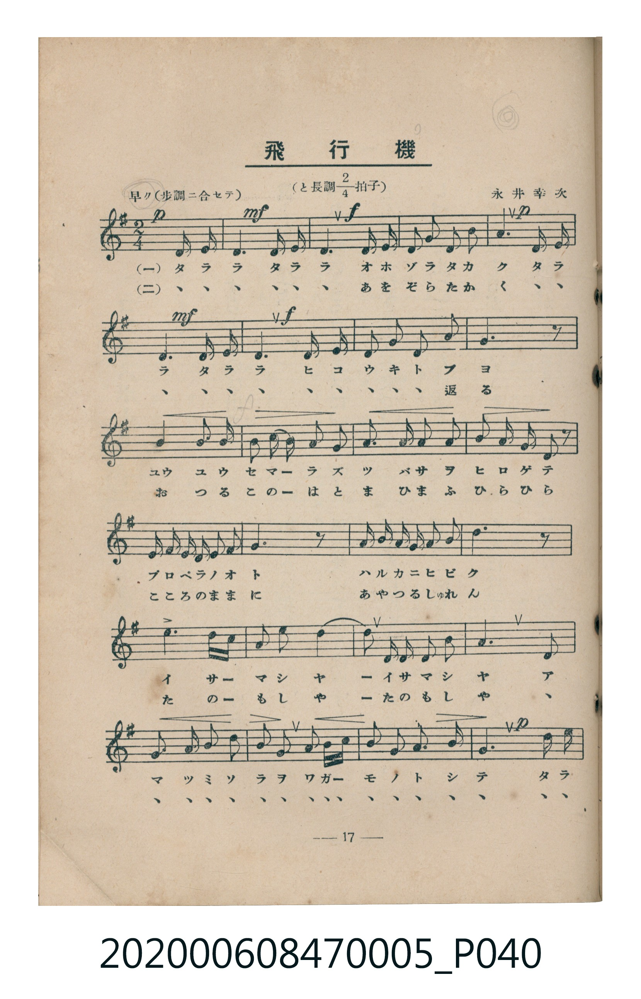
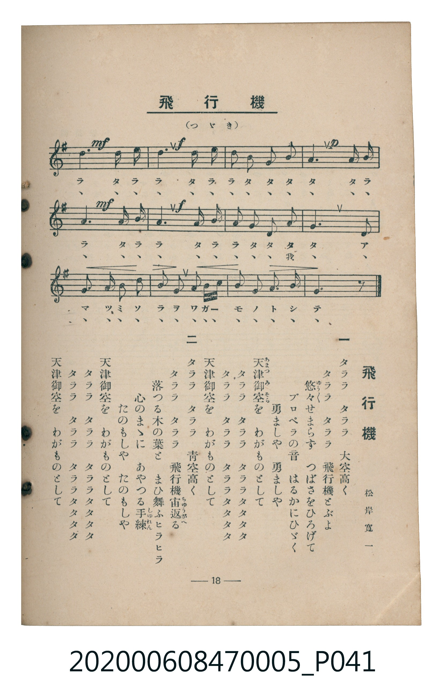

# 飛行機

> Re:Shōka 使用 AI 協助辨識與重建樂譜，可能會有錯誤。歡迎回報。

- **鋼琴伴奏版**：<br><audio controls src="hikoki.mp3"></audio>
- **NEUTRINO 歌聲合成版**：<br><audio controls src="hikoki_neutrino.mp3"></audio>

- 松岸寬一 作詞
- 永井幸次 作曲
- 臺灣教育會公認《新定兒童唱歌》尋常科第五學年用（2020.006.0847.0005）

## 說明

原書資訊與歌詞全文（對應 P040.jpg – P041.jpg，書頁 pp. 17–18，第二學期第 4 首）：
調性與拍號：と長調二分之二拍子（G 大調 2/4 拍），早ク（步調ニ合セテ）
作詞：松岸寬一　作曲：永井幸次


## 歌詞

```text
一　タララ　タララ　大空高く
タララ　タララ　飛行機とぶよ
悠々（ゆう／＼）せまらず　つばさをひろげて
プロペラの音　はるかにひゞく
勇ましや　勇ましや
天津御空（あまつみそら）を　わがものとして
タララ　タララ　タララタタタタ
タララ　タララ　タララタタタタ
天津御空を　わがものとして

二　タララ　タララ　青空高く
タララ　タララ　飛行機宙返（ちゅうがへ）る
落つる木の葉と　まひ舞ふヒラヒラ
心のまゝに　あやつる手練（しゅれん）
たのもしや　たのもしや
天津御空を　わがものとして
タララ　タララ　タララタタタタ
タララ　タララ　タララタタタタ
天津御空を　わがものとして
```

## ABC

<div class="abc-score" data-abc-src="hikoki.abc" aria-label="五線譜載入中"></div>

[下載 ABC 原始檔](hikoki.abc)

## TMD 檔案連結

- [主旋律 TMD 檔案](hikoki.tmd) [[在 TMD Studio 編輯](https://tmdlang.github.io/Tmd-TS/#tmd=s7IKdvYPcrWy4qpTUCpJTLdSSM7PyUlNLsnMz7MqzsjMK0nNjM_KTMmPL87Iz05Ugisry88pzU21Si9KTEmNN403MjAyiDcwMIs3sDAxBzIMTBFKi_NLi5JTrYqTM_Lzc-JLUitKkvLzsxHyBUX5Zal5iXlANQVFIBtTwIoQClLLMlNSQdKpKZkl-UWZiTlI7kgtKga7FWxJfElRYl5xclFmAcgDCFUlGalAx4IlC_KLkIwGmpaemWdVkpgJ9B_Ij-WJ8bmJmXk5iXkpSlxaWgovF89-sbDn2cr5ClpaXIq2CoaGZlz2tgruXDZG-iZ2IHNetO963rj42dSZL5o2PZvT_LR1zYtVvY8bup5N2_B03aynrZOer176dMrGZ2t7Hjd0P93Q_XTHjufLJz5fs-bJrilP1-54unPL8ykr3u_pAAWhHjAI9UBBCGQYmL7f0wl26bO5-55u2vF0_ZonOxoUnuyd82LlPIj4hh1Pdk19unPHszULQeLPZm9S4uLS11KwpRbgUlBQeNo3_9nsHS82t79Y0fWiox3oD6D9T1tXPJvWDnT10w29z9o7FQIMTAz0sgrSFR41TAZxDEGc93t6gDpfLmhUKCjQUzA0B8oZWgAFwX7vAfr92Zz5QLaCicLLZdOAnn2_ZxbIwher9j9rWA6yqrv3xcz5QNHHjSteTt0OFAdp62h7srMbyADKPl07AegEd4WnS5YDJRWAMaIAFAWb1PNs-srHTeuB0s_WLgVKPm7ufjqh43HT7sfNbUAFIHsgIQk0Hjl8Hzc0QEISJI4UvlxgHWD5x01A01aCECob6IrnK3e9XD3jcWM_SDUudfAkBfTW48Ztj5s6QKqfNS143NAKdO_jprbHjUA39r_fswfo0seNsx837nvcBGTMAhnUuORx44bHjVMfN0163LjpcVPv40YgYxnYwubpj5vXPm6eBbKncd3L-ZvBGtY_bup-3AhEq8Ea5kGd97S7HWRw4_THTS0g1yNxwdJLVj7bsvTpvoVAP4Fc1dgElgbavv9x41yge0BuA7oB5Lf-x409j5uACtaBvTQd5h4cAYBgAxkwRJYGZEficww48nYBMyDOyHs5dxJpkfd03cwX-6eAQ2bh46ZWYJSB7G3cAQ6WbnA6nrAXFF5N3c_mAN2x7sVEYBSuAMcIMBw3vegARsTWx82TwEaDSLCH9jeDHQ6M8LmgCAOpbgJFEMSgzu7n27eA7QRGU-vjJqBHJ0NT8-NGYHpaB_Y4NEbRREgJr0EVeUCllJdkUKCgpc_F5ZGZnZ-daRWQmZiX71BjUFMNskLBxtBMyw7MwlaCIko4UOm1owGYCBQ0TBWebuh_vr5BE4t6oEVQs2CguqAWFEjAbLpSoQZMQoRz07CLg4VXAQVmg4Sb9oEyOFAOpBRIrFYAi67HNBtqc42CgYIuGIIkTePBTCBVA2MDJUBWG4KZhkBxCAsoDBQ1BrOMgaIglikUg9g1CkbYzQXb6mNYowAzHuQgMA33GCHxVVBxmI8hamA6QJ4G2Q_yNRaTIPYbUWB_YxNUfhJIvHEemN0JlpkPJrsh9jf2Y7WfyMSzqweceEyISjzEJZPmSUCpzeCgWQZKHGtBaaUDREwDJ5PmFfBUCAbwJEJMUoBEtxE0KYBkQCLmIJ0IhSAISm-IVEBEeAOdDZGHOR3EXguW6QCT0yDhDXQ-whawvfC4JiZWN0HpyeC4awOze8EktOQGs0GFN8S6JlA0o1pHbLnQSVLULoNEVzM4zoAEyO7dIIF5j5v3wHL7LkgMtoB0PW6eABTZCmJsgghPArFB0d0EFAC2bZDi1gzsfjOkjGsCZhmBI80MEn_QBADkgSMUJAPJ4CAdIBo9UsFuhoTzMmicgSDE6SBRcK6B5tpd0PhrgeqAuB7EAsUJxP0gHjjOgT4AsUGxgRS_jV3Q2FuCFDEg8clg0XVgElQeACsMqAyo3IDEO4QNrGehMmAboDkawSY2ep_OBtX9xEfvdLDPgO0xcHg8bu4DRdMqSLwBMycyAAn1A_FqcCEHbKzConYySjGPLf9Cos4QHmmI8hmeJ5HUgFSYqEOiHl0ZUixjOh1WPEMcj5Y_sLoeFJmgSEIusLFkYGBEgnFTLzg6YVEGIkGyoCIfzS5gMQ1sz8CTBKQxBHZgD9Q6kLVkZeBdU0iJ4aYlkOgAJmpQhoXG4zyI0HYgEyoPEgVKg9SD0j9YCUgBWAKqBqJpEUb-xax4jeExVwMmDaGRj6VEBudupHgFOgBWWIKyBDQrgbMsSAziZGSzkZ0MUQHRAVMFUbMILUZBlSUkC4KyJ6x4gFaujcC0BYw9FFuAOsBxD1YDUgHRAVMFUQOSIzqrtq4lKatC4gxYTj1ung-Kh72QuAEVwKCS9nEzMAM-bloDikaQODCaQIJ9kIwMj0pg6QsCWBtjkGiBZEBEKQuLW0NwUwsSr8ZgeeKaWvC4gzodFBt7oXEELoLBBS3I-SCZNVAZUHyBRCHuR45XUOELiVNsDStE0QpMFY3gJlnjXGhcgQtVYMMJRIKaR8AKFS3eQXkbVETD47cRVnmQ0IwCDywgt8Gp2YxCFYY2tGEEyCtACmcEk96qBkUuSBaacQnHNeEGNKY4rOmMICEewRvPNLeJyDimQVOZ2DgG53CU8pj0tjJaBOMrmWkQ4hBdaGUzrewhpnRGyruktZOpWjrDAJ6SGVTzgtrKoPgzAccmLLZhsYq_40ObMhkE0dtOtCmPETbVcnHp2ilABkwUgCxlLgA)]
- [鋼琴伴奏 TMD 檔案](hikoki_piano.tmd) [[在 TMD Studio 編輯](https://tmdlang.github.io/Tmd-TS/#tmd=s7IKdvYPcrWy4tLSUni5ePaLhT3PVs5_v6fjZfee5xO2PNmz5enS_uedHe_3dCpoaXEp2ioYGppx2dsquHPZGOmb2HHVKSi9aN_1vHHxs6kzXzRtejan-Wnrmhereh83dD2btuHpullPWyc9X7306ZSNz9b2PG7ofrqh--mOHc-XT3y-Zs2TXVOert3xdOeW51NWAK00MjAy0DMwMNMzsDAxBzIMTIG2KoFseDZ339NNO56uX_NkR4PCk71zXqycBxHfsOPJrqlPd-54tmYhSPzZ7E1KXFwemdn52ZlWAZmJeflBHg41BjXVXApAYGNopmUHZulrKdiiA4UAAxMDvayCdAWQy3Y0AENCQcNU4emG_ufrGzSxqNfSB5tVo2CgoAuG1QW1CqbxYCaQqoGxgRK5abUKhmCmIVAcwgIKA0WNwSxjoCiIZQrFIHaNghF2c8G2-hjWKMCMf9y0H0I3rwTqApGExFdBxWeDxJv2QdXAdDxuWg22_3HTemwmQew3osD-xiao_CSQeOM8MLsTLDMfTHZD7G_sx2o_kVG4qwcchSbERCExUQWJDiNoVIFkQCLmIJ0IhSAISg-IWCIiPJonQeU3g0N9GZi9FizTASanQcKjeQWSLWB74XFBTKhvgtKTwWHbBmb3gsmFj5taYSI9jxt3QKxrAkUDqnXE5p5O4oPeDGy8GVK6NwGzjMBhagYJXmj8AHng8AbJQPIHSAeIRg_zZZBgBAXDMmiQgiDIV7vBouBEB030u6DB2wLVMQEothXMAgUZSAYUQY-bwVHSBBJ73AwKLKTgb-yCBu4SpHADiU8Gi64Dk6Ds9LgRFIkgGVC2g0QLhP24EWQnSAZsAzRDINjEhv7T2aBSnPiEDwlUQ3hwIgoeeGJGUgNSYaIOiRR0ZUjhPx0cXI-bZ4ED-XFzH9gboHIHJAtK1SgJCyjWD8SrwWXP4-ZueJCDgg-5JMKS8oFBDMZNveCAhgUmiATJgsoyNLuA5c_jphZ4ZD1unA5M_2AH9kCtA1lLVsrfNYXUlI9Z4hvDQ7YGTBpCIwdLUQPOF0jh3rQEKgFJwNBECE7sILHtQDZMBcRskA6QWmiGAKqA6ICpgqhZhBbioFIaknhBCRuWsaCleiMw7oGhi2ILUAc4bsBqQCogOmCqIGpAckQn8ta1xAc0JMQgaRdRdMCC3RBc_UKC3BgsT1z1Cw9WYLnxuBlccTXthQYfuFwBlx6Pm8G5vmkNVAYUlCDRPljhDg9yUIkCCW5slS2ivABGWCO4mm6cCw1GcEkBrExBJKjKBBbiaFECyhagcgce9I2wEpGEqtUQvXVEtaoVtRUECniQLDS9E44Hwg0eTHFYUwdBgsILog5nHNDcJiLDn7ZNG7Twx1fe0CBAILrQShxa2UNMmYOU7Elo1mCWOaDiHtS0AQWvCTiwYZEBC3T8zUjalDYgiF6h0qakQdhUi9pH80Huo1kgumgv9kx9un_1sxlNz_pnPdnZ_bJhE6h3OnsTMPk_6-59unbC0-3LnnV2Q_qoqN0xSFkBazvGK0SbxsdCMwA0UQPFDIFCGCJQClkbwix4lsJvIsxmqBBcObIlBnDTTIBiJkgWo_Ph2pHMQRFDGAUXxq4ZqFDBCMg3ioVROE0ixhHEeQ9nuMJFqBjyUBG8QUZ-fOIJBLxehgYmOMxziQk5YAbRtVOA5JFoH6A4Eg8Ya0CeMhcA)]

## 分析

```text
================================================================================
📊 TMD Song Profile: [ 飛行機 ]
================================================================================
⏱  Duration:       0:38 (38.3s), 37 measures total
🎼 Key & Tempo:    首調基準 G, != 116.0 BPM, <2/4>
   - 分析範圍：      由實際發聲的音符與和弦推測調性；播放脈絡另行呈現
🎤 人聲音域:    D4 (MIDI 62) – E5 (MIDI 76) [跨度: 14 個半音 / 1.2 個八度, 難度: moderate]
   - 最低音:  D4 in [Hikoki #1 @ m.1, 0:00]
   - 最高音: E5 in [Hikoki #1 @ m.10, 0:09]
   - 適合: soprano, mezzo-soprano, contralto, tenor, baritone, bass
🏛  結構:      Hikoki (38.3s)
⚡ 編曲密度:        Peak 1 軌道同時演奏
🗝  調性診斷：       G 大調（純淨自然大調，未偵測到可信轉調）
   - 風格氣質:    純淨自然大調（陽光明朗、易唱易記，無明顯調外色彩）
   - 轉調歷程:    全曲維持單一推測調性（未偵測到可信轉調）
   - 核心骨幹音:  G, D, A, B, E
   - 調性數值:    G 大調 [相關度: 0.89, 穩定度: High, 自然音純度: 99.3%]
   - 候選調性 (K-S): G 大調 (0.89), D 大調 (0.77), B 小調 (0.56)
   - 五度圈歷程:   +1
   - 各段落調性細節:
     • [Hikoki #1]: G 大調 (r: 0.89, 自然音純度: 99.3%, 調外音: C#)

  [ 五度圈游移軌跡 ]
               C  
         F           [G ]*
      Bb               D  
      Eb               A  
         Ab           E  
            Db       B  
               F# 
     (* = active key center)

  [ 十二半音累積音高分佈 ]
     C  : █                          1.8%
     C# : █                          0.7%
     D  : ██████████████████        23.0%
     D# :                            0.0%
     E  : ████                       5.3%
     F  :                            0.0%
     F# : ███                        4.3%
     G  : ████████████████████████  30.9%
     G# :                            0.0%
     A  : ███████████████           19.1%
     A# :                            0.0%
     B  : ████████████              14.9%
--------------------------------------------------------------------------------
Assignment 軌道音域：
  - Piano         : D4 – E5 (14 個半音 / 1.2 個八度, 123 個音符)
================================================================================
```


## 原書掃描頁






