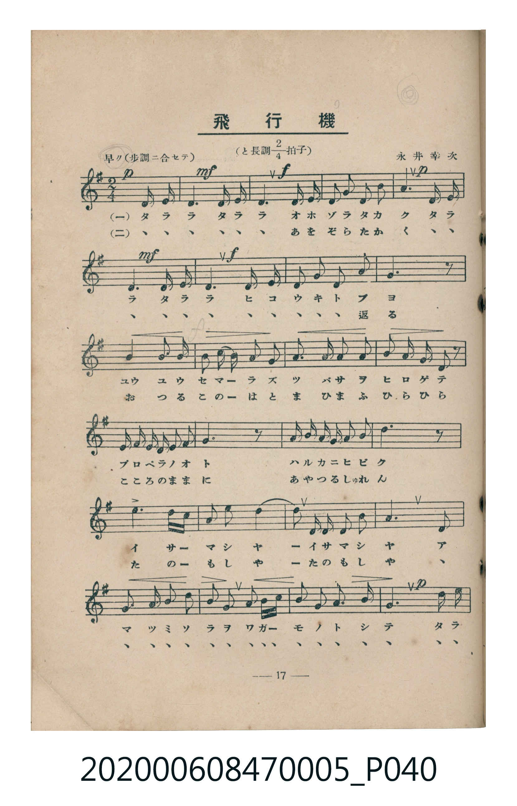
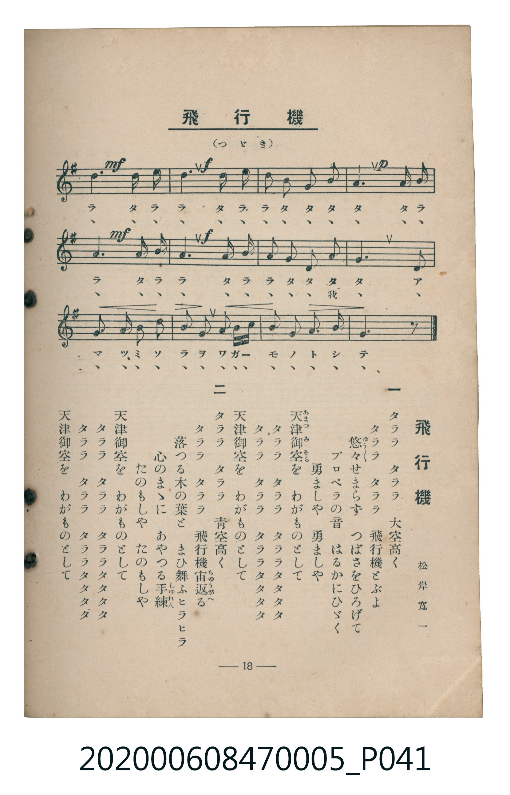

# 飛行機

<audio controls src="hikoki.mp3"></audio>

- 松岸寬一 作詞
- 永井幸次 作曲
- 臺灣教育會公認《新定兒童唱歌》尋常科第五學年用（2020.006.0847.0005）

## 說明

原書資訊與歌詞全文（對應 P040.jpg – P041.jpg，書頁 pp. 17–18，第二學期第 4 首）：
調性與拍號：と長調二分之二拍子（G 大調 2/4 拍），早ク（步調ニ合セテ）
作詞：松岸寬一　作曲：永井幸次

## 跨冊／重複收錄參照

> 同名異曲（各冊收錄之不同詞曲版本）

- **[同名異曲]** 《新定兒童唱歌》尋常科第一學年用（2020.006.0847.0001）：[**〈ヒカウキ〉**](../../grade_1_2020.006.0847.0001/3_04_hikoki/index.md)（`F` / `2/4` — [原始 TMD](../../grade_1_2020.006.0847.0001/3_04_hikoki/hikoki.tmd)）
- **[同名異曲]** 《うたのほん》（唱歌課本）下卷（2006.006.0878）：[**〈ひかうき（飛機）〉**](../../../utanohon/ge_2006.006.0878/10_hikoki/index.md)（`F` / `2/4` — [原始 TMD](../../../utanohon/ge_2006.006.0878/10_hikoki/hikoki.tmd)）
- 總表：[跨冊重複與同名歌曲總索引](../../../duplicate_songs.md)

## 歌詞

```text
一　タララ　タララ　大空高く
タララ　タララ　飛行機とぶよ
悠々（ゆう／＼）せまらず　つばさをひろげて
プロペラの音　はるかにひゞく
勇ましや　勇ましや
天津御空（あまつみそら）を　わがものとして
タララ　タララ　タララタタタタ
タララ　タララ　タララタタタタ
天津御空を　わがものとして

二　タララ　タララ　青空高く
タララ　タララ　飛行機宙返（ちゅうがへ）る
落つる木の葉と　まひ舞ふヒラヒラ
心のまゝに　あやつる手練（しゅれん）
たのもしや　たのもしや
天津御空を　わがものとして
タララ　タララ　タララタタタタ
タララ　タララ　タララタタタタ
天津御空を　わがものとして
```

## ABC

```abc
X:1
T:飛行機
M:2/4
L:1/16
Q:1/4=116
K:G
V:V1 name="Piano" snm="Pia"
[V:V1]
!p! z4 D3 D | !mf! D4 G3 G | !f! G4 B3 B | B2 d2 d2 B2 |
!p! A4 D3 D | !mf! D4 G3 G | !f! G4 A3 A | B2 G2 A2 F2 |
G6 z2 | e3 e d2 B2 | c2 B A G2 E2 | D3 E F2 G2 |
A2 B2 A2 z2 | D E F G A2 B2 | A6 z2 | E F G A B2 ^c2 |
d6 z2 | e4 d2 B2 | A3 B d4- | d2 G G A2 F2 |
G6 D2 | G3 A B2 G2 | A2 d2 B2 G B | d3 B G2 B2 |
!p! A4 D3 D | !mf! D4 G3 G | !f! G4 B3 B | B2 A2 G2 F2 |
!p! A4 D3 D | !mf! D4 G3 G | !f! G4 A3 A | B2 A2 G2 F2 |
G6 D2 | G3 A B2 G2 | e2 c2 A2 c A | G3 G B2 A2 |
G6 z2 |
```

## TMD 檔案連結

- [主旋律 TMD 檔案](hikoki.tmd) [[在 TMD Studio 編輯](https://tmdlang.github.io/Tmd-TS/#tmd=s7IKdvYPcrWy4qpTUCpJTLdSSM7PyUlNLsnMz7MqzsjMK0nNjM_KTMmPL87Iz05Ugisry88pzU21Si9KTEmNN403MjAyiDcwMIs3sDAxBzIMTBFKi_NLi5JTrYqTM_Lzc-JLUitKkvLzsxHyBUX5Zal5iXlANQVFIBtTwIoQClLLMlNSQdKpKZkl-UWZiTlI7kgtKga7FWxJfElRYl5xclFmAcgDCFUlGalAx4IlC_KLgEZraSm8XDz7xcKeZyvnK2hpcSnaKhgamnHZ2yq4c9kY6ZvYgbS-aN_1vHHxs6kzXzRtejan-Wnrmhereh83dD2btuHpullPWyc9X7306ZSNz9b2PG7ofrqh--mOHc-XT3y-Zs2TXVOert3xdOeW51NWvN_TAQocPWDg6IECB8gwMH2_pxPsuGdz9z3dtOPp-jVPdjQoPNk758XKeRDxDTue7Jr6dOeOZ2sWgsSfzd6kxMWlr6VgSy3ApaCg8LRv_rPZO15sbn-xoutFRzvQH0D7n7aueDatHejqpxt6n7V3KgQYmBjoZRWkKzxqmAziGII47_f0AHW-XNCoUFCgp2BoDpQztAAKgv3eA_T7sznzgWwFE4WXy6YBPft-zyyQhS9W7X_WsBxkVXfvi5nzgaKPG1e8nLodKA7S1tH2ZGc3kAGUfbp2AtAJ7gpPlywHSioAY0QBKAo2qefZ9JWPm9YDpZ-tXQqUfNzc_XRCx-Om3Y-b24AKQPZAQhJoPHL4Pm5ogIQkSBwpfLnAOsDyj5uApq0EIVQ20BXPV-56uXrG48Z-kGqQNG7V8IQF9Nzjxm2PmzoQep41LXjc0Ap0--OmtseNQPf2v9-zB-jqx42zHzfue9wEZMwCqWxc8rhxw-PGqY-bJj1u3PS4qfdxI5CxDMny5umPm9c-bp4FsrNx3cv5m8Ha1j9u6n7cCESrwdrmoTj4aXc7yJLG6Y-bWtC4SIqWrHy2ZenTfQuBPga5s7EJrAjonv2PG-cCXQhyLdBVID_3P27sedwEVLAO7NXpqC7EETwINpABQxRrQ3Y2PueBI3sXMMPijr65k8iJ7KfrZr7YPwUcYgsfN7UCIxdke-MOcHB1Iwx6MWEvKDSbup_NAbpp3YuJwChfAY47YChvetEBjLKtj5sngS0AkUhe3N8M9gowmcwFRTBITxMoKiHGdXY_374FbD8wQlsfNwG9PhmaH6BeaASmyHXgAIGmADQR0kNzkEc2UAPlJSUUKGjpc3F5ZGbnZ2daBWQm5uU71BjUKFSD7FCwMTTTsgOzsBXRiCIUVDzuaACmFwUNU4WnG_qfr2_QxKIeaBPULBioLqhVAIaAAjBEFGrAJEQ4Nw27OFh4FVBgNki4aR8w4EByIKVAYrUCWHQ9ptlQm2sUDBR0wRAkaRoPZgKpGhgbKAGy2hDMNASKQ1hAYaCoMZhlDBQFsUyhGMSuUTDCbi44WxIReLt6wIFnQlTgERdMzZOAUpvBAbIMFDhrQWHVASKmgYOpeQU8FsAAHkTEBAXEu0bQoADJgETMQToRCkEQFN5Eh8KOTpJCYRnEZ81g7wEJkFd3gwTmPW7eA0sYuyCebQHpetw8ASiyFcTYBBGeBGKDQqYJKACsZ5GCwQzsfjOkODYBs4zA_jODeBUaVkAe2O8gGUhaAOkA0aT4_-lsUJFLvP-ng90OrCrBfn3c3AfyxyqIx4ARjQxAQv1AvBqcS4AtC5jfJ6NkGWxpAeI3Q7ivEGkdHr9IakAqTNQhYUNuMtg1hZRgaFoCcTMwYkHRDvXsPIjQdiATKg8SBUqD1IPSAFgJSAFYAqoGomkRRirAzOnGcO_VQDMIJISwZAFwGiE6DbSuJSkNQPwJTN6Pm-eD3L4X4h9Q0gel8cfNwJh93LQG5HWQONBrIME-aFEA8z4w3YMA1hIT4hVIzCLSNyw8DMHlISQsjMHyFJSH4CY4cmVCzfIQVRhaY8AIUB4AUjgDgfTqARQAIFlogqAwPGhQPxAbHph5gvQKAi0wSM0dSOmCtBqCqrkDBvDkDFBpAaolQP41AfseFjqwUMBWO9ZycenaKUCaYApAljIXAA)]
- [鋼琴伴奏 TMD 檔案](hikoki_piano.tmd) [[在 TMD Studio 編輯](https://tmdlang.github.io/Tmd-TS/#tmd=s7IKdvYPcrWy4tLSUni5ePaLhT3PVs5_v6fjZfee5xO2PNmz5enS_uedHe_3dCpoaXEp2ioYGppx2dsquHPZGOmb2HHVKSi9aN_1vHHxs6kzXzRtejan-Wnrmhereh83dD2btuHpullPWyc9X7306ZSNz9b2PG7ofrqh--mOHc-XT3y-Zs2TXVOert3xdOeW51NWAK00MjAy0DMwMNMzsDAxBzIMTIG2KoFseDZ339NNO56uX_NkR4PCk71zXqycBxHfsOPJrqlPd-54tmYhSPzZ7E1KXFwemdn52ZlWAZmJeflBHg41BjUK1VwKQGBjaKZlB2bpaynYogOFAAMTA72sgnQFkNN2NACDQkHDVOHphv7n6xs0sajX0gebVaNgoKALhtUFtQqm8WAmkKqBsYESuWm1CoZgpiFQHMICCgNFjcEsY6AoiGUKxSB2jYIRdnO5iPTCrh6wF0yI8QIxToU4xwjqVJAMSMQcpBOhEARB4UG0K3d0Eu9KM7DxZkhBZAJmGYGtN4O4BOoVIA_sNJAMJChBOkA0Kc57OhuUJYgPRIithnD7EJEIDxgkNSAVJuoQV5MbfrumkBp-mEnMGG59DTTmIT7AErfg0CU69FrXEu84iC2QQEFEGsyphuA8AnGmMViegjxiiJ7NqZZHULMzyHEgWWg4UuhW2uZnNLeSGudIQUpChsaMc1ASBWVqkHNMwI6DOR7mSGxlTS1qqe-DUupbIAr9F3umPt2_-tmMpmf9s57s7H7ZsAlU4c3eBAzbZ929T9dOeLp92bPObki1h1rAQyINVsTEK0SbxsdCQxcaYkAxQ6AQhgiUQtaGMAseX_hNhNkMFYIrR7bEAG6aCVDMBMlidD5cO5I5KGIIo-DC2DUDFSoYAflGsTAKp0nEOII47-EMV7gIFUMeKoI3yMiPTzyBgNfL0MAEh3kuMSEHzCG6dgqQTKKAwlLmAgA)]

## 分析

```text
================================================================================
📊 TMD Song Profile: [ 飛行機 ]
================================================================================
⏱  Duration:       0:38 (38.3s), 37 measures total
🎼 Key & Tempo:    首調基準 G, != 116.0 BPM, <2/4>
   - 分析範圍：      由實際發聲的音符與和弦推測調性；播放脈絡另行呈現
🎤 人聲音域:    D4 (MIDI 62) – E5 (MIDI 76) [跨度: 14 個半音 / 1.2 個八度, 難度: moderate]
   - 最低音:  D4 in [Hikoki #1 @ m.1, 0:00]
   - 最高音: E5 in [Hikoki #1 @ m.10, 0:09]
   - 適合: soprano, mezzo-soprano, contralto, tenor, baritone, bass
🏛  結構:      Hikoki (38.3s)
⚡ 編曲密度:        Peak 1 軌道同時演奏
🗝  調性診斷：       G 大調（純淨自然大調，未偵測到可信轉調）
   - 風格氣質:    純淨自然大調（陽光明朗、易唱易記，無明顯調外色彩）
   - 轉調歷程:    全曲維持單一推測調性（未偵測到可信轉調）
   - 核心骨幹音:  G, D, A, B, E
   - 調性數值:    G 大調 [相關度: 0.89, 穩定度: High, 自然音純度: 99.3%]
   - 候選調性 (K-S): G 大調 (0.89), D 大調 (0.77), B 小調 (0.56)
   - 五度圈歷程:   +1
   - 各段落調性細節:
     • [Hikoki #1]: G 大調 (r: 0.89, 自然音純度: 99.3%, 調外音: C#)

  [ 五度圈游移軌跡 ]
               C  
         F           [G ]*
      Bb               D  
      Eb               A  
         Ab           E  
            Db       B  
               F# 
     (* = active key center)

  [ 十二半音累積音高分佈 ]
     C  : █                          1.8%
     C# : █                          0.7%
     D  : ██████████████████        23.0%
     D# :                            0.0%
     E  : ████                       5.3%
     F  :                            0.0%
     F# : ███                        4.3%
     G  : ████████████████████████  30.9%
     G# :                            0.0%
     A  : ███████████████           19.1%
     A# :                            0.0%
     B  : ████████████              14.9%
--------------------------------------------------------------------------------
Assignment 軌道音域：
  - Piano         : D4 – E5 (14 個半音 / 1.2 個八度, 123 個音符)
================================================================================
```


## 原書掃描頁






