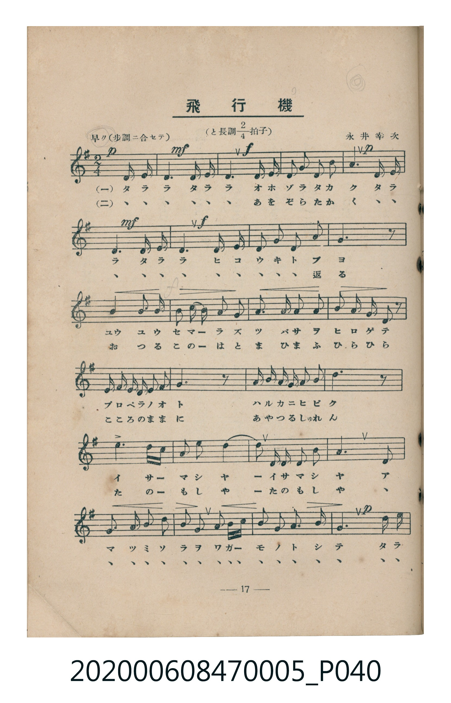
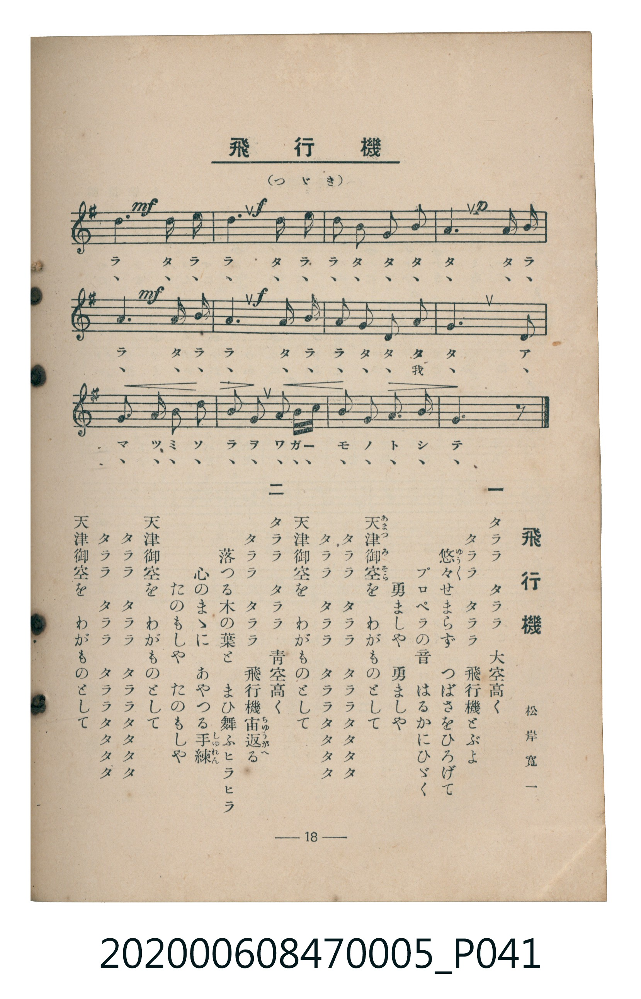

# 飛行機

> Re:Shōka 使用 AI 協助辨識與重建樂譜，可能會有錯誤。歡迎回報。

- **鋼琴伴奏版**：<br><audio controls src="hikoki.mp3"></audio>
- **NEUTRINO 歌聲合成版**：<br><audio controls src="hikoki_neutrino.mp3"></audio>

- 松岸寬一 作詞
- 永井幸次 作曲
- 臺灣教育會公認《新定兒童唱歌》尋常科第五學年用（2020.006.0847.0005）

## 說明

原書資訊與歌詞全文（對應 P040.jpg – P041.jpg，書頁 pp. 17–18，第二學期第 4 首）：
調性與拍號：と長調二分之二拍子（G 大調 2/4 拍），早ク（步調ニ合セテ）
作詞：松岸寬一　作曲：永井幸次


## 歌詞

```text
一　タララ　タララ　大空高く
タララ　タララ　飛行機とぶよ
悠々（ゆう／＼）せまらず　つばさをひろげて
プロペラの音　はるかにひゞく
勇ましや　勇ましや
天津御空（あまつみそら）を　わがものとして
タララ　タララ　タララタタタタ
タララ　タララ　タララタタタタ
天津御空を　わがものとして

二　タララ　タララ　青空高く
タララ　タララ　飛行機宙返（ちゅうがへ）る
落つる木の葉と　まひ舞ふヒラヒラ
心のまゝに　あやつる手練（しゅれん）
たのもしや　たのもしや
天津御空を　わがものとして
タララ　タララ　タララタタタタ
タララ　タララ　タララタタタタ
天津御空を　わがものとして
```

## ABC

<div class="abc-score" data-abc-src="hikoki.abc" aria-label="五線譜載入中"></div>

[下載 ABC 原始檔](hikoki.abc)

## TMD 檔案連結

- [主旋律 TMD 檔案](hikoki.tmd) [[在 TMD Studio 編輯](https://tmdlang.github.io/Tmd-TS/#tmd=s7IKdvYPcrWy4qpTUCpJTLdSSM7PyUlNLsnMz7MqzsjMK0nNjM_KTMmPL87Iz05Ugisry88pzU21Si9KTEmNN403MjAyiDcwMIs3sDAxBzIMTBFKi_NLi5JTrYqTM_Lzc-JLUitKkvLzsxHyBUX5Zal5iXlANQVFIBtTwIoQClLLMlNSQdKpKZkl-UWZiTlI7kgtKga7FWxJfElRYl5xclFmAcgDCFUlGalAx4IlC_KLkIwGmpaemWdVkpgJ9B_Ij-WJ8bmJmXk5iXkpyKpKMvKBXi3IqLTKyCwGuSE5MSc-OzEPKUSgLihITE-1CjAwMdAFEoZKXFpaCi8Xz36xsOfZyvkKWlpcirYKhoZmXPa2Cu5cNkb6JnYgA16073reuPjZ1JkvmjY9m9P8tHXNi1W9jxu6nk3b8HTdrKetk56vXvp0ysZna3seN3Q_3dD9dMeO58snPl-z5smuKU_X7ni6c8vzKSve7-kARYMeMBr0QNEAZBiYvt_TCXbis7n7nm7a8XT9mic7GhSe7J3zYuU8iPiGHU92TX26c8ezNQtB4s9mb1Li4tLXUrClFuBSUFB42jf_2ewdLza3v1jR9aKjHegPoP1PW1c8m9YOdPXTDb3P2jsVQIGml1WQrvCoYTKIYwjivN_TA9T5ckGjQkGBnoKhOVDO0AIoCPZ7D9Dvz-bMB7IVTBReLpsG9Oz7PbNAFr5Ytf9Zw3KQVd29L2bOB4o-blzxcup2oDhIW0fbk53dQAZQ9unaCUAnuCs8XbIcKKkAjBEFoCjYpJ5n01c-bloPlH62dilQ8nFz99MJHY-bdj9ubgMqANkDCUmg8cjh-7ihARKSIHGk8OUC6wDLP24CmrYShFDZQFc8X7nr5eoZjxv7QapxqYMnKaC3Hjdue9zUAVL9rGnB44ZWoHsfN7U9bgS6sf_9nj1Alz5unP24cd_jJiBjFsigxiWPGzc8bpz6uGnS48ZNj5t6HzcCGcvAFjZPf9y89nHzLJA9jetezt8M1rD-cVP340YgWg3WMA_qvKfd7SCDG6c_bmoBuR6JC5ZesvLZlqVP9y0E-gnkqsYmsDTQ9v2PG-cC3QNyG9ANIL_1P27sedwEVLAO7KXpMPfgCAAEG8iAIbI0IDsSn2PAkbcLmAFxRt7LuZNIi7yn62a-2D8FHDILHze1AqMMZG_jDnCwdIPT8YS9oPBq6n42B-iOdS8mAqNwBThGgOG46UUHMCK2Pm6eBDYaRII9tL8Z7HBghM8FRRhIdRMogiAGdXY_374FbCcwmlofNwE9Ohmamh83AtPTOrDHoTGKJkJKeA2qyAMqpbwkgwIFLX0uLo_M7PzsTKuAzMS8fIcag5pqkBUKNoZmWnZgFrYSFFHCgUqvHQ3ARKCgYarwdEP_8_UNmljUAy2CmgUD1QW1oEACZtOVCjVgEiKcm4ZdHCy8CigwGyTctA-UwYFyIKVAYrUCWHQ9ptlQm2sUDBR0wRAkaRoPZgKpGhgbKAGy2hDMNASKQ1hAYaCoMZhlDBQFsUyhGMSuUTDCbi7YVh_DGgWY8SAHgWm4xwiJr4KKw3wMUQPTAfI0yH6Qr7GYBLHfiAL7G5ug8pNA4o3zwOxOsMx8MNkNsb-xH6v9RCaeXT3gxGNCVOIhLpk0TwJKbQYHzTJQ4lgLSisdIGIaOJk0r4CnQjCAJxFikgIkuo2gSQEkAxIxB-lEKARBUHpDpAIiwhvobIg8zOkg9lqwTAeYnAYJb6DzEbaA7YXHNTGxuglKTwbHXRuY3QsmoSU3mA0qvCHWNYGiGdU6YsuFTpKidhkkuprBcQYkQHbvBgnMe9y8B5bbd0FisAWk63HzBKDIVhBjE0R4EogNiu4moACwbYMUt2Zg95shZVwTMMsIHGlmkPiDJgAgDxyhIBlIBgfpANHokQp2MyScl0HjDAQhTgeJgnMNNNfugsZfC1QHxPUgFihOIO4H8cBxDvQBiA2KDaT4beyCxt4SpIgBiU8Gi64Dk6DyAFhhQGVA5QYk3iFsYD0LlQHbAM3RCDax0ft0NqjuJz56p4N9BmyPgcPjcXMfKJpWQeINmDmRAUioH4hXgws5YGMVFrWTUYp5bPkXEnWG8EhDlM_wPImkBqTCRB0S9ejKkGIZ0-mw4hnieLT8gdX1oMgERRJygY0lAwMjEoybesHRCYsyEAmSBRX5aHYBi2lgewaeJCCNIbADe6DWgawlKwPvmkJKDDctgUQHMFGDMiw0HudBhLYDmVB5kChQGqQelP7BSkAKwBJQNRBNizDyL2bFawyPuRowaQiNfCwlMjh3I8Ur0AGwwhKUJaBZCZxlQWIQJyObjexkiAqIDpgqiJpFaDEKqiwhWRCUPWHFA7RybQSmLWDsodgC1AGOe7AakAqIDpgqiBqQHNFZtXUtSVkVEmfAcupx83xQPOyFxA2oAAaVtI-bgRnwcdMaUDSCxIHRBBLsg2RkeFQCS18QwNoYg0QLJAMiSllY3BqCm1qQeDUGyxPX1ILHHdTpoNjYC40jcBEMLmhBzgfJrIHKgOILJApxP3K8ggpfSJxia1ghilZgqmgEN8ka50LjClyoAhtOIBLUPAJWqGjxDsrboCIaHr-NsMqDhGYUeGABuQ1OzWYUqjC0oQ0jQF4BUjgjmPRWNShyQbLQjEs4rgk3oDHFYU1nBAnxCN54prlNRMYxDZrKxMYxOIejlMekt5XRIhhfyUyDEIfoQiubaWUPMaUzUt4lrZ1M1dIZBvCUzKCaF9RWBsWfCTg2YbENi1X8HR_alMkgiN52ok15jLCplotL104BMmCiAGQpcwEA)]
- [鋼琴伴奏 TMD 檔案](hikoki_piano.tmd) [[在 TMD Studio 編輯](https://tmdlang.github.io/Tmd-TS/#tmd=s7IKdvYPcrWy4qpTUCpJTLdSyC8qychPL0osyKi0ysgsLskvykxOzInPTsxLVIIrKs4vLUpOjS9ITE-1CjAwMdAFEoZKXFpaCi8Xz36xsOfZyvnv93S87N7zfMKWJ3u2PF3a_7yz4_2eTgUtLS5FWwVDQzMue1sFdy4bI30TO5CpL9p3PW9c_GzqzBdNm57NaX7auubFqt7HDV3Ppm14um7W09ZJz1cvfTpl47O1PY8bup9u6H66Y8fz5ROfr1nzZNeUp2t3PN255fmUFUArjQyMDPQMDMz0DCxMzIEMA1OgrWB3P5u77-mmHU_Xr3myo0Hhyd45L1bOg4hv2PFk19SnO3c8W7MQJP5s9iYlLi6PzOz87EyrgMzEvPwgD4cag5pqLgUgsDE007IDs_S1FGzRgQIoLPSyCtIVQC7b0QAMCQUNU4WnG_qfr2_QxKJeSx9sVo2CgYIuGFYX1CqYxoOZQKoGxgZK5KbVKhiCmYZAcQgLKAwUNQazjIGiIJYpFIPYNQpG2M0F2-pjWKMAM_5x034I3bwSqAtEEhJfBRWfDRJv2gdVA9PxuGk12P7HTeuxmQSx34gC-xuboPKTQOKN88DsTrDMfDDZDbG_sR-r_URG4a4ecBSaEBOFxEQVJDqMoFEFkgGJmIN0IhSCICg9IGKJiPBongSV3wwO9WVg9lqwTAeYnAYJj-YVSLaA7YXHBTGhvglKTwaHbRuY3QsmFz5uaoWJ9Dxu3AGxrgkUDajWEZt7OokPejOw8WZI6d4EzDICh6kZJHih8QPkgcMbJAPJHyAdIBo9zJdBghEUDMugQQqCIF_tBouCEx000e-CBm8LVMcEoNhWMAsUZCAZUAQ9bgZHSRNI7HEzKLCQgr-xCxq4S5DCDSQ-GSy6DkyCstPjRlAkgmRA2Q4SLRD240aQnSAZsA3QDIFgExv6T2eDSnHiEz4kUA3hwYkoeOCJGUkNSIWJOiRS0JUhhf90cHA9bp4FDuTHzX1gb4DKHZAsKFWjJCygWD8QrwaXPY-bu-FBDgo-5JIIS8oHBjEYN_WCAxoWmCASJAsqy9DsApY_j5ta4JH1uHE6MP2DHdgDtQ5kLVkpf9cUUlM-ZolvDA_ZGjBpCI0cLEUNOF8ghXvTEqgEJAFDEyE4sYPEtgPZMBUQs0E6QGqhGQKoAqIDpgqiZhFaiINKaUjiBSVsWMaCluqNwLgHhi6KLUAd4LgBqwGpgOiAqYKoAckRnchb1xIf0JAQg6RdRNEBC3ZDcPULCXJjsDxx1S88WIHlxuNmcMXVtBcafOByBVx6PG4G5_qmNVAZUFCCRPtghTs8yEElCiS4sVW2iPICGGGN4Gq6cS40GMElBbAyBZGgKhNYiKNFCShbgModeNA3wkpEEqpWQ_TWEdWqVtRWECjgQbLQ9E44Hgg3eDDFYU0dBAkKL4g6nHFAc5uIDH_aNm3Qwh9feUODAIHoQitxaGUPMWUOUrInoVmDWeaAintQ0wYUvCbgwIZFBizQ8TcjaVPagCB6hUqbkgZhUy1qH80HuY9mgeiivdgz9en-1c9mND3rn_VkZ_fLhk2g3unsTcDk_6y79-naCU-3L3vW2Q3po6J2xyBlBaztGK8QbRofC80A0EQNFDMECmGIQClkbQiz4FkKv4kwm6FCcOXIlhjATTMBipkgWYzOh2tHMgdFDGEUXBi7ZqBCBSMg3ygWRuE0iRhHEOc9nOEKF6FiyENF8AYZ-fGJJxDwehkamOAwzyUm5IAZRNdOAZJHon2A4kg8YKwBecpcAA)]

## 分析

```text
================================================================================
📊 TMD Song Profile: [ 飛行機 ]
================================================================================
⏱  Duration:       0:38 (38.3s), 37 measures total
🎼 Key & Tempo:    首調基準 G, != 116.0 BPM, <2/4>
   - 分析範圍：      由實際發聲的音符與和弦推測調性；播放脈絡另行呈現
🎤 人聲音域:    D4 (MIDI 62) – E5 (MIDI 76) [跨度: 14 個半音 / 1.2 個八度, 難度: moderate]
   - 最低音:  D4 in [Hikoki #1 @ m.1, 0:00]
   - 最高音: E5 in [Hikoki #1 @ m.10, 0:09]
   - 適合: soprano, mezzo-soprano, contralto, tenor, baritone, bass
🏛  結構:      Hikoki (38.3s)
⚡ 編曲密度:        Peak 1 軌道同時演奏
🗝  調性診斷：       G 大調（純淨自然大調，未偵測到可信轉調）
   - 風格氣質:    純淨自然大調（陽光明朗、易唱易記，無明顯調外色彩）
   - 轉調歷程:    全曲維持單一推測調性（未偵測到可信轉調）
   - 核心骨幹音:  G, D, A, B, E
   - 調性數值:    G 大調 [相關度: 0.89, 穩定度: High, 自然音純度: 99.3%]
   - 候選調性 (K-S): G 大調 (0.89), D 大調 (0.77), B 小調 (0.56)
   - 五度圈歷程:   +1
   - 各段落調性細節:
     • [Hikoki #1]: G 大調 (r: 0.89, 自然音純度: 99.3%, 調外音: C#)

  [ 五度圈游移軌跡 ]
               C  
         F           [G ]*
      Bb               D  
      Eb               A  
         Ab           E  
            Db       B  
               F# 
     (* = active key center)

  [ 十二半音累積音高分佈 ]
     C  : █                          1.8%
     C# : █                          0.7%
     D  : ██████████████████        23.0%
     D# :                            0.0%
     E  : ████                       5.3%
     F  :                            0.0%
     F# : ███                        4.3%
     G  : ████████████████████████  30.9%
     G# :                            0.0%
     A  : ███████████████           19.1%
     A# :                            0.0%
     B  : ████████████              14.9%
--------------------------------------------------------------------------------
Assignment 軌道音域：
  - Piano         : D4 – E5 (14 個半音 / 1.2 個八度, 123 個音符)
================================================================================
```


## 原書掃描頁






