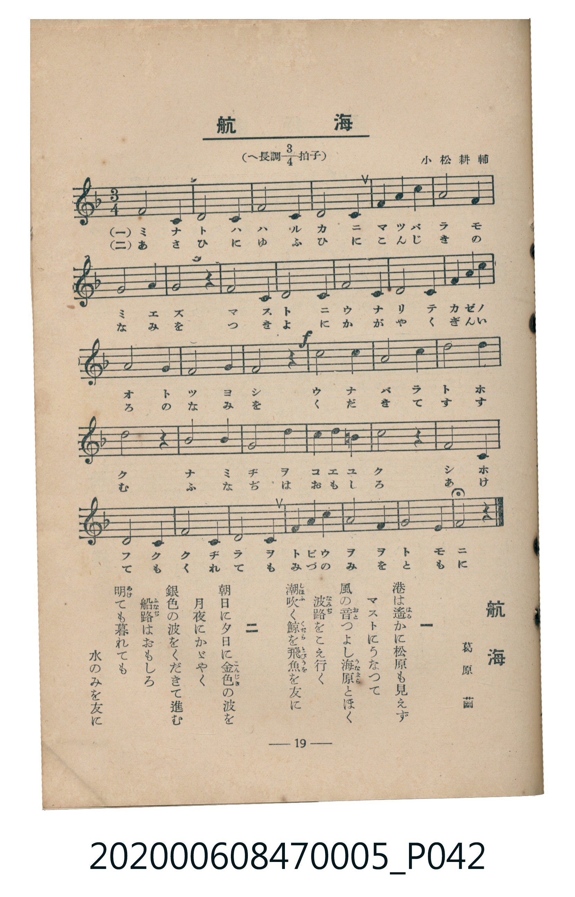

# 航海

> Re:Shōka 使用 AI 協助辨識與重建樂譜，可能會有錯誤。歡迎回報。

- **鋼琴伴奏版**：<br><audio controls src="kokai.mp3"></audio>
- **NEUTRINO 歌聲合成版**：<br><audio controls src="kokai_neutrino.mp3"></audio>

- 葛原齒 作詞
- 小松耕輔 作曲
- 臺灣教育會公認《新定兒童唱歌》尋常科第五學年用（2020.006.0847.0005）

## 說明

原書資訊與歌詞全文（對應 P042.jpg，書頁 p. 19，第二學期第 5 首）：
調性與拍號：へ長調四分之三拍子（F 大調 3/4 拍）
作詞：葛原齒　作曲：小松耕輔


## 歌詞

```text
一　港は遙（はる）かに松原も見えず
マストにうなつて
風の音（おと）つよし海原（うなばら）とほく
波路（なみぢ）をこえ行く
潮吹（しほふ）く鯨（くぢら）を飛魚（とびうを）を友に

二　朝日に夕日に金色（こんじき）の波を
月夜にかゞやく
銀色の波をくだきて進む
船路（ふなぢ）はおもしろ
明（あ）けても暮れても水のみを友に
```

## ABC

<div class="abc-score" data-abc-src="kokai.abc" aria-label="五線譜載入中"></div>

[下載 ABC 原始檔](kokai.abc)

## TMD 檔案連結

- [主旋律 TMD 檔案](kokai.tmd) [[在 TMD Studio 編輯](https://tmdlang.github.io/Tmd-TS/#tmd=s7IKdvYPcrWy4qpTUCpJTLdSSM7PyUlNLsnMz7MqzsjMK0nNjM_KTMmPL87Iz05Ugisry88pzU21Si9KTEmNN403MjAyiDcwMIs3sDAxBzIMTBFKi_NLi5JTrYqTM_Lzc-JLUitKkvLzsxHyBUX5Zal5iXlANQVFIBtTwIoQClLLMlNSQdKpKZkl-UWZiTlI7kgtKga7FWxJfElRYl5xclFmAcgDCFUlGalAx5YnlqQWoQsCdZSlIhkIND89M8-qJDET6GOQr8sT43MTM_NyEvNSkFWVZOQDPV-QUWmVkVkMclVyYk58dmIeUhhB3VSQmJ5qFWBgYqTEpaWl8KJj1bOt2xW0tLgUbRUMDSy47G0V3LhsjPVN7EAaX7Tvet64-NnUmS-aNj2b0_y0dc2LVb2PG7qeTdvwdN2sp62Tnq9e-nTKxmdrex43dD_d0P10x47nyyc-X7Pmya4pT9fueLpzy_MpK97v6QBFiB4wQvRAEQJkGJi-39MJdtqLibOf9s1_uXeSwpO9c16snAcWfLqh_9ncfS8apr7YMwUk_mz2JiUuLn0tBVtqAS4FBQWgvc9m73ixuf3Fiq4XHe1ATwDtf9q64tm0dqCTn27ofdbeqQAKKb2sgvT3e3qAil8uaFQo0FMwtARywb7sAfry2Zz5QLaCqcLLZdOA3nq_ZxbI9Ber9j9rWA4yt7v3xcz5QNHHjTteTt0OFH86e_bTjrYnO7uf7OgEyj5dOwFon5vC0yXLgZIKwLBXAIoCTQIZAwkVoG54QD1uaIAECVAQOaC4wMp3NADln-1Y_7hx_cvGmUBzgYzHTd1A0x43dj9uXA1UDjTmcVPTi2VALlAW7NjHzfMeN-183Azkr37c2Pa4cdXjxiWPG5eB5F4uWvG4cd3L-ZvBhnU9bgRGKNCwJY-bgNzpwNQDNA8sBdG24XETMAiACoC6dj9u7AcZ8Wzzohfb14MVAVXsf9y4CKSiadLjxslAN7xY2ANTt3fd0wk7weqmg3VvBZvU_3I9KBEBGUCdUOObJr1cPPvl2llgcaBVm0H2N02CSD3tB3kVEiC7gEmz4dmcuc-mLwWKPV0yFcJ42T7xRScwCIG6Jz9uAjpjxuNGUJgDvQp0LdAMsHvmdDxdMgccJt2Pm4BB1AJ16MuuBqBuuFqwyxYADQAG2cuGTY-bGsApoGMnzNdbwR4H-xoYHcBAbGoCebGpF2zLjD6woiaw9ESgGUDpZ7PWPW4ChguYvWEL0CpQwMG9BtRGeSaAAgUtfS4ub2B5mmkVkJmYl-9QY1BTDbJBwcZCyw7MwJb1FEAZYEcDMPYUNMwUgCnx-foGHXh-0cSiAWgP1LDHzfNBLFDC61JQqAFSHTB-P4QPpCD81WB-E5CC8Lsh8vNA7BYQMQEisBKmYJECzKIaBdN4BV0wBDNqFAyhXBBdo2AE5YHoGgVjFDkQzxSKaxTMYMaAeGCzfQxBls6HioO8AVIH8gdMpB8qAqIhIqshIkC_wES6oWrmgXktYHICVGwlXNUihK1GQJnGJphM41SI2sZNcBGYHW1wka241DROBvGawGTjDKhYL1zVOrCt-KN_Vw-F0d-0AhK9u2CxB4xXEH8njA9MF6DAAMY6RP0yCB-YaiDyqyD8Npj8aiDeAxToQyQCWMRCohkUvQagqERNEahpwATMA8U2CIJEEanFGCiLNQ0A_QIJ-11AGmQ6JF4h3oHFJSh9QDwE07UMKgJKQRA1oHQA8RREBcJPyKlgFTym9kNtmQSzt3EJemw2Qe0Fxz1EFzTtNfbA1UDtbYSk2MeNfeDU8bixhWA62NEJTgempKaDJmD0ocQzMEdD-NB0sR3Cr06rBYcUStQjMj5Y--Pm2Ug5HzPSMWMZZKphHFjIHCqEyO4gFjjiEVENdC16NIKCDCICi_zteCIWOWtDzAA5GiVzN6FlQJwRDRGBFjKNC-AiIP0gEZDtjxtnwkkCUQhsk5CXlZvWQ-IDEuxI0QPM4iB-E4y_CRKjm6G5_nEzJCuj6YfFOGpswnIiKOMiSmNQpAHjFhSDiLgDZV1QvEGiGlUjShGPFK_roeKQIgE5xkCZG-ILmAioGIX4A5blQT6BiKGZg0gLGLHcgKoSXEhD4g8U2yARUKEPEQGZChIBuQrYGgCLTYfaAEstMHMQVcNEsI0Eiu8pZBbfU6GRBIo8pDgExzZKZQyJdEj2nIxUfgPFIQqg-R5YacMLeXisw0pcaFENilkQRC2OIdW1OUgJiImawyE8EAkr9pFLblDtCcmq0CCGRyAkwlFrYWjEQ7MtpO6EZXGQHIyEFQ2gCISU82DnI5XcIF0Qe6G2QEtckAioNMauBpT5HzcuBZOwogEsBi4OgI1gqB8gCQRUzkPsreXi0rVTALfvFIAMZS4A)]
- [鋼琴伴奏 TMD 檔案](kokai_piano.tmd) [[在 TMD Studio 編輯](https://tmdlang.github.io/Tmd-TS/#tmd=s7IKdvYPcrWy4qpTUCpJTLdSyC8qychPL0osyKi0ysgsLskvykxOzInPTsxLVIIrKs4vLUpOjS9ITE-1CjAwMVLi0tJSeNGx6tnW7e_3dLzs3vN8wpYne7Y8Xdr_vLPj_Z5OBS0tLkVbBUMDCy57WwU3LhtjfRM7kGkv2nc9b1z8bOrMF02bns1pftq65sWq3scNXc-mbXi6btbT1knPVy99OmXjs7U9jxu6n27ofrpjx_PlE5-vWfNk15Sna3c83bnl-ZQVQCuNDIwM9AwMzPQMLEzMgQwDU6CtYPe-mDj7ad_8l3snKTzZO-fFynlgwacb-p_N3feiYeqLPVNA4s9mb1Li4vLOz07MtArITMzLD_JwqDGoqeZSAAIbCy07MENfS8EWHSiA3LKj4cXCHgUNMwWguc_XN-gogMJEL6sgXROLBi19sGE1CqbxCrpgCGbUKBhCuSC6RsEIygPRNQrGKHIgnikU1yiYwYwB8cBm-xjWKDxung8Vf9zcBVb3uLkDLtIPFQHREJHVEJEmEA0R6YaqmQfmtYDJCVCxlXBVixC2GgFlGptgMo1TIWobN8FFYHa0wUW24lLTOBnEawKTjTOgYr1wVevAtuKPlV095MQKLKQh4Q4KbwNQ2KJGEWqkmIB5oOAHQZAoIvqMgbJYI6VpBTQwdgFpkOmQgAaJ7IQHLijCQLpAUQHRtQwqAopSiBpQxIBEIIEKisDHTXuA_D6UaFkFD7r9UFsmwextXIIevE1Qe8GRAdEFTQyNPXA1UHsbIUnocWMfOLoeN7YQjJgdneCIMaU0YjBjojqtVsEwDixkDhVC5BEQCxw5iOhoggcLPKhB3oKIwCJoO57AR84PEDMeN89G2AEK-ia0VIszMiAi0JzZuAAuAtIPEgHZ_rhxJpwkEMxPZ88mq1SC2gtK9YiyBRSawEAHBS0iUEHpHhSgkDhA1YhSYCEF-HqoOCQ_IQclKGeAROAFSDOoUADp2QwOfFB0PG6GRgG6OYhIwgj-BlSV4CIHErCgaACJgIowiAjIVJAIyFWPm0Auedw4HWoDLBph5iAKuolgGwkURlPIiQxYKQItfkABDoKoRQykTjAHKQExUXMEhAciYUUZcmkEKqIhSRvqc3i4QuIBtaiHxgc0mUMKaFiWAMnBSFhWAoUrpOwCOx-pNALpgtgLtQVaioBEQCUMdjWgzPK4cSmYhGUlsBg4-zxuhGVYSLyByi6IvbUoVbsPctVugqjan-yc8XLRiucLtjzbuurJzm5gKfWsu_fp2glP50x-0TEP2EJ4Oq_76fZlzzq7IS0b5Io8XiHaND4WQgCzCZBrCOQBMQFJFI4JkGMSCxKDBBVOvQYIJkgFnAM0AL_lUGOx6UXhgIpRsGHoDsDjRJCjoNIoZkEcYgTkGOWiSSH5A6wKh6-RLEXIofJQwwdiCYgECgAtASUAXTsFcBqI9gEqQHCMwBxlLgA)]

## 分析

```text
================================================================================
📊 TMD Song Profile: [ 航海 ]
================================================================================
⏱  Duration:       0:48 (48.3s), 29 measures total
🎼 Key & Tempo:    首調基準 F, != 108.0 BPM, <3/4>
   - 分析範圍：      由實際發聲的音符與和弦推測調性；播放脈絡另行呈現
🎤 人聲音域:    C4 (MIDI 60) – F5 (MIDI 77) [跨度: 17 個半音 / 1.4 個八度, 難度: challenging]
   - 最低音:  C4 in [Kokai #1 @ m.1, 0:00]
   - 最高音: F5 in [Kokai #1 @ m.15, 0:24]
   - 適合: soprano, mezzo-soprano, contralto, tenor, baritone, bass
🏛  結構:      Kokai (48.3s)
⚡ 編曲密度:        Peak 1 軌道同時演奏
🗝  調性診斷：       F 大調（純淨自然大調，未偵測到可信轉調）
   - 風格氣質:    純淨自然大調（陽光明朗、易唱易記，無明顯調外色彩）
   - 轉調歷程:    全曲維持單一推測調性（未偵測到可信轉調）
   - 核心骨幹音:  A, C, G, F, D
   - 調性數值:    F 大調 [相關度: 0.81, 穩定度: Moderate, 自然音純度: 100.0%]
   - 候選調性 (K-S): F 大調 (0.81), C 大調 (0.77), A 小調 (0.72)
   - 五度圈歷程:   -1
   - 各段落調性細節:
     • [Kokai #1]: F 大調 (r: 0.81, 自然音純度: 100.0%)

  [ 五度圈游移軌跡 ]
               C  
        [F ]*          G  
      Bb               D  
      Eb               A  
         Ab           E  
            Db       B  
               F# 
     (* = active key center)

  [ 十二半音累積音高分佈 ]
     C  : █████████████████████     20.5%
     C# :                            0.0%
     D  : ██████                     6.0%
     D# :                            0.0%
     E  : █████                      4.8%
     F  : ████████████████████      19.3%
     F# :                            0.0%
     G  : █████████████████████     20.5%
     G# :                            0.0%
     A  : ████████████████████████  23.5%
     A# : ██████                     5.4%
     B  :                            0.0%
--------------------------------------------------------------------------------
Assignment 軌道音域：
  - Piano         : C4 – F5 (17 個半音 / 1.4 個八度, 61 個音符)
================================================================================
```


## 原書掃描頁




