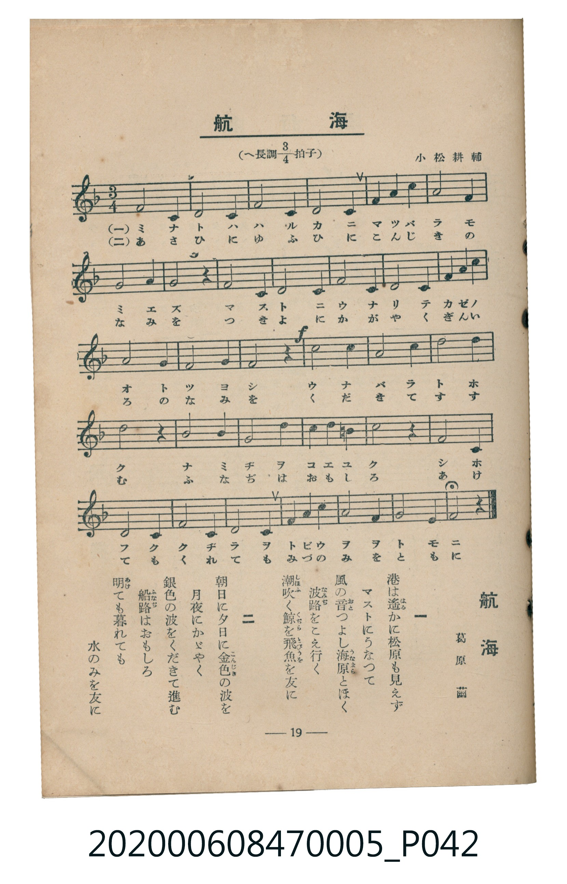

# 航海

> Re:Shōka 使用 AI 協助辨識與重建樂譜，可能會有錯誤。歡迎回報。

- **NEUTRINO 歌聲合成版**：<br><audio controls src="kokai_neutrino.mp3"></audio>
- **鋼琴伴奏版**：<br><audio controls src="kokai.mp3"></audio>


- 葛原齒 作詞
- 小松耕輔 作曲
- 臺灣教育會公認《新定兒童唱歌》尋常科第五學年用（2020.006.0847.0005）

## 說明

原書資訊與歌詞全文（對應 P042.jpg，書頁 p. 19，第二學期第 5 首）：
調性與拍號：へ長調四分之三拍子（F 大調 3/4 拍）
作詞：葛原齒　作曲：小松耕輔


## 歌詞

```text
一　港は遙（はる）かに松原も見えず
マストにうなつて
風の音（おと）つよし海原（うなばら）とほく
波路（なみぢ）をこえ行く
潮吹（しほふ）く鯨（くぢら）を飛魚（とびうを）を友に

二　朝日に夕日に金色（こんじき）の波を
月夜にかゞやく
銀色の波をくだきて進む
船路（ふなぢ）はおもしろ
明（あ）けても暮れても水のみを友に
```

## ABC

```abc
X:1
T:航海
M:3/4
L:1/16
Q:1/4=108
K:F
V:V1 name="Piano" snm="Pia"
[V:V1]
C8 C4 | F8 F4 | G8 G4 | A8 F4 |
w: 1.~ミ ナ | ト ハ | ハ ル | カ ニ
w: 2.~あ さ | ひ に | ゆ ふ | ひ に
A4 c4 c4 | d8 c4 | A8 G4 | F4 z4 C4 |
w: 1.~マ ツ バ | ラ モ | ミ エ | ズ マ
w: 2.~こ ん じ | き の | な み | を つ
F8 G4 | A8 B4 | c8 A4 | G8 A2 B2 |
w: 1.~ス ト | ニ ウ | ナ ツ | テ ゼ ノ
w: 2.~き よ | に か | が や | く ん い
A8 G4 | F8 G4 | !f! A8 f4 | e8 c4 |
w: 1.~オ ト | ツ ヨ | シ ウ | ナ バ
w: 2.~ろ の | な み | を く | だ き
d4 c4 A4 | c8 z4 | d8 e4 | f8 c4 |
w: 1.~ラ ト ホ | ク | ナ ミ | ヂ ヲ
w: 2.~て す す | む | ふ な | ぢ は
B4 A4 G4 | c8 z4 | A8 F4 | G8 C4 |
w: 1.~コ エ ユ | ク | シ ホ | フ ク
w: 2.~お も し | ろ | あ け | て も
B8 A4 | G8 F4 | E4 F4 G4 | A8 G4 |
w: 1.~ク ヂ | ラ ヲ | ト ビ ウ | ヲ ト
w: 2.~く れ | て も | み づ の | み と
G4 F4 z4 |
w: 1.~モ ニ
w: 2.~も に
```

## TMD 檔案連結

- [主旋律 TMD 檔案](kokai.tmd) [[在 TMD Studio 編輯](https://tmdlang.github.io/Tmd-TS/#tmd=s7IKdvYPcrWy4qpTUCpJTLdSSM7PyUlNLsnMz7MqzsjMK0nNjM_KTMmPL87Iz05Ugisry88pzU21Si9KTEmNN403MjAyiDcwMIs3sDAxBzIMTBFKi_NLi5JTrYqTM_Lzc-JLUitKkvLzsxHyBUX5Zal5iXlANQVFIBtTwIoQClLLMlNSQdKpKZkl-UWZiTlI7kgtKga7FWxJfElRYl5xclFmAcgDCFUlGalAx5YnlqQWoQsCdZSlIhkIND89M8-qJDET6GOQr8sT43MTM_NyEvNSlLi0tBRedKx6tnW7gpYWl6KtgqGBBZe9rYIbl42xvokdyJAX7bueNy5-NnXmi6ZNz-Y0P21d82JV7-OGrmfTNjxdN-tp66Tnq5c-nbLx2dqexw3dTzd0P92x4_nyic_XrHmya8rTtTue7tzyfMqK93s6QCGqBwxRPVCIAhkGpu_3dIKd-WLi7Kd981_unaTwZO-cFyvngQWfbuh_Nnffi4apL_ZMAYk_m71JiYtLX0vBllqAS0FBAWjvs9k7Xmxuf7Gi60VHO9ATQPuftq54Nq0d6OSnG3qftXcqBBiYGOllFaS_39MDVPxyQaNCgZ6CoSWQC_ZlD9CXz-bMB7IVTBVeLpsG9Nb7PbNApr9Ytf9Zw3KQud29L2bOB4o-btzxcup2oPjT2bOfdrQ92dn9ZEcnUPbp2glA-9wUni5ZDpRUAIa9AlAUaBLIGEioAHXDA-pxQwMkSICCyAHFBVa-owEo_2zH-seN6182zgSaC2Q8buoGmva4sftx42qgcqAxj5uaXiwDcoGyYMc-bp73uGnn42Ygf_XjxrbHjaseNy553LgMJPdy0YrHjetezt8MNqzrcSMwQoGGLXncBOROB6YeoHlgKYi2DY-bgEEAVADUtftxYz_IiGebF73Yvh6sCKhi_-PGRSAVTZMeN04GuuHFwh6Yur3rnk7YCVY3Hax7K9ik_pfrQYkIyADqhBrfNOnl4tkv184CiwOt2gyyv2kSROppP8irkADZBUyaDc_mzH02fSlQ7OmSqRDGy_aJLzqBQQjUPflxE9AZMx43gsIc6FWga4FmgN0zp-PpkjngMOl-3AQMohaoQ192NQB1w9WCXbYAaAAwyF42bHrc1ABOAR07Yb7eCvY42NfA6AAGYlMTyItNvWBbZvSBFTWBpScCzQBKP5u17nETMFzA7A1bgFaBAg7uNaA2yjMBFCho6XNxeQMLxEyrgMzEvHyHGoOaapANCjYWWnZgBraspwDKADsagLGnoGGmAEyJz9c36MDziyYWDUB7oIY9bp4PYoESXpeCQg2Q6oDx-yF8IAXhrwbzm4AUhN8NkZ8HYreAiAkQgZUwBYsUYBbVKJjGK-iCIZhRo2AI5YLoGgUjKA9E1ygYo8iBeKZQXKNgBjMGxAOb7WMIsnQ-VBzkDZA6kD9gIv1QERANEVkNEQH6BSbSDVUzD8xrAZMToGIr4aoWIWw1Aso0NsFkGqdC1DZugovA7GiDi2zFpaZxMojXBCYbZ0DFeuGq1oFtxR_9u3oojP6mFZDo3QWLPWC8gvg7YXxgugAFBjDWIeqXQfjAVAORXwXht8HkVwPxHqBAHyIRwCIWEs2g6DUARSVqikBNAyZgHii2QRAkikgtxkBZrGkA6BdI2O8C0iDTIfEK8Q4sLkHpA-IhmK5lUBFQCoKoAaUDiKcgKhB-Qk4Fq-AxtR9qyySYvY1L0GOzCWovOO4huqBpr7EHrgZqbyMkxT5u7AOnjseNLQTTwY5OcDowJTUdNAGjDyWegTkawoemi-0QfnVaLTikUKIekfHB2h83z0bK-ZiRjhnLIFMN48BC5lAhRHYHscARj4hqoGvRoxEUZBARWORvxxOxyFkbYgbI0SiZuwktA-KMaIgItJBpXAAXAekHiYBsf9w4E04SiEJgm4S8rNy0HhIfkGBHih5gFgfxm2D8TZAY3QzN9Y-bIVkZTT8sxlFjE5YTQRkXURqDIg0Yt6AYRMQdKOuC4g0S1agaUYp4pHhdDxWHFAnIMQbK3BBfwERAxSjEH7AsD_IJRAzNHERawIjlBlSV4EIaEn-g2AaJgAp9iAjIVJAIyFXA1gBYbDrUBlhqgZmDqBomgm0kUHxPIbP4ngqNJFDkIcUhOLZRKmNIpEOy52Sk8hsoDlEAzffAShteyMNjHVbiQotqUMyCIGpxDKmuzUFKQEzUHA7hgUhYsY9ccoNqT0hWhQYxPAIhEY5aC0MjHpptIXUnLIuD5GAkrGgARSCknAc7H6nkBumC2Au1BVrigkRApTF2NaDM_7hxKZiEFQ1gMXBxAGwEQ_0ASSCgch5iby0Xl66dArh9pwBkKHMBAA)]
- [鋼琴伴奏 TMD 檔案](kokai_piano.tmd) [[在 TMD Studio 編輯](https://tmdlang.github.io/Tmd-TS/#tmd=s7IKdvYPcrWy4tLSUnjRserZ1u3v93S87N7zfMKWJ3u2PF3a_7yz4_2eTgUtLS5FWwVDAwsue1sFNy4bY30TO646BaUX7bueNy5-NnXmi6ZNz-Y0P21d82JV7-OGrmfTNjxdN-tp66Tnq5c-nbLx2dqexw3dTzd0P92x4_nyic_XrHmya8rTtTue7tzyfMoKoJVGBkYGegYGZnoGFibmQIaBKdBWJbANE2c_7Zv_cu8khSd757xYOQ8s-HRD_7O5-140TH2xZwpI_NnsTUpcXN752YmZVgGZiXn5QR4ONQY11VwKQGBjoWUHZuhrKdiiAwWQW3Y0vFjYo6BhpgA09_n6Bh2FAAMTI72sgnRNLBq09MGG1SiYxivogiGYUaNgCOWC6BoFIygPRNcoGKPIgXimUFyjYAYzBsQDm-1jWKPwuHk-VPxxcxdY3ePmDrhIP1QERENEVkNEmkA0RKQbqmYemNcCJidAxVbCVS1C2GoElGlsgsk0ToWobdwEF4HZ0QYX2YpLTeNkEK8JTDbOgIr1wlWtA9uKP1Z29ZATK7CQhoQ7KLwNQGGLGkWokWIC5oGCHwRBoojoMwbKYo2UphXQwNgFpEGmQwIaJLITHrigCAPpAkUFRNcyqAgoSiFqQBEDEoEEKigCHzftAfL7UKJlFTzo9kNtmQSzt3EJevA2Qe0FRwZEFzQxNPbA1UDtbYQkoceNfeDoetzYQjBidnSCI8aU0ojBjInqtFoFwziwkDlUCJFHQCxw5CCiowkeLPCgBnkLIgKLoO14Ah85P0DMeNw8G2EHKOib0FItzsiAiEBzZuMCuAhIP0gEZPvjxplwkkAwP509m6xSCWovKNUjyhZQaAIDHRS0iEAFpXtQgELiAFUjSoGFFODroeKQ_IQclKCcARKBFyDNoEIBpGczOPBB0fG4GRoF6OYgIgkj-BtQVYKLHEjAgqIBJAIqwiAiIFNBIiBXPW4CueRx43SoDbBohJmDKOgmgm0kUBhNIScyYKUItPgBBTgIohYxkDrBHKQExETNERAeiIQVZcilEaiIhiRtqM_h4QqJB9SiHhof0GQOKaBhWQIkByNhWQkUrpCyC-x8pNIIpAtiL9QWaCkCEgGVMNjVgDLL48alYBKWlcBi4OzzuBGWYSHxBiq7IPbWolTtPshVuwmian-yc8bLRSueL9jybOuqJzu7gaXUs-7ep2snPJ0z-UXHPGAL4em87qfblz3r7Ia0bJAr8niFaNP4WAgBzCZAriGQB8QEJFE4JkCOSSxIDBJUOPUaIJggFXAO0AD8lkONxaYXhQMqRsGGoTsAjxNBjoJKo5gFcYgRkGOUiyaF5A-wKhy-RrIUIYfKQw0fiCUgEigAtASUAHTtFMBpINoHqADBMQJzlLkA)]

## 分析

```text
================================================================================
📊 TMD Song Profile: [ 航海 ]
================================================================================
⏱  Duration:       0:48 (48.3s), 29 measures total
🎼 Key & Tempo:    首調基準 F, != 108.0 BPM, <3/4>
   - 分析範圍：      由實際發聲的音符與和弦推測調性；播放脈絡另行呈現
🎤 人聲音域:    C4 (MIDI 60) – F5 (MIDI 77) [跨度: 17 個半音 / 1.4 個八度, 難度: challenging]
   - 最低音:  C4 in [Kokai #1 @ m.1, 0:00]
   - 最高音: F5 in [Kokai #1 @ m.15, 0:24]
   - 適合: soprano, mezzo-soprano, contralto, tenor, baritone, bass
🏛  結構:      Kokai (48.3s)
⚡ 編曲密度:        Peak 1 軌道同時演奏
🗝  調性診斷：       F 大調（純淨自然大調，未偵測到可信轉調）
   - 風格氣質:    純淨自然大調（陽光明朗、易唱易記，無明顯調外色彩）
   - 轉調歷程:    全曲維持單一推測調性（未偵測到可信轉調）
   - 核心骨幹音:  A, C, G, F, D
   - 調性數值:    F 大調 [相關度: 0.81, 穩定度: Moderate, 自然音純度: 100.0%]
   - 候選調性 (K-S): F 大調 (0.81), C 大調 (0.77), A 小調 (0.72)
   - 五度圈歷程:   -1
   - 各段落調性細節:
     • [Kokai #1]: F 大調 (r: 0.81, 自然音純度: 100.0%)

  [ 五度圈游移軌跡 ]
               C  
        [F ]*          G  
      Bb               D  
      Eb               A  
         Ab           E  
            Db       B  
               F# 
     (* = active key center)

  [ 十二半音累積音高分佈 ]
     C  : █████████████████████     20.5%
     C# :                            0.0%
     D  : ██████                     6.0%
     D# :                            0.0%
     E  : █████                      4.8%
     F  : ████████████████████      19.3%
     F# :                            0.0%
     G  : █████████████████████     20.5%
     G# :                            0.0%
     A  : ████████████████████████  23.5%
     A# : ██████                     5.4%
     B  :                            0.0%
--------------------------------------------------------------------------------
Assignment 軌道音域：
  - Piano         : C4 – F5 (17 個半音 / 1.4 個八度, 61 個音符)
================================================================================
```


## 原書掃描頁




