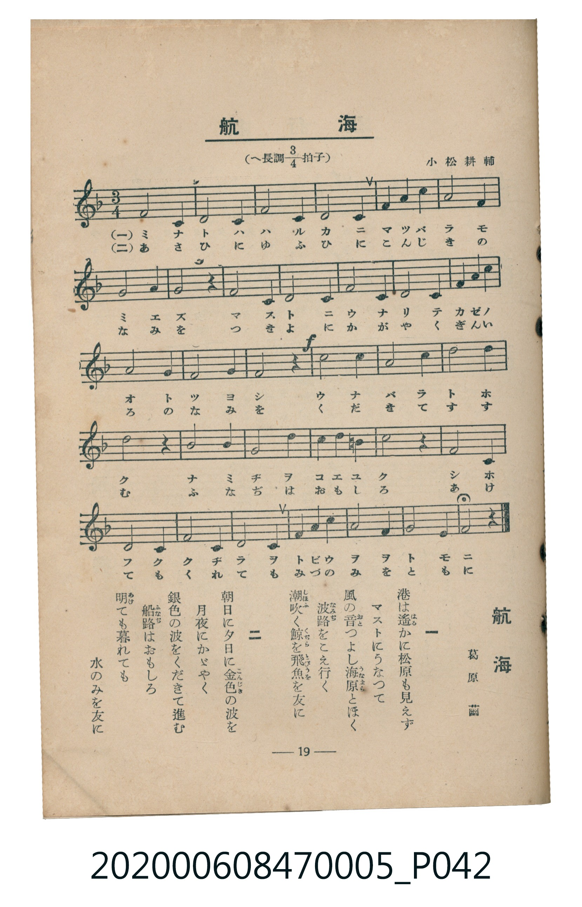

# 航海

<audio controls src="kokai.mp3"></audio>

- 葛原齒 作詞
- 小松耕輔 作曲
- 臺灣教育會公認《新定兒童唱歌》尋常科第五學年用（2020.006.0847.0005）

## 說明

原書資訊與歌詞全文（對應 P042.jpg，書頁 p. 19，第二學期第 5 首）：
調性與拍號：へ長調四分之三拍子（F 大調 3/4 拍）
作詞：葛原齒　作曲：小松耕輔

## 歌詞

```text
一　港は遙（はる）かに松原も見えず
マストにうなつて
風の音（おと）つよし海原（うなばら）とほく
波路（なみぢ）をこえ行く
潮吹（しほふ）く鯨（くぢら）を飛魚（とびうを）を友に

二　朝日に夕日に金色（こんじき）の波を
月夜にかゞやく
銀色の波をくだきて進む
船路（ふなぢ）はおもしろ
明（あ）けても暮れても水のみを友に
```

## ABC

```abc
X:1
T:航海
C:TMD (Chen, Chih-Han / aguai)
M:3/4
L:1/16
Q:1/4=108
K:F
V:V1 name="Piano" snm="Pia"
[V:V1]
C8 C4 | F8 F4 | G8 G4 | A8 F4 |
A4 c4 c4 | d8 c4 | A8 G4 | F4 z4 C4 |
F8 G4 | A8 B4 | c8 A4 | G8 A2 B2 |
A8 G4 | F8 G4 | !f! A8 f4 | e8 c4 |
d4 c4 A4 | c8 z4 | d8 e4 | f8 c4 |
B4 A4 G4 | c8 z4 | A8 F4 | G8 C4 |
B8 A4 | G8 F4 | E4 F4 G4 | A8 G4 |
G4 F4 z4 |
```

## TMD 檔案連結

- [主旋律 TMD 檔案](kokai.tmd)
- [鋼琴伴奏 TMD 檔案](kokai_piano.tmd)

## 分析

```text
================================================================================
📊 TMD Song Profile: [ 航海 ]
================================================================================
⏱  Duration:       0:48 (48.3s), 29 measures total
🎼 Key & Tempo:    首調基準 F, != 108.0 BPM, <3/4>
   - 分析範圍：      由實際發聲的音符與和弦推測調性；播放脈絡另行呈現
🎤 人聲音域:    C4 (MIDI 60) – F5 (MIDI 77) [跨度: 17 個半音 / 1.4 個八度, 難度: challenging]
   - 最低音:  C4 in [Kokai #1 @ m.1, 0:00]
   - 最高音: F5 in [Kokai #1 @ m.15, 0:24]
   - 適合: soprano, mezzo-soprano, contralto, tenor, baritone, bass
🏛  結構:      Kokai (48.3s)
⚡ 編曲密度:        Peak 1 軌道同時演奏
🗝  調性診斷：       F 大調（純淨自然大調，未偵測到可信轉調）
   - 風格氣質:    純淨自然大調（陽光明朗、易唱易記，無明顯調外色彩）
   - 轉調歷程:    全曲維持單一推測調性（未偵測到可信轉調）
   - 核心骨幹音:  A, C, G, F, D
   - 調性數值:    F 大調 [相關度: 0.81, 穩定度: Moderate, 自然音純度: 100.0%]
   - 候選調性 (K-S): F 大調 (0.81), C 大調 (0.77), A 小調 (0.72)
   - 五度圈歷程:   -1
   - 各段落調性細節:
     • [Kokai #1]: F 大調 (r: 0.81, 自然音純度: 100.0%)

  [ 五度圈游移軌跡 ]
               C  
        [F ]*          G  
      Bb               D  
      Eb               A  
         Ab           E  
            Db       B  
               F# 
     (* = active key center)

  [ 十二半音累積音高分佈 ]
     C  : █████████████████████     20.5%
     C# :                            0.0%
     D  : ██████                     6.0%
     D# :                            0.0%
     E  : █████                      4.8%
     F  : ████████████████████      19.3%
     F# :                            0.0%
     G  : █████████████████████     20.5%
     G# :                            0.0%
     A  : ████████████████████████  23.5%
     A# : ██████                     5.4%
     B  :                            0.0%
--------------------------------------------------------------------------------
Assignment 軌道音域：
  - Piano         : C4 – F5 (17 個半音 / 1.4 個八度, 61 個音符)
================================================================================
```


## 原書掃描頁




